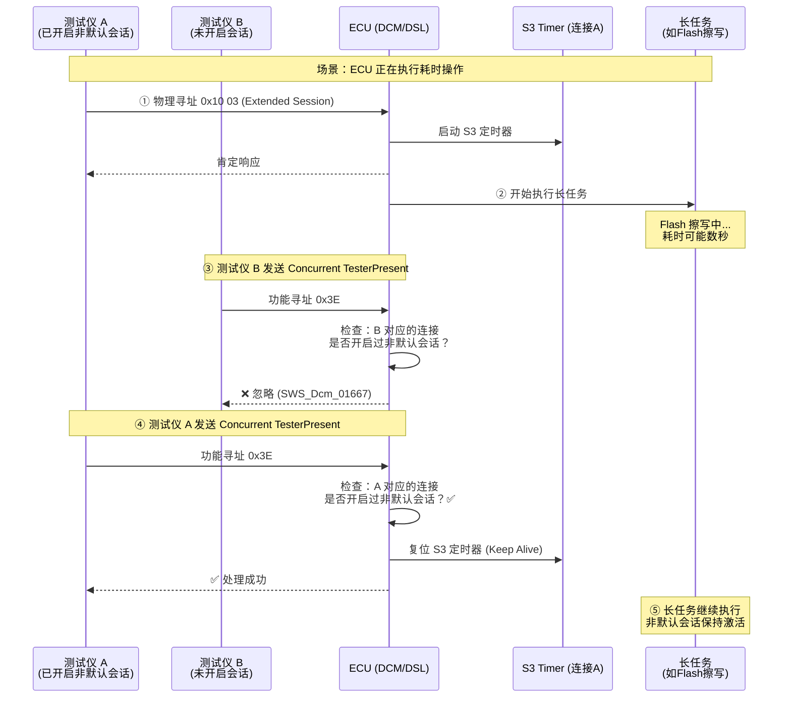
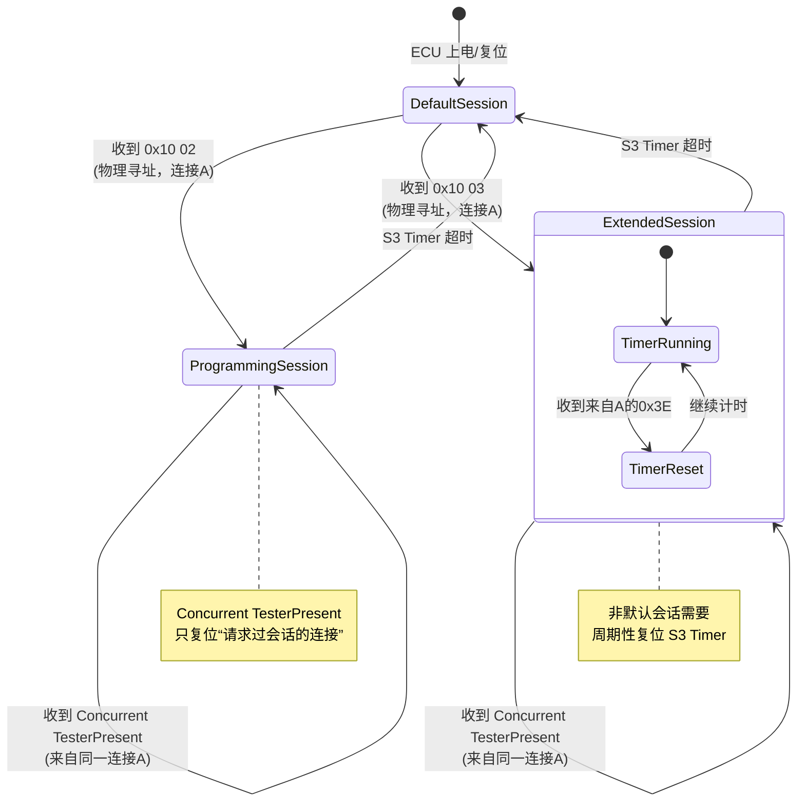
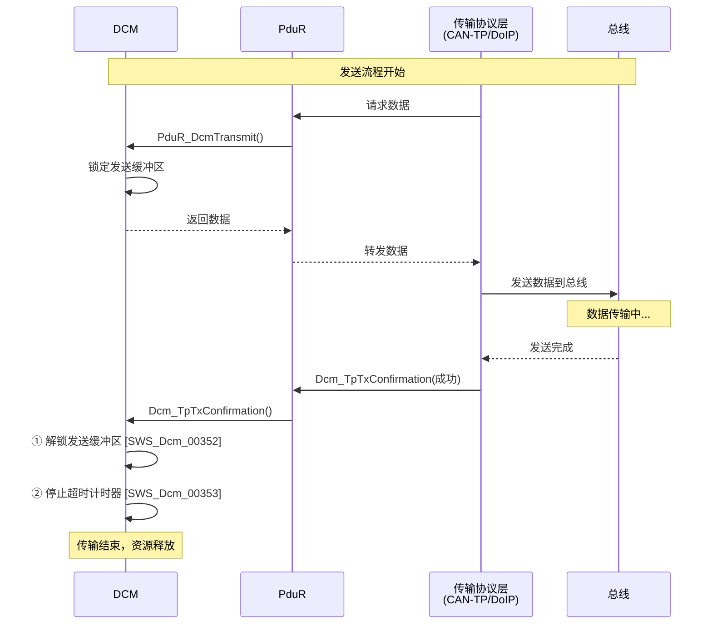
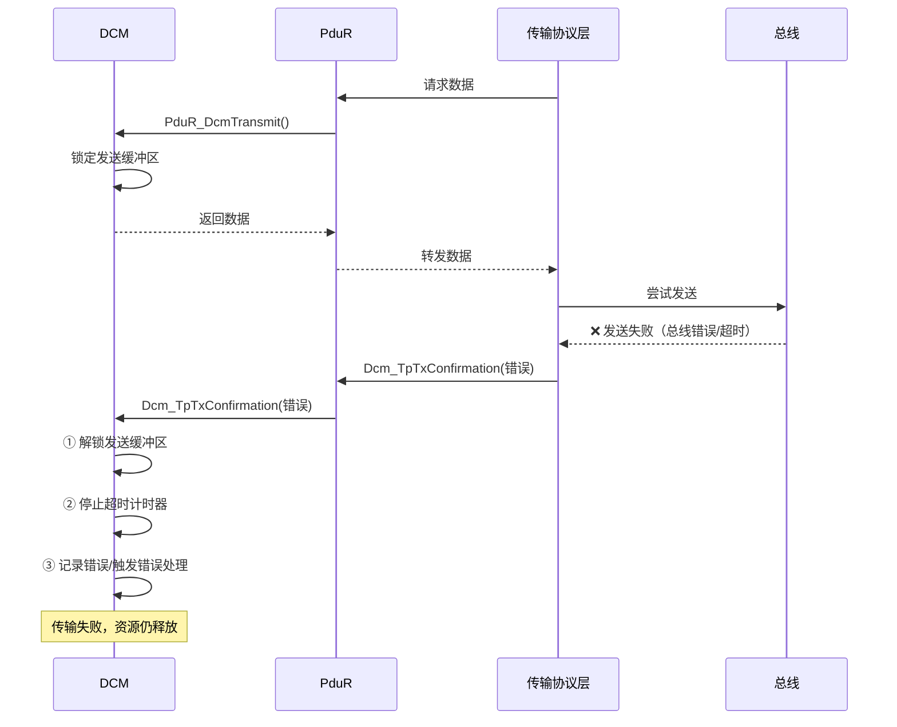
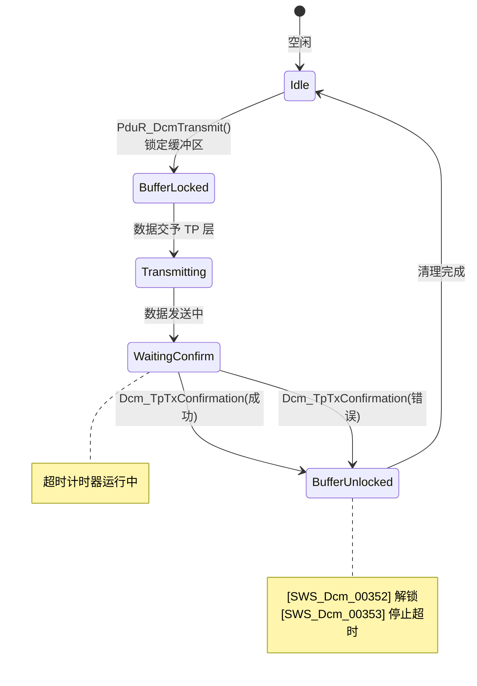

# 概述

> [!tip] 
>
> 标准文件请参见[Specification of Diagnostic Communication Manager](https://www.autosar.org/fileadmin/standards/R24-11/CP/AUTOSAR_CP_SWS_DiagnosticCommunicationManager.pdf) 

AUTOSAR **Dcm (Diagnostic Communication Manager)** 模块被划分为三个核心子模块：**DSL**、**DSD** 和 **DSP**。这种分层架构类似于 OSI 模型，将网络传输管理、请求分发和具体业务逻辑解耦。


1. DSL (Diagnostic Session Layer) —— “看门人”与“计时员”

   DSL 是 Dcm 的最底层，直接与 PduR（PDU Router）交互。它的职责不是理解诊断命令是什么，而是确保通信管道的合规性。

   - **数据流监控**：负责接收来自底层的原始诊断数据，并处理物理寻址（Physical）和功能寻址（Functional）的逻辑。
   - **会话与安全管理**：管理当前处于哪个诊断会话（如 Default, Extended）以及安全解锁状态（Security Level）。
   - **协议计时（Timing）**：这是 DSL 最关键的任务。它负责监控 $P2_{Server}$ 和 $P2^*_{Server}$ 等时间参数，确保 ECU 在规定时间内给出响应，或者在必要时发送“等候（Pending）”响应。

2. DSD (Diagnostic Service Dispatcher) —— “调度员”

   DSD 位于中间层，起到承上启下的作用。

   - **有效性检查**：当 DSL 把一串原始字节传给 DSD 时，DSD 会根据当前会话和安全等级，检查这个服务 ID（SID）是否被允许执行。
   - **分发请求**：如果检查通过，DSD 会识别 SID（例如 `0x22` 读数据），并将其转发给 DSP 中对应的处理函数。
   - **响应触发**：当 DSP 处理完逻辑后，DSD 会封装响应报文并通知 DSL 发送出去。

3. DSP (Diagnostic Service Processing) —— “业务员”

   DSP 是处理具体诊断业务的地方，它真正“读懂”诊断命令。

   - **子服务处理**：例如诊断命令 `0x31 01 AA BB`（启动例程），DSP 会解析出 `01` 是启动，`AA BB` 是具体的 Routine ID。
   - **应用层交互**：DSP 通过接口调用 RTE 中的 SW-C（软件组件）或者直接访问其他 BSW 模块（如 Dem, NvM）来获取数据或执行动作。

> [!tip] 
>
> 为了让你更直观地理解它们的关系，我们可以模拟一次 **0x22（读取 DID）** 的过程：
>
> 1. **物理层 -> DSL**：PduR 收到总线数据，交给 DSL。DSL 启动 $P2$ 定时器，并确认当前的会话允许诊断。
> 2. **DSL -> DSD**：DSL 把数据包传给 DSD。DSD 发现 SID 是 `0x22`，查询配置表发现当前安全等级允许读数据，于是把请求传给 DSP。
> 3. **DSD -> DSP**：DSP 解析出具体的 DID（例如 `0xF190` VIN 码），发现这个数据存在 NvM 里，于是调用相应接口读取。
> 4. **DSP -> DSD**：DSP 把 VIN 码的数据给 DSD。
> 5. **DSD -> DSL**：DSD 加上肯定响应标识（`0x62`），打包好给 DSL。
> 6. **DSL -> 物理层**：DSL 停止 $P2$ 定时器，通过 PduR 发送响应。


# 一般设计

## NRC

在诊断协议中，**NRC（Negative Response Code，否定响应码）** 是 ECU 与诊断仪之间沟通的“错误语言”。在诊断开发中极易被忽略但又极其重要的原则：**NRC 的优先级排序**。

1. 为什么 NRC 的顺序很重要？

   根据 ISO 14229-1 (UDS标准)，当一个诊断请求同时触发多个错误时，ECU 不能随机返回一个 NRC，必须按照协议规定的**优先级**进行判定。

   例如，如果你发送了一个长度错误且安全状态未解锁的请求：

   - 如果先判定安全（返回 `0x33`），再判定长度（返回 `0x13`），这在某些 OEM 看来是不合规的。
   - 要求 Dcm 的实现必须严格遵循 ISO 14229-1 附录中的流程图顺序。

2. Dcm 内部典型的 NRC 判定顺序

   通常情况下，Dcm 子模块（DSL -> DSD -> DSP）会按照以下逻辑链条依次检查：

   1. **SID 检查**：ECU 是否支持该服务？（不支持返回 `0x11 ServiceNotSupported`）
   2. **格式检查**：请求长度是否正确？（不正确返回 `0x13 IncorrectMessageLengthOrInvalidFormat`）
   3. **会话检查**：当前会话（Session）是否允许此操作？（不允许返回 `0x7F ServiceNotSupportedInActiveSession`）
   4. **安全检查**：是否解锁？（未解锁返回 `0x33 SecurityAccessDenied`）
   5. **条件检查**：当前车辆状态（如车速、转速）是否允许？（返回 `0x22 ConditionsNotCorrect`）
   6. **业务逻辑检查**：具体的参数是否超出范围？（返回 `0x31 RequestOutOfRange`）

3. 数据类型：Dcm_NegativeResponseCodeType

   在代码实现中，你会经常在接口中看到这个类型。它本质上是一个 `uint8`。

   - 如果你在开发一个 **SW-C（软件组件）** 来处理某个特定的 DID（0x22 服务），当你的代码逻辑发现数据异常时，你会通过 RTE 接口返回一个 `Dcm_NegativeResponseCodeType` 给 Dcm。
   - **注意**：你不需要在代码里手动加上 `0x7F` 前缀，你只需要返回类似 `0x31` 这样的代码，Dcm 的 **DSD 子模块** 会自动帮你封装成 `7F 22 31` 这样的标准报文格式。

> [!tip] 
>
> 在看 Dcm 规范时，可以尝试把 NRC 分为两类：
>
> - **Dcm 自动处理的 NRC**：如 `0x11`（服务不支持）、`0x13`（长度错误）、`0x7E`（子服务不支持）。这些通常在 DSD 层就直接判定并拦截了，请求甚至传不到应用层。
> - **应用层（SW-C）触发的 NRC**：如 `0x31`（数值不合法）、`0x22`（条件不满足）。这些需要你在 DSP 处理函数中，通过逻辑判定后主动传给 Dcm。

## 与Nvm之间的交互

在诊断系统中，许多信息必须在掉电后保持，比如**诊断会话状态（Session）**、**安全解锁状态（Security Level）**、**DTC 老化计数器**或某些**特定的 DID 数据**。

1. 非易失性信息的初始化与依赖

   - **实现特定性**：AUTOSAR 并没有强制规定 Dcm 必须通过哪种具体 API 去“拿”这些数据，或者这些数据是否必须在 `Dcm_Init` 之前就准备好。这属于系统集成的范畴，通常在配置 BswM 状态机时，会确保 NvM 先执行 `NvM_ReadAll`，待数据加载完成后再初始化 Dcm。
   - **读取校验**：Dcm 必须具备“容错逻辑”。如果 NvM 数据读取失败（比如 CRC 校验错误），Dcm 不能直接崩溃，而必须执行 **Default Reaction（默认反应）**。
     - *典型场景*：如果安全访问（Security Access）的尝试次数存储在 NvM 中但读取失败，默认反应通常是：强制锁定一段时间，防止暴力破解。

2. 服务取消与任务清理

   这是一个关于“收尾”的重要规定。诊断服务有时会因为异常情况被中止：

   - **RCRRP 超限**：当 ECU 发送了过多的 `0x78`（ResponsePending）报文，达到了配置的上限（$P2_{Server}$ 超时限制）。
   - **协议抢占（Protocol Preemption）**：例如，一个低优先级的 OBD 请求正在执行（涉及 NvM 读写），此时突然来了一个高优先级的 UDS 物理请求。

   **核心操作**：如果此时 Dcm 正在访问 NvM，它必须显式调用 `NvM_CancelJobs()`。

   - **原因**：NvM 是一个异步处理模块。如果不取消，NvM 可能会在 Dcm 已经跳转到新协议后，继续修改之前的缓冲区数据，导致内存冲突或逻辑错误。

> [!tip] 
>
> 当你深入研究 Dcm 配置时，可以留意以下几个典型的 NvM 应用场景：
>
> 1. **Programming Counter / Attempt Counter**：记录刷写次数或解锁失败次数，防止非法篡改。
> 2. **Diagnostic Session Persistence**：某些 OEM 要求在非预期复位（如看门狗复位）后，ECU 能够恢复到之前的诊断会话（如仍保持在 Programming Session）。
> 3. **Active Protocol**：记录当前正在运行的诊断协议栈状态。

## 数据类型

1. 非整型与不透明数据处理

   在诊断中，数据并不总是简单的数字（如 `uint16` 的电压值），有时是序列号、指纹信息或复杂的结构体。

   - **匹配解释**：对于 `uint8[n]` 类型的数组，Dcm 可以将其视为与其总大小匹配的整型进行处理（例如，`uint8[2]` 可能会被当做 `uint16` 进行字节序转换）。
   - **OPAQUE（不透明）模式**：
     - **定义**：如果 `DcmDspDataEndianness` 配置为 `OPAQUE`，Dcm **不会尝试解释**其中的内容。
     - **处理逻辑**：数据被视为原始的字节流（`uint8[n]`），并直接映射到对应长度的信号中。
     - **应用场景**：当你需要处理 VIN 码（字符串）、加密密钥或由应用层 SW-C 自行解析的自定义协议数据时，必须配置为 `OPAQUE`，以防止 Dcm 错误地调换字节顺序。

2. 字节序转换的扩展

   传统的诊断标准（如早期的一些定义）有时只明确了无符号整型的字节序转换。AUTOSAR Dcm 对此进行了明确扩展：

   - **支持有符号类型**：Dcm 必须支持对有符号整型（如 `sint8`, `sint16`, `sint32`）执行大端（Big-endian/MSB first）或小端（Little-endian/LSB first）转换。
   - **配置项**：具体的转换规则由 `DcmDspData` 中的 `DcmDspDataEndianness` 参数决定。在 UDS 协议中，通常默认使用 **大端模式（Big-endian）**。

> [!tip] 
>
> 在进行 Dcm 配置（例如配置一个用于读取车速的 DID）时，这几个需求对应的实战意义如下：
>
> 1. **高低字节反了？**
>
>    如果你在诊断仪上看到的十六进制值是 `01 02`，但应用层收到的值是 `0x0201`，这通常是因为 `DcmDspDataEndianness` 配置成了小端，而诊断协议通常期望大端。
>
> 2. **字符串乱码？**
>
>    处理像 VIN 码这样的 ASCII 字符串时，**千万不要使能字节序转换**。必须将该 Data 配置为 `OPAQUE`，否则 Dcm 可能会为了“转换字节序”而把你的字符串顺序前后颠倒。
>
> 3. **对齐问题**：
>
>    必须映射到 $n$ 字节信号。这意味着 Dcm 不会对 `OPAQUE` 数据进行位偏移（Bit-shifting）或压缩，它必须是整字节对齐的。

### 原子类型数据

|                      | ATOMIC           | ==    | ==     | ==     | ==    | ==     | ==     |
| -------------------- | ---------------- | ----- | ------ | ------ | ----- | ------ | ------ |
| Data bit size        | 1 (Byte aligned) | 8     | 16     | 32     | 8     | 16     | 32     |
| DcmDspDidDataType    | BOOLEAN          | UINT8 | UINT16 | UINT32 | SINT8 | SINT16 | SINT32 |
| DcmDspDataEndianness | N/A              | N/A   | LE,BE  | LE,BE  | N/A   | LE,BE  | LE,BE  |
| DcmDspDataUSe Port   | S/R, C/S and I/O | ==    | ==     | ==     | ==    | ==     | ==     |
| resulting ImplType   | BOOLEAN          | UINT8 | UINT16 | UINT32 | SINT8 | SINT16 | SINT32 |

1. 字节序（Endianness）的适用范围

   - **N/A (不适用)**：可以看到 `BOOLEAN`、`UINT8` 和 `SINT8` 的字节序配置都是 **N/A**。
     - **原理**：因为它们只占用 1 个字节（或更少），不存在多字节排列顺序的问题。
   - **LE, BE (支持切换)**：只有位宽 $\ge 16$ 位的类型（`UINT16/32`, `SINT16/32`）才需要配置 `DcmDspDataEndianness`。

2. 布尔型的特殊对齐

   **1 (Byte aligned)**：虽然 `BOOLEAN` 逻辑上只有 1 位，但在 Dcm 处理诊断数据（DID）时，它被定义为 **字节对齐**。

   - **实战意义**：在 UDS 报文中，如果你定义一个 DID 包含一个布尔值，它通常会占用 1 个完整的 Byte，而不是和其他位挤在一起（除非使用了特殊的位偏移配置）。

3. 端口接口（Use Port）

   表格中提到 `S/R (Sender/Receiver)`、`C/S (Client/Server)` 和 `I/O`。

   - 这说明这些原子类型在 Dcm 与应用层 SW-C 交互时，可以通过多种 RTE 接口实现。
   - 例如：你读取一个 VIN 码（UINT8 数组），Dcm 可能会通过 **Client/Server** 接口调用你的 `Data_Read` 函数。

4. 最终实现类型（resulting ImplType）

   这一行告诉你编译器（如你的 IAR）最终看到的变量类型：

   - 在 Dcm 配置工具（如 DaVinci Configurator）中选定 `DcmDspDidDataType` 后，生成的代码会自动使用 `uint16`、`sint32` 等标准类型。

> [!tip] 
>
> - **Atomic vs OPAQUE**：这张表里都是 **Atomic（原子）** 类型，意味着 Dcm “认识”这些数据，并能帮你做字节序转换和符号扩展。
> - **如果你配置为 OPAQUE**：它就不会出现在这个原子类型表里。对于 Dcm 来说，OPAQUE 就是一串 `uint8` 数组，它不关心里面是 `float` 还是几个 `uint16` 的组合。


### 数组数据类型

|                      | Field (Static)            | ==                        | ==                          | ==                         | ==                    | ==                         | Field (Dynamic)          |
| -------------------- | ------------------------- | ------------------------- | --------------------------- | -------------------------- | --------------------- | -------------------------- | ------------------------ |
| Data bit size        | 8-8*N                     | ==                        | 16-16*N                     | ==                         | 32-32*N               | ==                         | 8-8*N                    |
| DcmDspDataByteSize   | Any                       | ==                        | (size MOD 2)==0             | ==                         | (size MOD 4)==0       | ==                         | Any                      |
| DcmDspDidDataType    | UINT8_N                   | SINT8_N                   | UINT16_N                    | SINT16_N                   | UINT32_N              | SINT32_N                   | UINT8_DYN                |
| DcmDspDataEndianness | N/A                       | ==                        | LE,BE                       | ==                         | ==                    | ==                         | N/A                      |
| DcmDspDataUSe Port   | S/R, C/S, FNC, NVM        | S/R,C/S                   | ==                          | ==                         | ==                    | ==                         | C/S,FNC                  |
| resulting ImplType   | DataArrayTypeUint8_(Data) | DataArrayTypeSint8_(Data) | DataArrayTypeUint16_(Data） | DataArrayTypeSint16_(Data) | taArrayTypeUint32_(Da | DataArrayTypeSint32_(Data) | DataArrayTypeUint8_(Data |

1. 静态数组 vs. 动态数组 (Field Static vs. Dynamic)

   这是最关键的区别，决定了内存分配和数据交换的方式。

   - **静态数组 (Field Static)**：
     - 长度在配置阶段就是**固定**的（如 $8 \cdot N$）。
     - 适用于 VIN 码、硬件版本号等长度永远不变的数据。
   - **动态数组 (Field Dynamic - `UINT8_DYN`)**：
     - 报文长度在运行时可以变化。
     - **限制**：你会发现动态数组只支持 `UINT8_DYN`。这意味着如果你要传输动态长度的数据，Dcm 默认将其视为原始字节流（类似 OPAQUE 处理）。
     - **接口限制**：动态数据仅支持 `C/S` (Client/Server) 和 `FNC` (Function调用)，不支持 `S/R` (Sender/Receiver)，因为标准的 S/R 接口通常要求固定长度。

2. 字节对齐与对齐约束 (`size MOD X == 0`)

   这是在集成开发中最容易出错的地方。为了确保 Dcm 能够正确执行字节序转换（LE/BE），数组的总字节数必须符合其基本类型的倍数：

   - **`UINT16_N` / `SINT16_N`**：总字节数必须是 2 的倍数 (`size MOD 2 == 0`)。
   - **`UINT32_N` / `SINT32_N`**：总字节数必须是 4 的倍数 (`size MOD 4 == 0`)。
   - **原理**：如果一个 `UINT32_N` 的数组总长度是 7 个字节，Dcm 就无法完整地将最后一个元素按 4 字节进行大端或小端反转。

3. 数据使用端口 (DcmDspDataUse Port)

   这张表增加了一个重要的选项：**`NVM`**。

   - 对于 `UINT8_N` 或 `SINT8_N`（静态数组），Dcm 可以直接与 NvM 模块交互。
   - **应用场景**：比如某些写入后需要永久保存的配置参数。你可以直接在配置工具里把这个 DID 映射到 NvM 的一个 Block，而**不需要写任何应用层 C 代码**（通过 `NvM_ReadBlock` / `NvM_WriteBlock` 自动完成）。

4. 最终生成的 ImplType

   注意到底部的类型定义变成了 `DataArrayType...`。在 IAR 编译环境中，这通常会被定义为一个结构体或数组别名。例如：

   ```c
   typedef uint8 DataArrayTypeUint8_17[17]; // 假设 N=17
   ```

- **原子类型** 关注的是“这一个数怎么解析”。
- **数组类型** 关注的是“这一堆数怎么排布，以及内存够不够分”。

### 嵌套数据类型

AUTOSAR Dcm 处理复杂数据结构的核心哲学：**通过“池化引用”实现无限嵌套**。

在传统的诊断开发中，DID 通常是扁平的（一串信号排开）。但现代汽车电子需要处理如“传感器序列”或“配置快照”这类具有逻辑层次的数据。为了在配置（ARXML）中描述这种层级，Dcm 引入了 **CompositePool（复合池）** 机制。

1. 嵌套机制的“三位一体”结构

   嵌套配置由三个关键组件构成：

   - **Anchor Object（锚点对象）**：这是嵌套结构的**根（Root）**。
     - 如果它是一个简单的 `uint8`，它就是终点。
     - 如果它代表一个结构体，它就变成了一个“容器”，指向池中的元素。
   - **Composite Pool（复合池）**：这是一个**备选零件库**。它存储了所有可能被嵌套引用的子元素（信号、数组或子结构体）。
   - **Composite Reference（复合引用）**：这是**连接线**。它定义了父结构体具体包含了池中的哪些元素。

2. 核心逻辑：从配置到内存的映射，这种设计解决了两个棘手问题：

   1. 递归嵌套

      由于池中的元素（Pool Element）本身又可以作为新的“锚点”并引用更深层的池元素，这允许你定义极其复杂的 C 语言结构，例如：

      > `Structure A` -> 包含 `Array B` -> `Array B` 的每个元素是 `Structure C` -> `Structure C` 包含 `Primitive D`。

   2. 位置解耦与绝对偏移

      无论嵌套多深，子元素的 `ByteOffset` 必须是**相对于整个 DID 开头的绝对偏移量**。

      - **好处**：Dcm 在运行时解析数据时，不需要进行复杂的递归地址计算，直接根据绝对偏移量从缓存区取数即可，极大地提高了诊断响应的实时性。

3. 约束与边界保护（防止配置冲突）

   规范中提到的几个 [SWS] 编号实际上是在为这种灵活性划定“红线”：

   - **独占性 [SWS_Dcm_01633]**：如果一个信号变成了嵌套容器，它就不能再拥有自己的 `DataRef`（因为它的数据是由子元素构成的）。
   - **空间包含 [SWS_Dcm_01635]**：父结构体定义的 `ByteSize` 必须像一个信封，把所有子元素严丝合缝地包裹在内，不允许子元素“溢出”到父节点定义的空间之外。
   - **唯一性 [SWS_Dcm_01637]**：池里的每个元素只能被引用一次，防止在同一个结构体里出现两个完全重叠的物理定义。

> [!note] 
>
> 你可能会觉得这比在 IAR 里写一个 `struct` 麻烦得多。但 AUTOSAR 这样设计的目的是为了**工具链的自动化**：
>
> 1. **诊断调查问卷（CDD/ODX）对接**：这种嵌套定义可以自动导出为 ODX 文件，让诊断仪知道如何拆解这个复杂的 DID。
> 2. **RTE 自动生成**：基于这些引用关系，RTE 会自动生成复杂的 C 结构体定义和映射代码，确保应用层 SW-C 拿到的数据结构与总线上的原始字节流完全一致。


由上图可知，存在三个逻辑岛：

1. 核心容器岛：DcmDspDid 与 DcmDspDidSignal

   - **DcmDspDid**: 这是最外层的容器。它包含多个 `DcmDspDidSignal`。
   - **DcmDspDidSignal**: 这是最核心的配置项，代表 DID 中的一个“数据段”。它有两个基础参数：
     - **`DcmDspDidByteOffset`**: 决定该信号在报文中的绝对位置（起始字节）。
     - **`DcmDspDataByteSize`**: 决定该信号占用的总长度。

2. 传统/简单模式：DcmDspDidDataRef

   这是你最开始接触的那种扁平定义：

   - **路径**：`DcmDspDidSignal` -> `DcmDspDidDataRef` -> `DcmDspData`。
   - **逻辑**：它直接引用一个具体的数据类型定义（如 `UINT16`、`UINT8_N`）。
   - **互斥规则**：注意图中 `DcmDspDidDataRef` 的 `upperMultiplicity = 1`。根据规范 [SWS_Dcm_01633]，如果一个信号使用了这种直接引用，它通常就不再使用嵌套引用。

3. 嵌套/复合模式：CompositePool 与 CompositeRef

   - **DcmDspDidSignalCompositePool**: 它是 `DcmDspDid` 下属的一个子容器，类似于一个“零件箱”。
   - **DcmDspDidSignalCompositeRef**: 这是一个引用（Reference）。
   - **嵌套实现**：
     - 一个 `DcmDspDidSignal`（作为父结构体）可以通过 `CompositeRef` 指向 `CompositePool` 里的元素。
     - 关键点在于递归：你会发现 `DcmDspDidSignalCompositePool` 下面又可以包含 `DcmDspDidSignal`。
     - **这正是实现“无限嵌套”的 UML 表达：信号包含引用，引用指向池，池里又是信号。**

> [!tip] 
>
> 假设我们要定义一个读取“动力电池组状态”的 DID。
>
> 1. 核心容器 (DcmDspDid)
>
>    这是最外层的结构，代表整个诊断数据包。
>
>    ```c
>    /* 对应 DcmDspDid：地基/大箱子 */
>    typedef struct {
>        /* 这里的每一个成员，在配置里都是一个 DcmDspDidSignal */
>    
>        // 方案 A：传统简单模式
>        uint16 BatteryVoltage; 
>    
>        // 方案 B：嵌套复合模式（结构体 A）
>        BatteryPack_t PackStatus; 
>    
>    } Dcm_Did_BatteryInfo_t;
>    ```
>
> 2. 传统简单模式 (Simple Mode)
>
>    这种模式下，`DcmDspDidSignal` 直接通过 `DataRef` 指向一个基础类型。
>
>    ```c
>    /* 这就是【传统简单模式】
>       在配置中：Signal_BatteryVoltage -> DataRef -> UINT16
>       它直接就是一个物理值，没有内部结构。
>    */
>    uint16 BatteryVoltage; // 占 2 个字节，Offset = 0
>    ```
>
> 3. 嵌套复合模式 (Nested/Composite Mode)
>
>    这就是“零件池”与“引用”发挥作用的地方。它对应 C 语言中的嵌套结构体。
>
>    ```c
>    /* 这就是【DcmDspDidSignalCompositePool】：零件池
>       这里定义了“电池组”这个大零件内部包含哪些小零件。
>    */
>    typedef struct {
>        uint16 Temp_Sensor1; // 零件 X (池元素)
>        uint16 Temp_Sensor2; // 零件 Y (池元素)
>        uint8  FanStatus;    // 零件 Z (池元素)
>    } BatteryPack_t;
>                                        
>    /* 这就是【嵌套复合模式】的锚点信号
>       在配置中：Signal_PackStatus -> CompositeRef -> 引用了上面的池元素
>    */
>    BatteryPack_t PackStatus; // 占 5 个字节，Offset = 2
>    ```
>
> 我们可以把整个报文的内存布局写出来，你会看得更清楚：
>
> | **字节偏移** | **变量名**              | **模式类别**     | **逻辑岛关系**             |
> | ------------ | ----------------------- | ---------------- | -------------------------- |
> | **0**        | `BatteryVoltage` (High) | **传统简单模式** | 信号直接映射到 `uint16`    |
> | **1**        | `BatteryVoltage` (Low)  | **传统简单模式** | 直接引用基础类型           |
> | ---          | ---                     | ---              | ---                        |
> | **2**        | `PackStatus.Temp1` (H)  | **嵌套复合模式** | `Signal_PackStatus` (锚点) |
> | **3**        | `PackStatus.Temp1` (L)  | **嵌套复合模式** | 通过 `CompositeRef`        |
> | **4**        | `PackStatus.Temp2` (H)  | **嵌套复合模式** | 引用 `CompositePool`       |
> | **5**        | `PackStatus.Temp2` (L)  | **嵌套复合模式** | 中的子信号                 |
> | **6**        | `PackStatus.FanStatus`  | **嵌套复合模式** | 最终构成一个 `struct`      |

实际上，规范中还划定了原子信号（Leaf Signal）**与**复合信号（Nested/Composite Signal）之间的严格界限。

1. “容器信号”的身份转变 [SWS_Dcm_01633]

   当你决定让一个 `DcmDspDidSignal` 包含子元素时（即引用了 `CompositeRef`），它的角色就从“数据载体”变成了“空间描述符”。

   - **参数剥离**：它被禁止拥有 `DcmDspDidDataRef`。这意味着这个父信号本身不再具备 `UINT8` 或 `UINT16` 等具体的数据类型属性。
   - **唯一职责**：它只负责声明自己在整个 DID 报文里**占多大坑**（Size）以及**从哪开始**（Offset）。具体的数据解析交由它包含的子信号完成。

2. 绝对坐标系的强制要求 [SWS_Dcm_01636]

   这是 Dcm 配置中最容易产生逻辑偏差的地方。通常我们在 C 语言中处理结构体偏移是相对父节点的，但 AUTOSAR Dcm 坚持使用**绝对偏移（Absolute Offset）**。

   > **举例说明：**
   >
   > 假设一个 DID 报文。
   >
   > - **根结构体 A**：Offset = 10, Size = 4。
   > - **子信号 B**（位于 A 内部）：它的 Offset 必须写成 **10**（如果它是第一个字节），而**不能**写成 0。
   > - **子信号 C**（位于 A 内部）：它的 Offset 必须写成 **12**（如果是第三个字节），而**不能**写成 2。

   **这种设计的好处**：Dcm 的内部引擎（DSP 子模块）在提取数据时，可以实现“扁平化搜索”。它不需要递归计算地址，只需要遍历当前 DID 下的所有叶子信号，直接根据绝对地址去缓冲区拿数即可。

3. 池化元素的唯一性与闭环 [SWS_Dcm_01637] & [SWS_Dcm_01638]

   - **禁止重叠引用**：`CompositePool` 里的元素就像物理存在的零件，一个零件不能同时装在两个支架上。这保证了 DID 报文内存布局的唯一性，防止出现“一个内存字节被两个不同信号定义”的配置逻辑冲突。
   - **作用域闭环**：引用不能跨越 DID。你不能在读取 DID `0xF190` 时，去引用定义在 `0xF180` 池子里的信号。

4. 逻辑映射表 [SWS_Dcm_01639]

   规范中提到的这一段非常有价值，它告诉我们这套嵌套逻辑是**高度复用**的。你可以直接把这套理解平移到其他服务中：

   | **DID 配置项**    | **Routine (0x31) 对应项**             | **含义**             |
   | ----------------- | ------------------------------------- | -------------------- |
   | `DcmDspDidSignal` | `DcmDsp<Action>Routine<In/Out>Signal` | 结构体/信号锚点      |
   | `CompositePool`   | `...SignalCompositePool`              | 零件池（子元素仓库） |
   | `CompositeRef`    | `...SignalCompositeSignalRef`         | 嵌套连接线           |

并且在规范中明确告诉我们：你在 DID（0x22/0x2E 服务）中学会的那套复杂的嵌套逻辑，可以无缝平移到 **Routine Control（0x31 服务）** 的所有输入输出场景中。

1. 为什么 Routine 需要这种复杂的嵌套？

   在简单的 ECU 中，启动一个例程（Routine）可能只需要一个简单的 ID。但在复杂的控制器（如网关、智驾域控）中，`0x31` 服务往往承载着极重的任务：

   - **输入 (In)**：比如“请求指纹校验”，输入参数可能包含：`{算法ID, 公钥长度, 公钥数据[], 随机数}`。
   - **输出 (Out)**：例程完成后返回的数据，可能包含：`{校验结果, 错误代码, 剩余尝试次数}`。

   如果不用嵌套结构，开发者只能将这些参数定义为一串扁平的、难以维护的字节数组。使用嵌套结构后，Dcm 可以自动根据配置完成**字节序转换**和**数据对齐**。

2. 映射关系深度拆解

   我们可以将这种对应关系看作是“换汤不换药”的逻辑映射：

   | **逻辑角色** | **DID 领域 (Data Identifier)** | **Routine 领域 (Service 0x31)**                |
   | ------------ | ------------------------------ | ---------------------------------------------- |
   | **容器主体** | `DcmDspDid`                    | `DcmDspStartRoutineIn` (及其 Out/Stop 等)      |
   | **信号锚点** | `DcmDspDidSignal`              | `DcmDspStartRoutineInSignal`                   |
   | **零件池**   | `DcmDspDidSignalCompositePool` | `DcmDspStartRoutineInSignalCompositePool`      |
   | **连接引用** | `DcmDspDidSignalCompositeRef`  | `DcmDspStartRoutineInSignalCompositeSignalRef` |

3. 以 `StartRoutineIn` 为例

   当你配置一个 Routine 的输入参数时，遵循这套映射逻辑会带来以下好处：

   1. **一致的偏移量算法**：

      根据 **[SWS_Dcm_01636]**，即使是 `StartRoutineInSignal` 的嵌套子元素，其 `ByteOffset` 也是相对于整个诊断请求报文（即 `SID + SubFunction + RoutineID` 之后的部分）的**绝对位置**。

   2. **自动接口生成**：

      RTE 会根据这些嵌套定义，为应用层的 Routine 处理函数（如 `Rte_Call_RoutineServices_..._Start`）生成结构化良好的 C 语言参数类型。

   3. **支持 RCRRP (0x78) 响应**：

      由于 Routine 往往耗时较长，如果参数配置为结构化数据，Dcm 在发送 `Pending` 响应及最终结果回复（RequestResults）时，能更精确地管理内存缓冲区。

具体的对应关系为：

1. DcmDspDid 对应
   1.  DcmDspStartRoutineIn
   2.  DcmDspStartRoutineOut
   3.  DcmDspStopRoutineIn
   4.  DcmDspStopRoutineOut
   5.  DcmDspRequestRoutineResultsIn
   6.  DcmDspRequestRoutineResultsOut
2. DcmDspDidSignal 对应
   1. DcmDspStartRoutineInSignal
   2. DcmDspStartRoutineOutSignal
   3. DcmDspStopRoutineInSignal
   4. DcmDspStopRoutineOutSignal
   5. DcmDspRequestRoutineResultsInSignal
   6. DcmDspRequestRoutineResultsOutSignal
3. DcmDspDidSignalCompositePool对应
   1. DcmDspStartRoutineInSignalCompositePool
   2. DcmDspStartRoutineOutSignalCompositePool
   3. DcmDspStopRoutineInSignalCompositePool
   4. DcmDspStopRoutineOutSignalCompositePool
   5. DcmDspRequestRoutineResultsInSignalCompositePool
   6. DcmDspRequestRoutineResultsOutSignalCompositePool
4. DcmDspDidSignalCompositeRef 对应
   1. DcmDspStartRoutineInSignalCompositeSignalRef
   2. DcmDspStartRoutineOutSignalCompositeSignalRef
   3. DcmDspStopRoutineInSignalCompositeSignalRef
   4. DcmDspStopRoutineOutSignalCompositeSignalRef
   5. DcmDspRequestRoutineResultsInSignalCompositeSignalRef
   6. DcmDspRequestRoutineResultsOutSignalCompositeSignalRef

我们可以看以下例子：


在图中，整个诊断请求报文就像一把尺子。

- **结构体 A (锚点)**：
  - `Pos = 2`：从尺子的刻度 2 开始。
  - `Size = 4`：一直占到刻度 6 之前。
- **信号 X (叶子节点)**：
  - 注意！它的 `Pos` 也是 **2**（绝对位置），而不是相对于 A 的 0。
  - `Size = 1`，类型是 `UINT8`。
- **信号 Y (叶子节点)**：
  - `Pos = 4`（绝对位置）。
  - `Size = 2`，类型是 `UINT16`。
- **Gap (间隙)**：刻度 3 的位置被空出来了，这在诊断协议里很常见，比如保留位。

这张图展示了在配置工具里，把这个结构描述给 Dcm 听。


1. 第一岛：核心容器 (The Root)

   左上角的 **DcmDspStartRoutineIn** 就是大箱子。它是 `Signal_A` 和 `Pool_X/Y` 的共同父节点。

2. 第二岛：锚点信号 (The Anchor) —— 绿色的 Signal_A

   它是入口。它不直接连数据类型，而是干了两件事：

   1. **占位**：告诉 Dcm 它在 `Pos=2`，大小为 `4`。
   2. **引用**：通过两个蓝色的 **CompositeSignalRef**，像磁铁一样把池子里的零件 X 和 Y 吸过来。

3. 第三岛：零件池 (The Pool) —— 橙色的 ContainedPool

   这就是你之前不太理解的“零件池”。

   - **Pool_X** 和 **Pool_Y** 住在池子里。
   - 每个池子元素下面都挂着一个真正的叶子信号（底部的绿色方块）。这些叶子信号才真正定义了 `Pos`、`Size` 和具体的 `DataType` (如 `UINT16`)。

如果 Dcm 根据这两张图生成代码，你会得到类似这样的定义：

```
/* 对应 Figure 7.5 的内存布局 */
typedef struct {
    /* Offset 0, 1: 可能是其他信号或 Routine ID */
    uint8 _reserved_0_1[2]; 

    /* 下面是结构体 A 的内容 (Offset 2 到 5) */
    struct {
        uint8  Signal_X;     /* Pos: 2, Size: 1 (UINT8)  */
        uint8  _gap;         /* Pos: 3, 这是一个空隙 */
        uint16 Signal_Y;     /* Pos: 4, Size: 2 (UINT16) */
    } Signal_A;

    /* Offset 6 之后是其他内容 */
} StartRoutineIn_t;
```

> [!tip] 
>
> 你可能会问：“我直接定义一个结构体 A 不就行了吗？为什么要搞出 Pool 和 Ref 这种弯弯绕？”
>
> 1. **绝对位置的强制性**：通过 `Pool` 和 `Ref`，配置工具可以强制校验 `Signal_X` 的位置（2）是否真的在 `Signal_A` 的范围（2~6）内。
> 2. **跨服务的统一性**：正如 [SWS_Dcm_01639] 所说，这套逻辑可以原封不动地搬到 `StopRoutine` 或 `RequestResults` 里。只要你学会了这一套，所有的复杂诊断数据你都能配出来。

### 数据类型限制


1. 数组必须声明“总体大小”

   - **规则 [SWS_Dcm_CONSTR_06002/06012]**：

     如果你用的是 `_N` 结尾的数组类型（如 `UINT16_N`），你必须明确填写 `DcmDspDataByteSize`。

   - **逻辑解释**：

     对于单体（Primitive）类型（如 `UINT16`），Dcm 知道它肯定是 2 字节。但对于数组，Dcm 必须知道这个数组到底包含多少个元素，才能分配内存。

2. 对齐铁律：不许“切断”基本单元

   - **规则 [SWS_Dcm_CONSTR_06035/06036]**：

     - 如果是 `UINT16_N` 数组，总字节数必须是 **2 的倍数**。
     - 如果是 `UINT32_N` 数组，总字节数必须是 **4 的倍数**。

   - **逻辑解释**：

     Dcm 需要对数组里的每个元素做字节序转换（Endianness Conversion）。如果一个 `UINT32_N` 数组你只给 7 个字节，最后一个元素就只剩 3 个字节了，Dcm 没法对这个“残缺”的 32 位数进行大端转小端的翻转。

3. 动态长度的“排队”原则

   - **规则 [SWS_Dcm_CONSTR_06011]**：

     在 Routine（0x31 服务）的参数列表中，`VARIABLE_LENGTH`（变长参数）只能出现在**最后一个**。

   - **逻辑解释**：

     这和 C 语言的变参函数（如 `printf`）逻辑一致。如果变长参数放在中间，Dcm 就无法通过偏移量（Offset）定位到它后面的参数了。

4. 通信接口的“死板”要求

   - **规则 [SWS_Dcm_CONSTR_06026]**：

     如果你配置 DID 的方式是通过 **Sender/Receiver (S/R)** 接口、**NvM** 访问或者直接访问 **ECU 信号**，那么**严禁使用变长数据**。

   - **逻辑解释**：

     RTE 的 S/R 接口和 NvM 的 Block 都是基于**静态内存分配**的。它们在编译时就需要确定固定的大小。如果你想传动态长度的数据，只能使用 **Client/Server (C/S)** 接口，因为 C/S 接口允许在调用时传递一个长度参数（Length）。

如果你违反了这些约束，通常会发生以下两种情况：

1. **配置工具报错**：在你生成代码（Generate）之前，工具会弹出一堆 Error，告诉你“Size must be a multiple of 4”。
2. **代码运行异常**：如果你强行绕过检查，生成的 `Rte_Type.h` 里的数组长度可能与你预想的不符，导致诊断仪读取时出现 `0x13` (NRC IncorrectMessageLength)。

| **约束场景** | **关键参数**   | **强制要求摘要**     |
| ------------ | -------------- | -------------------- |
| **16位数组** | `UINT16_N`     | `ByteSize % 2 == 0`  |
| **32位数组** | `UINT32_N`     | `ByteSize % 4 == 0`  |
| **变长信号** | `UINT8_DYN`    | 必须放在参数列表最后 |
| **S/R 接口** | `USE_DATA_S/R` | 必须是固定长度       |

### Dcm操作状态类型


作为嵌入式软件开发人员，你可以把 `Dcm_OpStatusType` 理解为 Dcm 与应用层（SW-C）之间的一种“握手协议”。它主要解决一个矛盾：诊断服务（如刷写、复杂的 Routine 运算）可能需要几秒钟，但 `Dcm_MainFunction` 必须毫秒级循环，不能死等。

1. DCM_INITIAL：第一次亲密接触 [SWS_Dcm_00527]
   - **场景**：当 Dcm 刚收到一个诊断请求（如 `0x31` 启动 Routine），第一次调用你的回调函数时。
   - **逻辑**：此时 `OpStatus` 必定为 `DCM_INITIAL`。
   - **你的任务**：在这个状态下进行初始化，比如检查参数合法性、开启定时器或触发底层驱动。
2. DCM_E_PENDING：让 Dcm “等一下” [SWS_Dcm_00530]
   - **场景**：你的任务还没做完（比如正在擦除 Flash），无法立刻给诊断仪回复。
   - **逻辑**：你向 Dcm 返回 `DCM_E_PENDING`。
   - **后续调用**：Dcm 会在下一个 `Dcm_MainFunction` 循环中再次调用你，此时 `OpStatus` 变为 `DCM_PENDING`。
   - **注意**：只要你一直返回 `PENDING`，Dcm 就会一直用这个状态“骚扰”你，直到你返回 `E_OK` 或错误 NRC。
3. DCM_E_FORCE_RCRRP：主动申请“缓期执行” [SWS_Dcm_00528]
   - **场景**：你预感到这次操作时间很长（超过了 $P2_{Server}$ 时间），为了防止诊断仪超时报错误，你需要给诊断仪发一个 **NRC 0x78 (Response Pending)**。
   - **逻辑**：你返回 `DCM_E_FORCE_RCRRP`。
   - **Dcm 动作**：Dcm 收到后会立刻向总线发送一帧 `7F XX 78`。在这个过程中，它**不会**再调用你的函数，避免重入冲突。
4. DCM_FORCE_RCRRP_OK：你可以继续了 [SWS_Dcm_00529]
   - **场景**：上一步提到的 NRC 0x78 已经成功发到了总线上。
   - **逻辑**：Dcm 确认发送成功后，会再次调用你的函数，此时 `OpStatus` 变为 `DCM_FORCE_RCRRP_OK`。
   - **你的任务**：看到这个状态，说明你已经成功“续命”了，可以接着上次中断的地方继续干活。

假设你在编写一个 Routine 的处理函数：

```c
Std_ReturnType MyRoutine_Start(Dcm_OpStatusType OpStatus, ...) {
    switch (OpStatus) {
        case DCM_INITIAL:
            // 步骤 1: 启动异步硬件操作
            Start_Async_Hardware_Job();
            return DCM_E_PENDING; // 告诉 Dcm：我刚开始，还要等

        case DCM_PENDING:
            // 步骤 2: 轮询硬件状态
            if (Check_Hardware_Job_Done()) {
                return E_OK; // 任务完成！
            } else if (Is_Almost_Timeout()) {
                return DCM_E_FORCE_RCRRP; // 快超时了，赶紧申请发 0x78
            }
            return DCM_E_PENDING; // 还没完，继续等

        case DCM_FORCE_RCRRP_OK:
            // 步骤 3: 0x78 发完了，重置内部计时器，继续轮询
            Reset_Internal_Timer();
            return DCM_E_PENDING;

        default:
            return E_NOT_OK;
    }
}
```

- **INITIAL** 是开始。
- **PENDING** 是中间循环。
- **FORCE_RCRRP** 是“发救命信号”。
- **FORCE_RCRRP_OK** 是“救命信号发完了，继续工作”。

这种设计确保了嵌入式系统不会因为诊断操作而导致主循环卡死，同时也保证了诊断协议的时间合规性。

### 生成符号

Dcm 模块通过生成符号名（Symbolic Names）来简化应用层（SWC）对 **CEMR（Control Enable Mask Record）** 的操作。

在 UDS 协议的 **0x2F (InputOutputControlByIdentifier)** 服务中，CEMR 是一个非常关键的掩码，用于告知 ECU 哪些信号应该受诊断仪控制，哪些应该维持原样。

1. 为什么要生成符号名？

   手动处理 CEMR 位掩码在嵌入式开发中非常容易出错，原因有三：

   - **大端序与位顺序的矛盾**：规范提到，网络上发送的第一个位控制 DID 的第一个参数，但在多字节内存布局中，这个位可能是最高有效位（MSB）。开发者很容易在进行 `(1 << n)` 操作时算错位置。
   - **配置变更的鲁棒性**：如果 DID 的参数长度发生变化，对应的位偏移（Bit Offset）也会随之改变。使用符号名可以确保代码在配置更新后只需重新编译，而不需要手动修改位掩码数值。
   - **代码可读性**：相比于 `Mask = 0x80`，使用 `Dcm_Cemr_MyDid_SignalA` 显然更直观。

2. Dcm_Cemr_{DID}Type 的实现逻辑

   根据 **[SWS_Dcm_91087]**，Dcm 会为具有 IO Control 功能的 DID 的每个数据元素生成一个文本表（Text Table）或枚举。

   - **生成规则**：对于每一个受控信号，Dcm 都会计算其在 CEMR 字节流中的准确位置。
   - **使用方式**：SWC（应用层软件组件）通过这些生成的符号名作为掩码（Mask），对接收到的控制请求进行位运算，从而提取出具体的控制许可。

假设你有一个名为 `CoolingFan` 的 DID，包含两个控制位：`FanSpeed` 和 `FanRelay`。

**不使用符号名（危险且难读）：**

```c
/* 开发者必须自己根据规范计算掩码 */
if (ControlMask & 0x80) { // 假设第一个位对应 FanSpeed
    // 执行控制
}
```

**使用 Dcm 生成的符号名（安全且标准）：**

```c
/* Dcm 会在 Dcm_Cfg.h 或 Rte_Dcm_Type.h 中生成类似定义 */
#define Dcm_Cemr_CoolingFan_FanSpeed  ((uint8)0x80)
#define Dcm_Cemr_CoolingFan_FanRelay  ((uint8)0x40)

/* 应用层代码 */
if (ControlMask & Dcm_Cemr_CoolingFan_FanSpeed) {
    // 自动映射到正确的网络位，无需担心字节序问题
}
```

# DSL：诊断服务层

**DSL (Diagnostic Session Layer)** 是 Dcm 模块的门卫，它不关心 DID 里具体是什么数，它只关心诊断仪和 ECU 之间的**状态、时间和权限**。

根据你提供的规范描述，我们可以将 DSL 的核心职责拆解为以下四个关键领域：

1. 会话管理 (Session Handling) [SWS_Dcm_00030]

   这是 DSL 最基础的功能，完全遵循 ISO 14229-1 和 ISO 15765-3 标准。

   - **状态维护**：DSL 负责管理 ECU 当前处于哪种会话模式（如 `Default`、`Programming` 或 `Extended`）。
   - **会话超时 (S3 Timer)**：如果诊断仪在一段时间内没有发送任何请求，DSL 会负责将 ECU 自动切回 `Default Session` 以确保安全。

2. 应用层时间处理 (Timing Handling)

   时间是诊断协议的灵魂。DSL 负责监控和执行所有的 $P2$ 时间参数：

   - **$P2_{Server}$**：ECU 接收到请求后，必须在此时间内给出响应（或者发 0x78 续命）。
   - **$P2^{*}_{Server}$**：发送 0x78 响应后的扩展等待时间。
   - **职责分工**：DSL 负责计秒表，如果应用层（SWC）处理太慢，DSL 就会根据时间戳触发 NRC 0x78 或 0x10（响应超时）。

3. 特定响应行为 (Response Behavior)

   DSL 决定了在某些特殊情况下如何回复诊断仪：

   - **多路请求处理**：当多个诊断请求同时到达（例如物理寻址和功能寻址冲突）时，DSL 负责仲裁优先级。
   - **响应抑制 (Suppress Pos Response)**：如果请求中设置了 `SuppressPosResponseBit`，DSL 会拦截掉本该发出的肯定响应。

4. 认证状态管理 (Authentication State)

   这是 ISO 14229-1:2018 引入的新特性，比传统的 0x27 安全访问更先进：

   - **连接绑定**：DSL 为每个诊断连接（Connection）独立维护认证状态。
   - **状态转换**：DSL 管理从“未认证”到“已认证”的转换过程，并为 DSP（诊断服务处理）提供权限检查的依据。

我们可以把 Dcm 的三个子模块想象成一个**餐厅**：

1. **DSL (门卫/前台)**：检查你有没有预约（Session），看你进店多久了（Timing），确保一次只进一个客人（Connection Handling）。
2. **DSD (服务员)**：看你的菜单（SID），判断这个菜能不能做（NRC 检查），然后把单子传给后厨。
3. **DSP (后厨)**：真正切菜、炒菜（解析数据、读取 NvM、执行 Routine）。

DSL 的核心意义在于它**屏蔽了底层网络的差异性**（Network-independent）。无论你是走 CAN、LIN 还是 Ethernet (DoIP)，对于 DSL 来说，它看到的都是一套标准的 ISO 时间参数和状态迁移规则。

## 与其他模块的交互

DSL（诊断会话层）在 AUTOSAR Dcm 架构中扮演着“通信枢纽”的角色。它负责协调底层网络、上层应用以及 Dcm 内部其他子模块之间的交互。 

1. 与 PduR 模块的交互

   - **输入流**：PduR 模块负责接收来自总线（如 CAN, LIN, Ethernet）的原始诊断请求数据，并将其提供给 DSL 子模块。
   - **输出流**：DSL 子模块负责触发诊断响应的发送过程。

2. 与 DSD (诊断服务调度器) 子模块的交互

   - **请求分发**：DSL 子模块在接收到请求后，会通知 DSD 子模块有新请求到达，并负责传输相关数据。
   - **响应触发**：当 DSD 完成服务识别后，会触发 DSL 执行最终诊断响应的输出操作。

3. 与 SW-Cs / DSP 子模块的交互

   **权限与状态共享**：DSL 子模块为应用层软件组件（SW-Cs）以及 DSP（诊断服务处理）子模块提供访问当前安全状态（Security State）**和**会话状态（Session State）的接口。这确保了只有在正确的会话或安全级别下，特定的诊断操作（如写入 DID 或执行 Routine）才会被允许。

4. 与 ComM (通信管理) 模块的交互

   **通信一致性**：DSL 子模块负责保证符合 ComM 模块所要求的通信行为。例如，当 ComM 要求进入低功耗状态时，DSL 需确保诊断通信能够正确挂起或关闭。

为什么 DSL 位于 DSD 之前？

这种设计的核心目的是为了实现**协议无关性**。

- **DSL 处理的是“通道”**：它关心的是数据包是否完整、时间是否超时、当前的 Session 是否允许建立连接。
- **DSD 处理的是“语义”**：它只在 DSL 确认连接有效后，才开始解析请求里的 `SID` 是 `0x22` 还是 `0x31`。

## 请求处理(PduR->DSD)

**DSL 子模块**作为 PduR（协议数据单元路由）与 Dcm 内部 **DSD 子模块**之间的桥梁。它不仅涉及数据的搬运，还包含了关键的**缓冲区保护**和**多路访问限制**逻辑。

1. 接收阶段：握手与拷贝

   当底层网络（如 CAN TP）收到诊断数据时，PduR 会通过以下 API 与 Dcm 交互：

   - **`Dcm_StartOfReception`**：
     - **触发时机**：收到首帧（FF）或单帧（SF）时。
     - **功能**：告知 Dcm 数据的总大小。Dcm 会在此处检查缓冲区是否足够，或判断服务是否可用，从而决定是接受还是拒绝（Reject）这次接收。
     - **元数据处理**：对于通用连接（Generic Connections），寻址信息（MetaData）会在此处传递给 Dcm，DSL 必须存储这些信息以便后续响应或识别同一测试仪。
   - **`Dcm_CopyRxData`**：
     - **功能**：Dcm 被要求将数据从 PduR 提供的缓冲区拷贝到自己的内部缓冲区中。

2. 验证与转发：隔离机制

   这是 DSL 履行“交通警察”职责的核心：

   - **转发时机 [SWS_Dcm_00111]**：DSL **只有**在收到 `Dcm_TpRxIndication` 且结果为 `E_OK`（表示整包诊断数据已完整、正确接收）之后，才会将数据转发给 DSD 子模块。
   - **资源锁定 [SWS_Dcm_00241]**：
     - 一旦 `Dcm_TpRxIndication` 成功返回，DSL 会阻塞（Block）对应的 `DcmPduId`。
     - 这种锁定状态会一直持续，直到响应报文发送完毕（即收到 `Dcm_TpTxConfirmation`）为止。
     - **排他性**：在处理当前请求期间，同一连接（Connection）不允许接收其他请求（例如 OBD 抢占 UDS 会话），除非是并发的 `TesterPresent` 请求。

3. PduId 与寻址配置

   DSL 支持为不同的诊断应用配置独立的 PduId，这决定了数据的流向和处理方式：

   - **多应用隔离**：可以分别为 OBD（接收/发送）、UDS 物理寻址和 UDS 功能寻址配置不同的 `DcmPduId`。
   - **寻址类型固定**：寻址类型（物理或功能）是直接配置在 `DcmDslProtocolRxPduId` 上的。
   - **配置灵活性**：无论传输层使用何种寻址格式（扩展寻址或正常寻址），物理和功能接收总是对应不同的 `RxPduId`，这使得 Dcm 能够从入口处就区分请求的属性。

在嵌入式开发中，这一层逻辑主要体现在生成的 `Dcm_Lcfg.c` 或 `Dcm_PBcfg.c` 中：

1. **缓冲区溢出**：如果你的 `Dcm_StartOfReception` 返回了错误，通常是因为你在配置工具中给 `DcmDslBufferSize` 分配的空间小于诊断仪发送的 `FF_DL`。
2. **多路处理失败**：如果你发现诊断仪在发送 0x2E（写数据）后立刻发送 0x22（读数据）导致 ECU 无响应，通常是因为第一个请求还没收到 `TxConfirmation`，DSL 还在执行 [SWS_Dcm_00241] 规定的阻塞逻辑。
3. **TesterPresent 的特殊性**：只有 $0x3E 80$ (Concurrent TesterPresent) 能够穿透这种阻塞机制，这也是为了维持非默认会话（Non-default session）而设计的“绿色通道”。

### Dcm_StartOfReception

1. 缓冲区与基础协议映射 (Buffer & ISO Mapping)

   DSL 必须严格遵守 ISO 14229-2 的会话层定义，确保与底层传输层（TP）的握手逻辑一致：

   - **溢出处理 [SWS_Dcm_00444]**：如果诊断仪请求的数据长度（TpSduLength）超过了 Dcm 预留的缓冲区大小，`Dcm_StartOfReception` 必须返回 `BUFREQ_E_OVFL`。
   - **非法长度 [SWS_Dcm_00642]**：如果收到的长度为 0，则返回 `BUFREQ_E_NOT_OK`。
   - **标准映射 [SWS_Dcm_01671, 01672, 01673]**：Dcm 的 API 与 ISO 14229-2 有明确的映射关系。`Dcm_StartOfReception` 对应 **T_DataSOM.ind**（消息开始接收），而 `Dcm_TpRxIndication` 对应 **T_Data.ind**（消息接收完成）。

2. 多客户端并发处理 (Multi-client Handling)

   这是 Dcm 最复杂的逻辑之一，遵循 ISO 14229-1 附录 J 的流程图。它允许 ECU 同时面对多个诊断客户端（例如：OBD 扫描仪 + 售后诊断仪）：

   - **资源分配 [SWS_Dcm_01675]**：Dcm 会为每个配置的协议行（`DcmDslProtocolRow`）分配独立的协议资源和缓冲区，从而实现在默认会话（Default Session）下的并行处理。
   - **第二请求的处理 (NRC 0x21) [SWS_Dcm_01676, 01677]**：当 Dcm 已经忙于处理一个请求，又收到来自**另一个连接**的请求时，其行为取决于配置参数 `DcmDslDiagRespOnSecondDeclinedRequest`：
     - **TRUE**：回复 **NRC 0x21** (Busy Repeat Request)，告知客户端稍后再试。
     - **FALSE**：直接忽略该请求，不发回任何响应。

3. 同一连接的“防重入”限制 [SWS_Dcm_01678]

   对于来自**同一个连接**（Same Connection）的并行请求，Dcm 采取了更严格的限制策略：

   - **拒绝逻辑**：如果 Dcm 正在处理某个连接上的请求，而该连接又发来了新的请求，Dcm 必须拒绝这个新请求。
   - **静默拒绝**：与多客户端不同，在这种情况下，Dcm 不会发送任何响应，甚至不发 NRC 0x21。这弥补了 ISO 标准在同一连接并发请求定义上的空白。

在进行嵌入式开发和测试时，这些规范对应以下常见场景：

| **现象**                 | **规范依据**    | **原因分析**                                                 |
| ------------------------ | --------------- | ------------------------------------------------------------ |
| **刷写时缓冲区报错**     | [SWS_Dcm_00444] | 传输层分段数据总长超过了 `DcmDslBuffer` 的配置值。           |
| **两个诊断仪冲突**       | [SWS_Dcm_01676] | 若配置为 TRUE，第二个诊断仪会看到 `7F XX 21`；若为 FALSE，它会表现为超时。 |
| **同一工具连发两条指令** | [SWS_Dcm_01678] | 诊断工具在收到上一条指令的确认响应前发出了新指令，ECU 会直接丢弃新指令。 |

### Dcm_CopyRxData

1. 数据拷贝与缓冲区更新 [SWS_Dcm_00443]

   当底层传输层（TP）分段发送诊断请求时，它会多次调用 `Dcm_CopyRxData`：

   - **任务**：Dcm 必须将 `info` 参数指向的原始数据拷贝到其内部预留的接收缓冲区（Rx Buffer）中。
   - **反馈机制**：每次拷贝完成后，Dcm 必须更新 `bufferSizePtr`。这个值告诉 TP 层：**“我这儿还剩下多少空位”**。这决定了 TP 层后续发送流控制帧（Flow Control）时的行为。

2. 零长度请求的处理 [SWS_Dcm_00996]

   如果 TP 层调用 `Dcm_CopyRxData` 且 `SduLength` 为 **0**：

   - **响应**：Dcm 必须返回 `BUFREQ_OK`。
   - **信息查询**：此时不发生拷贝，但 Dcm 仍需在 `bufferSizePtr` 中填入当前缓冲区剩余的可用空间。这通常被传输层用来探测接收端的实时负载。

3. “只读/锁定”安全协议 [SWS_Dcm_00342]

   这是保证诊断数据完整性的关键锁机制：

   - **锁定状态**：一旦 Dcm 开始通过 `Dcm_CopyRxData` 填充数据，整个接收缓冲区就进入了“不可触碰”状态。
   - **禁止访问**：在收到 `Dcm_TpRxIndication` 明确告知接收成功或失败之前，Dcm 模块的任何其他部分（如 DSD 或 DSP）都**严禁**访问该缓冲区。
   - **逻辑前提**：只有在 `Dcm_StartOfReception` 成功返回后，系统才会期待并处理 `Dcm_TpRxIndication`。

如果你在调试 0x36（分段传输）或长 DID 写入时遇到问题，可以参考以下场景：

- **数据被截断**：检查 `Dcm_StartOfReception` 返回的 `RxBufferSizePtr`。如果这个初始容量给小了，后续的 `Dcm_CopyRxData` 就会因为剩余空间不足（`bufferSizePtr` 变小）导致接收失败。
- **竞态条件（Race Condition）**：[SWS_Dcm_00342] 保证了 Dcm 不会去解析一个“还没收全”的数据包。如果你发现代码在 `Dcm_TpRxIndication` 之前就开始尝试解析 SID，说明你的 DSL 层状态机实现违背了这条规范。
- **性能优化**：由于 `Dcm_CopyRxData` 会在 `MainFunction` 之外被频繁调用（通常在中断上下文中），拷贝逻辑的执行效率直接影响了总线上的响应间隔时间（STmin）。

### Dcm_TpRxIndication

1. 核心逻辑：失败即丢弃 [SWS_Dcm_00344]

   当底层传输层（TP）完成一个数据包的接收（无论是单帧还是多帧）并调用 `Dcm_TpRxIndication` 时：

   - **触发条件**：如果参数 `Result` **不等于 `E_OK`**（例如发生了 `NTFRSLT_E_TIMEOUT_CR` 接收超时或 `NTFRSLT_E_WRONG_SN` 序列号错误）。
   - **Dcm 动作**：Dcm 必须**严禁评估或解析**该 `DcmRxPduId` 对应的接收缓冲区。
   - **后果**：该请求会被直接忽略，不会转发给 DSD 子模块进行处理，也不会发送任何响应。

2. 设计原理（Rationale）

   - **数据不确定性**：在接收失败的情况下，缓冲区中哪些部分是正确的数据、哪些是残余的旧数据或乱码是无法确定的。
   - **安全性**：如果 Dcm 尝试解析一个损坏的数据包，可能会导致错误的诊断操作（如误写 DID 或执行了错误的 Routine）。

💡 针对嵌入式开发的实战意义

- **诊断仪显示“Timeout”但 ECU 没回 NRC**：

  通常是因为总线干扰导致 CAN-TP 接收失败（如丢帧）。此时 TP 会给 DSL 发送 `Result != E_OK`。根据 [SWS_Dcm_00344]，Dcm 会直接装死（不解析缓冲区），因此你不会在后续的 DSD 处理中看到任何记录。

- **缓冲区重用**：

  由于 Dcm 在此时不会清理缓冲区，如果下一条成功的指令较短，缓冲区后半部分可能还留着上次失败的数据。但只要你遵循规范不跨界访问，这不会产生问题。

## 会话保持

在 UDS 诊断中，如果 ECU 处于非默认会话（如扩展会话或编程会话），且在一段时间（$S3$ 时间）内没有收到任何请求，它会自动跳回默认会话。

为了防止这种情况，测试仪会周期性发送 `TesterPresent` ($0x3E 80$)。而 **Concurrent TesterPresent**（并发 TesterPresent）特指在 ECU 正在处理一个耗时请求（比如正在擦除 Flash 或执行复杂的 Routine）时，依然能够并行处理的保活指令。

1. 核心定义与目的

   - **别名**：在规范中也被称为“旁路逻辑 (Bypass Logic)”。
   - **主要功能**：其唯一目的是重置 ISO 14229-2 定义的 **$S3$ 定时器**，从而保持非默认会话的激活状态。
   - **触发方式**：通常通过**功能寻址 (Functional Addressing)** 发送。

2. “并发”处理的独立性

   - **并行性**：这种请求的处理与当前正在进行的物理寻址请求或服务处理（比如正在进行的 $0x2E$ 或 $0x31$ 服务）是完全**相互独立**的。
   - **不阻塞**：即使 DSL 模块因为 [SWS_Dcm_00241] 锁定了某个 PduId 来处理长任务，`TesterPresent` 依然可以被处理。

3. 安全限制：连接绑定 [SWS_Dcm_01666, 01667]

   AUTOSAR 对 ISO 标准进行了增强，增加了严格的连接限制：

   - **同连接原则**：Dcm 只处理来自**开启了非默认会话的同一个连接**的 `Concurrent TesterPresent`。
   - **设计目的**：这是为了防止其他测试仪（未开启会话的第三方设备）干扰当前正在进行的诊断协议和时间行为。

在配置和调试时注意：

1. **功能寻址配置**：确保你的 `UDS_func_DcmDslProtocolRxPduId` 能够正确接收并触发 DSL 内部的保活逻辑。
2. **$S3_{Server}$ 超时**：如果在 IAR 调试时发现单步执行时间太长导致 ECU 自动退出了扩展会话，通常是因为主循环（`Dcm_MainFunction`）停止运行，导致 $S3$ 定时器溢出且无法处理 `TesterPresent`。
3. **多客户端干扰**：如果你同时接入了两个诊断工具，A 工具开启了会话，B 工具发送的 `0x3E` 会被 Dcm 忽略（根据 [SWS_Dcm_01667]），不会重置 A 工具开启的 $S3$ 计数器。

多测试仪的时序如下：



$S3$定时器与会话状态转换时序流程为：




### Dcm_CopyTxData

> **Dcm_CopyTxData** 是 DCM 模块中用于**分段传输数据拷贝**的回调函数。当上层（PduR/传输协议）准备好发送下一段数据时，调用此函数让 DCM 将待发送数据拷贝到指定缓冲区中。它实现了发送场景下的**流式数据传递**机制。


1. 核心定义与目的

   - **函数角色**：DCM 作为数据提供方，通过此函数将待发送数据**分块**提供给传输协议层
   - **典型场景**：读取大数据块（如 `$0x22$` 读取长 DID、`$0x19$` 读取 DTC 信息）时，一次响应无法承载全部数据，需要分段传输
   - **触发方**：传输协议层（如 CAN TP、DoIP）在准备好发送下一段时调用

   > 可以理解为：**传输协议每发完一段数据，就找 DCM 要下一段**，直到全部发完。

2. 函数行为规范 [SWS_Dcm_00346]

   当 `Dcm_CopyTxData` 被调用，且 DCM 成功将数据拷贝到 `info` 参数指向的缓冲区时，函数应返回 `BUFREQ_OK`。

   - **成功条件**：DCM 成功将数据拷贝到 `info` 参数指定的缓冲区中
   - **返回值**：`BUFREQ_OK`

   | 返回值            | 含义                                   |
   | ----------------- | -------------------------------------- |
   | `BUFREQ_OK`       | 数据拷贝成功，传输协议可以继续发送     |
   | `BUFREQ_E_NOT_OK` | 数据拷贝失败（见下文 [SWS_Dcm_00350]） |

3. 注意事项与约束 [SWS_Dcm_00350]

   数据长度限制

   - `availableDataPtr` 参数的值**不得超过剩余待发送字节数**
   - 即：不能向传输协议声称“还有 X 字节可发”但实际上没那么多数据

   错误处理与完成确认

   当 `Dcm_CopyTxData` 返回 `BUFREQ_E_NOT_OK` 时：

   - 之前通过 `PduR_DcmTransmit()` 发起的传输请求**尚未完成**
   - 需要一个**最终确认**（调用 `Dcm_TpTxConfirmation` 指示错误）来结束本次传输
   - 只有收到这个最终确认后，才能开始下一次传输（再次调用 `PduR_DcmTransmit()`）

   - **责任归属**：由**传输协议层**负责确认传输的中止（abort）

4. 正常分段发送流程

   ```mermaid
   sequenceDiagram
       participant App as 应用层 (SWC/DSP)
       participant DCM as DCM
       participant PduR as PduR
       participant TP as 传输协议 (CAN-TP/DoIP)
       participant Bus as 总线
   
       Note over App,Bus: 场景：响应大数据块（如长 DID 读取）
   
       App->>DCM: 请求读取长数据
       DCM->>DCM: 准备完整响应数据<br/>(假设 1500 字节)
       
       Note over DCM,TP: 第一段发送 (TP 层请求)
       TP->>PduR: 请求发送数据
       PduR->>DCM: PduR_DcmTransmit()
       DCM->>DCM: 准备第一段数据 (如 500 字节)
       DCM-->>PduR: 返回数据
       PduR-->>TP: 转发数据
       TP->>Bus: 发送第一段
   
       Note over DCM,TP: 第二段发送 (继续请求)
       TP->>PduR: 请求下一段
       PduR->>DCM: Dcm_CopyTxData()
       DCM->>DCM: 拷贝第二段数据 (500 字节)<br/>到 info 缓冲区
       DCM-->>PduR: 返回 BUFREQ_OK
       PduR-->>TP: 转发数据
       TP->>Bus: 发送第二段
   
       Note over DCM,TP: 第三段发送 (最后一段)
       TP->>PduR: 请求下一段
       PduR->>DCM: Dcm_CopyTxData()
       DCM->>DCM: 拷贝第三段数据 (500 字节)
       DCM-->>PduR: 返回 BUFREQ_OK<br/>(且剩余字节为 0)
       PduR-->>TP: 转发数据
       TP->>Bus: 发送第三段
   
       Note over DCM,TP: 传输完成确认
       TP->>PduR: 传输完成
       PduR->>DCM: Dcm_TpTxConfirmation()
       DCM->>App: 响应发送完成
   ```

   

5. 错误场景（拷贝失败/传输中止）

   ```mermaid
   sequenceDiagram
       participant DCM as DCM
       participant PduR as PduR
       participant TP as 传输协议
   
       Note over DCM,TP: 正常传输进行中...
   
       TP->>PduR: 请求下一段数据
       PduR->>DCM: Dcm_CopyTxData()
       DCM->>DCM: 尝试拷贝数据<br/>❌ 失败（如数据被破坏）
       DCM-->>PduR: 返回 BUFREQ_E_NOT_OK
       
       Note over DCM,TP: 错误处理阶段
       PduR-->>TP: 透传错误状态
       TP->>TP: 决定中止传输
       TP->>PduR: 传输中止确认
       PduR->>DCM: Dcm_TpTxConfirmation(错误)
       
       Note over DCM: 本次传输结束<br/>可以开始下一次传输
   ```

   

6. 发送事务生命周期

   ```mermaid
   stateDiagram-v2
       [*] --> Idle: 空闲
   
       Idle --> TransmitStarted: PduR_DcmTransmit()<br/>开始发送
   
       TransmitStarted --> SendingData: 发送第一段数据
   
       SendingData --> MoreData: 还有数据待发送
   
       MoreData --> CopyingData: Dcm_CopyTxData() 被调用
   
       CopyingData --> SendingData: 返回 BUFREQ_OK<br/>数据拷贝成功
   
       CopyingData --> ErrorPending: 返回 BUFREQ_E_NOT_OK
   
       ErrorPending --> TransmitFinished: Dcm_TpTxConfirmation(错误)
   
       SendingData --> TransmitFinished: Dcm_TpTxConfirmation(成功)<br/>全部发送完成
   
       TransmitFinished --> Idle: 清理，准备下次传输
   ```

   

7. 与其他函数/模块的关联

   | 函数/模块                       | 关系     | 说明                                       |
   | ------------------------------- | -------- | ------------------------------------------ |
   | `PduR_DcmTransmit()`            | 前置调用 | 由传输协议调用，触发 DCM 准备第一段数据    |
   | `Dcm_TpTxConfirmation()`        | 后续确认 | 传输完成后，传输协议调用此函数通知 DCM     |
   | `Dcm_CopyRxData()`              | 对应函数 | 接收方向的类似机制（分段接收时的数据拷贝） |
   | `BUFREQ_OK` / `BUFREQ_E_NOT_OK` | 返回值   | 状态码定义                                 |

与接收方向 `Dcm_CopyRxData` 的对比

| 特性           | Dcm_CopyTxData                  | Dcm_CopyRxData                  |
| -------------- | ------------------------------- | ------------------------------- |
| **方向**       | 发送 (Tx)                       | 接收 (Rx)                       |
| **数据流向**   | DCM → 传输协议缓冲区            | 传输协议缓冲区 → DCM            |
| **调用时机**   | 每段数据发送前                  | 每段数据接收后                  |
| **典型返回值** | `BUFREQ_OK` / `BUFREQ_E_NOT_OK` | `BUFREQ_OK` / `BUFREQ_E_NOT_OK` |

### Dcm_TpTxConfirmation

> **Dcm_TpTxConfirmation** 是传输协议层（TP）通知 DCM **发送完成确认**的回调函数。当一帧或多帧数据已成功发送到总线上（或至少已提交给控制器），TP 层调用此函数，DCM 据此释放资源并停止相关的超时计时器。

1. 核心定义与目的

   - **函数角色**：传输协议层（如 CAN-TP、FlexRay TP）向 DCM 报告“发送已完成”的异步确认
   - **典型场景**：DCM 通过 `PduR_DcmTransmit()` 请求发送一段响应数据，TP 层处理完传输后（成功或失败），调用此函数通知 DCM
   - **触发方**：传输协议层（PduR 下层）

   > 可以理解为：**快递员（TP）把包裹送达后，打电话通知发件人（DCM）“已送达”**。

2. 函数行为规范

   1. 解锁发送缓冲区 [SWS_Dcm_00352]

      > **[SWS_Dcm_00352]**：当 `Dcm_TpTxConfirmation` 被调用时，DCM 模块应**解锁发送缓冲区**。

      - **目的**：发送缓冲区在传输期间被锁定，防止被其他请求覆盖
      - **动作**：释放缓冲区锁，使其可以被后续的新传输请求使用
      - **关联概念**：`PduId` 级别的锁机制，与 [SWS_Dcm_00241] 中的长任务锁类似

   2. 停止超时处理 [SWS_Dcm_00353]

      > **[SWS_Dcm_00353]**：当 `Dcm_TpTxConfirmation` 被调用时，DCM 模块应停止以下错误处理：
      >
      > - 页面缓冲区超时 (Page buffer timeout)
      > - $P2_{ServerMax}$ / $P2^*_{ServerMax}$ 超时

      - **目的**：确认已收到响应，无需继续监控超时
      - **停止的超时类型**：

      | 超时类型               | 说明                                    |
      | ---------------------- | --------------------------------------- |
      | **页面缓冲区超时**     | 分段传输中，等待后续数据段超时          |
      | **$P2_{ServerMax}$**   | ECU 响应最大允许时间（含应用处理）      |
      | **$P2^*_{ServerMax}$** | 发送 0x78（待处理响应）后的扩展等待时间 |

      > 当传输确认到达时，意味着响应已发出，这些计时器自然应当停止。

   3. FlexRay 特殊限制

      > **For FlexRay**：由于 FlexRay 规范不强制要求存在发送中断，`Dcm_TpTxConfirmation` 的确切含义取决于：
      >
      > - FlexRay 通信控制器的能力
      > - FlexRay 接口的配置

      | 可能性                 | 含义                                          | 对 DCM 的影响                          |
      | ---------------------- | --------------------------------------------- | -------------------------------------- |
      | **"已存入发送缓冲区"** | 数据仅提交给 FlexRay 控制器，未必已发送到总线 | DCM 认为传输完成，但实际总线可能未收到 |
      | **"已发送到网络"**     | 数据确实已出现在 FlexRay 总线上               | 更可靠，但依赖硬件支持                 |

      > ⚠️ **注意**：配置 FlexRay 时，需要明确确认语义，避免 DCM 过早释放缓冲区导致数据丢失。

正常发送完成流程



错误场景（传输失败）




与其他函数/模块的关联

| 函数/模块              | 关系     | 说明                                               |
| ---------------------- | -------- | -------------------------------------------------- |
| `PduR_DcmTransmit()`   | 前置调用 | 发起传输，此时 DCM 锁定缓冲区                      |
| `Dcm_CopyTxData()`     | 配套函数 | 分段传输时，TP 层通过此函数获取后续数据段          |
| `Dcm_TpRxIndication()` | 对应函数 | 接收方向的通知（收到数据时调用）                   |
| 超时管理模块           | 被操作   | 停止 $P2_{ServerMax}$、$P2^*_{ServerMax}$ 等计时器 |
| 缓冲区管理器           | 被操作   | 解锁发送缓冲区                                     |

发送事务与确认的关系




与接收方向 `Dcm_TpRxIndication` 的对比

| 特性         | Dcm_TpTxConfirmation | Dcm_TpRxIndication             |
| ------------ | -------------------- | ------------------------------ |
| **方向**     | 发送完成确认 (Tx)    | 接收指示 (Rx)                  |
| **调用时机** | 数据发送到总线后     | 数据从总线接收后               |
| **主要动作** | 解锁缓冲区、停止超时 | 触发数据解析、启动 $P2$ 计时器 |
| **典型来源** | TP 层确认            | TP 层指示                      |


## 响应处理（DSD->PduR）

> DCM 内部 **DSD** 和 **DSL** 两个子模块在**响应发送**过程中的协作关系：DSD 请求发送，DSL 执行发送，并通过 `PduR` 模块将响应数据传递到传输层。同时定义了**周期传输**和**无响应**两种特殊场景的处理规则。

1. 核心流程：DSD 请求 DSL 发送响应

   1. DSD 请求 DSL 发送响应 [SWS_Dcm_00114]

      DSD 子模块应请求 DSL 子模块进行响应的传输。

      - **职责划分**：
        - **DSD**：负责构造响应数据、确定发送的必要性
        - **DSL**：负责执行实际的传输动作（调用 `PduR` 接口）

   2. DSL 触发传输 [SWS_Dcm_00115]

      当某个 `DcmDslMainConnection` 的诊断响应准备好后，DSL 子模块应通过调用 `PduR_DcmTransmit()` 来触发响应的传输，使用对应的 `DcmDslProtocolTxPduRef` 配置参数作为 `PduId`。

      - **关键点**：
        - 每个诊断主连接 (`DcmDslMainConnection`) 有独立的响应准备状态
        - 用于发送的 `PduId` 来源于配置参数 `DcmDslProtocolTxPduRef`

2. 响应 PDU 的标识与路由

   响应使用 `DcmTxPduId` 发送，该 ID 在 DCM 模块配置中与接收请求时使用的 `DcmDslProtocolRxPduId` 相关联。

   **核心映射关系**：发送 PDU ID 与接收 PDU ID 在配置中绑定——用哪个 ID 收到的请求，就用对应的 ID 发送响应。

   | 方向         | 配置参数                | 说明                                |
   | ------------ | ----------------------- | ----------------------------------- |
   | **接收**     | `DcmDslProtocolRxPduId` | 标识收到请求的 PDU                  |
   | **发送**     | `DcmTxPduId`            | 标识发送响应的 PDU                  |
   | **映射关系** | 配置中与 Rx ID 绑定     | 响应使用与请求配对的 Tx PDU ID 发送 |

   > 简单理解：**来时的路，就是回去的路**。

3. 特殊传输模式

   1. 周期传输 [SWS_Dcm_01072]

      在周期传输模式下，DCM 在调用 `PduR_DcmTransmit()` 时应**提供完整的负载数据**，并且**不应期望** `Dcm_CopyTxData` 被回调。

      **周期传输与普通传输的区别**：

      | 特性                      | 普通传输                                                     | 周期传输           |
      | ------------------------- | ------------------------------------------------------------ | ------------------ |
      | **数据提供方式**          | 先调用 `PduR_DcmTransmit()`，后通过 `Dcm_CopyTxData()` 分次拷贝 | 一次性提供完整负载 |
      | **`Dcm_CopyTxData` 回调** | 会发生                                                       | **不会发生**       |
      | **典型场景**              | 单次响应（如读取 DID）                                       | 周期发送的响应     |

   2. 周期传输的完成确认 [SWS_Dcm_01073]

      在周期传输模式下，DCM 将通过 `Dcm_TxConfirmation` 被调用，以指示传输结果。

      > 注意区分：普通传输使用 `Dcm_TpTxConfirmation`，周期传输使用 `Dcm_TxConfirmation`（命名上省略了 `Tp` 前缀）。

4. 完整传输链路中的后续步骤

   DCM 成功调用 `PduR_DcmTransmit()` 后，`PduR` 模块将依次执行以下动作：

   1. **调用 `Dcm_CopyTxData`**：请求 DCM 提供待发送的数据
   2. **调用 `Dcm_TpTxConfirmation`**：在整个 PDU 成功发送完毕或发生错误后进行确认

   **发送流程的三步走**：

   ```mermaid
   sequenceDiagram
       participant DSD as DSD
       participant DSL as DSL
       participant DCM as DCM (整体)
       participant PduR as PduR
       participant TP as 传输协议层
   
       DSD->>DSL: ① 请求发送响应 [SWS_Dcm_00114]
       DSL->>DCM: 响应已准备好
       DCM->>PduR: ② 调用 PduR_DcmTransmit() [SWS_Dcm_00115]
       Note over DCM,PduR: 传入 DcmDslProtocolTxPduRef 作为 PduId
   
       PduR->>DCM: ③ 回调 Dcm_CopyTxData() 请求拷贝数据
       DCM-->>PduR: 返回数据
       PduR-->>TP: 转发数据
   
       TP->>TP: 传输中...
       TP->>PduR: 传输完成或发生错误
       PduR->>DCM: ④ 回调 Dcm_TpTxConfirmation()
   ```

5. 确认转发与错误处理

   1. 确认转发 [SWS_Dcm_00117]

      当 DSL 子模块通过 `Dcm_TpTxConfirmation` 回调收到传输完成（成功或失败）的确认后，DSL 应将该确认**转发给 DSD 子模块**。

      - **数据流向**：`Dcm_TpTxConfirmation` → DSL → DSD
      - **目的**：让 DSD 知道响应已发出（或发送失败），以便进行后续状态更新或错误处理

   2. 失败时不允许重试 [SWS_Dcm_00118]

      在以下情况下，DSD 子模块**不得重复发送**诊断响应：

      - 调用 `PduR_DcmTransmit()` 失败
      - `Dcm_TpTxConfirmation` 回调带有错误指示

      - **设计原则**：一次请求对应一次响应尝试，失败后由上层（测试仪）负责重试
      - **补充说明**：`Dcm_TpTxConfirmation` 仅在 `PduR_DcmTransmit()` 调用成功时才会被回调

6. 无响应配置 [SWS_Dcm_01166]

   如果 `DcmDslProtocolTx` 的多重性配置为 **零**，DCM 应处理接收到的诊断请求但**不发送响应**。

   - **适用场景**：
     - 仅需 ECU 执行动作、无需返回数据的请求（如某些特定的例程控制）
     - 测试或调试模式
   - **配置含义**：发送 PDU 数量为零 → 没有可用的发送通道

7. 完整的响应发送流程（成功场景）

   ```mermaid
   sequenceDiagram
       participant Test as 测试仪
       participant Bus as 总线
       participant PduR as PduR
       participant DSL as DSL
       participant DSD as DSD
       participant App as 应用层
   
       Test->>Bus: 发送诊断请求
       Bus->>PduR: 转发请求
       PduR->>DSL: 指示收到请求
   
       DSL->>DSD: 转发请求进行处理
       DSD->>App: 请求数据
       App-->>DSD: 返回响应数据
   
       Note over DSD: 响应数据已准备好
       DSD->>DSL: ① 请求发送响应 [SWS_Dcm_00114]
       
       DSL->>PduR: ② 调用 PduR_DcmTransmit() [SWS_Dcm_00115]
       Note over DSL,PduR: 使用 DcmDslProtocolTxPduRef 作为 PduId
   
       PduR->>DSL: ③ 回调 Dcm_CopyTxData()
       DSL-->>PduR: 返回响应数据
   
       PduR->>Bus: 发送响应数据
       Bus-->>Test: 返回诊断响应
   
       PduR->>DSL: ④ 回调 Dcm_TpTxConfirmation(成功)
       DSL->>DSD: ⑤ 转发确认 [SWS_Dcm_00117]
       
       Note over DSD: 响应发送完成
   ```

8. 错误场景（无重试）

   ```mermaid
   sequenceDiagram
       participant DSD as DSD
       participant DSL as DSL
       participant PduR as PduR
   
       DSD->>DSL: 请求发送响应
   
       DSL->>PduR: 调用 PduR_DcmTransmit()
       PduR-->>DSL: ❌ 调用失败
   
       Note over DSL: 传输启动失败
       DSL->>DSD: 转发失败状态
   
       DSD->>DSD: 不进行重试 [SWS_Dcm_00118]
       
       Note over DSD: 静默结束，等待下一个请求
   ```

   

9. 响应发送状态机

   ```mermaid
   stateDiagram-v2
       [*] --> 空闲: 初始化
   
       空闲 --> 响应就绪: DSD 构造好响应
   
       响应就绪 --> 已请求发送: DSD 请求 DSL 发送
   
       已请求发送 --> 等待拷贝数据: 调用 PduR_DcmTransmit() 成功
   
       已请求发送 --> 发送失败: 调用 PduR_DcmTransmit() 失败 [不重试]
   
       等待拷贝数据 --> 传输中: 完成 Dcm_CopyTxData() 回调
   
       传输中 --> 等待确认: 数据交予传输协议层
   
       等待确认 --> 发送完成: 收到 Dcm_TpTxConfirmation(成功)
   
       等待确认 --> 发送失败: 收到 Dcm_TpTxConfirmation(错误)
   
       发送完成 --> 空闲: 清理完成
   
       发送失败 --> 空闲: 不重试 [SWS_Dcm_00118]
   
       note right of 发送失败: 无论成功或失败<br/>均不重复发送响应
   ```

   配置参数速查

| 配置参数                 | 所属容器            | 说明                             |
| ------------------------ | ------------------- | -------------------------------- |
| `DcmDslProtocolTxPduRef` | `DcmDslProtocol`    | 发送响应时使用的发送 PDU ID      |
| `DcmDslProtocolRxPduId`  | `DcmDslProtocol`    | 接收请求的接收 PDU ID            |
| `DcmDslProtocolTx`       | `DcmDslProtocol`    | 发送配置容器，多重性为零时无响应 |
| `DcmDslMainConnection`   | `DcmDslConnections` | 诊断主连接，关联接收和发送 PDU   |


流程中的角色分工总结

| 子模块     | 职责                                                         |
| ---------- | ------------------------------------------------------------ |
| **DSD**    | 构造响应内容、判断是否需要发送、**请求** DSL 发送            |
| **DSL**    | 执行发送（调用 `PduR_DcmTransmit()`）、**转发**确认回 DSD    |
| **PduR**   | 路由数据、回调 `Dcm_CopyTxData` 获取数据、回调 `Dcm_TpTxConfirmation` 确认 |
| **传输层** | 实际总线发送、硬件确认                                       |


## 通用连接处理

> **通用连接** 是 DCM 中一种特殊的诊断连接类型，它使用元数据项在**运行时**动态携带测试仪的实际地址信息。这使得 DCM 能够支持需要显式寻址的诊断协议（如 DoIP、FlexRay 以及部分 CAN 寻址模式），从而实现同一配置下处理来自不同测试仪的请求。

1. 核心定义与适用范围

   1. 什么是通用连接

      通用连接通过带有 `SOURCE_ADDRESS_16` 和 `TARGET_ADDRESS_16` 元数据项的 DCM PDU 来标识。这些连接在**运行时**携带实际的测试仪地址信息。

      **支持的技术**：

      | 诊断技术                          | 是否支持通用连接 | 说明                     |
      | --------------------------------- | ---------------- | ------------------------ |
      | **DoIP**（基于 IP 的诊断）        | ✅ 支持           | 以太网诊断的标准寻址方式 |
      | **FlexRay** 诊断                  | ✅ 支持           |                          |
      | **CAN** 诊断（29位混合寻址）      | ✅ 支持           | 符合 ISO 15765-2 标准    |
      | **CAN** 诊断（11位扩展/混合寻址） | 视情况支持       | 取决于 CAN ID 的实际布局 |

   2. 重要特性

      - **地址格式无关性**：DCM 不需要感知 `CanTp` 层实际使用的寻址格式
      - **多连接共享**：多个连接可以引用同一个 DCM PDU

      > 可以理解为：通用连接就像**带收件人和发件人标签的快递包裹**——DCM 不需要知道快递员是怎么送的，只需要读取和填写地址标签即可。

2. 通用连接的一致性约束 [SWS_Dcm_CONSTR_06044]

   > **约束**：通用连接必须保持一致。这意味着同一个 `DcmDslConnection` 中引用的所有 PDU（包括接收 PDU、发送 PDU、周期发送 PDU）的**元数据项**和**PDU 长度**必须完全相同。

   **涉及的配置参数**：

   | 参数                     | 含义               |
   | ------------------------ | ------------------ |
   | `DcmDslProtocolRxPduRef` | 引用的接收 PDU     |
   | `DcmDslProtocolTxPduRef` | 引用的发送 PDU     |
   | `DcmDslPeriodicTxPduRef` | 引用的周期发送 PDU |

   **一致性要求**：所有这些 PDU 的元数据类型和长度必须一致。

   ```mermaid
   flowchart LR
       subgraph Connection [同一个 DcmDslConnection]
           Rx[接收 PDU<br/>RxPduRef]
           Tx[发送 PDU<br/>TxPduRef]
           Periodic[周期发送 PDU<br/>PeriodicTxPduRef]
       end
   
       Rx --> Check{元数据项一致?<br/>PDU长度一致?}
       Tx --> Check
       Periodic --> Check
       Check -->|✅ 是| Valid[有效配置]
       Check -->|❌ 否| Invalid[❌ 配置错误]
   ```

   

3. 接收请求时的源地址处理

   1. 存储源地址 [SWS_Dcm_00848]

      通过通用连接接收到的诊断请求中的**源地址必须被存储**。该地址通过 `Dcm_StartOfReception()` 回调的 `SOURCE_ADDRESS_16` 元数据项提供。

      **数据流向**：

      ```mermaid
      sequenceDiagram
          participant TP as 传输协议层
          participant PduR as PduR
          participant DCM as DCM
          participant Storage as 存储的源地址
      
          TP->>PduR: 接收诊断请求
          PduR->>DCM: Dcm_StartOfReception(SOURCE_ADDRESS_16)
          Note over DCM: SOURCE_ADDRESS_16 = 测试仪地址
          DCM->>Storage: 存储源地址
          Note over Storage: 用于后续发送响应
      ```

   2. 目标地址验证 [SWS_Dcm_01347]

      如果通过 `Dcm_StartOfReception()` 收到了 `TARGET_ADDRESS_16` 元数据项，DCM 应进行地址验证：当目标地址与配置的 ECU 地址 `DcmDspProtocolEcuAddr` **不相等**时，DCM 应**忽略**该物理请求。

      ```mermaid
      flowchart TD
          Start[收到诊断请求] --> HasTarget{元数据中包含<br/>TARGET_ADDRESS_16?}
          HasTarget -->|否| Process[正常处理请求]
          HasTarget -->|是| Compare{TARGET_ADDRESS_16 ==<br/>配置的 ECU 地址?}
          Compare -->|相等| Process
          Compare -->|不相等| Ignore[忽略该物理请求]
          
          Ignore --> Note[不发送响应，静默丢弃]
      ```

      > **设计目的**：防止将发送给其他 ECU 的请求误处理。

4. 发送响应时的地址设置

   1. 设置目标地址 [SWS_Dcm_00849]

      当 DCM 准备为通用连接请求发送**响应**、**事件响应**或**周期消息**时，DCM 应将 `TARGET_ADDRESS_16` 设置为**之前存储的源地址值**，并在调用 `PduR_DcmTransmit()` 时通过元数据指针传递。

      ```mermaid
      flowchart LR
          Storage[存储的源地址<br/>= 测试仪 A 的地址] --> SetTarget
          SetTarget[设置 TARGET_ADDRESS_16<br/>= 存储的源地址] --> Transmit
          Transmit[调用 PduR_DcmTransmit<br/>携带元数据] --> Reply
          
          Reply[响应发送给<br/>测试仪 A]
      ```

      > **简单理解**：把之前收到的“发件人地址”填到“收件人地址”栏，让响应能够正确返回给发起请求的测试仪。

   2. 设置源地址 [SWS_Dcm_01348]

      发送响应时，响应的**源地址**从配置参数 `DcmDspProtocolEcuAddr` 读取。如果发送 PDU 配置了 `SOURCE_ADDRESS_16` 元数据项，DCM 应将其提供给 `PduR_DcmTransmit()`。

      | 配置方式                     | 行为                        | 适用场景                         |
      | ---------------------------- | --------------------------- | -------------------------------- |
      | **配置 `SOURCE_ADDRESS_16`** | DCM 自动填入配置的 ECU 地址 | 所有响应使用同一源地址           |
      | **省略 `SOURCE_ADDRESS_16`** | 由下层协议配置地址          | 同一连接的不同消息需要不同源地址 |

      > **灵活性说明**：如果同一 `DcmDslProtocolRow` 下不同诊断消息需要不同的源地址，可以在 PDU 中省略 `SOURCE_ADDRESS_16`，改由下层协议配置地址。同理，物理请求中的 `TARGET_ADDRESS_16` 也可以省略。

5. 应用层接口：源地址透传 [SWS_Dcm_01429]

   通过通用连接接收到的诊断请求中的**源地址**应通过以下参数传递给应用层：

   - 参数名称：`TesterSourceAddress`
   - 关联规范：`SWS_Dcm_01341`、`SWS_Dcm_01342`、`SWS_Dcm_00694`、`SWS_Dcm_00698`

   ```mermaid
   flowchart LR
       Request[诊断请求] --> DCM
       DCM --> |提取 SOURCE_ADDRESS_16| App
       
       subgraph DCM [DCM 内部]
           Storage[存储源地址]
       end
       
       subgraph App [应用层]
           Logic[诊断业务逻辑<br/>可识别具体测试仪<br/>读取 TesterSourceAddress]
       end
   ```

   > **价值**：应用层可以根据源地址区分不同的测试仪，实现**多客户端隔离**或**基于测试仪 ID 的差异化处理**。

6. 通用连接的完整交互流程

   ```mermaid
   sequenceDiagram
       participant Tester as 测试仪 A<br/>(地址 0x1234)
       participant Bus as 总线
       participant TP as 传输协议层
       participant PduR as PduR
       participant DCM as DCM
       participant App as 应用层
   
       Note over Tester,App: 阶段一：接收请求，存储源地址
   
       Tester->>Bus: 诊断请求<br/>(目标 ECU，源地址 0x1234)
       Bus->>TP: 转发
       TP->>PduR: 传输确认
       PduR->>DCM: Dcm_StartOfReception(<br/>SOURCE_ADDRESS_16=0x1234)
       
       DCM->>DCM: [SWS_Dcm_00848]<br/>存储源地址 0x1234
       
       DCM->>DCM: [SWS_Dcm_01347]<br/>验证 TARGET_ADDRESS_16<br/>(如存在)
       
       DCM->>App: 转发请求<br/>TesterSourceAddress=0x1234
   
       Note over Tester,App: 阶段二：发送响应，使用存储的地址
   
       App->>DCM: 返回响应数据
       
       DCM->>DCM: [SWS_Dcm_00849]<br/>设置 TARGET_ADDRESS_16<br/>= 存储的源地址 (0x1234)
       
       DCM->>DCM: [SWS_Dcm_01348]<br/>设置 SOURCE_ADDRESS_16<br/>= ECU 配置地址
       
       DCM->>PduR: PduR_DcmTransmit(<br/>TARGET_ADDRESS_16=0x1234)
       PduR->>TP: 转发
       TP->>Bus: 发送响应
       Bus-->>Tester: 诊断响应<br/>(目标地址 0x1234)
   ```

7. 地址处理逻辑总结

   | 场景     | 方向 | 地址类型 | 地址来源                                | 规范            |
   | -------- | ---- | -------- | --------------------------------------- | --------------- |
   | 接收请求 | Rx   | 源地址   | 从元数据 `SOURCE_ADDRESS_16` 读取并存储 | [SWS_Dcm_00848] |
   | 接收请求 | Rx   | 目标地址 | 从元数据 `TARGET_ADDRESS_16` 读取并验证 | [SWS_Dcm_01347] |
   | 发送响应 | Tx   | 目标地址 | 使用存储的源地址（即请求方的地址）      | [SWS_Dcm_00849] |
   | 发送响应 | Tx   | 源地址   | 从配置 `DcmDspProtocolEcuAddr` 读取     | [SWS_Dcm_01348] |
   | 应用层   | -    | 源地址   | 通过 `TesterSourceAddress` 参数透传     | [SWS_Dcm_01429] |

配置参数速查

| 配置参数                 | 所属容器           | 说明                                     |
| ------------------------ | ------------------ | ---------------------------------------- |
| `DcmDslProtocolRxPduRef` | `DcmDslConnection` | 引用的接收 PDU                           |
| `DcmDslProtocolTxPduRef` | `DcmDslConnection` | 引用的发送 PDU                           |
| `DcmDslPeriodicTxPduRef` | `DcmDslConnection` | 引用的周期发送 PDU                       |
| `DcmDspProtocolEcuAddr`  | `DcmDspProtocol`   | ECU 的诊断地址（用于填充响应中的源地址） |
| `SOURCE_ADDRESS_16`      | PDU 元数据         | 16 位源地址元数据项                      |
| `TARGET_ADDRESS_16`      | PDU 元数据         | 16 位目标地址元数据项                    |


通用连接 vs 非通用连接

| 特性             | 通用连接                    | 非通用连接     |
| ---------------- | --------------------------- | -------------- |
| **地址来源**     | 运行时动态（元数据）        | 静态配置       |
| **支持的协议**   | DoIP、FlexRay、部分 CAN     | 传统 CAN、LIN  |
| **多测试仪支持** | ✅ 支持（通过源地址区分）    | ❌ 需要多个连接 |
| **地址验证**     | 可选（`TARGET_ADDRESS_16`） | 不需要         |
| **配置复杂度**   | 较高                        | 较低           |


## 通过发送忙响应保证响应定时

> 当应用层（或 DSP 子模块）能够执行请求的诊断任务，但需要额外时间完成任务并准备响应时，DSL 子模块应在达到响应时间阈值时发送 NRC 0x78（Response pending）的否定响应，以保证对测试仪的响应定时。该否定响应使用独立缓冲区发送，避免干扰正在进行的请求处理。NRC 0x78 的发送次数可通过配置参数限制，防止应用死锁时无限发送。

---

1. **NRC 0x78 的触发条件** [SWS_Dcm_00024]

   - 应用层（或 DSP）能够执行请求的诊断任务
   - 但需要**额外时间**完成任务并准备响应
   - 达到响应时间阈值时触发：
     - `DcmDspSessionP2ServerMax - DcmTimStrP2ServerAdjust`
     - 或 `DcmDspSessionP2StarServerMax - DcmTimStrP2StarServerAdjust`

2. **响应定时参数说明**

   | 参数                           | 说明                                                       |
   | ------------------------------ | ---------------------------------------------------------- |
   | `DcmDspSessionP2ServerMax`     | $P2_{Server}$ 最大响应时间（ECU 处理请求并返回响应的时间） |
   | `DcmTimStrP2ServerAdjust`      | $P2_{Server}$ 时间调整值                                   |
   | `DcmDspSessionP2StarServerMax` | $P2^*_{Server}$ 最大响应时间（发送 0x78 后的扩展等待时间） |
   | `DcmTimStrP2StarServerAdjust`  | $P2^*_{Server}$ 时间调整值                                 |

3. **独立缓冲区发送** [SWS_Dcm_00119]

   - DSL 使用**独立缓冲区**发送 NRC 0x78 响应
   - **目的**：避免覆盖正在进行的请求处理（如应用已在诊断缓冲区中准备了响应内容）

4. **发送次数限制** [SWS_Dcm_00119][SWS_Dcm_01567]

   - 可通过配置参数 `DcmDslDiagRespMaxNumRespPend` 限制 NRC 0x78 的发送次数
   - 目的：避免应用死锁时**无限**发送 NRC 0x78
   - 默认行为：若未配置该参数，NRC 0x78 发送次数为**无限**

5. **完整流程**

   ```mermaid
   sequenceDiagram
       participant Tester as 测试仪
       participant DSL as DSL
       participant DSP as DSP/应用

       Tester->>DSL: 诊断请求
       DSL->>DSP: 转发请求
       Note over DSP: 任务执行中...

       alt 任务耗时超过 $P2_{Server}$
           DSL->>Tester: NRC 0x78（独立缓冲区）
           Note over Tester: 测试仪等待更长时间
       end

       DSP-->>DSL: 响应准备完成
       DSL->>Tester: 肯定响应

       Note over DSL: 若应用死锁，NRC 0x78 发送次数<br/>受 DcmDslDiagRespMaxNumRespPend 限制
   ```

6. **相关配置参数**

   | 配置参数                       | 说明                                    |
   | ------------------------------ | --------------------------------------- |
   | `DcmDspSessionP2ServerMax`     | $P2_{Server}$ 最大响应时间              |
   | `DcmDspSessionP2StarServerMax` | $P2^*_{Server}$ 最大扩展响应时间        |
   | `DcmTimStrP2ServerAdjust`      | $P2_{Server}$ 时间调整值                |
   | `DcmTimStrP2StarServerAdjust`  | $P2^*_{Server}$ 时间调整值              |
   | `DcmDslDiagRespMaxNumRespPend` | NRC 0x78 最大发送次数（可选，默认无限） |

7. **相关规范**

   | 规范                              | 内容              |
   | --------------------------------- | ----------------- |
   | `SWS_Dcm_00024`                   | NRC 0x78 触发条件 |
   | `SWS_Dcm_00119`                   | 独立缓冲区发送    |
   | `SWS_Dcm_01567`                   | 最大发送次数配置  |
   | `ECUC_Dcm_00693`                  | 配置参数定义      |
   | `RS_Diag_04016` / `RS_Diag_04249` | 上游需求          |

## 周期传输的支持

> UDS 服务 **ReadDataByPeriodicIdentifier（0x2A）** 允许测试仪请求 ECU 通过一个或多个周期数据标识符（periodicDataIdentifier）周期性地发送数据记录值。DCM 使用独立的协议和可配置大小的独立缓冲区来发送周期传输响应。

1. **0x2A 服务概述**

   - 服务名称：`ReadDataByPeriodicIdentifier`
   - 服务 ID：`0x2A`
   - 功能：测试仪请求 ECU **周期性**发送数据记录值
   - 通过一个或多个 `periodicDataIdentifier` 标识要传输的数据

2. **独立协议与缓冲区** [SWS_Dcm_00122]

   - DCM 使用**独立的协议**发送周期传输响应
   - 使用**独立的缓冲区**，大小可配置
   - 目的：不影响普通诊断响应的发送

3. **协议链接配置**

   - 配置参数：`DcmDslPeriodicTransmissionConRef`
   - 作用：将接收周期传输请求/发送周期传输响应的协议，链接到用于发送周期传输消息的协议
   - 注意：多个 `DcmTxPduId` 可分配给周期传输协议

4. **通信模式限制** [SWS_Dcm_00123]

   - 周期传输通信**仅在完全通信模式（Full Communication Mode）下进行**

5. **周期传输事件的处理** [SWS_Dcm_00125]

   - 在非完全通信模式下发生的周期传输事件：
     - DCM **丢弃**该事件
     - **不排队**等待传输

6. **通信模式激活** [SWS_Dcm_00126]

   - 周期传输事件**不会激活**完全通信模式

7. **完整流程**

   ```mermaid
   sequenceDiagram
       participant Tester as 测试仪
       participant DCM as DCM
       participant COM as 通信层

       Tester->>DCM: 0x2A 请求<br/>（含 periodicDataIdentifier）

       alt 完全通信模式
           DCM->>DCM: 启动周期传输
           loop 每个周期
               DCM->>COM: 发送周期响应（独立协议/缓冲区）
               COM->>Tester: 周期数据
           end
       else 非完全通信模式
           DCM->>DCM: 丢弃周期传输事件
           Note over DCM: 不排队，不激活通信模式
       end
   ```

8. **相关配置参数**

   | 配置参数                           | 说明                                |
   | ---------------------------------- | ----------------------------------- |
   | `DcmDslPeriodicTransmissionConRef` | 链接周期传输请求协议与响应协议      |
   | `DcmTxPduId`                       | 周期传输响应使用的 PDU ID（可多个） |
   | 独立缓冲区大小                     | 可配置                              |

9. **相关规范**

   | 规范            | 内容                       |
   | --------------- | -------------------------- |
   | `SWS_Dcm_00122` | 独立协议和缓冲区           |
   | `SWS_Dcm_00123` | 仅在完全通信模式下进行     |
   | `SWS_Dcm_00125` | 非完全通信模式下丢弃事件   |
   | `SWS_Dcm_00126` | 周期传输事件不激活通信模式 |
   | `RS_Diag_04016` | 上游需求                   |

## 分段响应的支持（分页缓冲区）

> 当启用分页缓冲区时，DCM 提供一种发送大于已配置诊断缓冲区的响应的机制，无需 ECU 提供等于最大响应长度的缓冲区。分页缓冲区**仅用于发送**（不支持接收），且**仅供 DCM 内部使用**（应用层不可用）。

1. **分页缓冲区的作用** [SWS_Dcm_00028]

   - 允许发送**大于**已配置诊断缓冲区的响应
   - ECU 无需提供等于最大响应长度的缓冲区
   - 适用方向：**仅发送**（不支持接收）
   - 适用范围：**DCM 内部使用**（应用层不可用）

2. **依赖关系** [SWS_Dcm_CONSTR_06055]

   - `DcmDslProtocolMaximumResponseSize` 仅在 `DcmPagedBufferEnabled = TRUE` 时存在

3. **启用分页缓冲区时的长度检查** [SWS_Dcm_01058]

   - 若响应长度 > `DcmDslProtocolMaximumResponseSize`
   - 返回 NRC **0x14**（`DCM_E_RESPONSETOOLONG`）

4. **未启用分页缓冲区时的长度检查** [SWS_Dcm_01059]

   - 若响应长度 > `Dcm_MsgContextType` 结构中的 `resMaxDataLen`
   - 返回 NRC **0x14**（`DCM_E_RESPONSETOOLONG`）

5. **TP 数据请求处理** [SWS_Dcm_01186]

   - DCM 应提供 TP 请求的**正确数据量**
   - 若请求的数据量不可用，返回 `BUFREQ_E_BUSY`
   - 建议：立即填充分页缓冲区

6. **流程图**

   ```mermaid
   flowchart TD
       Start[生成响应] --> Paged{DcmPagedBufferEnabled<br/>== TRUE?}
       
       Paged -->|是| CheckP{响应长度 ><br/>DcmDslProtocolMaximumResponseSize?}
       CheckP -->|是| NRC14A[返回 NRC 0x14]
       CheckP -->|否| SendA[发送响应<br/>分页缓冲区]
       
       Paged -->|否| CheckNP{响应长度 ><br/>resMaxDataLen?}
       CheckNP -->|是| NRC14B[返回 NRC 0x14]
       CheckNP -->|否| SendB[发送响应<br/>普通缓冲区]
   ```

7. **相关配置参数**

   | 配置参数                            | 说明                                         |
   | ----------------------------------- | -------------------------------------------- |
   | `DcmPagedBufferEnabled`             | 是否启用分页缓冲区                           |
   | `DcmDslProtocolMaximumResponseSize` | 最大响应长度（启用分页缓冲区时）             |
   | `resMaxDataLen`                     | 结构体 `Dcm_MsgContextType` 中的最大数据长度 |

8. **相关规范**

   | 规范                   | 内容                         |
   | ---------------------- | ---------------------------- |
   | `SWS_Dcm_00028`        | 分页缓冲区机制               |
   | `SWS_Dcm_CONSTR_06055` | 依赖关系                     |
   | `SWS_Dcm_01058`        | 启用分页缓冲区时的长度检查   |
   | `SWS_Dcm_01059`        | 未启用分页缓冲区时的长度检查 |
   | `SWS_Dcm_01186`        | TP 数据请求处理              |
   | `RS_Diag_04147`        | 上游需求                     |


## 应用层触发的 ResponsePending 响应支持

> 在某些场景下（如例程执行），应用层需要请求立即发送 NRC 0x78（Response pending）响应，该响应应立即发送，而非等到接近响应时间（$P2_{Server}$ 或 $P2^*_{Server}$ 最大值）时才发送。当 DCM 调用操作并返回错误状态 `DCM_E_FORCE_RCRRP` 时，DSL 子模块触发 NRC 0x78 的发送。该响应需使用独立缓冲区发送，避免覆盖正在进行的请求处理。

1. **应用层触发的 NRC 0x78 与定时触发的 NRC 0x78 的区别**

   | 对比项       | 定时触发（标准行为）                                 | 应用层触发（主动请求）                 |
   | ------------ | ---------------------------------------------------- | -------------------------------------- |
   | **触发条件** | 达到响应时间阈值（$P2_{Server}$ 或 $P2^*_{Server}$） | 应用层返回 `DCM_E_FORCE_RCRRP`         |
   | **触发时机** | 接近超时时自动触发                                   | 应用层判断需要时立即触发               |
   | **典型场景** | 任务耗时超过预期                                     | 例程执行等需要主动告知测试仪等待的场景 |
   | **发送方式** | 独立缓冲区                                           | 独立缓冲区（同样）                     |

2. **触发机制** [SWS_Dcm_00024 扩展]

   - DCM 调用应用层（或 DSP）的操作
   - 应用层返回错误状态 `DCM_E_FORCE_RCRRP`
   - DSL 子模块**立即**触发 NRC 0x78 的发送
   - 不受响应时间阈值限制

3. **独立缓冲区要求** [SWS_Dcm_00119 扩展]

   - NRC 0x78 响应使用**独立缓冲区**发送
   - 避免覆盖正在进行的请求处理
   - 应用层可能在诊断缓冲区中已准备响应内容

4. **完整流程**

   ```mermaid
   sequenceDiagram
       participant Tester as 测试仪
       participant DSL as DSL
       participant DSP as DSP/应用

       Tester->>DSL: 诊断请求（如例程执行）
       DSL->>DSP: 调用操作

       alt 应用层需要主动请求 NRC 0x78
           DSP-->>DSL: 返回 DCM_E_FORCE_RCRRP
           DSL->>Tester: NRC 0x78（立即发送，独立缓冲区）
           Note over DSL: 不等待 P2ServerMax 超时
       end

       DSP-->>DSL: 响应准备完成
       DSL->>Tester: 肯定响应
   ```

5. **两种 NRC 0x78 触发方式对比**

   ```mermaid
   flowchart TD
       subgraph TimingTrigger[定时触发]
           A1[请求处理中] --> A2{达到 P2ServerMax?}
           A2 -->|是| A3[DSL 自动发送 NRC 0x78]
           A2 -->|否| A1
       end

       subgraph AppTrigger[应用层触发]
           B1[请求处理中] --> B2[应用返回 DCM_E_FORCE_RCRRP]
           B2 --> B3[DSL 立即发送 NRC 0x78]
       end
   ```

6. **相关配置**

   - `DcmDslDiagRespMaxNumRespPend`：NRC 0x78 最大发送次数限制（应用层触发同样受此限制）
   - 独立缓冲区大小配置

7. **相关规范**

   | 规范            | 内容                       |
   | --------------- | -------------------------- |
   | `SWS_Dcm_00024` | 定时触发的 NRC 0x78 发送   |
   | `SWS_Dcm_00119` | 独立缓冲区发送             |
   | `SWS_Dcm_01567` | 最大发送次数配置           |
   | 本规范          | 应用层触发的 NRC 0x78 发送 |

## 安全等级管理

> DSL 子模块负责保存当前激活的安全等级，并提供获取和设置安全等级的接口。初始化时安全等级设为 `0x00`（锁定状态），在特定会话转换时重置为 `0x00`。每次安全等级变更时更新模式声明组。安全等级相关配置包括尝试计数器、延迟时间和超时重置等选项。

1. **安全等级的存储与接口** [SWS_Dcm_00020]

   - DSL 子模块保存当前激活的安全等级
   - 提供的接口：
     - `Dcm_GetSecurityLevel()`：获取当前激活的安全等级
     - `DslInternal_SetSecurityLevel()`：设置新的安全等级

2. **初始化安全等级** [SWS_Dcm_00033]

   - DCM 初始化时，安全等级设置为 `0x00`
   - 宏定义：`DCM_SEC_LEV_LOCKED`（锁定状态）

3. **安全等级重置条件** [SWS_Dcm_00139]

   以下情况下，DSL 将安全等级重置为 `0x00`（安全启用）：

   - 从**非默认会话**转换到**另一个非默认会话**（包括当前激活的诊断会话）
   - 从**非默认会话**转换到**默认会话**（由 UDS 服务 0x10 或 S3Server 超时触发）

   ```mermaid
   flowchart LR
       Start[当前会话] --> Check{会话转换?}
       Check -->|非默认 → 非默认| Reset[重置安全等级为 0x00]
       Check -->|非默认 → 默认| Reset
       Check -->|其他| Keep[保持当前安全等级]
   ```

4. **安全等级变更通知** [SWS_Dcm_01329]

   - 每次安全等级变更时，DCM 更新模式声明组 `DcmSecurityAccess`
   - 更新内容：新的安全等级值

5. **安全等级配置约束**

   - 同一时间**只有一个安全等级**处于激活状态
   - 配置约束 [SWS_Dcm_CONSTR_06083]：
     - 若 `DcmDspSecurityNumAttDelay` 未配置，则 `DcmDspSecurityAttemptCounterEnabled` 必须设为 `FALSE`
   - 配置约束 [SWS_Dcm_CONSTR_06101]：
     - `DcmDspSecurityResetAttemptCounterOnTimeout` 仅在 `DcmDspSecurityAttemptCounterEnabled = TRUE` 时存在

6. **相关配置参数**

   | 配置参数                                     | 说明                     |
   | -------------------------------------------- | ------------------------ |
   | `DcmDspSecurityNumAttDelay`                  | 安全尝试次数延迟配置     |
   | `DcmDspSecurityAttemptCounterEnabled`        | 是否启用尝试计数器       |
   | `DcmDspSecurityResetAttemptCounterOnTimeout` | 超时时是否重置尝试计数器 |

7. **相关规范**

   | 规范                   | 内容               |
   | ---------------------- | ------------------ |
   | `SWS_Dcm_00020`        | 安全等级存储与接口 |
   | `SWS_Dcm_00033`        | 初始化安全等级     |
   | `SWS_Dcm_00139`        | 安全等级重置条件   |
   | `SWS_Dcm_01329`        | 模式声明组更新     |
   | `SWS_Dcm_CONSTR_06083` | 尝试计数器配置约束 |
   | `SWS_Dcm_CONSTR_06101` | 超时重置配置约束   |

### 初始化序列

> 在 DCM 初始化期间，对于每个启用了尝试计数器的安全行，会调用相应的 `Xxx_GetSecurityAttemptCounter` 来获取尝试计数器的值。该过程支持异步操作，且具有超时取消机制。初始化完成后，根据恢复的尝试计数器值决定是否启动安全延迟定时器。

1. **初始化时获取尝试计数器** [SWS_Dcm_01154]

   - 对于每个 `DcmDspSecurityRow` 条目，若 `DcmDspSecurityAttemptCounterEnabled = TRUE`
   - 调用对应的 `Xxx_GetSecurityAttemptCounter` 获取尝试计数器值

2. **获取失败时的处理** [SWS_Dcm_01156]

   - 若 `Xxx_GetSecurityAttemptCounter` 返回 `E_NOT_OK`
   - 尝试计数器设置为该安全行配置的 `DcmDspSecurityNumAttDelay` 值

3. **异步操作的挂起与恢复** [SWS_Dcm_01351]

   - 若 `Xxx_GetSecurityAttemptCounter` 返回 `DCM_E_PENDING`
   - DCM 中断当前调用链，在下一个 `Dcm_MainFunction()` 周期中恢复
   - 适用场景：值存储在特定的非易失性存储器中

4. **配置依赖** [SWS_Dcm_CONSTR_06076]

   - `DcmDspSecurityGetAttemptCounterFnc` 仅在以下条件同时满足时存在：
     - `DcmDspSecurityUsePort = USE_ASYNCH_FNC`
     - `DcmDspSecurityAttemptCounterEnabled = TRUE`

5. **超时取消机制** [SWS_Dcm_01352]

   - 条件：达到 `DcmDspSecurityMaxAttemptCounterReadoutTime` 配置的延迟
   - 且仍有 `Xxx_GetSecurityAttemptCounter` 未完成（前一周期返回 `DCM_E_PENDING`）
   - 行为：以 `OpStatus = DCM_CANCEL` 取消挂起的操作

6. **取消后的初始化** [SWS_Dcm_01353]

   - 剩余安全行（未成功获取尝试计数器）的 AttemptCounter
   - 初始化为该安全行配置的 `DcmDspSecurityNumAttDelay` 值

7. **初始化期间的安全访问限制** [SWS_Dcm_01354]

   - 在所有 `Xxx_GetSecurityAttemptCounter` 操作未完成且操作链未被取消期间
   - 任何 SecurityAccess（0x27）服务的 Seed 子功能请求，返回 NRC **0x22**（`conditionsNotCorrect`）

8. **安全延迟定时器启动** [SWS_Dcm_01355]

   - 所有尝试计数器值已成功或未成功获取后（或操作链已取消）
   - 若至少一个恢复的 AttemptCounter ≥ 对应安全行的 `DcmDspSecurityNumAttDelay`
   - DCM 启动 `SecurityDelayTimer`，超时值为较高的：
     - `DcmDspSecurityDelayTimeOnBoot` 或 `DcmDspSecurityDelayTime`

9. **零值定时器处理** [SWS_Dcm_01356]

   - 定时器配置为 0 时，启动时视为**立即超时**
   - 即无延迟效果

10. **配置约束** [SWS_Dcm_CONSTR_06074]

    - `DcmDspSecurityMaxAttemptCounterReadoutTime` 必须是 `DcmTaskTime` 的倍数，且最小等于 `DcmTaskTime`

11. **初始化序列时序图**

    ```mermaid
    sequenceDiagram
        participant DCM as DCM
        participant NVM as NVM/存储
        participant Timer as 定时器

        DCM->>DCM: 初始化开始
        loop 每个启用了尝试计数器的安全行
            DCM->>NVM: Xxx_GetSecurityAttemptCounter()
            alt 立即返回
                NVM-->>DCM: 返回计数值
                DCM->>DCM: 存储计数值
            else 返回 PENDING
                NVM-->>DCM: DCM_E_PENDING
                DCM->>DCM: 中断调用链，下一周期恢复
            else 返回 E_NOT_OK
                NVM-->>DCM: E_NOT_OK
                DCM->>DCM: 使用 DcmDspSecurityNumAttDelay
            end
        end

        alt 超时（> DcmDspSecurityMaxAttemptCounterReadoutTime）
            DCM->>NVM: DCM_CANCEL 取消挂起操作
            DCM->>DCM: 剩余行使用 DcmDspSecurityNumAttDelay
        end

        DCM->>DCM: 检查所有 AttemptCounter 值
        alt 存在 AttemptCounter ≥ DcmDspSecurityNumAttDelay
            DCM->>Timer: 启动 SecurityDelayTimer
            Note over Timer: 延迟后允许安全访问
        end
    ```

12. **相关配置参数**

    | 配置参数                                     | 说明                 |
    | -------------------------------------------- | -------------------- |
    | `DcmDspSecurityAttemptCounterEnabled`        | 是否启用尝试计数器   |
    | `DcmDspSecurityNumAttDelay`                  | 尝试次数延迟阈值     |
    | `DcmDspSecurityGetAttemptCounterFnc`         | 获取尝试计数器的函数 |
    | `DcmDspSecurityMaxAttemptCounterReadoutTime` | 最大读取超时时间     |
    | `DcmDspSecurityDelayTimeOnBoot`              | 启动时安全延迟时间   |
    | `DcmDspSecurityDelayTime`                    | 安全延迟时间         |
    | `DcmDspSecurityUsePort`                      | 使用端口类型         |
    | `DcmTaskTime`                                | DCM 任务周期时间     |

13. **相关规范**

    | 规范            | 内容                   |
    | --------------- | ---------------------- |
    | `SWS_Dcm_01154` | 获取尝试计数器         |
    | `SWS_Dcm_01156` | 获取失败处理           |
    | `SWS_Dcm_01351` | 异步操作挂起与恢复     |
    | `SWS_Dcm_01352` | 超时取消               |
    | `SWS_Dcm_01353` | 取消后初始化           |
    | `SWS_Dcm_01354` | 初始化期间安全访问限制 |
    | `SWS_Dcm_01355` | 安全延迟定时器启动     |
    | `SWS_Dcm_01356` | 零值定时器处理         |


### AttemptCounter 更新

> 成功发送密钥（sendKey）子功能请求时，对应安全等级的尝试计数器被重置。若配置了超时重置且安全延迟定时器超时，尝试计数器也被重置。当计数器发生变化时，DCM 通过调用 `Xxx_SetSecurityAttemptCounter` 通知应用层。

1. **成功发送密钥时重置** [SWS_Dcm_01357]

   - **触发条件**：`sendKey` 子功能请求成功
   - **行为**：重置该安全等级对应的尝试计数器

2. **超时重置** [SWS_Dcm_01599]

   - **触发条件**：
     - `DcmDspSecurityResetAttemptCounterOnTimeout = TRUE`
     - `SecurityDelayTimer` 超时
   - **行为**：重置该安全等级对应的尝试计数器

3. **计数器变更通知** [SWS_Dcm_01155]

   - **触发条件**：DCM 已更改尝试计数器
   - **行为**：调用 `Xxx_SetSecurityAttemptCounter()`
   - **前提**：`DcmDspSecurityAttemptCounterEnabled = TRUE`
   - **目的**：通知应用层计数器变化

4. **配置依赖** [SWS_Dcm_CONSTR_06078]

   - `DcmDspSecuritySetAttemptCounterFnc` 仅在以下条件同时满足时存在：
     - `DcmDspSecurityUsePort = USE_ASYNCH_FNC`
     - `DcmDspSecurityAttemptCounterEnabled = TRUE`

5. **AttemptCounter 更新流程**

   ```mermaid
   flowchart TD
       subgraph Reset[重置场景]
           A1[sendKey 成功] --> R1[重置 AttemptCounter]
           A2[SecurityDelayTimer 超时<br/>且 DcmDspSecurityResetAttemptCounterOnTimeout = TRUE] --> R1
       end

       subgraph Notify[通知应用层]
           R1 --> N1[Dcm 调用 Xxx_SetSecurityAttemptCounter]
           N1 --> N2[应用层收到计数器变更通知]
       end
   ```

6. **相关配置参数**

   | 配置参数                                     | 说明                   |
   | -------------------------------------------- | ---------------------- |
   | `DcmDspSecurityAttemptCounterEnabled`        | 是否启用尝试计数器     |
   | `DcmDspSecurityResetAttemptCounterOnTimeout` | 超时是否重置尝试计数器 |
   | `DcmDspSecurityUsePort`                      | 使用端口类型           |
   | `DcmDspSecuritySetAttemptCounterFnc`         | 设置尝试计数器的函数   |

7. **相关规范**

   | 规范                   | 内容                |
   | ---------------------- | ------------------- |
   | `SWS_Dcm_01357`        | 成功 sendKey 时重置 |
   | `SWS_Dcm_01599`        | 超时重置            |
   | `SWS_Dcm_01155`        | 计数器变更通知      |
   | `SWS_Dcm_CONSTR_06078` | 配置依赖            |

## 会话状态管理

> DSL 子模块负责保存当前激活的会话状态，并提供获取和设置会话状态的接口。初始化时会话状态设为 `0x01`（默认会话）。应用层可通过 `Dcm_ResetToDefaultSession` 将当前会话重置为默认会话，并触发模式切换。

1. **会话状态的存储与接口** [SWS_Dcm_00022]

   - DSL 子模块保存当前激活的会话状态
   - 提供的接口：
     - `Dcm_GetSesCtrlType()`：获取当前激活的会话
     - `DslInternal_SetSesCtrlType()`：设置新的会话

2. **初始化会话状态** [SWS_Dcm_00034]

   - DCM 初始化时，会话状态设置为 `0x01`
   - 含义：**默认会话（DefaultSession）**

3. **应用层重置会话** [SWS_Dcm_01062]

   - 接口：`Dcm_ResetToDefaultSession()`
   - 功能：
     - 将当前会话重置为默认会话
     - 触发模式声明组 `DcmDiagnosticSessionControl` 的模式切换
     - 调用：`SchM_Switch_<bsnp>_DcmDiagnosticSessionControl(RTE_MODE_DcmDiagnosticSessionControl_DCM_DEFAULT_SESSION)`

4. **典型应用场景**

   - 自动终止扩展诊断会话
   - 示例：超过速度限制时自动退出扩展会话

5. **会话状态转换图**

   ```mermaid
   stateDiagram-v2
       [*] --> DefaultSession: 初始化 (0x01)

       DefaultSession --> ExtendedSession: 0x10 03 (扩展会话)
       DefaultSession --> ProgrammingSession: 0x10 02 (编程会话)

       ExtendedSession --> ExtendedSession: 保持会话
       ProgrammingSession --> ProgrammingSession: 保持会话

       ExtendedSession --> DefaultSession: S3 超时 / 0x10 01 / Dcm_ResetToDefaultSession()
       ProgrammingSession --> DefaultSession: S3 超时 / 0x10 01 / Dcm_ResetToDefaultSession()
   ```

6. **相关配置/接口**

   | 接口/参数                      | 说明                 |
   | ------------------------------ | -------------------- |
   | `Dcm_GetSesCtrlType()`         | 获取当前会话状态     |
   | `DslInternal_SetSesCtrlType()` | 设置会话状态         |
   | `Dcm_ResetToDefaultSession()`  | 应用层重置到默认会话 |
   | `DcmDiagnosticSessionControl`  | 模式声明组           |

7. **相关规范**

   | 规范            | 内容               |
   | --------------- | ------------------ |
   | `SWS_Dcm_00022` | 会话状态存储与接口 |
   | `SWS_Dcm_00034` | 初始化会话状态     |
   | `SWS_Dcm_01062` | 应用层重置会话     |

## 认证状态管理

> DCM 为每个诊断连接提供认证状态管理，支持"已认证"和"未认证"两种状态。DSL 子模块负责初始化状态，并在连接空闲或 S3 超时时回退到未认证状态。认证状态可通过模式声明组对外暴露，并支持持久化存储。

1. **每连接的认证状态** [SWS_Dcm_01477]

   - DCM 为每个配置的 `DcmDslConnection` 提供独立的认证状态
   - 状态类型：
     - `deauthenticated`（未认证）
     - `authenticated`（已认证）

2. **模式声明组暴露** [SWS_Dcm_01478]

   - 每个连接的认证状态通过 `DcmAuthenticationState_<ConnectionName>` 模式声明组对外提供
   - 该模式声明组仅由 DCM 修改，应用层的修改不影响 DCM 内部状态

3. **初始化行为** [SWS_Dcm_01480][SWS_Dcm_01481]

   - 默认（未配置持久化或模式规则为 false）：`Dcm_Init` 将所有认证状态初始化为 `deauthenticated`
   - 持久化启用时：从持久化存储恢复认证状态（包括角色和白名单）

4. **状态转换控制** [SWS_Dcm_01479]

   - 从 `deauthenticated` 到 `authenticated`：仅当客户端成功执行认证序列后
   - 从 `authenticated` 到 `deauthenticated`：由 DSL 子模块负责（空闲超时、S3 超时等）

5. **回退条件 - 空闲连接** [SWS_Dcm_01482]

   以下条件**全部满足**时，从已认证回退到未认证：
   - 该连接上次诊断响应发送时处于**默认会话**
   - `DcmDspAuthenticationDefaultSessionTimeOut` 已配置
   - 该连接在超时时间内未收到诊断请求（从上次 `Dcm_TpTxConfirmation` 开始计算）

6. **回退条件 - S3 超时** [SWS_Dcm_01483]

   - 若 DCM 处于非默认会话且发生 S3Server 超时
   - 该连接执行从已认证到未认证的转换

7. **持久化认证信息清除** [SWS_Dcm_01484]

   - 当认证状态转换到 `deauthenticated` 时
   - DCM 清除该连接上所有持久化的认证信息

8. **回退后的角色处理** [SWS_Dcm_01485]

   - 从 `authenticated` 转换到 `deauthenticated` 后：
     - 丢弃当前角色和白名单
     - 使用配置的 `DcmDspAuthenticationDeauthenticatedRoleRef` 角色

9. **应用层设置未认证角色** [SWS_Dcm_01486][SWS_Dcm_01487][SWS_Dcm_01488]

   - API：`Dcm_SetDeauthenticatedRole`（仅当连接处于未认证状态时有效）
   - 作用：覆盖配置的未认证角色
   - 生命周期：
     - 仅在未认证状态下有效
     - 转换到已认证状态时被丢弃
     - 不持久化

10. **启动时默认角色** [SWS_Dcm_01489]

    - 若认证状态不持久化：
    - 启动时始终处于 `deauthenticated` 状态
    - 使用 `DcmDspAuthenticationDeauthenticatedRoleRef` 配置的默认角色

11. **认证状态机**

    ```mermaid
    stateDiagram-v2
        [*] --> Deauthenticated: 初始化 / 持久化未启用

        Deauthenticated --> Deauthenticated: Dcm_SetDeauthenticatedRole<br/>（仅未认证状态有效）

        Deauthenticated --> Authenticated: 认证序列成功

        Authenticated --> Authenticated: 保持认证状态

        Authenticated --> Deauthenticated: 空闲超时 / S3 超时<br/>（清除持久化信息）
    ```

12. **相关配置参数**

    | 配置参数                                      | 说明                         |
    | --------------------------------------------- | ---------------------------- |
    | `DcmDspAuthenticationPersistStateModeRuleRef` | 持久化认证状态的模式规则引用 |
    | `DcmDspAuthenticationDefaultSessionTimeOut`   | 默认会话空闲超时时间（秒）   |
    | `DcmDspAuthenticationDeauthenticatedRoleRef`  | 未认证状态默认角色           |
    | `DcmDslConnection`                            | 诊断连接配置                 |

13. **相关规范**

    | 规范            | 内容                 |
    | --------------- | -------------------- |
    | `SWS_Dcm_01477` | 每连接认证状态       |
    | `SWS_Dcm_01478` | 模式声明组暴露       |
    | `SWS_Dcm_01479` | 认证状态类型         |
    | `SWS_Dcm_01480` | 初始化行为           |
    | `SWS_Dcm_01481` | 持久化初始化         |
    | `SWS_Dcm_01482` | 空闲回退             |
    | `SWS_Dcm_01483` | S3 超时回退          |
    | `SWS_Dcm_01484` | 清除持久化信息       |
    | `SWS_Dcm_01485` | 回退后角色处理       |
    | `SWS_Dcm_01486` | 应用层设置未认证角色 |
    | `SWS_Dcm_01487` | 仅未认证状态有效     |
    | `SWS_Dcm_01488` | 角色生命周期         |
    | `SWS_Dcm_01489` | 启动时默认角色       |

## 非默认会话

> DCM 支持 ISO 14229-1 定义的会话类型，分为默认会话和非默认会话。在非默认会话中，使用 S3 定时器检测非活跃测试仪，定时器超时后自动返回默认会话。S3 定时器仅对请求非默认会话的特定连接上的客户端生效。

---

1. **会话类型**

   - **默认会话（Default Session）**：ECU 启动后的初始会话状态
   - **非默认会话（Non-Default Session）**：如扩展会话（Extended Session）、编程会话（Programming Session）等

2. **S3 定时器** [SWS_Dcm_01668]

   - DCM 支持 S3Server 定时器
   - 根据 ISO 14229-2 启动和停止该定时器
   - 用途：检测非活跃测试仪

3. **会话与连接的绑定** [SWS_Dcm_01669]

   - S3 定时器仅对**请求非默认会话的 `DcmDslConnection` 上的客户端**生效
   - 不同连接的会话状态相互独立

4. **S3 超时处理** [SWS_Dcm_01670]

   - 若 S3Server 超时，DCM 切换回默认会话
   - 同时触发认证状态回退（参见认证状态管理相关规范）

5. **会话状态机**

   ```mermaid
   stateDiagram-v2
       [*] --> DefaultSession: 初始化

       DefaultSession --> NonDefaultSession: 请求进入非默认会话<br/>（0x10 02/03）
       NonDefaultSession --> NonDefaultSession: 收到 TesterPresent<br/>（复位 S3 定时器）
       NonDefaultSession --> DefaultSession: S3 定时器超时

       Note right of NonDefaultSession: S3 定时器仅对<br/>请求该会话的连接生效
   ```

6. **多连接场景**

   ```mermaid
   flowchart LR
       subgraph ECU[ECU]
           ConnA[连接 A]
           ConnB[连接 B]
       end

       ConnA -->|请求非默认会话| TimerA[S3 定时器 A 运行]
       ConnB -->|仍处于默认会话| NoTimer[S3 定时器未启动]

       TimerA -->|超时| FallbackA[连接 A 回退默认会话]
   ```

7. **相关配置参数**

   | 配置参数           | 说明                         |
   | ------------------ | ---------------------------- |
   | `DcmDslConnection` | 诊断连接配置                 |
   | S3 定时器相关参数  | ISO 14229-2 定义的定时器配置 |

8. **相关规范**

   | 规范            | 内容                      |
   | --------------- | ------------------------- |
   | `SWS_Dcm_01668` | S3Server 定时器支持       |
   | `SWS_Dcm_01669` | 会话与连接绑定            |
   | `SWS_Dcm_01670` | S3 超时回退默认会话       |
   | `SWS_Dcm_01483` | 认证状态回退（S3 超时时） |

## 定时参数的修改

> DCM 模块按照 ISO 14229-2 处理协议定时参数（P2ServerMin、P2ServerMax、P2*ServerMin、P2*ServerMax、S3Server）。P2min/P2*min 固定为 0ms。S3Server 默认 5000ms，可通过配置覆盖。这些参数可通过 UDS 服务 0x10 或 0x83 动态修改，修改后的参数在发送响应后生效。

1. **支持的协议定时参数** [SWS_Dcm_00027]

   | 参数           | 说明                      |
   | -------------- | ------------------------- |
   | `P2ServerMin`  | 最小 $P2_{Server}$ 时间   |
   | `P2ServerMax`  | 最大 $P2_{Server}$ 时间   |
   | `P2*ServerMin` | 最小 $P2^*_{Server}$ 时间 |
   | `P2*ServerMax` | 最大 $P2^*_{Server}$ 时间 |
   | `S3Server`     | S3 定时器超时值           |

2. **P2min 固定值** [SWS_Dcm_00143]

   - `P2min = 0ms`
   - `P2*min = 0ms`

3. **S3Server 默认超时值** [SWS_Dcm_01679]

   - 若 `DcmS3ServerTimeoutOverwrite` 未配置
   - S3Server 超时值默认为 **5000ms**

4. **S3Server 覆盖配置** [SWS_Dcm_01680]

   - 若 `DcmS3ServerTimeoutOverwrite` 已配置
   - 使用配置值作为 S3Server 超时值

5. **动态修改方式**

   | UDS 服务 | 功能                     | 说明                   |
   | -------- | ------------------------ | ---------------------- |
   | `0x10`   | DiagnosticSessionControl | 会话切换时修改定时参数 |
   | `0x83`   | AccessTimingParameter    | 显式修改定时参数       |

6. **DSL 提供的修改功能**

   - 提供当前激活的定时参数
   - 设置新的定时参数
   - **新定时值在发送响应后生效**

7. **定时参数修改流程**

   ```mermaid
   sequenceDiagram
       participant Tester as 测试仪
       participant DSL as DSL

       Tester->>DSL: 0x83 (AccessTimingParameter)
       DSL->>DSL: 暂存新定时参数
       DSL->>Tester: 肯定响应
       Note over DSL: 响应发送后，激活新定时参数
   ```

8. **定时参数作用范围**

   - 影响**会话层定时**（Session Layer Timing）
   - **不影响**传输层定时（Transport Layer Timing）

9. **相关配置参数**

   | 配置参数                      | 说明                                     |
   | ----------------------------- | ---------------------------------------- |
   | `DcmS3ServerTimeoutOverwrite` | S3Server 超时覆盖值（可选，默认 5000ms） |

10. **相关规范**

    | 规范                              | 内容                |
    | --------------------------------- | ------------------- |
    | `SWS_Dcm_00027`                   | 支持的定时参数      |
    | `SWS_Dcm_00143`                   | P2min/P2*min 固定值 |
    | `SWS_Dcm_01679`                   | S3Server 默认超时值 |
    | `SWS_Dcm_01680`                   | S3Server 覆盖配置   |
    | `RS_Diag_04015` / `RS_Diag_04249` | 上游需求            |


### 不同的服务表

> 不同协议对应不同的诊断服务集合（如 UDS 增强诊断命令、OBD 模式服务）。通过创建不同的服务表并将其链接到诊断协议，DSL 子模块在协议初始化时设置服务表链接，DSD 子模块使用该链接处理诊断请求。

1. **服务表的作用**

   - 不同协议支持不同的诊断服务集合
   - 示例：
     - **UDS 增强诊断**：支持 UDS 服务（如 0x10、0x22、0x2E、0x31 等）
     - **OBD 协议**：支持 OBD 模式服务（如 Mode 01、Mode 03 等）

2. **服务表链接机制** [SWS_Dcm_00035]

   - 每次协议初始化时，DSL 子模块设置指向对应服务表的链接
   - 配置参数：`DcmDslProtocolSIDTable`
   - DSD 子模块使用该链接处理诊断请求

3. **流程图**

   ```mermaid
   flowchart TD
       subgraph Config[配置]
           Proto1[协议 1<br/>UDS] --> Table1[服务表 1<br/>UDS 服务集]
           Proto2[协议 2<br/>OBD] --> Table2[服务表 2<br/>OBD 服务集]
       end

       subgraph Init[协议初始化]
           DSL[DSL 子模块] -->|设置链接| Link[指向对应服务表]
       end

       subgraph Processing[请求处理]
           Request[诊断请求] --> DSD[DSD 子模块]
           DSD -->|使用| Link
           Link -->|查找| Service{服务<br/>有效?}
           Service -->|是| Execute[执行服务]
           Service -->|否| NRC[返回 NRC 0x11<br/>ServiceNotSupported]
       end
   ```

4. **相关配置参数**

   | 配置参数                 | 说明                 |
   | ------------------------ | -------------------- |
   | `DcmDslProtocolSIDTable` | 协议对应的服务表配置 |

5. **相关规范**

   | 规范            | 内容           |
   | --------------- | -------------- |
   | `SWS_Dcm_00035` | 服务表链接机制 |

### 协议的优先级

> 配置参数 `DcmDslProtocolPriority` 为每个协议分配相对优先级，允许高优先级协议抢占正在运行的协议。不同协议通过不同的 `DcmDslProtocolRxPduId`（接收 PDU ID）来区分，例如车辆内部增强诊断与 OBD-II/WWH-OBD 通信，后者通常需更高优先级。

1. **优先级的作用**

   - 为每个协议分配相对优先级
   - 允许高优先级协议**抢占**正在运行的低优先级协议
   - 典型场景：OBD-II/WWH-OBD 通信优先级高于增强诊断

2. **抢占机制** [SWS_Dcm_00015]

   - 高优先级协议可**抢占**已运行的协议
   - 确保关键诊断请求（如 OBD）及时处理

3. **协议区分方式**

   - 不同协议使用不同的 `DcmDslProtocolRxPduId`（接收 PDU ID）
   - 通过配置参数 `DcmDslProtocolRxPduRef` 引用

4. **流程图**

   ```mermaid
   flowchart TD
       subgraph Protocols[协议配置]
           Proto1[协议 1<br/>增强诊断<br/>优先级: 低] --> PduId1[RxPduId: 0x100]
           Proto2[协议 2<br/>OBD-II<br/>优先级: 高] --> PduId2[RxPduId: 0x200]
       end

       subgraph Processing[处理流程]
           Start[接收到诊断请求] --> CheckPduId[检查 RxPduId]
           CheckPduId -->|0x100| LowPriority[低优先级协议]
           CheckPduId -->|0x200| HighPriority[高优先级协议]
           HighPriority --> Preempt{当前协议<br/>正在运行?}
           Preempt -->|是| PreemptAction[抢占当前协议]
           Preempt -->|否| Process[正常处理]
       end
   ```

5. **相关配置参数**

   | 配置参数                 | 说明                 |
   | ------------------------ | -------------------- |
   | `DcmDslProtocolPriority` | 协议优先级           |
   | `DcmDslProtocolRxPduRef` | 协议接收 PDU ID 引用 |

6. **相关规范**

   | 规范            | 内容           |
   | --------------- | -------------- |
   | `SWS_Dcm_00015` | 优先级抢占机制 |
   | `RS_Diag_04021` | 上游需求       |

### 协议的抢占

> 当高优先级协议需要处理时，DCM 支持抢占正在运行的低优先级协议。抢占过程中会取消所有外部挂起操作（含响应传输、接收），停止协议并清理上下文。被抢占的请求可选择返回 NRC 0x21（BusyRepeatRequest）或静默忽略。

1. **抢占触发条件** [SWS_Dcm_00015]

   - 高优先级协议收到请求时，可抢占正在运行的低优先级协议

2. **抢占处理流程**

   - **取消响应传输** [SWS_Dcm_00079]：若有挂起的响应，调用 `PduR_DcmCancelTransmit()` 取消
   - **取消接收** [SWS_Dcm_00575]：若有挂起的接收，调用 `PduR_DcmCancelReceive()` 取消
   - **停止当前协议** [SWS_Dcm_00460][SWS_Dcm_00576]：若取消失败（返回 `E_NOT_OK`），仍停止当前协议
   - **取消外部操作** [SWS_Dcm_01046]：调用 `Dcm_OpStatus = DCM_CANCEL` 取消所有外部挂起操作

3. **DEM 操作处理** [SWS_Dcm_01047]

   - 若当前协议有挂起的 DEM 操作，且新请求也需要与 DEM 交互
   - DCM **接受新请求**，并使用新请求的参数调用对应的 DEM API

4. **被抢占请求的响应**

   | `DcmDslDiagRespOnSecondDeclinedRequest` | 行为                                   |
   | --------------------------------------- | -------------------------------------- |
   | `TRUE`                                  | 发送 NRC **0x21**（BusyRepeatRequest） |
   | `FALSE`                                 | **忽略请求**，不生成任何响应           |

5. **多客户端同协议处理** [SWS_Dcm_00729]

   - 同一协议多个客户端（不同 RxPduId）同时请求时，第二个请求不被处理
   - 响应行为同第 4 点（由 `DcmDslDiagRespOnSecondDeclinedRequest` 控制）
   - 注意：UDS 合规场景下，应为每个测试仪配置独立的 `DcmDslProtocol` 实例

6. **并行请求处理** [SWS_Dcm_01050]

   - 若新请求优先级**相同或更低**，不调用 ComM 的 `ActiveDiagnostic/InactiveDiagnostic` API
   - 即不会激活/停用通信管理器状态

7. **抢占时序图**

   ```mermaid
   sequenceDiagram
       participant Low as 低优先级协议
       participant High as 高优先级协议
       participant DCM as DCM
       participant PduR as PduR

       Low->>DCM: 正在处理请求...
       High->>DCM: 高优先级请求到达
       DCM->>DCM: 检测到优先级抢占

       par 取消当前操作
           DCM->>PduR: PduR_DcmCancelTransmit()
           DCM->>PduR: PduR_DcmCancelReceive()
           DCM->>Low: Dcm_OpStatus = DCM_CANCEL
       end

       DCM->>High: 接受并处理高优先级请求

       alt 被抢占请求需要响应
           DCM->>Low: NRC 0x21（BusyRepeatRequest）
       else 被抢占请求静默忽略
           Note over DCM,Low: 不发送任何响应
       end
   ```

8. **相关配置参数**

   | 配置参数                                | 说明                           |
   | --------------------------------------- | ------------------------------ |
   | `DcmDslProtocolPriority`                | 协议优先级                     |
   | `DcmDslDiagRespOnSecondDeclinedRequest` | 被抢占/拒绝时是否发送 NRC 0x21 |
   | `DcmDslProtocolRxPduRef`                | 协议接收 PDU ID 引用           |

9. **相关规范**

   | 规范            | 内容               |
   | --------------- | ------------------ |
   | `SWS_Dcm_00079` | 取消响应传输       |
   | `SWS_Dcm_00460` | 取消失败时停止协议 |
   | `SWS_Dcm_01046` | 取消外部挂起操作   |
   | `SWS_Dcm_01047` | DEM 操作处理       |
   | `SWS_Dcm_00575` | 取消接收           |
   | `SWS_Dcm_00576` | 取消失败时停止协议 |
   | `SWS_Dcm_00727` | 返回 NRC 0x21      |
   | `SWS_Dcm_01605` | 静默忽略           |
   | `SWS_Dcm_00729` | 多客户端同协议处理 |
   | `SWS_Dcm_01050` | 并行请求 ComM 处理 |


### 并行诊断协议处理

> DCM 支持并行诊断服务处理，以减少多测试仪并发请求之间的干扰。在**默认会话**中可并行处理请求，在**非默认会话**中仅允许来自一个测试仪的诊断通信。OBD-II 请求可与 UDS 请求并行处理，无需协议优先级检查。高优先级协议可抢占低优先级协议，若低优先级处于非默认会话则抢占后会回退默认会话。

1. **并行处理的基本规则**

   | 场景           | 是否支持并行                                         |
   | -------------- | ---------------------------------------------------- |
   | **默认会话**   | ✅ 支持并行处理 [SWS_Dcm_01602]                       |
   | **非默认会话** | ❌ 仅允许单一测试仪通信，新请求被拒绝 [SWS_Dcm_01603] |

2. **OBD-II 并行处理** [SWS_Dcm_01367]

   - OBD-II 请求可与正在运行的 UDS 请求**并行处理**
   - **跳过**协议优先级检查（`SWS_Dcm_00015`）
   - **不执行**协议抢占
   - 实现约束：仅支持一个 OBD 协议，且为最高优先级

   | 配置约束                                | 说明                                           |
   | --------------------------------------- | ---------------------------------------------- |
   | `DcmDslProtocolType = DCM_OBD_ON_<XYZ>` | 仅支持一个 OBD 协议实例 [SWS_Dcm_CONSTR_06102] |
   | OBD 协议为最高优先级                    | OBD 协议优先级最高 [SWS_Dcm_CONSTR_06103]      |

3. **同一应用接口的串行化** [SWS_Dcm_01604][SWS_Dcm_01370]

   - 若新请求需要调用**正在处理中的同一应用接口**，DCM 延迟该调用
   - 等待当前操作完成后处理
   - 延迟期间，标准 $P2$ 定时和 NRC 0x78 机制生效
   - 外部视角：应用本身执行时间延长

4. **DEM 客户端标识** [SWS_Dcm_01369]

   - 处理诊断请求时，DCM 确定对应协议的 `DcmDemClientRef`
   - 在所有需要 `ClientId` 参数的 DEM API 调用中使用该值
   - 作用：让 DEM 区分并发调用

5. **高优先级抢占与会话回退** [SWS_Dcm_01371][SWS_Dcm_01372]

   - 若高优先级协议请求到达，且当前正在处理**非默认会话**中的诊断服务
   - DCM 行为：
     1. 取消当前运行的诊断请求
     2. 转换到默认会话
     3. 处理新的高优先级请求
   - 若高优先级协议在默认会话中处理时收到非默认会话切换请求，延迟切换直至高优先级服务完成

6. **命名规范约束** [SWS_Dcm_CONSTR_06000][SWS_Dcm_CONSTR_06001]

   - `DcmDspSessionRow` 的短名称需与 `Dcm_SesCtrlType` 和 `DcmDiagnosticSessionControl` 模式声明名称一致，且必须带 `DCM_` 前缀
   - ISO 标准诊断会话使用固定短名称：

   | 值   | 短名称                                 |
   | ---- | -------------------------------------- |
   | 1    | `DCM_DEFAULT_SESSION`                  |
   | 2    | `DCM_PROGRAMMING_SESSION`              |
   | 3    | `DCM_EXTENDED_DIAGNOSTIC_SESSION`      |
   | 4    | `DCM_SAFETY_SYSTEM_DIAGNOSTIC_SESSION` |

7. **并行处理决策流程图**

   ```mermaid
   flowchart TD
       Start[收到诊断请求] --> OBD{是否为<br/>OBD-II 请求?}
       OBD -->|是| Parallel[并行处理<br/>跳过优先级检查]
       
       OBD -->|否| NonDefault{有其他协议<br/>处于非默认会话?}
       NonDefault -->|否| Accept[接受并处理]
       NonDefault -->|是| Priority{当前协议<br/>优先级更高?}
       
       Priority -->|是| Process[继续处理当前请求<br/>新请求被拒绝/延迟]
       Priority -->|否| Preempt[抢占当前协议]
       Preempt --> Cancel[取消当前请求]
       Cancel --> Switch[回退默认会话]
       Switch --> Accept2[处理新请求]
   ```

8. **相关配置参数**

   | 配置参数                                | 说明                    |
   | --------------------------------------- | ----------------------- |
   | `DcmDslProtocolPriority`                | 协议优先级              |
   | `DcmDemClientRef`                       | DEM 客户端引用          |
   | `DcmDslProtocolType`                    | 协议类型（OBD/UDS）     |
   | `DcmDslDiagRespOnSecondDeclinedRequest` | 拒绝时是否发送 NRC 0x21 |

9. **相关规范**

   | 规范                         | 内容                 |
   | ---------------------------- | -------------------- |
   | `SWS_Dcm_01602`              | 默认会话并行处理     |
   | `SWS_Dcm_01603`              | 非默认会话拒绝新请求 |
   | `SWS_Dcm_01604`              | 同一接口串行化       |
   | `SWS_Dcm_01367`              | OBD-II 并行处理      |
   | `SWS_Dcm_01369`              | DEM 客户端标识       |
   | `SWS_Dcm_01370`              | 异步接口串行化       |
   | `SWS_Dcm_01371`              | 非默认会话抢占回退   |
   | `SWS_Dcm_01372`              | 默认会话延迟切换     |
   | `SWS_Dcm_CONSTR_06102/06103` | OBD 协议约束         |
   | `SWS_Dcm_CONSTR_06000/06001` | 命名规范约束         |

## 资源管理

> 由于资源有限，DCM 模块在设计时需考虑以下资源管理策略：仅分配一个诊断缓冲区用于请求和响应处理，NRC 0x78 使用独立缓冲区发送，分段响应使用分页缓冲区机制。

1. **单一诊断缓冲区**

   - 仅分配**一个**诊断缓冲区
   - 该缓冲区用于处理诊断请求和响应
   - 目的：节省内存资源

2. **NRC 0x78 独立缓冲区**

   - NRC 0x78（Response pending）响应使用**独立缓冲区**发送
   - 避免覆盖正在处理的请求/响应内容

3. **分页缓冲区（Paged-Buffer）**

   - 用于分段响应发送（参见 `SWS_Dcm_00028`）
   - 允许发送大于配置缓冲区的响应

4. **资源分配示意**

   ```mermaid
   flowchart LR
       subgraph DCM[诊断缓冲区]
           MainBuffer[主诊断缓冲区<br/>请求/响应处理]
       end

       subgraph Independent[独立缓冲区]
           NRC78[NRC 0x78 缓冲区]
           Paged[分页缓冲区<br/>分段响应]
       end
   ```

5. **相关规范**

   | 规范            | 内容                |
   | --------------- | ------------------- |
   | `SWS_Dcm_00028` | 分页缓冲区机制      |
   | `SWS_Dcm_00119` | NRC 0x78 独立缓冲区 |

## 通信模式处理

> 通信模式处理是 DCM 与 ComM 之间的接口。ComM 向 DCM 通知通道的当前通信状态，DCM 调用 ComM 报告诊断活动状态，以防止 ECU 休眠/关机。应用层可通过 API 修改诊断活动状态。

1. **ActiveDiagnostic 状态**

   | 状态值                | 说明                                   |
   | --------------------- | -------------------------------------- |
   | `DCM_COMM_ACTIVE`     | 诊断请求应保持 ECU 唤醒，防止休眠/关机 |
   | `DCM_COMM_NOT_ACTIVE` | 诊断请求不阻止 ECU 休眠/关机           |

2. **初始化状态** [SWS_Dcm_01069]

   - `Dcm_Init` 后，ActiveDiagnostic 设置为 `DCM_COMM_ACTIVE`

3. **应用层修改** [SWS_Dcm_01070][SWS_Dcm_01071][SWS_Dcm_CONSTR_06027]

   - 应用层通过 `Xxx_SetActiveDiagnostic()` 修改 ActiveDiagnostic 状态
   - `false` → `DCM_COMM_NOT_ACTIVE`
   - `true` → `DCM_COMM_ACTIVE`

4. **完全通信模式等待** [SWS_Dcm_01142]

   - DCM 在发送诊断响应前，需等待 ComM 的完全通信模式指示（`Dcm_ComM_FullComModeEntered`）
   - 等待时间不得超过 `P2ServerMax`（从收到请求时计算）

5. **静默通信模式错误处理** [SWS_Dcm_01143]

   - 若因 `SWS_Dcm_01142` 导致无法确认响应挂起传输（`DCM_E_FORCE_RCRRP`）
   - DCM 触发 DET 错误 `DCM_E_FORCE_RCRRP_IN_SILENT_COMM`
   - 注意：静默通信模式下，分段传输的请求可能丢失

6. **通信模式交互流程**

   ```mermaid
   sequenceDiagram
       participant App as 应用层
       participant DCM as DCM
       participant ComM as ComM

       Note over App,ComM: 初始化
       DCM->>DCM: ActiveDiagnostic = DCM_COMM_ACTIVE

       Note over App,ComM: 应用层控制
       App->>DCM: Xxx_SetActiveDiagnostic(false)
       DCM->>DCM: ActiveDiagnostic = DCM_COMM_NOT_ACTIVE

       Note over App,ComM: 诊断请求处理
       DCM->>ComM: 等待 FullComModeEntered
       ComM-->>DCM: 完全通信模式指示
       DCM->>App: 发送诊断响应
   ```

7. **相关配置/接口**

   | 接口/参数                          | 说明                      |
   | ---------------------------------- | ------------------------- |
   | `Xxx_SetActiveDiagnostic()`        | 应用层设置诊断活动状态    |
   | `Dcm_ComM_FullComModeEntered`      | ComM 通知完全通信模式     |
   | `DCM_E_FORCE_RCRRP_IN_SILENT_COMM` | 静默通信模式下的 DET 错误 |

8. **相关规范**

   | 规范                   | 内容             |
   | ---------------------- | ---------------- |
   | `SWS_Dcm_01069`        | 初始化状态       |
   | `SWS_Dcm_01070`        | 设置为非活动     |
   | `SWS_Dcm_01071`        | 设置为活动       |
   | `SWS_Dcm_01142`        | 完全通信模式等待 |
   | `SWS_Dcm_01143`        | 静默通信错误处理 |
   | `SWS_Dcm_CONSTR_06027` | 应用层接口       |

### 无通信模式

> ComM 通过调用 `Dcm_ComM_NoComModeEntered` 向 DCM 指示进入无通信模式。DCM 响应后立即禁用所有类型的通信传输（接收和发送），包括事件响应、周期传输和普通传输。若 NetworkId 对应的 ComM 通道未在 DCM 中引用，则不做任何处理。

1. **无通信模式的触发**

   - ComM 调用 `Dcm_ComM_NoComModeEntered` 指示进入无通信模式

2. **禁用所有通信** [SWS_Dcm_00148]

   - **接收和发送**全部关闭
   - 消息接收和消息发送均不可用

3. **禁用具体传输类型** [SWS_Dcm_00149][SWS_Dcm_00150][SWS_Dcm_00151]

   | 传输类型                 | 说明                                     |
   | ------------------------ | ---------------------------------------- |
   | **ResponseOnEvent 传输** | 事件响应传输                             |
   | **PeriodicId 传输**      | 周期传输（ReadDataByPeriodicIdentifier） |
   | **正常传输**             | 常规诊断响应传输                         |

4. **禁止 PduR 传输** [SWS_Dcm_00152]

   - `Dcm_ComM_NoComModeEntered` 调用后，DCM 不得调用 `PduR_DcmTransmit()`

5. **无效 NetworkId 处理** [SWS_Dcm_01324]

   - 若 `Dcm_ComM_NoComModeEntered` 传入的 NetworkId 对应的 ComM 通道未在 DCM 中引用（`DcmDslProtocolComMChannelRef`）
   - DCM **直接返回**，不执行任何进一步操作

6. **无通信模式流程**

   ```mermaid
   sequenceDiagram
       participant ComM as ComM
       participant DCM as DCM
       participant PduR as PduR

       ComM->>DCM: Dcm_ComM_NoComModeEntered(NetworkId)

       alt NetworkId 在 DCM 中引用
           DCM->>DCM: 禁用所有通信
           DCM->>DCM: 禁用 ResponseOnEvent
           DCM->>DCM: 禁用 PeriodicId 传输
           DCM->>DCM: 禁用正常传输
           DCM->>PduR: 不得调用 PduR_DcmTransmit()
       else NetworkId 未引用
           DCM->>DCM: 直接返回，无操作
       end
   ```

7. **相关配置参数**

   | 配置参数                       | 说明                 |
   | ------------------------------ | -------------------- |
   | `DcmDslProtocolComMChannelRef` | DCM 引用的 ComM 通道 |

8. **相关规范**

   | 规范            | 内容                 |
   | --------------- | -------------------- |
   | `SWS_Dcm_00148` | 禁用所有通信         |
   | `SWS_Dcm_00149` | 禁用 ResponseOnEvent |
   | `SWS_Dcm_00150` | 禁用周期传输         |
   | `SWS_Dcm_00151` | 禁用正常传输         |
   | `SWS_Dcm_00152` | 禁止 PduR 传输       |
   | `SWS_Dcm_01324` | 无效 NetworkId 处理  |


### 静默通信模式

> ComM 通过调用 `Dcm_ComM_SilentComModeEntered` 向 DCM 指示进入静默通信模式。DCM 响应后立即禁用所有发送传输（接收仍保持启用），包括事件响应、周期传输和普通传输。若 NetworkId 对应的 ComM 通道未在 DCM 中引用，则不做任何处理。

1. **静默通信模式的触发**

   - ComM 调用 `Dcm_ComM_SilentComModeEntered` 指示进入静默通信模式

2. **禁用所有发送** [SWS_Dcm_00153]

   - **消息发送**全部关闭
   - **接收保持启用**（与无通信模式的区别）

3. **禁用具体传输类型** [SWS_Dcm_00154][SWS_Dcm_00155][SWS_Dcm_00156]

   | 传输类型                 | 说明                                     |
   | ------------------------ | ---------------------------------------- |
   | **ResponseOnEvent 传输** | 事件响应传输                             |
   | **PeriodicId 传输**      | 周期传输（ReadDataByPeriodicIdentifier） |
   | **正常传输**             | 常规诊断响应传输                         |

4. **无效 NetworkId 处理** [SWS_Dcm_01325]

   - 若传入的 NetworkId 对应的 ComM 通道未在 DCM 中引用（`DcmDslProtocolComMChannelRef`）
   - DCM **直接返回**，不执行任何进一步操作

5. **无通信模式 vs 静默通信模式**

   | 对比项       | 无通信模式                  | 静默通信模式                    |
   | ------------ | --------------------------- | ------------------------------- |
   | **发送**     | ❌ 禁用                      | ❌ 禁用                          |
   | **接收**     | ❌ 禁用                      | ✅ **保持启用**                  |
   | **触发函数** | `Dcm_ComM_NoComModeEntered` | `Dcm_ComM_SilentComModeEntered` |

6. **静默通信模式流程**

   ```mermaid
   sequenceDiagram
       participant ComM as ComM
       participant DCM as DCM

       ComM->>DCM: Dcm_ComM_SilentComModeEntered(NetworkId)

       alt NetworkId 在 DCM 中引用
           DCM->>DCM: 禁用所有发送
           DCM->>DCM: 禁用 ResponseOnEvent
           DCM->>DCM: 禁用 PeriodicId 传输
           DCM->>DCM: 禁用正常传输
           Note over DCM: 接收仍保持启用
       else NetworkId 未引用
           DCM->>DCM: 直接返回，无操作
       end
   ```

7. **相关配置参数**

   | 配置参数                       | 说明                 |
   | ------------------------------ | -------------------- |
   | `DcmDslProtocolComMChannelRef` | DCM 引用的 ComM 通道 |

8. **相关规范**

   | 规范            | 内容                 |
   | --------------- | -------------------- |
   | `SWS_Dcm_00153` | 禁用所有发送         |
   | `SWS_Dcm_00154` | 禁用 ResponseOnEvent |
   | `SWS_Dcm_00155` | 禁用周期传输         |
   | `SWS_Dcm_00156` | 禁用正常传输         |
   | `SWS_Dcm_01325` | 无效 NetworkId 处理  |

### 完全通信模式

> ComM 通过调用 `Dcm_ComM_FullComModeEntered` 向 DCM 指示进入完全通信模式。DCM 响应后启用所有类型的通信（接收和发送），包括事件响应、周期传输和普通传输。若 NetworkId 对应的 ComM 通道未在 DCM 中引用，则不做任何处理。

1. **完全通信模式的触发**

   - ComM 调用 `Dcm_ComM_FullComModeEntered` 指示进入完全通信模式

2. **启用所有通信** [SWS_Dcm_00157]

   - **消息接收和发送**全部启用

3. **启用具体传输类型** [SWS_Dcm_00159][SWS_Dcm_00160][SWS_Dcm_00161]

   | 传输类型                 | 说明                                     |
   | ------------------------ | ---------------------------------------- |
   | **ResponseOnEvent 传输** | 事件响应传输                             |
   | **PeriodicId 传输**      | 周期传输（ReadDataByPeriodicIdentifier） |
   | **正常传输**             | 常规诊断响应传输                         |

4. **无限制处理** [SWS_Dcm_00162]

   - 完全通信模式启用后，DCM 可**无限制**处理：
     - `DslInternal_ResponseOnOneDataByPeriodicId()`
     - `DslInternal_ResponseOnOneEvent()`

5. **无效 NetworkId 处理** [SWS_Dcm_01326]

   - 若传入的 NetworkId 对应的 ComM 通道未在 DCM 中引用（`DcmDslProtocolComMChannelRef`）
   - DCM **直接返回**，不执行任何进一步操作

6. **三种通信模式对比**

   | 对比项       | 无通信模式         | 静默通信模式           | 完全通信模式         |
   | ------------ | ------------------ | ---------------------- | -------------------- |
   | **发送**     | ❌ 禁用             | ❌ 禁用                 | ✅ **启用**           |
   | **接收**     | ❌ 禁用             | ✅ **启用**             | ✅ **启用**           |
   | **触发函数** | `NoComModeEntered` | `SilentComModeEntered` | `FullComModeEntered` |

7. **完全通信模式流程**

   ```mermaid
   sequenceDiagram
       participant ComM as ComM
       participant DCM as DCM

       ComM->>DCM: Dcm_ComM_FullComModeEntered(NetworkId)

       alt NetworkId 在 DCM 中引用
           DCM->>DCM: 启用所有通信
           DCM->>DCM: 启用 ResponseOnEvent
           DCM->>DCM: 启用 PeriodicId 传输
           DCM->>DCM: 启用正常传输
           Note over DCM: 接收和发送均启用
           DCM->>DCM: 无限制处理周期/事件请求
       else NetworkId 未引用
           DCM->>DCM: 直接返回，无操作
       end
   ```

8. **相关配置参数**

   | 配置参数                       | 说明                 |
   | ------------------------------ | -------------------- |
   | `DcmDslProtocolComMChannelRef` | DCM 引用的 ComM 通道 |

9. **相关规范**

   | 规范            | 内容                 |
   | --------------- | -------------------- |
   | `SWS_Dcm_00157` | 启用所有通信         |
   | `SWS_Dcm_00159` | 启用 ResponseOnEvent |
   | `SWS_Dcm_00160` | 启用周期传输         |
   | `SWS_Dcm_00161` | 启用正常传输         |
   | `SWS_Dcm_00162` | 无限制处理周期/事件  |
   | `SWS_Dcm_01326` | 无效 NetworkId 处理  |


### 诊断激活状态

> DCM 通过 ComM 接口通知每个网络的诊断激活状态。'active' 状态表示正在处理诊断请求或处于非默认会话；'inactive' 状态表示处于默认会话且无诊断请求处理。DCM 根据请求接收、会话切换、S3 超时等事件自动更新状态，并通过 ComM_DCM_ActiveDiagnostic/InactiveDiagnostic 接口通知 ComM。

1. **诊断激活状态定义**

   | 状态           | 条件                                             |
   | -------------- | ------------------------------------------------ |
   | **'active'**   | DCM 正在处理一个或多个诊断请求，或处于非默认会话 |
   | **'inactive'** | DCM 处于默认会话，且该网络上无正在处理的诊断请求 |

2. **进入 'active' 状态的条件** [SWS_Dcm_01373]

   - 该网络上收到诊断请求
   - 会话切换到任何非默认会话

3. **进入 'inactive' 状态的条件** [SWS_Dcm_01374]

   - 当前诊断请求处理完成
   - 该网络上无其他协议的诊断请求正在处理
   - DCM 处于默认会话

4. **S3 超时强制回退** [SWS_Dcm_01375]

   - S3Server 超时发生且 DCM 转换到默认会话时
   - **所有网络**进入 'inactive' 状态

5. **通知 ComM 机制** [SWS_Dcm_01376][SWS_Dcm_01377]

   - **进入 active**：调用 `ComM_DCM_ActiveDiagnostic(NetworkId)`（前提：`ActiveDiagnostic = DCM_COMM_ACTIVE`）
   - **进入 inactive**：调用 `ComM_DCM_InactiveDiagnostic(NetworkId)`
   - NetworkId 来自 `DcmDslProtocolComMChannelRef`

6. **请求完成定义** [SWS_Dcm_01378]

   以下情况视为请求处理完成：

   - DCM 已发送肯定响应或非 0x78 的否定响应，并收到 `Dcm_TpTxConfirmation`
   - 服务处理完成且 SPRMIB=true，肯定响应被抑制
   - 功能寻址场景下，服务处理完成且否定响应被抑制

7. **状态转换图**

   ```mermaid
   stateDiagram-v2
       [*] --> Inactive: 初始化 / 默认会话

       Inactive --> Active: 收到诊断请求 / 进入非默认会话
       Active --> Active: 处理中 / 保持非默认会话
       Active --> Inactive: 请求完成 + 默认会话 + 无其他处理
       Active --> Inactive: S3 超时 → 默认会话
   ```

8. **诊断激活状态流程**

   ```mermaid
   sequenceDiagram
       participant DCM as DCM
       participant ComM as ComM

       Note over DCM,ComM: 进入 Active
       DCM->>DCM: 收到请求或进入非默认会话
       DCM->>ComM: ComM_DCM_ActiveDiagnostic(NetworkId)

       Note over DCM,ComM: 请求处理中...
       DCM->>DCM: 处理诊断请求

       Note over DCM,ComM: 进入 Inactive
       DCM->>DCM: 请求完成 + 默认会话 + 无其他处理
       DCM->>ComM: ComM_DCM_InactiveDiagnostic(NetworkId)
   ```

9. **相关配置参数**

   | 配置参数                       | 说明                     |
   | ------------------------------ | ------------------------ |
   | `DcmDslProtocolComMChannelRef` | 协议关联的 ComM 通道     |
   | `ActiveDiagnostic`             | 应用层控制的诊断激活状态 |

10. **相关规范**

    | 规范                  | 内容                   |
    | --------------------- | ---------------------- |
    | `SWS_Dcm_01373`       | 进入 active 状态       |
    | `SWS_Dcm_01374`       | 进入 inactive 状态     |
    | `SWS_Dcm_01375`       | S3 超时回退所有网络    |
    | `SWS_Dcm_01376`       | 通知 active 状态       |
    | `SWS_Dcm_01377`       | 通知 inactive 状态     |
    | `SWS_Dcm_01378`       | 请求完成定义           |
    | `SWS_Dcm_01070/01071` | 应用层控制诊断激活状态 |

# DSD：诊断调度服务

DSD(Diagnostic Service Dispatche)子模块负责检查传入诊断请求的有效性(诊断会话/安全访问级别/应用程序权限的验证)，并跟踪服务请求执行的进度。

DSD和DSL的交互为：

| 描述      | 解释                         |
| --------- | ---------------------------- |
| 双向      | 诊断消息的交换 (接收/发送)   |
| DSD到DSL  | 获取最新的诊断会话和安全级别 |
| DSL 到DSD | 诊断报文传输确认             |

DSD和DSP的交互为：

| 描述      | 解释                       |
| --------- | -------------------------- |
| DSD 到DSP | 委托诊断处理 ·确认传输消息 |
| DSP 到DSD | 处理结束的信号             |


## DSD 与其他模块的交互

> DSD（诊断服务调度器）子模块在接收到诊断消息时由 DSL 子模块调用，负责将请求处理委托给 DSP 或外部模块、跟踪请求处理状态，并将应用的响应传给 DSL 子模块进行发送。DSD 与 DSL、DSP 之间的交互方向和作用如下。

1. **DSD 子模块的主要操作**

   - 将请求处理**委托**给 DSP 子模块或 DCM 外部模块
   - **跟踪**请求处理状态（通过 `<Module>_<DiagnosticService>()` 和 `<Module>_<DiagnosticService>_<SubService>()` API 调用或“Service Interpreter calls”返回状态）
   - 将应用的响应**传输**给 DSL 子模块（Transmit 功能）

2. **DSD 与 DSL 的交互**

   | 方向          | 交互内容                     |
   | ------------- | ---------------------------- |
   | **双向**      | 诊断消息的交换（接收/发送）  |
   | **DSD → DSL** | 获取最新的诊断会话和安全等级 |
   | **DSL → DSD** | 诊断消息传输的确认           |

3. **DSD 与 DSP 的交互**

   | 方向          | 交互内容                         |
   | ------------- | -------------------------------- |
   | **DSD → DSP** | 委托请求处理；确认诊断消息的传输 |
   | **DSP → DSD** | 通知处理已完成                   |

4. **交互关系示意图**

   ```mermaid
   flowchart LR
       subgraph DSL[DSL 子模块]
           DSL_Msg[诊断消息接收/发送]
           DSL_Session[会话与安全等级]
           DSL_Confirm[传输确认]
       end

       subgraph DSD[DSD 子模块]
           DSD_Delegate[请求委托与跟踪]
           DSD_Response[响应传输]
       end

       subgraph DSP[DSP 子模块]
           DSP_Process[请求处理]
           DSP_Done[处理完成通知]
       end

       DSL_Msg <-->|双向: 消息交换| DSD_Delegate
       DSD_Delegate -->|获取会话/安全等级| DSL_Session
       DSL_Confirm -->|传输确认| DSD_Delegate
       DSD_Delegate -->|委托请求处理| DSP_Process
       DSP_Done -->|处理已完成| DSD_Delegate
       DSD_Response -->|响应传输| DSL_Msg
   ```

5. **相关规范**

   | 规范      | 内容                     |
   | --------- | ------------------------ |
   | Table 7.1 | DSD 与 DSL 的交互        |
   | Table 7.2 | DSD 与 DSP 的交互        |
   | 7.3.3     | DSD 与其他模块的交互说明 |

## 诊断服务标识符检查与诊断消息适配

> 当 DSL 子模块识别到新的诊断消息时，会触发 DSD 子模块开始处理。DSD 首先分析接收消息中的诊断服务标识符（基于消息第一个字节），并在“服务标识符表”中查找以确认该服务是否受支持。若不支持，则返回 NRC 0x11；若支持，则调用配置的服务接口或 DCM 内部实现的服务接口。DSD 还会存储服务标识符供后续使用，并对外部服务调用提供 `DCM_INITIAL`、`DCM_E_PENDING` 和 `DCM_CANCEL` 的状态处理。

1. **DSD 的触发与处理起点**

   - DSL 子模块识别到新的诊断消息后，**触发 DSD 子模块**
   - DSD 从分析诊断服务标识符开始处理
   - 服务标识符基于诊断消息的**第一个字节**

2. **响应标识符范围的过滤** [SWS_Dcm_00084]

   - 条件：`DcmRespondAllRequest = FALSE`
   - 若接收请求的服务 ID 位于以下范围，则 DCM **不响应**：
     - `0x40 ~ 0x7F`
     - `0xC0 ~ 0xFF`
   - 该范围对应诊断**响应标识符**（非请求服务 ID）

3. **服务支持性检查** [SWS_Dcm_00192][SWS_Dcm_00193]

   - DSD 分析诊断消息中的服务标识符
   - 在 **"Service Identifier Table"（服务标识符表）** 中搜索该服务标识符
   - 表中预定义了 ECU 支持的**所有服务 ID**
   - 出于性能考虑，可采用**查找表（lookup table）**方式实现

4. **服务标识符表的提供** [SWS_Dcm_00195]

   - DSL 子模块提供当前的 "Service Identifier Table"
   - 该表由配置生成
   - 可配置**多个**服务标识符表供选择
   - **同一时间只有一个表处于激活状态**

5. **服务支持时的处理** [SWS_Dcm_00196]

   - DSD 扫描激活的服务标识符表
   - 若服务受支持：
     - 且 `DcmDsdSidTabFnc`（见 ECUC_Dcm_00777）**不为空**：调用配置的服务接口 `<Module>_<DiagnosticService>`
     - 若 `DcmDsdSidTabFnc` **为空**：调用 DCM **内部实现**的服务接口
   - 若服务标识符不在表中：视为**不受支持**

6. **服务不支持时的处理** [SWS_Dcm_00197]

   - DSD 向 DSL 子模块发送否定响应，NRC **0x11**（Service not supported）

7. **服务标识符的存储** [SWS_Dcm_00198]

   - DSD 存储新接收的服务标识符供后续使用

8. **示例：WriteDataByIdentifier（写 VIN 号）**

   | 步骤 | 操作                                                         |
   | ---- | ------------------------------------------------------------ |
   | 1    | DSL 子模块接收到新诊断消息（`0x2E, 0xF1, 0x90, 0x57, 0x30, ...`） |
   | 2    | DSL 通过 "Data Indication" 功能向 DSD 指示新消息，消息存入诊断消息缓冲区 |
   | 3    | DSD 使用确定的服务标识符（缓冲区首字节 `0x2E`）检查服务是否受支持 |
   | 4    | 将接收到的诊断消息存入 DCM 变量 `Dcm_MsgContextType`         |

9. **服务标识符唯一性约束** [SWS_Dcm_CONSTR_06047]

   - `DcmDsdSidTabServiceId` 中配置的服务标识符 ID，在**同一个 `DcmDsdServiceTable` 内必须唯一**

10. **外部服务调用的状态处理**

    | 规范            | 场景                                    | 行为                                                         |
    | --------------- | --------------------------------------- | ------------------------------------------------------------ |
    | [SWS_Dcm_00732] | 首次调用 `<Module>_<DiagnosticService>` | `opStatus` 设为 `DCM_INITIAL`                                |
    | [SWS_Dcm_00733] | 服务返回 `DCM_E_PENDING`                | **不接受**同优先级或更低优先级的后续请求；DCM 内部超时处理（基于 RCR-RP 限制）可能取消外部服务处理 |
    | [SWS_Dcm_00735] | 发生取消                                | 再次调用 `<Module>_<DiagnosticService>`，`opStatus` 设为 `DCM_CANCEL` |

11. **处理流程图**

    ```mermaid
    flowchart TD
        Start[DSL 识别到新诊断消息] --> Trigger[触发 DSD]
        Trigger --> CheckRange{服务 ID 在<br/>0x40~0x7F 或 0xC0~0xFF?}
        CheckRange -->|是且 DcmRespondAllRequest=FALSE| NoResp[不响应]
        CheckRange -->|否| Analyze[分析服务标识符<br/>消息首字节]
        Analyze --> Search[在激活的服务标识符表中搜索]
        Search --> Supported{服务<br/>受支持?}
        Supported -->|否| NRC11[发送 NRC 0x11]
        Supported -->|是| CheckFnc{DcmDsdSidTabFnc<br/>非空?}
        CheckFnc -->|是| ExtCall[调用配置的服务接口]
        CheckFnc -->|否| IntCall[调用 DCM 内部服务接口]
        ExtCall --> Store[存储服务标识符]
        IntCall --> Store
        Store --> Done[处理完成]
    ```

12. **相关配置参数**

    | 配置参数                | 说明                                         |
    | ----------------------- | -------------------------------------------- |
    | `DcmRespondAllRequest`  | 是否响应所有请求（FALSE 时过滤响应 ID 范围） |
    | `DcmDsdSidTabFnc`       | 服务标识符对应的服务接口（ECUC_Dcm_00777）   |
    | `DcmDsdSidTabServiceId` | 服务标识符 ID 配置                           |
    | `DcmDsdServiceTable`    | 服务表配置容器                               |

13. **相关规范**

    | 规范                   | 内容                           |
    | ---------------------- | ------------------------------ |
    | `SWS_Dcm_00084`        | 响应标识符范围过滤             |
    | `SWS_Dcm_00192`        | 分析服务标识符                 |
    | `SWS_Dcm_00193`        | 在服务标识符表中搜索           |
    | `SWS_Dcm_00195`        | DSL 提供服务标识符表           |
    | `SWS_Dcm_00196`        | 服务支持时的调用处理           |
    | `SWS_Dcm_00197`        | 服务不支持时返回 NRC 0x11      |
    | `SWS_Dcm_00198`        | 存储服务标识符                 |
    | `SWS_Dcm_CONSTR_06047` | 服务标识符唯一性约束           |
    | `SWS_Dcm_00732`        | 首次调用状态 `DCM_INITIAL`     |
    | `SWS_Dcm_00733`        | `DCM_E_PENDING` 时拒绝后续请求 |
    | `SWS_Dcm_00735`        | 取消时 `opStatus = DCM_CANCEL` |

## suppressPosRspMsgIndicationBit 的处理

> `suppressPosRspMsgIndicationBit` 是子功能参数结构的一部分（基于诊断消息第二个字节的 bit 7，参见 ISO 14229-1 第 6.5 节）。当该位为 TRUE 时，DSD 子模块不发送肯定响应，并从诊断消息中掩掉该位。抑制信息通过 `Dcm_MsgContextType` 在层间传递。若出现 responsePending（NRC 0x78），DCM 清除该位，因为最终响应仍需要发送。该处理仅在服务标识符配置了 `DcmDsdSidTabSubfuncAvail` 时执行。

1. **该位的位置**

   - 属于**子功能参数**结构
   - 位置：诊断消息**第二个字节的 bit 7**（参见 ISO 14229-1 第 6.5 节：服务器响应实现规则）

2. **为 TRUE 时不发送肯定响应** [SWS_Dcm_00200]

   - 条件：`suppressPosRspMsgIndicationBit = TRUE`
   - 行为：DSD 子模块**不发送**肯定响应消息

3. **从消息中移除该位** [SWS_Dcm_00201]

   - DSD 子模块通过**掩码**方式，将 `suppressPosRspMsgIndicationBit` 从诊断消息中移除

4. **层间传递抑制信息** [SWS_Dcm_00202]

   - DCM 模块通过参数 `Dcm_MsgContextType` 在各层之间传递“肯定响应抑制处于激活状态”的信息

5. **responsePending 时清除该位** [SWS_Dcm_00203]

   - 场景：出现 responsePending（NRC 0x78）
   - 行为：DCM 清除 `suppressPosRspMsgIndicationBit`
   - 原因：此场景下**最终响应**（否定或肯定）仍需要发送

6. **处理的前提条件** [SWS_Dcm_00204]

   - 仅当新接收的服务标识符配置了 `DcmDsdSidTabSubfuncAvail` 时，DCM 才执行该位处理
   - 原因：`suppressPosRspMsgIndicationBit` 仅在服务**存在子功能**时可用
   - 注意：该处理需**独立于请求中的处理顺序**（例如 RoutineControl 服务）

7. **处理流程图**

   ```mermaid
   flowchart TD
       Start[接收诊断请求] --> CheckSubfunc{服务配置了<br/>DcmDsdSidTabSubfuncAvail?}
       CheckSubfunc -->|否| Normal[正常处理<br/>不涉及该位]
       CheckSubfunc -->|是| ReadBit[读取第二字节 bit7]
       ReadBit --> BitTrue{suppressPosRspMsg<br/>IndicationBit == TRUE?}
       BitTrue -->|否| SendPos[正常发送肯定响应]
       BitTrue -->|是| MaskBit[掩掉该位]
       MaskBit --> NoPos[不发送肯定响应]
       NoPos --> Pending{出现<br/>responsePending?}
       Pending -->|是| ClearBit[清除该位<br/>最终响应仍需发送]
       Pending -->|否| End[处理结束]
       ClearBit --> End
   ```

8. **关键处理要点**

   | 处理阶段      | 行为                                   |
   | ------------- | -------------------------------------- |
   | 位为 TRUE     | 不发送肯定响应                         |
   | 消息解析      | 掩掉该位后继续处理                     |
   | 层间传递      | 通过 `Dcm_MsgContextType` 传递抑制状态 |
   | 出现 NRC 0x78 | 清除该位，保留最终响应能力             |
   | 子功能缺失    | 不执行该位处理                         |

9. **相关配置参数**

   | 配置参数                   | 说明                     |
   | -------------------------- | ------------------------ |
   | `DcmDsdSidTabSubfuncAvail` | 服务标识符是否提供子功能 |

10. **相关规范**

    | 规范                  | 内容                                   |
    | --------------------- | -------------------------------------- |
    | `SWS_Dcm_00200`       | 位为 TRUE 时不发送肯定响应             |
    | `SWS_Dcm_00201`       | 从消息中移除该位                       |
    | `SWS_Dcm_00202`       | 通过 `Dcm_MsgContextType` 传递抑制信息 |
    | `SWS_Dcm_00203`       | responsePending 时清除该位             |
    | `SWS_Dcm_00204`       | 处理前提为服务存在子功能               |
    | ISO 14229-1 第 6.5 节 | 服务器响应实现规则                     |

## 验证功能

> 在执行接收到的诊断服务之前，DSD 会执行一系列验证。只有所有验证都成功通过，DSD 才接受该服务。验证按固定顺序执行，任何一步失败即生成相应 NRC。当 DSD 生成 NRC 时，DCM 只调用 `XXX_Confirmation`，不调用 `DspInternal_DcmConfirmation()`。

1. **验证的执行原则**

   - DSD 在执行接收到的诊断服务**之前**执行一组验证
   - 仅当**所有验证成功通过**时，DSD 才接受该服务

2. **验证顺序** [SWS_Dcm_01535]

   验证按以下**固定顺序**执行：

   | 顺序 | 验证内容                                     |
   | ---- | -------------------------------------------- |
   | 1    | **制造商权限验证**（调用制造商接口指示操作） |
   | 2    | **SID 验证**（服务标识符验证）               |
   | 3    | **当前认证状态下的服务访问控制验证**         |
   | 4    | **诊断会话验证**                             |
   | 5    | **服务安全访问等级验证**                     |
   | 6    | **供应商权限验证**（调用供应商接口指示操作） |
   | 7    | **服务 ID 的模式规则验证**                   |

3. **验证顺序示意图**

   ```mermaid
   flowchart TD
       Start[收到诊断请求] --> V1[1. 制造商权限验证]
       V1 --> V2[2. SID 验证]
       V2 --> V3[3. 认证状态访问控制验证]
       V3 --> V4[4. 诊断会话验证]
       V4 --> V5[5. 服务安全访问等级验证]
       V5 --> V6[6. 供应商权限验证]
       V6 --> V7[7. 服务 ID 模式规则验证]
       V7 --> Accept[全部通过 → 接受服务]
       
       V1 -->|失败| NRC[生成 NRC]
       V2 -->|失败| NRC
       V3 -->|失败| NRC
       V4 -->|失败| NRC
       V5 -->|失败| NRC
       V6 -->|失败| NRC
       V7 -->|失败| NRC
   ```

4. **生成 NRC 时的确认行为** [SWS_Dcm_01474]

   - 若 DSD 生成 NRC，DCM 只调用 `XXX_Confirmation`
   - **不调用** `DspInternal_DcmConfirmation()`

5. **验证失败的典型 NRC**

   | 验证项           | 失败时的典型 NRC                                |
   | ---------------- | ----------------------------------------------- |
   | 制造商权限       | 视实现                                          |
   | SID 验证         | 0x11（Service not supported）                   |
   | 认证状态访问控制 | 0x34 / 0x33 等（视认证机制）                    |
   | 诊断会话         | 0x7F（Service not supported in active session） |
   | 安全访问等级     | 0x33（Security access denied）                  |
   | 供应商权限       | 视实现                                          |
   | 模式规则         | 视实现                                          |

6. **相关规范**

   | 规范                                                | 内容                      |
   | --------------------------------------------------- | ------------------------- |
   | `SWS_Dcm_01535`                                     | DSD 服务执行前的验证顺序  |
   | `SWS_Dcm_01474`                                     | 生成 NRC 时的确认调用行为 |
   | `RS_Diag_04230` / `RS_Diag_04005` / `RS_Diag_04006` | 上游需求                  |

### 诊断服务访问权限验证

> UDS 服务 Authentication（0x29）用于改变诊断连接的认证状态并提供访问权限。根据达到的角色和白名单，测试仪在该连接上可获得动态的诊断服务集合。DSD 子模块在服务 ID（SID）和子功能（SF）级别验证服务能否执行。认证检查仅适用于 UDS 服务（SID 范围 0x10~0xFF），OBD 服务被明确排除。访问权限验证按 7 个层级的顺序进行，任一检查授予访问即跳过剩余检查；若所有检查失败，则返回 NRC 0x34（authenticationRequired）。

1. **认证检查的适用范围** [SWS_Dcm_01536]

   - DCM 仅对 **UDS 服务**验证认证
   - UDS 服务的 SID 范围为 **0x10 ~ 0xFF**
   - **OBD 服务被明确排除**在认证检查之外
   - 原因：法规要求 OBD 服务必须**始终可用**，与认证状态无关
   - 使用 WWH-OBD 时，系统工程师须确保这些服务始终可访问

2. **访问权限验证的前提** [SWS_Dcm_01537]

   - 仅当配置了 `DcmDspAuthentication` 容器时，DCM 才验证服务的访问权限
   - 若**未配置** `DcmDspAuthentication`：DCM 将所有诊断服务视为**当前连接已授予访问权限**，直接处理
   - 访问权限检查在服务结构的**不同层级**进行

3. **未认证状态下的角色** [SWS_Dcm_01538]

   - 若当前连接处于 `deauthenticated` 状态
   - DCM 使用 `DcmDspAuthenticationDeauthenticatedRoleRef` 配置的角色作为当前角色
   - 所有基于角色的访问验证均使用该角色

4. **允许服务执行的定义** [SWS_Dcm_01539]

   满足以下**任一条件**即允许服务执行：

   - 角色验证成功
   - 服务被白名单允许

5. **访问权限检查顺序** [SWS_Dcm_01540]

   按以下顺序检查，**任一检查授予访问即跳过剩余检查**：

   | 顺序 | 检查层级                                  |
   | ---- | ----------------------------------------- |
   | 1    | **服务 ID 级别**检查                      |
   | 2    | **服务 ID + 子功能级别**检查              |
   | 3    | **带一个或多个 DID 的服务**检查           |
   | 4    | **动态定义的 DID** 检查                   |
   | 5    | **服务 0x31 按子功能**检查                |
   | 6    | **服务 0x19 的 MemorySelection 参数**检查 |
   | 7    | **服务 0x14 的 MemorySelection 参数**检查 |

6. **服务 ID 级别认证检查** [SWS_Dcm_01541]

   满足以下**任一条件**即授予访问：

   - 该服务通过 `DcmDsdServiceRoleRef` 配置了**服务角色**，且角色验证成功
   - 当前连接的白名单中存在**匹配该服务的 SID 条目**（1 字节元素）

7. **带子功能服务的认证检查** [SWS_Dcm_01542]

   满足以下**任一条件**即授予访问：

   - 该服务和子功能通过 `DcmDsdSubServiceRoleRef` 配置了**子服务角色**，且角色验证成功
   - 当前连接的白名单中存在**匹配该服务及子功能的 SID + 子功能条目**（2 字节元素）

8. **3 字节和 4 字节白名单条目的验证** [SWS_Dcm_01562]

   - DCM 按配置的**完整白名单服务元素长度**验证
   - 授予访问的条件：接收请求的**前几个字节**与整个白名单条目匹配
   - 用途：扩展白名单服务验证能力，适配遗留认证方案

9. **访问权限失败时的响应** [SWS_Dcm_01544]

   - 若 `SWS_Dcm_01540` 范围内的检查失败，导致服务执行验证不通过
   - DCM 发送 NRC **0x34**（authenticationRequired）
   - **停止**服务处理

10. **访问权限检查流程图**

    ```mermaid
    flowchart TD
        Start[收到 UDS 服务请求] --> UDS{SID 范围<br/>0x10~0xFF?}
        UDS -->|否 OBD 服务| Skip[跳过认证检查<br/>直接执行]
        UDS -->|是| Config{DcmDspAuthentication<br/>已配置?}
        Config -->|否| Grant[视为已授权<br/>直接执行]
        Config -->|是| Order[按顺序执行 7 级检查]
        Order --> C1[1. SID 级别]
        C1 -->|通过| Grant2[授予访问<br/>跳过剩余检查]
        C1 -->|不通过| C2[2. SID + 子功能级别]
        C2 -->|通过| Grant2
        C2 -->|不通过| C3[3. 带 DID 的服务]
        C3 -->|通过| Grant2
        C3 -->|不通过| C4[4. 动态 DID]
        C4 -->|通过| Grant2
        C4 -->|不通过| C5[5. 0x31 按子功能]
        C5 -->|通过| Grant2
        C5 -->|不通过| C6[6. 0x19 MemorySelection]
        C6 -->|通过| Grant2
        C6 -->|不通过| C7[7. 0x14 MemorySelection]
        C7 -->|通过| Grant2
        C7 -->|不通过| NRC34[发送 NRC 0x34<br/>停止服务处理]
    ```

11. **相关配置参数**

    | 配置参数                                     | 说明               |
    | -------------------------------------------- | ------------------ |
    | `DcmDspAuthentication`                       | 认证配置容器       |
    | `DcmDspAuthenticationDeauthenticatedRoleRef` | 未认证状态默认角色 |
    | `DcmDsdServiceRoleRef`                       | 服务级别角色引用   |
    | `DcmDsdSubServiceRoleRef`                    | 子服务级别角色引用 |

12. **相关规范**

    | 规范            | 内容                  |
    | --------------- | --------------------- |
    | `SWS_Dcm_01536` | 仅对 UDS 服务验证认证 |
    | `SWS_Dcm_01537` | 访问权限验证的前提    |
    | `SWS_Dcm_01538` | 未认证状态角色        |
    | `SWS_Dcm_01539` | 允许服务执行的定义    |
    | `SWS_Dcm_01540` | 访问权限检查顺序      |
    | `SWS_Dcm_01541` | SID 级别认证检查      |
    | `SWS_Dcm_01542` | 子功能级别认证检查    |
    | `SWS_Dcm_01562` | 3/4 字节白名单验证    |
    | `SWS_Dcm_01544` | 失败时返回 NRC 0x34   |

### 诊断会话验证

> UDS 服务 DiagnosticSessionControl（0x10）用于在 ECU 中启用不同的诊断会话（如默认会话、扩展会话）。诊断会话启用了 ECU 中特定的诊断服务和/或功能集合，并启用一组与协议相关的、适用于所启动会话的定时参数。收到服务请求时，DSD 模块通过 `Dcm_GetSesCtrlType` 获取当前诊断会话，并验证所请求的服务（**不是** UDS 服务 0x10 本身）及子服务在当前会话中是否被允许。若服务在当前会话不被允许，返回 NRC 0x7F；若服务允许但子服务不被允许，返回 NRC 0x7E。

1. **诊断会话的作用**

   - UDS 服务 **DiagnosticSessionControl（0x10）** 启用不同诊断会话
   - 典型会话：默认会话（Default Session）、扩展会话（Extended Session）等
   - 会话启用特定的诊断服务集合和/或功能
   - 会话启用一组与协议相关的**定时参数**（适用于该会话）

2. **DSD 的验证流程**

   - 收到服务请求后，DSD 通过 `Dcm_GetSesCtrlType` 获取**当前诊断会话**
   - 验证所请求的**服务**及**子服务**在当前会话中是否被允许
   - 注意：`0x10` 服务本身的处理**不属于** DSD 子模块的职责

3. **服务在当前会话不被允许** [SWS_Dcm_00211]

   - 判断依据：配置参数 `DcmDsdSidTabSessionLevelRef`
   - 行为：DSD 向 DSL 子模块发送否定响应，NRC **0x7F**（serviceNotSupportedInActiveSession）

4. **服务允许但子服务不被允许** [SWS_Dcm_00616]

   - 前提：服务在当前会话**已被允许**（满足 SWS_Dcm_00211 的检查）
   - 判断依据：配置参数 `DcmDsdSubServiceSessionLevelRef`
   - 行为：DSD 向 DSL 子模块发送否定响应，NRC **0x7E**（subFunctionNotSupportedInActiveSession）

5. **验证决策表**

   | 服务在当前会话 | 子服务在当前会话 | 结果              |
   | -------------- | ---------------- | ----------------- |
   | ✅ 允许         | ✅ 允许           | 继续处理          |
   | ✅ 允许         | ❌ 不允许         | 返回 NRC **0x7E** |
   | ❌ 不允许       | —                | 返回 NRC **0x7F** |

6. **验证流程图**

   ```mermaid
   flowchart TD
       Start[收到服务请求] --> GetSession[通过 Dcm_GetSesCtrlType<br/>获取当前诊断会话]
       GetSession --> CheckSid{服务在当前<br/>会话被允许?<br/>DcmDsdSidTabSessionLevelRef}
       CheckSid -->|否| NRC7F[返回 NRC 0x7F<br/>serviceNotSupportedInActiveSession]
       CheckSid -->|是| HasSub{请求包含<br/>子服务?}
       HasSub -->|否| Pass[继续处理]
       HasSub -->|是| CheckSub{子服务在当前<br/>会话被允许?<br/>DcmDsdSubServiceSessionLevelRef}
       CheckSub -->|否| NRC7E[返回 NRC 0x7E<br/>subFunctionNotSupportedInActiveSession]
       CheckSub -->|是| Pass
   ```

7. **相关配置参数**

   | 配置参数                          | 说明                       |
   | --------------------------------- | -------------------------- |
   | `DcmDsdSidTabSessionLevelRef`     | 服务在当前会话是否被允许   |
   | `DcmDsdSubServiceSessionLevelRef` | 子服务在当前会话是否被允许 |

8. **相关规范**

   | 规范            | 内容                          |
   | --------------- | ----------------------------- |
   | `SWS_Dcm_00211` | 服务不被允许时返回 NRC 0x7F   |
   | `SWS_Dcm_00616` | 子服务不被允许时返回 NRC 0x7E |
   | ISO 14229-1     | 诊断会话与 0x10 服务定义      |

### 服务安全访问等级验证

> 安全访问等级处理的目的是提供访问某些数据和/或诊断服务的能力，这些数据和服务出于安全、排放或功能安全原因而受限制。DSD 子模块通过 UDS 服务 SecurityAccess（0x27）执行此处理，并通过 DSL 函数 `Dcm_GetSecurityLevel` 获取当前安全等级，验证所请求的服务（**不是** 0x27 服务本身）在当前安全等级下是否被允许。若服务在当前安全等级不被允许，返回 NRC 0x33；若服务允许但子服务不被允许，同样返回 NRC 0x33。安全等级的管理不属于 DSD 子模块的职责。

1. **安全访问等级处理的目的**

   - 提供访问受限制数据和/或诊断服务的能力
   - 限制原因：**安全、排放或功能安全**
   - DSD 通过 UDS 服务 **SecurityAccess（0x27）** 执行此处理

2. **DSD 的验证流程**

   - 通过 DSL 函数 `Dcm_GetSecurityLevel` 获取**当前安全等级**
   - 验证所请求的**服务**（不是 0x27 服务本身）在当前安全等级下是否被允许
   - 注意：安全等级的管理**不属于** DSD 子模块的职责

3. **应用层补充说明**

   - 某些用例下应用层也需要调用 `Dcm_GetSecurityLevel`
   - 例如：UDS 服务 ReadDataByIdentifier（0x22）中，部分 DID 可能是安全的

4. **服务在当前安全等级不被允许** [SWS_Dcm_00217]

   - 判断依据：配置参数 `DcmDsdSidTabSecurityLevelRef`
   - 行为：DSD 向 DSL 子模块发送否定响应，NRC **0x33**（Security access denied）

5. **服务允许但子服务不被允许** [SWS_Dcm_00617]

   - 前提：服务在当前安全等级**已被允许**（满足 SWS_Dcm_00217 的检查）
   - 判断依据：配置参数 `DcmDsdSubServiceSecurityLevelRef`
   - 行为：DSD 向 DSL 子模块发送否定响应，NRC **0x33**（Security access denied）

6. **验证决策表**

   | 服务在当前安全等级 | 子服务在当前安全等级 | 结果              |
   | ------------------ | -------------------- | ----------------- |
   | ✅ 允许             | ✅ 允许               | 继续处理          |
   | ✅ 允许             | ❌ 不允许             | 返回 NRC **0x33** |
   | ❌ 不允许           | —                    | 返回 NRC **0x33** |

7. **验证流程图**

   ```mermaid
   flowchart TD
       Start[收到服务请求] --> GetLevel[通过 Dcm_GetSecurityLevel<br/>获取当前安全等级]
       GetLevel --> CheckSid{服务在当前<br/>安全等级被允许?<br/>DcmDsdSidTabSecurityLevelRef}
       CheckSid -->|否| NRC33a[返回 NRC 0x33<br/>Security access denied]
       CheckSid -->|是| HasSub{请求包含<br/>子服务?}
       HasSub -->|否| Pass[继续处理]
       HasSub -->|是| CheckSub{子服务在当前<br/>安全等级被允许?<br/>DcmDsdSubServiceSecurityLevelRef}
       CheckSub -->|否| NRC33b[返回 NRC 0x33]
       CheckSub -->|是| Pass
   ```

8. **与诊断会话验证的对比**

   | 对比项                   | 诊断会话验证                      | 安全访问等级验证                   |
   | ------------------------ | --------------------------------- | ---------------------------------- |
   | **获取当前状态**         | `Dcm_GetSesCtrlType`              | `Dcm_GetSecurityLevel`             |
   | **服务级别配置**         | `DcmDsdSidTabSessionLevelRef`     | `DcmDsdSidTabSecurityLevelRef`     |
   | **子服务级别配置**       | `DcmDsdSubServiceSessionLevelRef` | `DcmDsdSubServiceSecurityLevelRef` |
   | **服务不被允许的 NRC**   | 0x7F                              | **0x33**                           |
   | **子服务不被允许的 NRC** | 0x7E                              | **0x33**                           |

9. **相关配置参数**

   | 配置参数                           | 说明                           |
   | ---------------------------------- | ------------------------------ |
   | `DcmDsdSidTabSecurityLevelRef`     | 服务在当前安全等级是否被允许   |
   | `DcmDsdSubServiceSecurityLevelRef` | 子服务在当前安全等级是否被允许 |

10. **相关规范**

    | 规范            | 内容                           |
    | --------------- | ------------------------------ |
    | `SWS_Dcm_00217` | 服务不被允许时返回 NRC 0x33    |
    | `SWS_Dcm_00617` | 子服务不被允许时返回 NRC 0x33  |
    | ISO 14229-1     | SecurityAccess（0x27）服务定义 |

### 服务模式依赖验证

> 模式依赖验证用于检查所请求的服务及子服务在当前**模式条件**下是否被允许。若服务在当前模式下不被允许，DSD 向 DSL 发送由引用的 `DcmModeRule` 计算出的否定响应；若服务允许但子服务在当前模式下不被允许，同样发送由对应 `DcmModeRule` 计算出的否定响应。与其他验证不同，这里的 NRC 并非固定值，而是由模式规则计算得出。

1. **服务在当前模式下不被允许** [SWS_Dcm_00773]

   - 判断依据：配置参数 `DcmDsdSidTabModeRuleRef`
   - 行为：DSD 向 DSL 子模块发送**引用的 `DcmModeRule` 计算出的否定响应**

2. **服务允许但子服务在当前模式下不被允许** [SWS_Dcm_00774]

   - 前提：服务在当前模式条件下**已被允许**（满足 SWS_Dcm_00773 的检查）
   - 判断依据：配置参数 `DcmDsdSubServiceModeRuleRef`
   - 行为：DSD 向 DSL 子模块发送**引用的 `DcmModeRule` 计算出的否定响应**

3. **验证决策表**

   | 服务在当前模式 | 子服务在当前模式 | 结果                                                         |
   | -------------- | ---------------- | ------------------------------------------------------------ |
   | ✅ 允许         | ✅ 允许           | 继续处理                                                     |
   | ✅ 允许         | ❌ 不允许         | 发送 `DcmDsdSubServiceModeRuleRef` 对应的 `DcmModeRule` 计算出的 NRC |
   | ❌ 不允许       | —                | 发送 `DcmDsdSidTabModeRuleRef` 对应的 `DcmModeRule` 计算出的 NRC |

4. **验证流程图**

   ```mermaid
   flowchart TD
       Start[收到服务请求] --> CheckSid{服务在当前模式<br/>条件被允许?<br/>DcmDsdSidTabModeRuleRef}
       CheckSid -->|否| NRCa[发送引用的 DcmModeRule<br/>计算出的否定响应]
       CheckSid -->|是| HasSub{请求包含<br/>子服务?}
       HasSub -->|否| Pass[继续处理]
       HasSub -->|是| CheckSub{子服务在当前模式<br/>条件被允许?<br/>DcmDsdSubServiceModeRuleRef}
       CheckSub -->|否| NRCb[发送引用的 DcmModeRule<br/>计算出的否定响应]
       CheckSub -->|是| Pass
   ```

5. **与其他验证的对比**

   | 对比项             | 诊断会话验证                      | 安全访问等级验证                   | 模式依赖验证                  |
   | ------------------ | --------------------------------- | ---------------------------------- | ----------------------------- |
   | **服务级别配置**   | `DcmDsdSidTabSessionLevelRef`     | `DcmDsdSidTabSecurityLevelRef`     | `DcmDsdSidTabModeRuleRef`     |
   | **子服务级别配置** | `DcmDsdSubServiceSessionLevelRef` | `DcmDsdSubServiceSecurityLevelRef` | `DcmDsdSubServiceModeRuleRef` |
   | **NRC 来源**       | 固定值 0x7F / 0x7E                | 固定值 0x33                        | **由 `DcmModeRule` 计算**     |

6. **相关配置参数**

   | 配置参数                      | 说明                           |
   | ----------------------------- | ------------------------------ |
   | `DcmDsdSidTabModeRuleRef`     | 服务对应的模式规则引用         |
   | `DcmDsdSubServiceModeRuleRef` | 子服务对应的模式规则引用       |
   | `DcmModeRule`                 | 模式规则定义，用于计算否定响应 |

7. **相关规范**

   | 规范            | 内容                               |
   | --------------- | ---------------------------------- |
   | `SWS_Dcm_00773` | 服务在当前模式下不被允许时的处理   |
   | `SWS_Dcm_00774` | 子服务在当前模式下不被允许时的处理 |

## 格式与子功能支持检查

> DSD 子模块在执行请求的命令之前，会检查特定子功能是否受支持，并检查请求消息的最小长度。若处理的服务的子功能未在 `DcmDsdSubService` 中配置，则返回 NRC 0x12（sub-functionNotSupported），但 UDS 服务 0x31（RoutineControl）不做此检查。若请求长度小于最小长度，返回 NRC 0x13（Incorrect message length or invalid format）。若某服务配置了 `DcmDsdSubService`，则 DCM 应同时支持该子功能在 SPRMIB 为 0 和 1 两种情况下工作。

1. **子功能支持检查** [SWS_Dcm_00273]

   - 触发条件：处理的服务的 `DcmDsdSubServiceId` 没有对应的已配置 `DcmDsdSubService`
   - 行为：DSD 发送否定响应，NRC **0x12**（sub-functionNotSupported）
   - **例外**：UDS 服务 **0x31（RoutineControl）不做此 NRC 检查**

2. **最小消息长度检查** [SWS_Dcm_00696]

   - 触发条件：请求长度**小于**该请求的最小长度
   - 行为：DSD 触发否定响应，NRC **0x13**（Incorrect message length or invalid format）

3. **SPRMIB 两种情况的支持** [SWS_Dcm_01411]

   - 前提：某 `DcmDsdService` 配置了 `DcmDsdSubService`
   - 要求：DCM 应支持 `DcmDsdSubServiceId` 中配置的子功能在 **SPRMIB 为 0 或 1** 两种情况下均可用

4. **检查决策表**

   | 检查项       | 触发条件                                      | 结果                 |
   | ------------ | --------------------------------------------- | -------------------- |
   | 子功能支持   | 无对应的 `DcmDsdSubService` 配置（0x31 除外） | NRC **0x12**         |
   | 最小消息长度 | 请求长度 < 最小长度                           | NRC **0x13**         |
   | SPRMIB 支持  | 配置了 `DcmDsdSubService`                     | 支持 SPRMIB = 0 和 1 |

5. **检查流程图**

   ```mermaid
   flowchart TD
       Start[收到服务请求] --> IsRC{服务是否为<br/>0x31 RoutineControl?}
       IsRC -->|否| CheckSub{存在对应的<br/>DcmDsdSubService 配置?}
       CheckSub -->|否| NRC12[返回 NRC 0x12<br/>sub-functionNotSupported]
       CheckSub -->|是| CheckLen[检查最小消息长度]
       IsRC -->|是| CheckLen
       CheckLen --> LenOk{请求长度 ≥<br/>最小长度?}
       LenOk -->|否| NRC13[返回 NRC 0x13<br/>Incorrect message length]
       LenOk -->|是| CheckSprmib{配置了<br/>DcmDsdSubService?}
       CheckSprmib -->|是| Support[支持 SPRMIB = 0 和 1]
       CheckSprmib -->|否| Pass[继续处理]
       Support --> Pass
   ```

6. **相关配置参数**

   | 配置参数             | 说明           |
   | -------------------- | -------------- |
   | `DcmDsdSubService`   | 子服务配置容器 |
   | `DcmDsdSubServiceId` | 子服务 ID      |

7. **相关规范**

   | 规范            | 内容                                     |
   | --------------- | ---------------------------------------- |
   | `SWS_Dcm_00273` | 子功能不支持时返回 NRC 0x12（0x31 除外） |
   | `SWS_Dcm_00696` | 消息长度不足时返回 NRC 0x13              |
   | `SWS_Dcm_01411` | 配置子服务时支持 SPRMIB 0/1              |

### 制造商应用环境/权限验证

> 该功能的目的在于：收到诊断请求后，立即请求制造商应用检查权限/环境。例如在 ECU after-run 状态下，可能不允许处理 OBD 请求。当配置了 `DcmDsdServiceRequestManufacturerNotification` 容器时，DSD 子模块调用所有已配置的 `ServiceRequestIndication` 端口上的 `Xxx_Indication` 操作，并根据返回值决定后续行为：`E_REQUEST_NOT_ACCEPTED` 时不作任何响应，`E_NOT_OK` 时返回错误码对应的 NRC。

1. **功能目的**

   - 收到诊断请求后**立即**请求制造商应用检查权限/环境
   - 典型示例：ECU **after-run 状态**下可能不允许处理 OBD 请求

2. **调用制造商通知接口** [SWS_Dcm_00218]

   - 前提：配置了 `DcmDsdServiceRequestManufacturerNotification` 容器
   - 行为：DSD 在**所有**已配置的 `ServiceRequestIndication` 端口上调用 `Xxx_Indication` 操作

3. **返回 `E_REQUEST_NOT_ACCEPTED` 的处理** [SWS_Dcm_00462][SWS_Dcm_01172]

   - 条件：至少有一个 `Xxx_Indication` 返回 `E_REQUEST_NOT_ACCEPTED`
   - 行为：DSD **不发送任何响应**
   - 确认调用：仅调用 `Xxx_Confirmation`，**不调用** `DspInternal_DcmConfirmation()`

4. **返回 `E_NOT_OK` 的处理** [SWS_Dcm_00463][SWS_Dcm_01321]

   - 前提：至少有一个 `Xxx_Indication` 返回 `E_NOT_OK`，且**没有**函数返回 `E_REQUEST_NOT_ACCEPTED`
   - 行为：DSD 触发否定响应，NRC 取自 `ErrorCode` 参数
   - 多个 `E_NOT_OK` 时：使用**第一个**返回 `E_NOT_OK` 的 `Xxx_Indication` 的 `ErrorCode`

5. **返回值处理决策表**

   | 返回值情况                                         | 响应行为                                          |
   | -------------------------------------------------- | ------------------------------------------------- |
   | 至少一个 `E_REQUEST_NOT_ACCEPTED`                  | **不响应**（仅调用 `Xxx_Confirmation`）           |
   | 至少一个 `E_NOT_OK`，且无 `E_REQUEST_NOT_ACCEPTED` | 返回**第一个** `E_NOT_OK` 的 `ErrorCode` 对应 NRC |
   | 全部返回 `E_OK`                                    | 继续后续验证                                      |

6. **处理流程图**

   ```mermaid
   flowchart TD
       Start[收到诊断请求] --> Config{DcmDsdServiceRequest<br/>ManufacturerNotification<br/>已配置?}
       Config -->|否| Pass[继续后续验证]
       Config -->|是| Call[调用所有配置的<br/>Xxx_Indication]
       Call --> CheckNotAccepted{存在返回<br/>E_REQUEST_NOT_ACCEPTED?}
       CheckNotAccepted -->|是| NoResp[不发送任何响应<br/>仅调用 Xxx_Confirmation]
       CheckNotAccepted -->|否| CheckNotOk{存在返回<br/>E_NOT_OK?}
       CheckNotOk -->|是| NRCCode[返回第一个 E_NOT_OK 的<br/>ErrorCode 对应 NRC]
       CheckNotOk -->|否| Pass2[全部 E_OK<br/>继续后续验证]
   ```

7. **相关配置参数**

   | 配置参数                                       | 说明                   |
   | ---------------------------------------------- | ---------------------- |
   | `DcmDsdServiceRequestManufacturerNotification` | 制造商请求通知端口配置 |

8. **相关规范**

   | 规范            | 内容                                     |
   | --------------- | ---------------------------------------- |
   | `SWS_Dcm_00218` | 调用所有配置的制造商通知接口             |
   | `SWS_Dcm_00462` | `E_REQUEST_NOT_ACCEPTED` 时不响应        |
   | `SWS_Dcm_01172` | 该情况下仅调用 `Xxx_Confirmation`        |
   | `SWS_Dcm_00463` | `E_NOT_OK` 时返回 `ErrorCode` 对应 NRC   |
   | `SWS_Dcm_01321` | 多个 `E_NOT_OK` 时取第一个的 `ErrorCode` |

### 供应商应用环境/权限验证

> 该功能的目的在于：在处理诊断消息**之前**，请求供应商应用检查权限/环境。例如在 ECU after-run 状态下，可能不允许处理 OBD 请求。当配置了 `DcmDsdServiceRequestSupplierNotification` 容器时，DSD 子模块调用所有已配置的 `ServiceRequestIndication` 端口上的 `Xxx_Indication` 操作，并根据返回值决定后续行为：`E_REQUEST_NOT_ACCEPTED` 时不作任何响应，`E_NOT_OK` 时返回错误码对应的 NRC。

1. **功能目的**

   - 在处理诊断消息**之前**请求供应商应用检查权限/环境
   - 典型示例：ECU **after-run 状态**下可能不允许处理 OBD 请求

2. **调用供应商通知接口** [SWS_Dcm_00516]

   - 前提：配置了 `DcmDsdServiceRequestSupplierNotification` 容器
   - 行为：DSD 在**所有**已配置的 `ServiceRequestIndication` 端口上调用 `Xxx_Indication` 操作

3. **返回 `E_REQUEST_NOT_ACCEPTED` 的处理** [SWS_Dcm_00517]

   - 条件：至少有一个 `Xxx_Indication` 返回 `E_REQUEST_NOT_ACCEPTED`
   - 行为：DSD **不发送任何响应**

4. **返回 `E_NOT_OK` 的处理** [SWS_Dcm_00518][SWS_Dcm_01322]

   - 前提：至少有一个 `Xxx_Indication` 返回 `E_NOT_OK`，且**没有**函数返回 `E_REQUEST_NOT_ACCEPTED`
   - 行为：DSD 触发否定响应，NRC 取自 `ErrorCode` 参数
   - 多个 `E_NOT_OK` 时：使用**第一个**返回 `E_NOT_OK` 的 `Xxx_Indication` 的 `ErrorCode`

5. **返回值处理决策表**

   | 返回值情况                                         | 响应行为                                          |
   | -------------------------------------------------- | ------------------------------------------------- |
   | 至少一个 `E_REQUEST_NOT_ACCEPTED`                  | **不响应**                                        |
   | 至少一个 `E_NOT_OK`，且无 `E_REQUEST_NOT_ACCEPTED` | 返回**第一个** `E_NOT_OK` 的 `ErrorCode` 对应 NRC |
   | 全部返回 `E_OK`                                    | 继续后续处理                                      |

6. **处理流程图**

   ```mermaid
   flowchart TD
       Start[即将处理诊断消息] --> Config{DcmDsdServiceRequest<br/>SupplierNotification<br/>已配置?}
       Config -->|否| Pass[继续后续处理]
       Config -->|是| Call[调用所有配置的<br/>Xxx_Indication]
       Call --> CheckNotAccepted{存在返回<br/>E_REQUEST_NOT_ACCEPTED?}
       CheckNotAccepted -->|是| NoResp[不发送任何响应]
       CheckNotAccepted -->|否| CheckNotOk{存在返回<br/>E_NOT_OK?}
       CheckNotOk -->|是| NRCCode[返回第一个 E_NOT_OK 的<br/>ErrorCode 对应 NRC]
       CheckNotOk -->|否| Pass2[全部 E_OK<br/>继续后续处理]
   ```

7. **与制造商验证的对比**

   | 对比项         | 制造商验证                                     | 供应商验证                                 |
   | -------------- | ---------------------------------------------- | ------------------------------------------ |
   | **触发时机**   | 收到诊断请求**后立即**                         | 处理诊断消息**之前**                       |
   | **配置容器**   | `DcmDsdServiceRequestManufacturerNotification` | `DcmDsdServiceRequestSupplierNotification` |
   | **验证顺序**   | 第 1 位                                        | 第 6 位                                    |
   | **返回值处理** | 相同                                           | 相同                                       |
   | **验证顺序**   | 第 1 位                                        | 第 6 位                                    |
   | **验证顺序**   | 第 1 位                                        | 第 6 位                                    |

8. **相关配置参数**

   | 配置参数                                   | 说明                   |
   | ------------------------------------------ | ---------------------- |
   | `DcmDsdServiceRequestSupplierNotification` | 供应商请求通知端口配置 |

9. **相关规范**

   | 规范            | 内容                                     |
   | --------------- | ---------------------------------------- |
   | `SWS_Dcm_00516` | 调用所有配置的供应商通知接口             |
   | `SWS_Dcm_00517` | `E_REQUEST_NOT_ACCEPTED` 时不响应        |
   | `SWS_Dcm_00518` | `E_NOT_OK` 时返回 `ErrorCode` 对应 NRC   |
   | `SWS_Dcm_01322` | 多个 `E_NOT_OK` 时取第一个的 `ErrorCode` |

## 诊断消息分发到 DSP 子模块

> DSD 子模块为最新接收的诊断服务标识符搜索 DSP 子模块中可执行的功能，并调用对应的 DSP 服务解释器（Service Interpreter）。

1. **分发机制** [SWS_Dcm_00221]

   - DSD 为最新接收的诊断服务标识符**搜索** DSP 子模块中可执行的功能
   - 调用对应的 **DSP 服务解释器**（DSP Service Interpreter）

2. **分发流程图**

   ```mermaid
   flowchart TD
       Start[验证全部通过] --> Search[DSD 搜索 DSP 中<br/>服务标识符对应的可执行功能]
       Search --> Found{找到对应<br/>服务解释器?}
       Found -->|是| Call[调用 DSP 服务解释器]
       Found -->|否| Fail[处理失败]
       Call --> Process[DSP 执行服务处理]
   ```

3. **在 DCM 子模块协作中的位置**

   ```mermaid
   flowchart LR
       DSL[DSL 子模块<br/>接收消息] --> DSD[DSD 子模块<br/>验证与分发]
       DSD --> DSP[DSP 子模块<br/>服务解释器执行]
       DSP --> App[应用/外部模块<br/>实际处理]
   ```

4. **相关规范**

   | 规范            | 内容                          |
   | --------------- | ----------------------------- |
   | `SWS_Dcm_00221` | DSD 搜索并调用 DSP 服务解释器 |
   | 7.3.3           | DSD 与 DSP 的交互             |

## 组装肯定或否定响应

> 当 DSP 子模块完成所请求诊断服务的执行后，DSD 子模块负责组装响应。DSP 服务解释器的执行结果分为肯定结果和否定结果，DSD 据此组装三种可能的响应：肯定响应、否定响应或不响应（响应被抑制的情况）。

1. **组装时机** [SWS_Dcm_00222]

   - 触发点：DSP 子模块**完成**所请求诊断服务的执行
   - 执行方：DSD 子模块

2. **DSP 执行结果**

   | 结果                            | 说明         |
   | ------------------------------- | ------------ |
   | **肯定结果**（positive Result） | 服务处理成功 |
   | **否定结果**（negative Result） | 服务处理失败 |

3. **可组装的响应类型**

   | 响应类型                          | 触发条件                                                  |
   | --------------------------------- | --------------------------------------------------------- |
   | **肯定响应**（positive Response） | DSP 返回肯定结果，且未抑制肯定响应                        |
   | **否定响应**（negative Response） | DSP 返回否定结果，或验证阶段生成 NRC                      |
   | **不响应**（no Response）         | 响应被抑制（如 `suppressPosRspMsgIndicationBit` 为 TRUE） |

4. **响应组装流程图**

   ```mermaid
   flowchart TD
       Start[DSP 执行完成] --> Result{DSP 执行结果}
       Result -->|肯定结果| Suppress{肯定响应<br/>被抑制?}
       Suppress -->|否| PosRsp[组装肯定响应]
       Suppress -->|是| NoRsp[不响应]
       Result -->|否定结果| NegRsp[组装否定响应]
   ```

5. **相关规范**

   | 规范            | 内容                                                      |
   | --------------- | --------------------------------------------------------- |
   | `SWS_Dcm_00222` | DSP 执行完成后由 DSD 组装响应                             |
   | `SWS_Dcm_00200` | `suppressPosRspMsgIndicationBit` 为 TRUE 时不发送肯定响应 |

### 肯定响应

> 当 DSP 返回肯定结果时，DSD 子模块负责将响应服务标识符和应用返回的响应数据流写入 `Dcm_MsgContextType`。DSD 将该上下文传入响应缓冲区，并将服务标识符置于缓冲区第一个字节，随后在下一个执行步骤中触发传输功能。

1. **添加响应服务标识符与响应数据** [SWS_Dcm_00223]

   - DSD 将**响应服务标识符**（Response SID）加入
   - DSD 将**应用返回的响应数据流**加入
   - 存放位置：参数 `Dcm_MsgContextType`

2. **写入响应缓冲区** [SWS_Dcm_00224]

   - DSD 将 `Dcm_MsgContextType` 传输到**响应缓冲区**
   - 将**服务标识符写入缓冲区的第一个字节**

3. **触发传输** [SWS_Dcm_00225]

   - DSD 在**下一个执行步骤**中执行 **"Initiate transmission"**（启动传输）功能

4. **处理流程图**

   ```mermaid
   flowchart TD
       Start[DSP 返回肯定结果] --> AddSid[将响应服务标识符<br/>加入 Dcm_MsgContextType]
       AddSid --> AddData[将应用返回的响应数据流<br/>加入 Dcm_MsgContextType]
       AddData --> ToBuffer[传入响应缓冲区]
       ToBuffer --> FirstByte[服务标识符写入<br/>缓冲区第一个字节]
       FirstByte --> Transmit[下一执行步骤<br/>触发 Initiate transmission]
   ```

5. **响应缓冲区布局**

   ```mermaid
   flowchart LR
       subgraph Buffer[响应缓冲区]
           Byte0[Byte 0<br/>响应服务标识符]
           Byte1[Byte 1...n<br/>响应数据流]
       end
   ```

6. **相关规范**

   | 规范            | 内容                               |
   | --------------- | ---------------------------------- |
   | `SWS_Dcm_00223` | 添加响应 SID 和响应数据流          |
   | `SWS_Dcm_00224` | 传输上下文到缓冲区，SID 置于首字节 |
   | `SWS_Dcm_00225` | 下一执行步骤触发传输               |


### 否定响应

> DSP 子模块可向 DSD 子模块触发带有特定 NRC 的否定响应传输。允许的 NRC 参见 ISO 14229-1（2020 版 Table 18：响应码参数定义）及 ISO 15031-5。DSP 和应用需负责所用 NRC 与被执行服务 ID 的正确匹配。DSD 子模块应处理应用支持的所有 NRC 以及 `Dcm_NegativeResponseCodeType` 中定义的所有 NRC。

1. **否定响应的触发**

   - DSP 子模块可向 DSD 子模块触发带有**特定 NRC** 的否定响应传输

2. **允许 NRC 的参考标准**

   | 标准                 | 参考内容                   |
   | -------------------- | -------------------------- |
   | **ISO 14229-1:2020** | 响应码参数定义（Table 18） |
   | **ISO 15031-5**      | OBD 相关响应码             |

3. **NRC 使用的责任**

   - DSP 和应用负责**正确使用**被执行服务 ID 对应的 NRC
   - 需确保 NRC 与该服务在标准中允许的 NRC 范围一致

4. **DSD 的 NRC 处理范围** [SWS_Dcm_00228]

   - DSD 处理**应用支持的所有 NRC**
   - DSD 处理 `Dcm_NegativeResponseCodeType` 中**定义的所有 NRC**

5. **处理流程图**

   ```mermaid
   flowchart TD
       Start[DSP 检测到处理失败] --> SelectNRC[选择特定 NRC]
       SelectNRC --> Trigger[触发否定响应传输<br/>到 DSD]
       Trigger --> Handle[DSD 处理该 NRC<br/>应用支持 + Dcm_NegativeResponseCodeType]
   ```

6. **相关规范**

   | 规范                      | 内容                                 |
   | ------------------------- | ------------------------------------ |
   | `SWS_Dcm_00228`           | DSD 处理应用支持及类型定义的所有 NRC |
   | ISO 14229-1:2020 Table 18 | 响应码参数定义                       |
   | ISO 15031-5               | OBD 响应码定义                       |

### 响应抑制

> 当 `suppressPosRspMsgIndicationBit` 被指示时（存储于 `Dcm_MsgContextType` 的 `Dcm_MsgAddInfo` 元素），DSD 子模块激活肯定响应的抑制。此外，在执行结果为否定且采用功能寻址时，DSD 对特定 NRC 的否定响应也进行抑制。

1. **肯定响应的抑制** [SWS_Dcm_00231]

   - 触发条件：`suppressPosRspMsgIndicationBit` 已被指示（见"suppressPosRspMsgIndicationBit 的处理"）
   - 存储位置：`Dcm_MsgContextType` 的 `Dcm_MsgAddInfo` 元素
   - 行为：DSD 子模块**激活肯定响应的抑制**

2. **功能寻址下否定响应的抑制** [SWS_Dcm_00001]

   - 触发条件：执行结果为**否定**，且采用**功能寻址**
   - 行为：DSD 激活以下否定响应的抑制：

   | NRC      | 含义                                                         |
   | -------- | ------------------------------------------------------------ |
   | **0x11** | Service not supported（服务不支持）                          |
   | **0x12** | SubFunction not supported（子功能不支持）                    |
   | **0x31** | Request out of range（请求超出范围）                         |
   | **0x7E** | Subfunction not supported in active session（子功能在当前会话不支持） |
   | **0x7F** | Service not supported in active session（服务在当前会话不支持） |

3. **抑制条件对比**

   | 抑制类型         | 触发条件                                | 抑制范围          |
   | ---------------- | --------------------------------------- | ----------------- |
   | **肯定响应抑制** | `suppressPosRspMsgIndicationBit` 被指示 | 肯定响应          |
   | **否定响应抑制** | 否定结果 + 功能寻址                     | 上表 5 个特定 NRC |

4. **处理流程图**

   ```mermaid
   flowchart TD
       Start[准备组装响应] --> CheckPos{suppressPosRsp<br/>MsgIndicationBit<br/>被指示?}
       CheckPos -->|是| SuppressPos[激活肯定响应抑制]
       CheckPos -->|否| CheckNeg{执行结果为否定<br/>且为功能寻址?}
       SuppressPos --> CheckNeg
       CheckNeg -->|是| CheckNRC{NRC 属于<br/>0x11/0x12/0x31/0x7E/0x7F?}
       CheckNRC -->|是| SuppressNeg[激活否定响应抑制]
       CheckNRC -->|否| Normal[正常发送否定响应]
       CheckNeg -->|否| Normal2[按结果发送响应]
   ```

5. **相关规范**

   | 规范            | 内容                                                |
   | --------------- | --------------------------------------------------- |
   | `SWS_Dcm_00231` | `suppressPosRspMsgIndicationBit` 指示时抑制肯定响应 |
   | `SWS_Dcm_00001` | 功能寻址下抑制 5 个特定 NRC 的否定响应              |
   | `RS_Diag_04020` | 上游需求                                            |

## 启动传输

> DSD 子模块将诊断（响应）消息（肯定或否定响应）转发给 DSL 子模块，DSL 再通过传输功能转发给 PduR 模块。PduR 在转发数据后返回确认，DSL 将该确认转发给 DSD，DSD 通过内部函数 `DspInternal_DcmConfirmation()` 转发给 DSP 子模块。若响应被抑制，DSL 不发送任何响应，但 DSD 仍会调用 `DspInternal_DcmConfirmation()`。无论哪种情况，DSD 最终都通过该函数结束一条诊断消息的处理，并在其后调用所有配置端口的 `Xxx_Confirmation()`。

1. **响应的转发链路**

   | 步骤 | 执行方 | 行为                                                  | 规范            |
   | ---- | ------ | ----------------------------------------------------- | --------------- |
   | 1    | DSD    | 将诊断（响应）消息转发给 DSL 子模块                   | [SWS_Dcm_00232] |
   | 2    | DSL    | 通过传输功能将响应消息转发给 PduR 模块                | [SWS_Dcm_00237] |
   | 3    | PduR   | 转发数据后返回确认                                    | —               |
   | 4    | DSL    | 将 PduR 的确认转发给 DSD 子模块                       | [SWS_Dcm_00235] |
   | 5    | DSD    | 通过 `DspInternal_DcmConfirmation()` 将确认转发给 DSP | [SWS_Dcm_00236] |

2. **响应被抑制时的处理** [SWS_Dcm_00238]

   - 条件：无需发送诊断（响应）消息（响应抑制）
   - DSL：**不发送任何响应**
   - DSL 到 DSD：**不发送** Data Confirmation
   - DSD：**仍然调用** `DspInternal_DcmConfirmation()`

3. **结束处理的统一要求** [SWS_Dcm_00240]

   - 前提：请求已被 DCM 完全处理
   - 行为：DSD 通过调用 `DspInternal_DcmConfirmation()` 结束一条诊断消息的处理
   - 原因：DSP 子模块**等待** `DspInternal_DcmConfirmation()` 的执行，因此必须发送，即使没有 Data Confirmation

   适用以下**所有情况**：

   | 情况           |
   | -------------- |
   | 肯定响应       |
   | 否定响应       |
   | 抑制的肯定响应 |
   | 抑制的否定响应 |

4. **通知端口的确认调用** [SWS_Dcm_00741][SWS_Dcm_00742]

   - DSD 在**所有**使用 `ServiceRequestNotification` 接口的端口上调用 `Xxx_Confirmation()`
   - 涉及配置：`DcmDsdServiceRequestManufacturerNotification`、`DcmDsdServiceRequestSupplierNotification`
   - 调用时机：**紧接**在 `DspInternal_DcmConfirmation()` 调用之后

5. **Indication 返回值对响应的最终影响**

   | `Indication()` 返回值    | 行为                                      | 规范            |
   | ------------------------ | ----------------------------------------- | --------------- |
   | `E_REQUEST_NOT_ACCEPTED` | 不发送任何诊断响应，结束当前诊断请求管理  | [SWS_Dcm_00677] |
   | `E_NOT_OK`               | 发送否定响应，NRC 等于 `ErrorCode` 参数值 | [SWS_Dcm_00678] |

6. **完整流程图**

   ```mermaid
   flowchart TD
       Start[DSD 组装好响应] --> Suppressed{响应被抑制?}
       Suppressed -->|否| Forward1[DSD 转发响应给 DSL]
       Forward1 --> Forward2[DSL 转发给 PduR]
       Forward2 --> Conf1[PduR 返回确认给 DSL]
       Conf1 --> Conf2[DSL 转发确认给 DSD]
       Conf2 --> Internal[DSD 调用<br/>DspInternal_DcmConfirmation]
       Suppressed -->|是| Internal
       Internal --> Notify[调用所有端口的<br/>Xxx_Confirmation]
       Notify --> End[结束当前诊断请求管理]
   ```

7. **相关规范**

   | 规范            | 内容                                              |
   | --------------- | ------------------------------------------------- |
   | `SWS_Dcm_00232` | DSD 转发响应给 DSL                                |
   | `SWS_Dcm_00237` | DSL 转发给 PduR                                   |
   | `SWS_Dcm_00235` | DSL 转发确认给 DSD                                |
   | `SWS_Dcm_00236` | DSD 通过内部函数转发确认给 DSP                    |
   | `SWS_Dcm_00238` | 响应抑制时不发送响应                              |
   | `SWS_Dcm_00240` | 统一通过 `DspInternal_DcmConfirmation()` 结束处理 |
   | `SWS_Dcm_00741` | 调用所有通知端口的 `Xxx_Confirmation()`           |
   | `SWS_Dcm_00742` | 确认调用时机                                      |
   | `SWS_Dcm_00677` | `E_REQUEST_NOT_ACCEPTED` 时不响应并结束管理       |
   | `SWS_Dcm_00678` | `E_NOT_OK` 时返回 `ErrorCode` 对应 NRC            |


# DSP：诊断服务处理层

## 通用处理

> 当 DSP 子模块收到 DSD 子模块要求处理诊断服务请求的函数调用时，DSP 总是执行以下基本处理步骤：分析接收的请求消息、检查格式及所寻址的子功能是否受支持、从 DEM/SW-C 或其他 BSW 模块获取数据或执行所需函数调用、组装响应。

1. **DSP 的基本处理步骤**

   | 步骤 | 操作                                                         |
   | ---- | ------------------------------------------------------------ |
   | 1    | **分析**接收的请求消息                                       |
   | 2    | **检查格式**及所寻址的子功能是否受支持                       |
   | 3    | **获取数据**或在 DEM、SW-C 或其他 BSW 模块上**执行所需函数调用** |
   | 4    | **组装响应**                                                 |

2. **处理流程图**

   ```mermaid
   flowchart TD
       Start[DSD 调用 DSP 处理请求] --> Analyze[1. 分析接收的请求消息]
       Analyze --> Check[2. 检查格式与子功能支持]
       Check --> Execute[3. 获取数据 / 执行函数调用<br/>DEM / SW-C / 其他 BSW 模块]
       Execute --> Assemble[4. 组装响应]
   ```

3. **相关规范**

   | 规范         | 内容                     |
   | ------------ | ------------------------ |
   | 本节 General | DSP 子模块的通用处理步骤 |

### 格式与子功能支持检查

> DSP 子模块在执行所请求的命令之前，会检查消息的适当长度和结构。当请求消息的分析结果显示格式或长度失败时，DSP 触发带有 NRC 0x13（Incorrect message length or invalid format）的否定响应。格式检查的详细程度由实现决定，取决于编译时诊断数据描述提供的详细级别。

1. **检查时机与内容**

   - DSP 在执行所请求的命令**之前**检查
   - 检查内容：消息的**适当长度**和**结构**

2. **格式/长度失败的处理** [SWS_Dcm_00272]

   - 触发条件：请求消息分析结果为**格式或长度失败**
   - 行为：DSP 触发否定响应，NRC **0x13**（Incorrect message length or invalid format）

3. **实现说明**

   - 格式检查的**详细程度由实现决定**
   - 取决于编译时**诊断数据描述**提供的详细级别

4. **处理流程图**

   ```mermaid
   flowchart TD
       Start[收到请求消息] --> Analyze[分析消息长度与结构]
       Analyze --> Check{格式与长度<br/>检查通过?}
       Check -->|否| NRC13[触发 NRC 0x13<br/>Incorrect message length or invalid format]
       Check -->|是| Execute[执行所请求的命令]
   ```

5. **与 DSD 层检查的关系**

   | 对比项       | DSD 层检查               | DSP 层检查           |
   | ------------ | ------------------------ | -------------------- |
   | **规范**     | `SWS_Dcm_00696`          | `SWS_Dcm_00272`      |
   | **检查内容** | 请求长度是否小于最小长度 | 消息长度与结构、格式 |
   | **NRC**      | 0x13                     | 0x13                 |
   | **层级**     | 服务调度层               | 服务处理层           |

6. **相关规范**

   | 规范            | 内容                          |
   | --------------- | ----------------------------- |
   | `SWS_Dcm_00272` | 格式或长度失败时返回 NRC 0x13 |
   | `SWS_Dcm_00696` | DSD 层最小消息长度检查        |

### 组装响应

> DSP 子模块负责组装响应消息（不包含响应服务标识符）并确定响应消息长度。当使用分页缓冲区机制时，DSP 必须在将任何数据传递给 DSD 或 DSL 子模块之前，先确定整体的响应长度。这是为了满足基于 CAN 的 ISO 15765-2 分段传输要求——在该传输方式下，第一帧 CAN 数据必须提供完整数据流的总长度。

1. **DSP 的组装职责** [SWS_Dcm_00039]

   - 组装响应消息，但**不包含响应服务标识符**（该标识符由 DSD 在写入缓冲区首字节时添加）
   - 确定响应消息的**长度**

2. **使用分页缓冲区时的长度确定要求** [SWS_Dcm_00038]

   - 前提：使用了分页缓冲区机制（参见 7.2.4.8）
   - 要求：在将**任何数据**传递给 DSD 或 DSL 子模块**之前**，先确定**整体响应长度**

3. **该要求的必要性**

   - 原因：CAN 上的分段诊断数据传输使用 ISO 15765-2
   - ISO 15765-2 要求在传输的**第一帧 CAN 数据**中提供完整数据流的**总长度**
   - 因此必须提前获得整体长度，而不能边组装边输出

4. **处理流程图**

   ```mermaid
   flowchart TD
       Start[DSP 处理完成] --> Assemble[组装响应消息<br/>不含响应服务标识符]
       Assemble --> Length[确定响应消息长度]
       Length --> Paged{使用分页<br/>缓冲区机制?}
       Paged -->|是| Overall[在传递任何数据前<br/>确定整体响应长度]
       Overall --> Pass[传递给 DSD]
       Paged -->|否| Pass
   ```

5. **与 DSD 组装响应的分工**

   | 子模块  | 职责                                                         |
   | ------- | ------------------------------------------------------------ |
   | **DSP** | 组装响应消息主体（不含 SID），确定长度；分页缓冲时提前给出整体长度 |
   | **DSD** | 将响应 SID 加到首字节，将上下文传入响应缓冲区，触发传输（参见"Positive Response"） |

6. **相关规范**

   | 规范            | 内容                                 |
   | --------------- | ------------------------------------ |
   | `SWS_Dcm_00039` | DSP 组装响应（不含 SID）并确定长度   |
   | `SWS_Dcm_00038` | 分页缓冲时须在传递数据前确定整体长度 |
   | 7.2.4.8         | 分页缓冲区机制                       |
   | ISO 15765-2     | CAN 分段传输要求第一帧提供总长度     |


### 否定响应码处理

> DSP 子模块在执行服务过程中，会根据 API 调用的返回结果、外部应用返回的错误码及请求消息参数分析结果，触发不同的否定响应。未特别指定 NRC 时默认使用 0x10（generalReject）；外部应用返回的错误码需在 0x01~0xFF 范围内；请求消息参数不受支持时使用 0x31（Request out of range）。

1. **默认 NRC：0x10** [SWS_Dcm_00271]

   - 触发条件：执行服务所发起的 API 调用**未返回 OK**
   - 前提：**未特别指定**其他 NRC
   - 行为：DSP 触发否定响应，NRC **0x10**（generalReject）

2. **外部应用错误码的取值范围** [SWS_Dcm_01414]

   - 前提：DCM 通过带有 `Dcm_NegativeResponseCodeType ErrorCode` 出参的 API 调用外部应用
   - 条件：返回值为 `E_NOT_OK`
   - 要求：DCM 仅接受 **0x01 ~ 0xFF** 范围内的值

3. **应用返回意外返回码的处理** [SWS_Dcm_01415]

   - 条件：应用将 `ErrorCode` 参数设置为 `DCM_POS_RESP`，同时返回 `E_NOT_OK`
   - 行为：DCM 报告运行时错误 **`DCM_E_INVALID_VALUE`**
   - 说明：返回值与错误码语义冲突（`E_NOT_OK` 却给出肯定响应码）

4. **请求参数不受支持：NRC 0x31** [SWS_Dcm_00275]

   - 触发条件：请求消息分析结果为**其他不受支持的消息参数**
   - 行为：DSP 触发否定响应，NRC **0x31**（Request out of range）

5. **NRC 触发条件汇总**

   | NRC                              | 触发条件                                       | 规范            |
   | -------------------------------- | ---------------------------------------------- | --------------- |
   | **0x10**（generalReject）        | API 调用未返回 OK，且未指定其他 NRC            | [SWS_Dcm_00271] |
   | **0x31**（Request out of range） | 请求消息包含其他不受支持的参数                 | [SWS_Dcm_00275] |
   | **应用返回的 NRC**               | 外部应用返回 `E_NOT_OK`，错误码在 0x01~0xFF 内 | [SWS_Dcm_01414] |
   | —（运行时错误）                  | 应用设 `DCM_POS_RESP` 且返回 `E_NOT_OK`        | [SWS_Dcm_01415] |

6. **处理流程图**

   ```mermaid
   flowchart TD
       Start[执行服务] --> CheckParam{请求消息参数<br/>受支持?}
       CheckParam -->|否| NRC31[触发 NRC 0x31<br/>Request out of range]
       CheckParam -->|是| CallAPI[调用 API 执行服务]
       CallAPI --> RetOK{API 返回 OK?}
       RetOK -->|是| Done[正常处理]
       RetOK -->|否| ExtApp{是否为外部应用<br/>返回的错误码?}
       ExtApp -->|是，0x01~0xFF| AppNRC[使用应用返回的 NRC]
       ExtApp -->|是，DCM_POS_RESP<br/>且 E_NOT_OK| RuntimeErr[报告 DCM_E_INVALID_VALUE]
       ExtApp -->|否| CheckSpec{是否指定了<br/>特定 NRC?}
       CheckSpec -->|否| NRC10[触发 NRC 0x10<br/>generalReject]
       CheckSpec -->|是| SpecNRC[使用指定的 NRC]
   ```

7. **相关规范**

   | 规范            | 内容                                                         |
   | --------------- | ------------------------------------------------------------ |
   | `SWS_Dcm_00271` | 未指定 NRC 时使用 0x10（generalReject）                      |
   | `SWS_Dcm_01414` | 外部应用错误码仅接受 0x01~0xFF                               |
   | `SWS_Dcm_01415` | 应用返回 `DCM_POS_RESP` 且 `E_NOT_OK` 时报 `DCM_E_INVALID_VALUE` |
   | `SWS_Dcm_00275` | 请求参数不受支持时返回 NRC 0x31                              |

### 诊断模式声明组

> DCM 充当以下诊断模式的模式管理器，并为每种模式定义对应的 `ModeDeclarationGroupPrototype`（作为 provided-ModeGroup）：会话控制、ECU 复位、安全访问、快速掉电、通信控制、DTC 设置控制、事件响应以及认证状态。RTE/SchM 会自动为这些名称加上 `MODE_` 前缀，因此这些名称本身不含 `MODE` 关键字。

1. **DCM 管理的诊断模式列表**

   | #    | 模式声明组                                             | 关联服务          |
   | ---- | ------------------------------------------------------ | ----------------- |
   | 1    | `DcmDiagnosticSessionControl`                          | 服务 0x10         |
   | 2    | `DcmEcuReset`                                          | 服务 0x11（部分） |
   | 3    | `DcmSecurityAccess`                                    | 服务 0x27         |
   | 4    | `DcmModeRapidPowerShutDown`                            | 服务 0x11（部分） |
   | 5    | `DcmCommunicationControl_<ComMChannelId 符号名>`       | 服务 0x28         |
   | 6    | `DcmControlDTCSetting`                                 | 服务 0x85         |
   | 7    | `DcmResponseOnEvent_<RoeEventID>`                      | 服务 0x86         |
   | 8    | `DcmAuthenticationState_<DcmDslMainConnection 符号名>` | 认证状态          |

2. **命名注意事项**

   - RTE/SchM 会在名称前**自动添加 `MODE_` 前缀**
   - 因此上述名称本身**不含** `MODE` 关键字

3. **安全访问模式组** [SWS_Dcm_01327][SWS_Dcm_01328]

   - DCM 定义 `DcmSecurityAccess` 模式声明组原型（provided-ModeGroup）
   - 模式声明包括 `DCM_SEC_LEV_LOCKED`、`DCM_SEC_LEV_1` ~ `DCM_SEC_LEV_63`
   - **初始模式**：`DCM_SEC_LEV_LOCKED`
   - 同时定义 `ModeSwitchInterface SchM_Switch_<bsnp>_DcmSecurityAccess`，其中 `isService = true`

4. **各模式组的定义** [SWS_Dcm_00806][SWS_Dcm_00777][SWS_Dcm_00807][SWS_Dcm_00780][SWS_Dcm_00781]

   | 模式组                                    | 定义方式                                       |
   | ----------------------------------------- | ---------------------------------------------- |
   | `DcmDiagnosticSessionControl`             | 作为 provided-ModeGroup，基于同名模式声明组    |
   | `DcmEcuReset`                             | 在 BSW 模块实例中作为 provided-ModeGroup       |
   | `DcmModeRapidPowerShutDown`               | 在 BSW 模块实例中作为 provided-ModeGroup       |
   | `DcmCommunicationControl_<ComMChannelId>` | 为 CommunicationControl 涉及的每个网络单独定义 |
   | `DcmControlDTCSetting`                    | 在 BSW 模块实例中作为 provided-ModeGroup       |

5. **事件响应模式组** [SWS_Dcm_00933][SWS_Dcm_00934]

   - 为每个 RoeEvent 单独定义 `DcmResponseOnEvent_<RoeEventId>` 原型
   - DCM 为每个 RoeEvent 提供**状态机**
   - 每个状态对应一个原型，用于报告该状态机的当前状态
   - 用途：SWC 据此激活事件报告，或将 ROE 状态报告给某个 DID

6. **相关规范**

   | 规范            | 内容                                            |
   | --------------- | ----------------------------------------------- |
   | `SWS_Dcm_01327` | `DcmSecurityAccess` 模式声明组定义              |
   | `SWS_Dcm_01328` | `SchM_Switch_<bsnp>_DcmSecurityAccess` 接口定义 |
   | `SWS_Dcm_00806` | `DcmDiagnosticSessionControl` 定义              |
   | `SWS_Dcm_00777` | `DcmEcuReset` 定义                              |
   | `SWS_Dcm_00807` | `DcmModeRapidPowerShutDown` 定义                |
   | `SWS_Dcm_00780` | `DcmCommunicationControl_<ComMChannelId>` 定义  |
   | `SWS_Dcm_00781` | `DcmControlDTCSetting` 定义                     |
   | `SWS_Dcm_00933` | `DcmResponseOnEvent_<RoeEventId>` 定义          |
   | `SWS_Dcm_00934` | 原型表示 ROE 状态机当前状态                     |

### 环境条件相关的执行控制

> 诊断服务的执行或证书的接受可以受**模式条件**限制，DCM 借此形式化环境检查。对诊断服务处理，可配置额外检查（[SWS_Dcm_00773]/[SWS_Dcm_00774]），类似会话与安全检查：引用的模式规则对请求能否被处理的若干模式声明进行仲裁，不满足时返回可配置的 NRC（[SWS_Dcm_00812]）。同样的模式规则检查也适用于证书验证（如限制到特定 VIN 或版本号），仅当所有条件有效时证书才被接受。

1. **模式规则的基本求值** [SWS_Dcm_00808]

   - `DcmModeRule` 对所有引用的 `DcmModeCondition` 和/或嵌套 `DcmModeRule` 求值
   - 求值方式由 `DcmLogicalOperator` 决定：
     - `DCM_AND` → 逻辑与
     - `DCM_OR` → 逻辑或
   - 仅引用单个条件或规则时：`DcmLogicalOperator` 不得存在，也不使用

2. **模式条件的引用约束** [SWS_Dcm_CONSTR_06028]

   - `DcmModeCondition` 必须具有以下**外部引用之一**：
     - `DcmBswModeRef`
     - `DcmSwcModeRef`
     - `DcmSwcSRDataElementRef`

3. **模式引用的求值** [SWS_Dcm_00810]

   | `DcmConditionType` | 条件成立的含义           |
   | ------------------ | ------------------------ |
   | `DCM_EQUALS`       | 引用的模式声明**已设置** |
   | `DCM_EQUALS_NOT`   | 引用的模式声明**未设置** |

4. **S/R 数据元素的比较求值** [SWS_Dcm_01119]

   将比较值（来自 `DcmSwcSRDataElementValueRef` 或 `DcmModeConditionCertificateCompareElementRef`）与 S/R 数据元素（来自 `DcmSwcSRDataElementRef`）比较：

   | `DcmConditionType`     | 条件为 true 的含义       |
   | ---------------------- | ------------------------ |
   | `DCM_EQUALS`           | S/R 值**等于**比较值     |
   | `DCM_EQUALS_NOT`       | S/R 值**不等于**比较值   |
   | `DCM_GREATER_THAN`     | S/R 值**大于**比较值     |
   | `DCM_GREATER_OR_EQUAL` | S/R 值**大于等于**比较值 |
   | `DCM_LESS_THAN`        | S/R 值**小于**比较值     |
   | `DCM_LESS_OR_EQUAL`    | S/R 值**小于等于**比较值 |

5. **比较类型的限制** [SWS_Dcm_CONSTR_06029]

   - `DCM_GREATER_THAN`、`DCM_GREATER_OR_EQUAL`、`DCM_LESS_OR_EQUAL`、`DCM_LESS_THAN` **不得**与模式引用（`DcmBswModeRef` / `DcmSwcModeRef`）一起使用
   - 模式当前值读取方式：`DcmBswModeRef` → `SchM_Mode` API；`DcmSwcModeRef` → `Rte_Mode` API

6. **多条件的求值顺序** [SWS_Dcm_00811]

   - 一个 `DcmModeRule` 引用多个 `DcmModeCondition` 时，按 `DcmArgumentRef` 的 `EcucReferenceValues` **索引属性顺序**求值
   - 该顺序**隐含 NRC 的优先级**

7. **NRC 的选取规则**

   | 规范            | 场景                                                         | NRC 选取                                                |
   | --------------- | ------------------------------------------------------------ | ------------------------------------------------------- |
   | [SWS_Dcm_00782] | 模式规则求值为 false，且未被 `DcmDspAuthenticationConnection` 引用 | 使用 `DcmModeRuleNrcValue`（可选参数）作为 NRC          |
   | [SWS_Dcm_00812] | 嵌套模式规则含 `DcmModeRuleNrcValue`                         | **优先于**上层 NRC 使用                                 |
   | [SWS_Dcm_00813] | `DCM_AND`                                                    | 使用**第一个**失败的、显式配置了 NRC 的模式规则的 NRC   |
   | [SWS_Dcm_00814] | `DCM_OR`                                                     | 使用**最后一个**失败的、显式配置了 NRC 的模式规则的 NRC |
   | [SWS_Dcm_00815] | 求值结果中没有指定 NRC                                       | 使用 NRC **0x22**（ConditionsNotCorrect）               |

   > `DcmDspAuthenticationConnection` 的模式规则**不参与** NRC 求值。

8. **模式切换端口** [SWS_Dcm_00942]

   - DCM 为每个 `DcmSwcModeRef` 引用的常用 `ModeDeclarationGroupPrototype` 创建 required 模式切换端口
   - 命名模式：`DcmModeUser_<ModeDeclarationGroupPrototype>`
   - 原型短名唯一时使用上述模式；否则名称由实现决定，但**前缀 `DcmModeUser_` 必须保留**
   - 原因：`ModeDeclarationGroupPrototype` 不保证唯一，需避免 Service-SWC 中的名称冲突

9. **示例前提**

   - `DcmModeRule1` 由 `DcmModeCondition1`、`DcmModeRule2`、`DcmModeRule3` 组成，定义 NRC 0x22
   - `DcmModeRule2` / `DcmModeRule3` 无子规则
   - `DcmModeRule2` 定义 NRC 0x72；`DcmModeRule3` 未定义 NRC

   **示例 1：OR 组合**（Condition1 OR Rule2 OR Rule3）

   | 失败项                            | 返回 NRC                            |
   | --------------------------------- | ----------------------------------- |
   | Condition1                        | 0x22                                |
   | Rule2                             | 0x72                                |
   | Rule3                             | 0x22                                |
   | Condition1、Rule2、Rule3 全部失败 | **0x72**（最后一个带 NRC 的失败项） |
   | Condition1、Rule3 失败            | 0x22                                |

   **示例 2：AND 组合**（Condition1 AND Rule2 AND Rule3）

   | 失败项                            | 返回 NRC                          |
   | --------------------------------- | --------------------------------- |
   | Condition1                        | 0x22                              |
   | Rule2                             | 0x72                              |
   | Rule3                             | 0x22                              |
   | Condition1、Rule2、Rule3 全部失败 | **0x22**（第一个带 NRC 的失败项） |
   | Condition1、Rule3 失败            | 0x22                              |
   | Rule2、Rule3 失败                 | 0x72                              |

   > AND 与 OR 的差异是为了支持优化实现。

10. **证书比较元素的配置约束**

    | 规范                   | 内容                                                         |
    | ---------------------- | ------------------------------------------------------------ |
    | [SWS_Dcm_CONSTR_06089] | 一个 `DcmModeCondition` 中，`DcmSwcSRDataElementRef` 与 `DcmModeConditionCertificateCompareElementRef` **只能配置其一** |
    | [SWS_Dcm_CONSTR_06090] | `DcmModeConditionCertificateCompareElementRef` 仅当父 `DcmModeRule` 被 `DcmDspAuthenticationConnection` 引用时才允许使用 |

11. **相关规范**

    | 规范                         | 内容                              |
    | ---------------------------- | --------------------------------- |
    | `SWS_Dcm_00808`              | 模式规则 AND/OR 求值              |
    | `SWS_Dcm_CONSTR_06028`       | 模式条件的外部引用要求            |
    | `SWS_Dcm_00810`              | 模式引用的 EQUALS/EQUALS_NOT 求值 |
    | `SWS_Dcm_01119`              | S/R 数据元素比较求值              |
    | `SWS_Dcm_CONSTR_06029`       | 比较类型与模式引用的限制          |
    | `SWS_Dcm_00811`              | 多条件按索引顺序求值              |
    | `SWS_Dcm_00782`              | 模式规则 NRC 配置                 |
    | `SWS_Dcm_00812`              | 嵌套规则 NRC 优先                 |
    | `SWS_Dcm_00813`              | AND 取第一个失败 NRC              |
    | `SWS_Dcm_00814`              | OR 取最后一个失败 NRC             |
    | `SWS_Dcm_00815`              | 无指定 NRC 时用 0x22              |
    | `SWS_Dcm_00942`              | 模式切换端口命名                  |
    | `SWS_Dcm_CONSTR_06089/06090` | 证书比较元素约束                  |

### Sender/Receiver 通信

> 若存在 `DcmDspDiagnosisScaling` 容器，DCM 应从该容器派生 CompuMethod，并将其添加到 `DataServices_Data` 的 S/R 端口所对应端口接口中的 DataType 上。

1. **缩放配置的处理** [SWS_Dcm_00964]

   - 前提：配置中存在 `DcmDspDiagnosisScaling` 容器
   - 行为：DCM 从 `DcmDspDiagnosisScaling` 容器**派生 CompuMethod**
   - 应用位置：添加到 `DataServices_Data` 的 S/R 端口所对应端口接口中的 **DataType**

2. **处理流程图**

   ```mermaid
   flowchart TD
       Start[配置解析] --> Check{DcmDspDiagnosisScaling<br/>存在?}
       Check -->|否| Normal[按默认处理]
       Check -->|是| Derive[从容器派生 CompuMethod]
       Derive --> Add[添加到 DataServices_Data<br/>S/R 端口接口的 DataType]
   ```

3. **作用说明**

   - CompuMethod 用于定义数据的物理值与内部值之间的换算关系
   - 通过诊断缩放配置，使 S/R 端口上的数据具备诊断相关的缩放语义

4. **相关规范**

   | 规范            | 内容                                              |
   | --------------- | ------------------------------------------------- |
   | `SWS_Dcm_00964` | 派生 CompuMethod 并添加到 S/R 端口接口的 DataType |
   | `SWS_Dcm_01035` | `DataServices_Data` S/R 端口定义                  |

### 从 DEXT 文件向 DCM Service SW-C 传递 SwDataDefProps 属性

> 用例：将 `SwDataDefProps` 的详细信息（如 CompuMethod、DataConstraints 和 Units）传递到 DCM Service SW-C，并在其中按 DID DataElement / 按 RoutineControl 信号使其可用。有两种可替代的工作流程。

1. **用例目标**

   - 将 `SwDataDefProps` 的详细信息传递到 DCM Service SW-C
   - 可传递的属性包括：
     - **CompuMethod**（换算方法）
     - **DataConstraints**（数据约束）
     - **Units**（单位）
   - 可用粒度：**按 DID DataElement** / **按 RoutineControl 信号**

2. **工作流程**

   - 提供**两种可替代的工作流程**供选择

3. **相关规范**

   | 规范 | 内容                                                         |
   | ---- | ------------------------------------------------------------ |
   | 本节 | 从 DEXT 文件传递 SwDataDefProps 到 DCM Service SW-C 的用例说明 |

### DcmDspDiagnosticDataElementRef 工作流程

> 该工作流程的特点是在生成的 EcuC 值中使用 `EcucForeignReference`。导入 DEXT 信息时，会生成一个专用 EcuC 参数，其中持有名为 `DcmDspDiagnosticDataElementRef` 的 `EcucForeignReference`，指向 DEXT 文件中的 `DiagnosticDataElement`。该引用使 DCM 能够访问对应 `DiagnosticDataElement` 的全部 `SwDataDefProps`（BaseType、CompuMethod、DataConstr 等）。容器 `DcmDspAlternativeDiagnosticDataElement` 聚合该引用。在生成对应 Service SWC 的流程步骤中，所有所需内容都基于该引用从 DEXT 直接复制到 Service SW-C，因此该流程**要求生成 Service SW-C 时 DEXT 文件必须存在**。

1. **核心机制：EcucForeignReference**

   - 在生成的 **EcuC 值**中使用 `EcucForeignReference`
   - 导入 DEXT 信息时生成一个**专用 EcuC 参数**
   - 该参数持有 `DcmDspDiagnosticDataElementRef`，指向 DEXT 文件中的 `DiagnosticDataElement`

2. **可访问的内容**

   通过该 `EcucForeignReference` 可访问对应 `DiagnosticDataElement` 的**全部 `SwDataDefProps`**：

   | 属性            | 说明                       |
   | --------------- | -------------------------- |
   | **BaseType**    | 基础类型                   |
   | **CompuMethod** | 换算方法                   |
   | **DataConstr**  | 数据约束                   |
   | 其他            | 其余 `SwDataDefProps` 内容 |

3. **容器聚合**

   - 容器 `DcmDspAlternativeDiagnosticDataElement` 聚合该 `EcucForeignReference`

4. **生成过程**

   - 在生成对应 **Service SWC** 的流程步骤中
   - 所有所需内容**直接基于 `EcucForeignReference`** 从 DEXT 复制到 Service SW-C

5. **关键约束**

   - 该工作流程**要求生成 Service SW-C 时 DEXT 文件存在**

6. **流程示意图**

   ```mermaid
   flowchart TD
       subgraph DEXT[DEXT 文件]
           DDE[DiagnosticDataElement]
           Props[SwDataDefProps<br/>BaseType / CompuMethod / DataConstr]
           DDE --- Props
       end

       subgraph EcuC[生成的 EcuC 值]
           Param[专用 EcuC 参数]
           Ref[DcmDspDiagnosticDataElementRef<br/>EcucForeignReference]
           Container[DcmDspAlternativeDiagnosticDataElement<br/>聚合容器]
           Param --- Ref
           Container --- Ref
       end

       subgraph Gen[生成阶段]
           SWC[Service SW-C]
       end

       DDE -->|导入时引用| Ref
       Ref -->|复制所需内容| SWC
       Note[要求：生成 SW-C 时 DEXT 文件存在]
   ```

7. **文本表映射的有效性约束** [SWS_Dcm_CONSTR_06053]

   - 条件：在 `DcmDspAlternativeDataType` 处聚合 `DcmDspTextTableMapping` 时
   - 要求：被 `DcmDspAlternativeDataType.DcmApplicationDataType` 引用的 DataType，其 CompuMethod 的 category 必须为：
     - **`TEXTTABLE`**，或
     - **`SCALE_LINEAR_AND_TEXTTABLE`**
   - 否则该聚合**无效**

8. **相关规范**

   | 规范                   | 内容                                      |
   | ---------------------- | ----------------------------------------- |
   | 7.4.1.7.1              | `DcmDspDiagnosticDataElementRef` 工作流程 |
   | `SWS_Dcm_CONSTR_06053` | `DcmDspTextTableMapping` 聚合的有效性约束 |

### DcmDspAlternativeDataType.DcmApplicationDataType 工作流程

> 该工作流程的特点是在导入 DEXT 信息时，除生成 EcuC 值外，还额外生成一个 **SW-C 片段**。该片段中直接复制了 DEXT 文件所需的所有 `SwDataDefProps`。生成的 EcuC 值中，参数 `DcmDspAlternativeDataType.DcmApplicationDataType` 引用该 SW-C 片段，从而可以访问全部 `SwDataDefProps`。在生成对应 Service SW-C 的流程步骤中，所需内容基于该引用从 SW-C 片段获取，因此该流程**不要求生成 Service SW-C 时 DEXT 文件存在**。

1. **核心机制：生成 SW-C 片段**

   - 导入 DEXT 信息时，除生成 **EcuC 值**外，额外生成一个 **SW-C 片段**
   - SW-C 片段中**直接复制**了 DEXT 文件中的全部所需 `SwDataDefProps`

2. **引用与访问方式**

   - 生成的 EcuC 值中，参数 `DcmDspAlternativeDataType.DcmApplicationDataType` **引用该 SW-C 片段**
   - 通过该引用可访问全部 `SwDataDefProps`：

   | 属性            | 说明                       |
   | --------------- | -------------------------- |
   | **BaseType**    | 基础类型                   |
   | **CompuMethod** | 换算方法                   |
   | **DataConstr**  | 数据约束                   |
   | 其他            | 其余 `SwDataDefProps` 内容 |

3. **生成 Service SW-C 阶段**

   - 所需内容基于 `DcmDspAlternativeDataType.DcmApplicationDataType` 对 SW-C 片段的**引用**获取

4. **关键优势**

   - **生成 Service SW-C 时不要求 DEXT 文件存在**
   - 与 `DcmDspDiagnosticDataElementRef` 工作流程的主要区别即在此

5. **流程示意图**

   ```mermaid
   flowchart TD
       subgraph DEXT[DEXT 文件]
           Props[SwDataDefProps<br/>BaseType / CompuMethod / DataConstr]
       end

       subgraph Import[导入阶段生成物]
           EcuC[EcuC 值<br/>DcmDspAlternativeDataType.DcmApplicationDataType]
           Fragment[SW-C 片段<br/>已复制全部 SwDataDefProps]
       end

       subgraph Gen[生成阶段]
           SWC[Service SW-C]
       end

       Props -->|导入时复制| Fragment
       EcuC -->|引用| Fragment
       Fragment -->|基于引用包含所需内容| SWC
       Note[生成 SW-C 时无需 DEXT 文件]
   ```

6. **两种工作流程对比**

   | 对比项                         | `DcmDspDiagnosticDataElementRef`          | `DcmDspAlternativeDataType.DcmApplicationDataType` |
   | ------------------------------ | ----------------------------------------- | -------------------------------------------------- |
   | **引用类型**                   | `EcucForeignReference` 指向 DEXT 中的元素 | 引用导入阶段生成的 SW-C 片段                       |
   | **导入阶段产物**               | 仅生成 EcuC 参数（持有外部引用）          | 生成 EcuC 值 + **SW-C 片段**                       |
   | **数据复制时机**               | 生成 Service SW-C 时从 DEXT 复制          | 导入 DEXT 时即复制到 SW-C 片段                     |
   | **生成 SW-C 时 DEXT 是否必需** | **必需**                                  | **不需要**                                         |

7. **相关规范**

   | 规范      | 内容                                                        |
   | --------- | ----------------------------------------------------------- |
   | 7.4.1.7.2 | `DcmDspAlternativeDataType.DcmApplicationDataType` 工作流程 |
   | 7.4.1.7.1 | `DcmDspDiagnosticDataElementRef` 工作流程（对比参考）       |

### 异步调用行为

> 当被调用的函数（DEM 函数、DCM 自身 API、端口接口等）返回异步挂起状态时，DCM 会在后续时机重新调用，直至得到最终结果。若因重试达到上限或响应挂起次数超限而中止，DCM 会通过 `OpStatus` 通知应用或 BSW，并报告运行时错误。`OpStatus = DCM_CANCEL` 时接口返回值被忽略。

1. **DEM 挂起的重试** [SWS_Dcm_01412]

   - 触发条件：DEM 函数返回 `DEM_PENDING`
   - 行为：DCM 在后续时机**再次调用**该函数
   - 持续条件：只要仍返回 `DEM_PENDING`

2. **响应挂起次数超限的处理** [SWS_Dcm_00120]

   - 触发条件：请求的诊断任务（见 [SWS_Dcm_00024]）的否定响应次数达到 `DcmDslDiagRespMaxNumRespPend` 配置值
   - 行为：
     - 停止处理当前活动诊断请求
     - 通过将活动端口接口的 `OpStatus` 设为 `DCM_CANCEL`，通知应用或 BSW（若该诊断任务涉及调用 SW-C 接口或 BSW 接口）
     - 报告运行时错误 **`DCM_E_INTERFACE_TIMEOUT`**
     - 发送否定响应，NRC **0x10**（General reject）

3. **Dcm_SetProgConditions 的重试** [SWS_Dcm_01184]

   - 触发条件：上次调用返回 `E_PENDING`
   - 行为：在**下一个 DCM 主函数周期**再次调用 `Dcm_SetProgConditions`

4. **DCM_E_PENDING 的重新触发** [SWS_Dcm_00760]

   - 行为：返回 `DCM_E_PENDING` 应触发**重新调用**（例如在下一个 MainFunction 周期）

5. **取消时返回值的处理** [SWS_Dcm_01413]

   - 条件：接口以 `OpStatus = DCM_CANCEL` 被调用
   - 行为：该接口的**返回值被忽略**

6. **处理流程图**

   ```mermaid
   flowchart TD
       Start[调用接口/函数] --> Result{返回值}
       Result -->|DEM_PENDING / E_PENDING<br/>/ DCM_E_PENDING| ReTrigger[后续时机重新调用<br/>如下一 MainFunction 周期]
       ReTrigger --> Result
       Result -->|最终成功| Done[继续处理]
       Result -->|响应挂起次数<br/>达到上限| Cancel[设 OpStatus = DCM_CANCEL<br/>通知应用/BSW]
       Cancel --> Err[报告 DCM_E_INTERFACE_TIMEOUT<br/>发送 NRC 0x10]
       Result -->|OpStatus 为 DCM_CANCEL| Ignore[忽略返回值]
   ```

7. **状态与行为汇总**

   | 返回/状态                              | 行为                                                         | 规范            |
   | -------------------------------------- | ------------------------------------------------------------ | --------------- |
   | `DEM_PENDING`                          | 后续时机再次调用该 DEM 函数                                  | [SWS_Dcm_01412] |
   | 否定响应次数达上限                     | 停止请求、设 `DCM_CANCEL`、报 `DCM_E_INTERFACE_TIMEOUT`、发 NRC 0x10 | [SWS_Dcm_00120] |
   | `E_PENDING`（`Dcm_SetProgConditions`） | 下一主函数周期再次调用                                       | [SWS_Dcm_01184] |
   | `DCM_E_PENDING`                        | 重新触发（如下一 MainFunction 周期）                         | [SWS_Dcm_00760] |
   | `OpStatus = DCM_CANCEL`                | 忽略返回值                                                   | [SWS_Dcm_01413] |

8. **相关配置参数**

   | 配置参数                       | 说明                                 |
   | ------------------------------ | ------------------------------------ |
   | `DcmDslDiagRespMaxNumRespPend` | 单个请求允许发送的 NRC 0x78 最大次数 |

9. **相关规范**

   | 规范            | 内容                                        |
   | --------------- | ------------------------------------------- |
   | `SWS_Dcm_01412` | DEM 返回 `DEM_PENDING` 时的重试             |
   | `SWS_Dcm_00120` | 响应挂起次数超限的取消与错误上报            |
   | `SWS_Dcm_01184` | `Dcm_SetProgConditions` 的 `E_PENDING` 重试 |
   | `SWS_Dcm_00760` | `DCM_E_PENDING` 的重新触发                  |
   | `SWS_Dcm_01413` | `DCM_CANCEL` 时忽略返回值                   |
   | `SWS_Dcm_00024` | 响应挂起的触发条件                          |

## UDS服务

> DCM 按照 ISO 14229-1 执行诊断请求验证、否定响应码（NRC）判定与处理，并按 SWS_Dcm_01641 实现 UDS 服务。以表格形式列出了各 SID 的支持情况，可分为完全支持、以 callout 方式支持、返回 NRC "ServiceNotSupported" 以及用户可选支持几类。


1. **请求验证总则** [SWS_Dcm_01622]

   - 前提需求：`RS_Diag_04196`、`RS_Diag_04203`
   - DCM 按 **ISO 14229-1** 执行以下处理：
     - 诊断请求验证
     - 否定响应码（NRC）判定
     - 处理流程

2. **UDS 服务的实现要求** [SWS_Dcm_00442]

   - DCM 模块按 **SWS_Dcm_01641** 实现 UDS 服务

3. **UDS 服务支持清单** [SWS_Dcm_01641]

   | SID  | 服务                            | 支持情况                         |
   | ---- | ------------------------------- | -------------------------------- |
   | 0x10 | DiagnosticSessionControl        | ✅ 支持                           |
   | 0x11 | ECUReset                        | ✅ 支持                           |
   | 0x14 | ClearDiagnosticInformation      | ✅ 支持                           |
   | 0x19 | ReadDTCInformation              | ✅ 支持                           |
   | 0x22 | ReadDataByIdentifier            | ✅ 支持                           |
   | 0x23 | ReadMemoryByAddress             | ✅ 支持（callout）                |
   | 0x24 | ReadScalingDataByIdentifier     | ✅ 支持                           |
   | 0x27 | SecurityAccess                  | ✅ 支持                           |
   | 0x28 | CommunicationControl            | ✅ 支持                           |
   | 0x29 | Authentication                  | ✅ 支持                           |
   | 0x2A | ReadDataByPeriodicIdentifier    | ✅ 支持                           |
   | 0x2C | DynamicallyDefineDataIdentifier | ✅ 支持                           |
   | 0x2E | WriteDataByIdentifier           | ✅ 支持                           |
   | 0x2F | InputOutputControlByIdentifier  | ✅ 支持                           |
   | 0x31 | RoutineControl                  | ✅ 支持                           |
   | 0x34 | RequestDownload                 | ✅ 支持（callout）                |
   | 0x35 | RequestUpload                   | ✅ 支持（callout）                |
   | 0x36 | TransferData                    | ✅ 支持                           |
   | 0x37 | RequestTransferExit             | ✅ 支持                           |
   | 0x38 | RequestFileTransfer             | ✅ 支持（callout）                |
   | 0x3D | WriteMemoryByAddress            | ✅ 支持（callout）                |
   | 0x3E | TesterPresent                   | ✅ 支持                           |
   | 0x83 | AccessTimingParameter           | ❌ 返回 NRC "ServiceNotSupported" |
   | 0x84 | SecuredDataTransmission         | ❌ 返回 NRC "ServiceNotSupported" |
   | 0x85 | ControlDTCSetting（On, off）    | ✅ 支持                           |
   | 0x86 | ResponseOnEvent                 | ✅ 支持                           |
   | 0x87 | LinkControl                     | 用户可选                         |

4. **支持情况分类**

   | 类别                                   | 服务                                                         |
   | -------------------------------------- | ------------------------------------------------------------ |
   | **完全支持**                           | 0x10、0x11、0x14、0x19、0x22、0x24、0x27、0x28、0x29、0x2A、0x2C、0x2E、0x2F、0x31、0x36、0x37、0x3E、0x85、0x86 |
   | **以 callout 方式支持**                | 0x23、0x34、0x35、0x38、0x3D                                 |
   | **固定返回 NRC "ServiceNotSupported"** | 0x83、0x84                                                   |
   | **用户可选**                           | 0x87                                                         |

   > "callout" 表示该服务由 DCM 调用外部实现的功能来完成，而非 DCM 内部完整实现。

5. **相关规范**

   | 规范                              | 内容                                   |
   | --------------------------------- | -------------------------------------- |
   | `SWS_Dcm_01622`                   | 按 ISO 14229-1 执行请求验证与 NRC 处理 |
   | `SWS_Dcm_00442`                   | 按 SWS_Dcm_01641 实现 UDS 服务         |
   | `SWS_Dcm_01641`                   | UDS 服务支持清单                       |
   | `RS_Diag_04196` / `RS_Diag_04203` | 上游需求                               |


### 使用 DEM 接口的通用行为

> 故障存储器相关的诊断服务默认直接由 DCM 内部处理，DCM 借助 DEM 模块清除、查询和读取 DTC、状态及相关数据。通过 DSD 子模块的 callout 处理此类诊断（例如服务 0x19 使用 `DcmDsdSubServiceFnc`）属于例外用例。DTC 状态可用掩码与严重度可用掩码均由 DEM 管理、不在 DCM 中配置，DCM 通过 `Dem_GetDTCStatusAvailabilityMask` 读取。为保证读取期间事件相关数据的一致，DCM 会在读操作期间锁定事件相关数据的更新。DEM 中可能耗时的 API 设计为异步，返回 `DEM_PENDING` 时 DCM 以相同参数再次调用，重复出现可导致 DCM 发送 NRC 0x78。

1. **默认处理方式**

   - 故障存储器相关的诊断服务**默认由 DCM 内部直接处理**
   - DCM 使用 **DEM 模块**完成：清除、查询、读取诊断故障码（DTC）、状态及相关数据
   - 通过 DSD 子模块 callout（如服务 0x19 的 `DcmDsdSubServiceFnc`）处理此类诊断属于**例外用例**

2. **可用掩码由 DEM 管理**

   | 掩码                              | 管理方 | DCM 读取方式                       |
   | --------------------------------- | ------ | ---------------------------------- |
   | UDS 定义的 **DTC 状态可用掩码**   | DEM    | `Dem_GetDTCStatusAvailabilityMask` |
   | UDS 定义的 **DTC 严重度可用掩码** | DEM    | `Dem_GetDTCStatusAvailabilityMask` |

   - 两者均**不在 DCM 中配置**

3. **读取期间的一致性保证**

   - 目的：确保读取序列期间事件相关数据**一致**
   - 行为：DCM 在**读操作期间锁定**事件相关数据的更新
   - DEM 提供的接口：
     - `Dem_DisableDTCRecordUpdate`（临时停止更新事件存储器）
     - `Dem_EnableDTCRecordUpdate`（恢复更新）
   - 涉及以下 DEM API 的使用期间：

   | DEM API                                      |
   | -------------------------------------------- |
   | `Dem_SelectExtendedDataRecord()`             |
   | `Dem_GetSizeOfExtendedDataRecordSelection()` |
   | `Dem_GetNextExtendedDataRecord()`            |
   | `Dem_SelectFreezeFrameData()`                |
   | `Dem_GetSizeOfFreezeFrameSelection()`        |
   | `Dem_GetNextFreezeFrameData()`               |

4. **异步 API 的处理**

   - 设计原因：DEM 中可能**耗时**的 API 调用设计为异步，调用可先返回，稍后再调用以获取数据
   - 返回值：可能为 **`DEM_PENDING`**
   - DCM 行为：
     - 检测到 `DEM_PENDING` 时，以**相同参数再次调用**
     - 下次调用时机由实现决定，**多数情况**发生在下一个 `Dcm_MainFunction`
   - 重复出现 `DEM_PENDING` 可能导致 DCM 发送 **ResponsePending NRC 0x78**

5. **交互流程图**

   ```mermaid
   flowchart TD
       Start[收到故障存储器相关服务] --> Lock[Dem_DisableDTCRecordUpdate<br/>锁定事件数据更新]
       Lock --> Call[调用 DEM API<br/>如 Select/Get 系列]
       Call --> Ret{返回值}
       Ret -->|DEM_PENDING| Again[相同参数稍后再次调用<br/>通常下一个 Dcm_MainFunction]
       Again --> Ret
       Ret -->|最终结果| Unlock[Dem_EnableDTCRecordUpdate<br/>恢复更新]
       Unlock --> Done[组装响应]
       Note[重复 DEM_PENDING<br/>可能触发 NRC 0x78]
   ```

6. **相关接口汇总**

   | 接口                               | 用途                                  |
   | ---------------------------------- | ------------------------------------- |
   | `Dem_GetDTCStatusAvailabilityMask` | 读取 DTC 状态可用掩码与严重度可用掩码 |
   | `Dem_DisableDTCRecordUpdate`       | 临时停止更新事件存储器                |
   | `Dem_EnableDTCRecordUpdate`        | 恢复更新事件存储器                    |

7. **关键规则小结**

   | 规则       | 内容                                              |
   | ---------- | ------------------------------------------------- |
   | 处理归属   | 故障存储器服务默认由 DCM 内部处理，callout 为例外 |
   | 掩码配置   | 两个可用掩码均由 DEM 管理，DCM 不配置             |
   | 数据一致性 | 读取期间锁定事件数据更新                          |
   | 异步重试   | 返回 `DEM_PENDING` 时以相同参数重试               |
   | 响应挂起   | 重复 `DEM_PENDING` 可导致发送 NRC 0x78            |

### 服务 0x10 — 诊断会话控制

> UDS 服务 0x10 允许外部测试仪在服务器中启用不同的诊断会话。诊断会话可启用服务器中特定的一组诊断服务和/或功能。该服务请求包含参数 `diagnosticSessionType`。DCM 按 ISO 14229-1:2020 实现该服务；若请求的子功能值未配置在 ECU 中，DSP 返回 NRC 0x12；若已配置，则即使请求的会话类型与当前会话相同，仍会执行后续步骤。发送确认时，设置新的会话类型、新的定时参数，并执行 `DcmDiagnosticSessionControl` 模式组的模式切换。DSP 还内部管理 DID 0xF186（ActiveDiagnosticSessionDataIdentifier）的读访问。

1. **服务功能与请求参数**

   - 服务 0x10 允许外部测试仪启用不同的诊断会话
   - 诊断会话启用服务器中**特定的一组诊断服务和/或功能**
   - 请求参数：`diagnosticSessionType`

2. **实现要求** [SWS_Dcm_00250]

   - DCM 按 **ISO 14229-1:2020** 实现 UDS 服务 0x10

3. **子功能未配置的处理** [SWS_Dcm_00307]

   - 触发条件：请求的子功能值**未**在 ECU 中配置（配置参数 `DcmDspSessionLevel`）
   - 行为：DSP 触发否定响应，NRC **0x12**（SubFunction not supported）

4. **子功能已配置时的处理** [SWS_Dcm_00307]

   - 条件：请求的子功能值已配置
   - 行为：即使请求的会话类型**与当前正在运行的会话类型相同**，仍按 ISO 14229-1 第 9.2 节执行以下步骤

5. **发送确认时的动作** [SWS_Dcm_00311]

   在发送确认函数中执行以下操作：

   | 操作               | 说明                                                         |
   | ------------------ | ------------------------------------------------------------ |
   | **设置新会话类型** | 通过 `DslInternal_SetSesCtrlType()`                          |
   | **设置新定时参数** | `P2ServerMax`、`P2ServerMax*`（配置参数 `DcmDspSessionP2ServerMax`、`DcmDspSessionP2StarServerMax`） |
   | **模式切换**       | 调用 `SchM_Switch_<bsnp>_DcmDiagnosticSessionControl()`，参数为新会话类型 |

6. **DID 0xF186 的内部管理** [SWS_Dcm_00085]

   - DSP 内部管理数据标识符 **0xF186**（`ActiveDiagnosticSessionDataIdentifier`）的读访问
   - 该 DID 在 ISO 14229-1 中定义

7. **处理流程图**

   ```mermaid
   flowchart TD
       Start[收到 0x10 请求] --> CheckSub{子功能值<br/>已配置?}
       CheckSub -->|否| NRC12[返回 NRC 0x12<br/>SubFunction not supported]
       CheckSub -->|是| Process[执行服务处理<br/>即使会话类型与当前相同]
       Process --> Confirm[发送确认函数]
       Confirm --> SetSession[设置新会话类型<br/>DslInternal_SetSesCtrlType]
       SetSession --> SetTiming[设置新定时参数<br/>P2ServerMax / P2ServerMax*]
       SetTiming --> ModeSwitch[模式切换<br/>SchM_Switch_DcmDiagnosticSessionControl]
   ```

8. **相关配置参数**

   | 配置参数                       | 说明                    |
   | ------------------------------ | ----------------------- |
   | `DcmDspSessionLevel`           | 配置的会话子功能值      |
   | `DcmDspSessionP2ServerMax`     | 会话对应的 P2ServerMax  |
   | `DcmDspSessionP2StarServerMax` | 会话对应的 P2*ServerMax |

9. **相关规范**

   | 规范            | 内容                                            |
   | --------------- | ----------------------------------------------- |
   | `SWS_Dcm_00250` | 按 ISO 14229-1:2020 实现 0x10                   |
   | `SWS_Dcm_00307` | 子功能未配置返回 NRC 0x12；已配置仍执行后续步骤 |
   | `SWS_Dcm_00311` | 发送确认时设置会话类型、定时参数并模式切换      |
   | `SWS_Dcm_00085` | DID 0xF186 读访问的内部管理                     |
   | `SWS_Dcm_91019` | 模式切换相关规范                                |

### 服务 0x11 — ECU 复位

> UDS 服务 ECUReset（0x11）允许外部测试仪请求服务器复位，请求参数为 `resetType`。DCM 按 UDS 规范实现该服务。对于非快速掉电类子功能，收到请求时触发 `DcmEcuReset` 模式切换为对应复位类型，随后启动肯定响应传输；在肯定响应的发送确认时，再切换至 `EXECUTE` 模式，由 BswM 执行最终复位处理。对于快速掉电启用/禁用子功能，则触发 `DcmRapidPowerShutDown` 模式切换。复位处理期间 DCM 忽略所有后续请求。

1. **服务功能与请求参数**

   - 服务 0x11 允许外部测试仪请求**服务器复位**
   - 请求参数：`resetType`
   - DCM 按 UDS 规范实现该服务 [SWS_Dcm_00260]

2. **复位类型与模式映射** [SWS_Dcm_00373]

   对除 `enableRapidPowerShutDown`（0x04）和 `disableRapidPowerShutDown`（0x05）以外的子功能：

   | 子功能        | resetType | 切换到的模式 |
   | ------------- | --------- | ------------ |
   | hardReset     | 0x01      | **HARD**     |
   | keyOffOnReset | 0x02      | **KEYONOFF** |
   | softReset     | 0x03      | **SOFT**     |

   - 收到请求后：先将 `DcmEcuReset` 模式组切换为收到的 `resetType`
   - 模式切换请求后：触发**肯定响应消息传输的启动**
   - 作用：通过模式切换通知 BswM 执行该复位类型所需的动作（动作在 BswM 动作列表中配置，集成商可定义是否最终执行复位）

3. **发送确认时切换至 EXECUTE** [SWS_Dcm_00594]

   - 时机：肯定响应的发送确认（调用 `Dcm_TpTxConfirmation`）时
   - 行为：将 `DcmEcuReset` 模式组切换至 `EXECUTE` 模式
   - 调用：`SchM_Switch_<bsnp>_DcmEcuReset(RTE_MODE_DcmEcuReset_EXECUTE)`
   - 作用：请求 BswM 按配置的动作列表对该复位类型执行最终处理

4. **快速掉电子功能的处理** [SWS_Dcm_00818]

   对 `enableRapidPowerShutdown`（0x04）和 `disableRapidPowerShutdown`（0x05）：

   | 子功能                         | 切换到的模式                   |
   | ------------------------------ | ------------------------------ |
   | 0x04 enableRapidPowerShutDown  | **ENABLE_RAPIDPOWERSHUTDOWN**  |
   | 0x05 disableRapidPowerShutDown | **DISABLE_RAPIDPOWERSHUTDOWN** |

   - 说明：启用快速掉电后，ECU 应**缩短其掉电时间**

5. **掉电时间参数** [SWS_Dcm_00589]

   - 前提：存在参数 `DcmDspPowerDownTime`
   - 行为：DCM 在 `enableRapidPowerShutDown` 子服务的肯定响应中，将 `powerDownTime` 设为 `DcmDspPowerDownTime` 的值

6. **复位处理期间忽略请求** [SWS_Dcm_00834]

   - 时机：发送 EcuReset 肯定响应之后（`Dcm_TpTxConfirmation` 调用后）
   - 行为：DCM 在**复位处理期间忽略所有后续请求**

7. **配置约束** [SWS_Dcm_CONSTR_06080]

   - 对服务 0x11 配置的每个 `DcmDsdSubService`，若**未**配置对应的 `DcmDsdSubServiceFnc`
   - 则必须配置一个 `DcmDspEcuResetRow` 容器，且 `DcmDspEcuResetId` 与 `DcmDsdSubServiceId` 匹配

8. **处理流程图**

   ```mermaid
   flowchart TD
       Start[收到 0x11 请求] --> Sub{子功能类型}
       Sub -->|0x01/0x02/0x03| Switch1[切换 DcmEcuReset 模式<br/>HARD / KEYONOFF / SOFT]
       Switch1 --> Transmit[启动肯定响应传输]
       Transmit --> Confirm[Dcm_TpTxConfirmation]
       Confirm --> Execute[切换至 EXECUTE 模式<br/>BswM 执行最终复位处理]
       Execute --> Ignore[复位处理期间忽略后续请求]
       Sub -->|0x04/0x05| Switch2[切换 DcmRapidPowerShutDown 模式<br/>ENABLE / DISABLE]
       Switch2 --> PowerDown[0x04 时肯定响应带 powerDownTime]
   ```

9. **相关配置参数**

   | 配置参数              | 说明                        |
   | --------------------- | --------------------------- |
   | `DcmDspEcuResetRow`   | 复位行配置容器              |
   | `DcmDspEcuResetId`    | 复位 ID（与子服务 ID 匹配） |
   | `DcmDspPowerDownTime` | 快速掉电时间                |

10. **相关规范**

    | 规范                   | 内容                                    |
    | ---------------------- | --------------------------------------- |
    | `SWS_Dcm_00260`        | 实现 UDS 服务 0x11                      |
    | `SWS_Dcm_00373`        | 非 0x04/0x05 子功能的模式切换与响应启动 |
    | `SWS_Dcm_00594`        | 发送确认时切换至 EXECUTE 模式           |
    | `SWS_Dcm_00818`        | 快速掉电子功能的模式切换                |
    | `SWS_Dcm_00589`        | 肯定响应中设置 powerDownTime            |
    | `SWS_Dcm_00834`        | 复位处理期间忽略后续请求                |
    | `SWS_Dcm_CONSTR_06080` | EcuResetRow 配置约束                    |

### 服务 0x14 — 清除诊断信息

> UDS 服务 ClearDiagnosticInformation（0x14）请求 ECU 清除错误存储器，请求参数为 `groupOfDTC`。DCM 通过 `Dem_SelectDTC()` 选择目标 DTC，再调用 `Dem_GetDTCSelectionResultForClearDTC()` 获取选择结果，并结合应用权限检查与模式条件检查，最终调用 `Dem_ClearDTC()` 执行清除。各步骤的返回结果分别映射到肯定响应或对应的否定响应码（NRC）。

1. **服务功能与请求参数**

   - 服务 0x14 请求 ECU **清除错误存储器**
   - 请求参数：`groupOfDTC`
   - DCM 按 UDS 规范实现该服务 [SWS_Dcm_00247]

2. **第一步：选择 DTC** [SWS_Dcm_01263]

   收到 0x14 请求后，调用 `Dem_SelectDTC()`，参数如下：

   | 参数        | 取值                                         |
   | ----------- | -------------------------------------------- |
   | `ClientId`  | 该 DCM 实例的 Client Id（`DcmDemClientRef`） |
   | `DTC`       | 请求中的 `groupOfDTC`                        |
   | `DTCFormat` | `DEM_DTC_FORMAT_UDS`                         |
   | `DTCOrigin` | `DEM_DTC_ORIGIN_PRIMARY_MEMORY`              |

3. **第二步：获取选择结果** [SWS_Dcm_01400]

   - 调用 `Dem_GetDTCSelectionResultForClearDTC()`
   - 参数：`ClientId`（该 DCM 实例的 `DcmDemClientRef`）

4. **选择结果的判定** [SWS_Dcm_01265]

   - 若 `Dem_GetDTCSelectionResultForClearDTC()` 返回 `DEM_WRONG_DTC`
   - 行为：DCM 发送 NRC **0x31**（RequestOutOfRange）

5. **应用权限检查** [SWS_Dcm_01268]

   - 前提：选择结果返回 `E_OK`
   - 检查内容：应用是否允许清除 DTC（配置参数 `DcmDspClearDTCCheckFnc`）
   - 不允许时：发送否定响应，NRC 取参数 `ErrorCode` 的值

6. **模式条件检查** [SWS_Dcm_01269]

   - 前提：应用允许清除
   - 检查内容：当前模式条件下 DTC 是否可清除（配置参数 `DcmDspClearDTCModeRuleRef`）
   - 不可清除时：发送引用的 `DcmModeRule` **计算出的**否定响应码

7. **第三步：执行清除** [SWS_Dcm_00005]

   - 前提：上述条件检查全部通过
   - 调用 `Dem_ClearDTC()`
   - 参数：`ClientId = ` 该 DCM 实例的 `DcmDemClientRef`

8. **`Dem_ClearDTC()` 返回值的处理**

   | 返回值                   | DCM 行为                                           | 规范            |
   | ------------------------ | -------------------------------------------------- | --------------- |
   | `E_OK`                   | 发送**肯定响应**                                   | [SWS_Dcm_00705] |
   | `DEM_CLEAR_FAILED`       | 否定响应 NRC **0x22**（conditionsNotCorrect）      | [SWS_Dcm_00707] |
   | `DEM_WRONG_DTC`          | 否定响应 NRC **0x31**（requestOutOfRange）         | [SWS_Dcm_00708] |
   | `DEM_CLEAR_BUSY`         | 否定响应 NRC **0x22**（conditionsNotCorrect）      | [SWS_Dcm_00966] |
   | `DEM_CLEAR_MEMORY_ERROR` | 否定响应 NRC **0x72**（generalProgrammingFailure） | [SWS_Dcm_01060] |
   | `DEM_WRONG_DTCORIGIN`    | 否定响应 NRC **0x31**（requestOutOfRange）         | [SWS_Dcm_01408] |

9. **处理流程图**

   ```mermaid
   flowchart TD
       Start[收到 0x14 请求<br/>groupOfDTC] --> Select[Dem_SelectDTC<br/>UDS 格式 / 主存储器]
       Select --> GetResult[Dem_GetDTCSelectionResultForClearDTC]
       GetResult --> Res1{返回结果}
       Res1 -->|DEM_WRONG_DTC| NRC31a[返回 NRC 0x31]
       Res1 -->|E_OK| CheckApp{应用允许<br/>清除 DTC?<br/>DcmDspClearDTCCheckFnc}
       CheckApp -->|否| NRCErr[返回 ErrorCode 对应 NRC]
       CheckApp -->|是| CheckMode{模式条件<br/>允许清除?<br/>DcmDspClearDTCModeRuleRef}
       CheckMode -->|否| NRCMode[返回 DcmModeRule 计算的 NRC]
       CheckMode -->|是| Clear[Dem_ClearDTC]
       Clear --> Res2{返回值}
       Res2 -->|E_OK| Pos[发送肯定响应]
       Res2 -->|DEM_CLEAR_FAILED<br/>/ DEM_CLEAR_BUSY| NRC22[返回 NRC 0x22]
       Res2 -->|DEM_WRONG_DTC<br/>/ DEM_WRONG_DTCORIGIN| NRC31b[返回 NRC 0x31]
       Res2 -->|DEM_CLEAR_MEMORY_ERROR| NRC72[返回 NRC 0x72]
   ```

10. **相关配置参数**

    | 配置参数                    | 说明                              |
    | --------------------------- | --------------------------------- |
    | `DcmDemClientRef`           | DCM 实例对应的 DEM 客户端 ID      |
    | `DcmDspClearDTCCheckFnc`    | 应用侧是否允许清除 DTC 的检查函数 |
    | `DcmDspClearDTCModeRuleRef` | 清除 DTC 的模式条件规则引用       |

11. **相关规范**

    | 规范                  | 内容                                          |
    | --------------------- | --------------------------------------------- |
    | `SWS_Dcm_00247`       | 实现 UDS 服务 0x14                            |
    | `SWS_Dcm_01263`       | 调用 `Dem_SelectDTC()` 的参数                 |
    | `SWS_Dcm_01400`       | 调用 `Dem_GetDTCSelectionResultForClearDTC()` |
    | `SWS_Dcm_01265`       | 选择结果为 `DEM_WRONG_DTC` 时返回 NRC 0x31    |
    | `SWS_Dcm_01268`       | 应用权限检查                                  |
    | `SWS_Dcm_01269`       | 模式条件检查                                  |
    | `SWS_Dcm_00005`       | 调用 `Dem_ClearDTC()`                         |
    | `SWS_Dcm_00705`       | 返回 `E_OK` 时发送肯定响应                    |
    | `SWS_Dcm_00707/00966` | 返回 NRC 0x22 的情形                          |
    | `SWS_Dcm_00708/01408` | 返回 NRC 0x31 的情形                          |
    | `SWS_Dcm_01060`       | 返回 NRC 0x72 的情形                          |


### 服务 0x19 — 读取 DTC 信息

> UDS 服务 0x19 允许客户端读取服务器中驻留的诊断故障码（DTC）信息。DCM 通过调用不同的 DEM 过滤与选择 API 来配置从 DEM 中检索特定数据。若 `Dem_SetDTCFilter()` 返回 `E_NOT_OK`，返回 NRC 0x31。对于寻址用户自定义故障存储器的子功能，在调用 DEM API 前需将 `MemorySelection` 加上 `0x0100` 以匹配 `Dem_DTCOriginType`。该服务处理器还可用于支持 SAE J1979-2 的配置，通过 OBD/UDS DTC 分离功能选择不同的 DTC 格式。

1. **服务功能**

   - 服务 0x19 允许客户端读取服务器中驻留的 **DTC 信息**的状态
   - DCM 按 UDS 规范实现该服务 [SWS_Dcm_00248]

2. **DEM 数据检索的过滤器设置**

   - DCM 通过以下过滤器/选择 API 设置从 DEM 检索特定数据：
     - `Dem_SetDTCFilter()`
     - `Dem_SetFreezeFrameRecordFilter()`
     - `Dem_SelectFreezeFrameData()`
     - `Dem_SelectExtendedDataRecord()`

3. **过滤器设置失败的处理** [SWS_Dcm_01043]

   - 触发条件：`Dem_SetDTCFilter()` 返回 `E_NOT_OK`
   - 行为：DCM 发送否定响应，NRC **0x31**（requestOutOfRange）

4. **用户自定义故障存储器的参数偏移** [SWS_Dcm_01334]

   - 适用：所有寻址用户自定义故障存储器的子功能
   - 行为：在调用相应 DEM API **之前**，将接收到的 `MemorySelection` 参数值**加上 `0x0100`**
   - 目的：匹配 `Dem_DTCOriginType`

5. **SAE J1979-2 支持的背景**

   - 服务 0x19 处理器可用于支持 SAE J1979-2 的配置
   - 此时 SAE J1979-2 服务报告的 DTC 值可能与 UDS DTC 值**不同**
   - 部分制造商不愿为 UDS 完全切换到 SAE J1979-2 支持，仅在 J1979-2 定义的**有限 UDS 子集**上支持 J1979-2 功能
   - 为此引入了 **OBD UDS DTC 分离**特性

6. **OBD/UDS DTC 分离配置** [SWS_Dcm_01618][SWS_Dcm_01619]

   | `DcmDspReadDTCInformationSupportedObdUdsDtcSeparation` | 对 SAE J1979-2 请求的 `DTCFormat` |
   | ------------------------------------------------------ | --------------------------------- |
   | **True**                                               | `DEM_DTC_FORMAT_OBD_3BYTE`        |
   | **False**                                              | `DEM_DTC_FORMAT_UDS`              |

   - 适用：所有符合 SAE J1979-2 的诊断请求
   - 调用 API：`Dem_SelectDTC()`

7. **FunctionalGroupIdentifier 的处理** [SWS_Dcm_01343][SWS_Dcm_01344]

   | 请求中的 `FunctionalGroupIdentifier` | 处理                                   |
   | ------------------------------------ | -------------------------------------- |
   | **等于 0x33**                        | 正常处理该请求                         |
   | **不等于 0x33**                      | 返回 NRC **0x31**（RequestOutOfRange） |

8. **处理流程图**

   ```mermaid
   flowchart TD
       Start[收到 0x19 请求] --> GroupId{含 FunctionalGroup<br/>Identifier?}
       GroupId -->|是且 ≠ 0x33| NRC31[返回 NRC 0x31]
       GroupId -->|否或 = 0x33| UserMem{寻址用户自定义<br/>故障存储器?}
       UserMem -->|是| Offset[MemorySelection + 0x0100]
       UserMem -->|否| Sep
       Offset --> Sep{SAE J1979-2 请求<br/>且 DTC 分离启用?}
       Sep -->|是| Obd3[Dem_SelectDTC<br/>DTCFormat = OBD_3BYTE]
       Sep -->|否| Uds[Dem_SelectDTC<br/>DTCFormat = UDS]
       Obd3 --> Filter[调用 DEM 过滤/选择 API]
       Uds --> Filter
       Filter --> FilterRet{Dem_SetDTCFilter<br/>返回 E_NOT_OK?}
       FilterRet -->|是| NRC31b[返回 NRC 0x31]
       FilterRet -->|否| Proc[按子功能处理请求]
   ```

9. **相关配置参数**

   | 配置参数                                               | 说明                      |
   | ------------------------------------------------------ | ------------------------- |
   | `DcmDspReadDTCInformationSupportedObdUdsDtcSeparation` | 是否启用 OBD/UDS DTC 分离 |

10. **相关规范**

    | 规范            | 内容                                             |
    | --------------- | ------------------------------------------------ |
    | `SWS_Dcm_00248` | 实现 UDS 服务 0x19                               |
    | `SWS_Dcm_01043` | `Dem_SetDTCFilter()` 失败返回 NRC 0x31           |
    | `SWS_Dcm_01334` | 用户自定义存储器 `MemorySelection` 加 0x0100     |
    | `SWS_Dcm_01618` | 分离启用时使用 `OBD_3BYTE` 格式                  |
    | `SWS_Dcm_01619` | 分离禁用时使用 `UDS` 格式                        |
    | `SWS_Dcm_01343` | FunctionalGroupIdentifier 为 0x33 时处理         |
    | `SWS_Dcm_01344` | FunctionalGroupIdentifier ≠ 0x33 时返回 NRC 0x31 |

#### 子功能 0x01、0x07 和 0x12

> UDS 服务 0x19 的子功能 0x01 或 0x12 请求 ECU 报告匹配测试仪定义条件的 DTC 数量，请求参数为 `DTCStatusMask`；子功能 0x07 请求报告匹配条件的 DTC 数量，请求参数为 `DTCSeverityMask` 和 `DTCStatusMask`。DCM 先以特定参数调用 `Dem_SetDTCFilter()` 设置过滤器，再通过 `Dem_GetNumberOfFilteredDTC()` 计算 DTC 数量，并按规定内容组装肯定响应。

1. **各子功能的请求参数**

   | 子功能   | 含义                                 | 请求参数                           |
   | -------- | ------------------------------------ | ---------------------------------- |
   | **0x01** | 按状态掩码报告 DTC 数量              | `DTCStatusMask`                    |
   | **0x07** | 按严重度掩码 + 状态掩码报告 DTC 数量 | `DTCSeverityMask`、`DTCStatusMask` |
   | **0x12** | 报告排放相关 OBD DTC 数量            | `DTCStatusMask`                    |

2. **肯定响应的数据内容** [SWS_Dcm_00376][SWS_Dcm_01642]

   | 参数名                      | 取值                                   |
   | --------------------------- | -------------------------------------- |
   | `DTCStatusAvailabilityMask` | DTC 状态可用掩码                       |
   | `DTCFormatIdentifier`       | `Dem_GetTranslationType()` 的返回值    |
   | `DTCCount`                  | 按 [SWS_Dcm_00293] 计算得出的 DTC 数量 |

3. **DTC 数量的计算流程** [SWS_Dcm_00293]

   - 先用 `Dem_SetDTCFilter()` 设置过滤器（参数见第 4 点）
   - 再用 `Dem_GetNumberOfFilteredDTC()` 计算匹配的 DTC 数量

4. **`Dem_SetDTCFilter()` 的参数取值** [SWS_Dcm_01643]

   | 参数                               | 0x01                                         | 0x07                       | 0x12                                 |
   | ---------------------------------- | -------------------------------------------- | -------------------------- | ------------------------------------ |
   | **ClientId**                       | 该 DCM 实例的 Client Id（`DcmDemClientRef`） | 同左                       | 同左                                 |
   | **DTCStatusMask**                  | 请求中的 `DTCStatusMask`                     | 请求中的 `DTCStatusMask`   | 请求中的 `DTCStatusMask`             |
   | **DTCFormat**                      | `DEM_DTC_FORMAT_UDS`                         | `DEM_DTC_FORMAT_UDS`       | `DEM_DTC_FORMAT_UDS`                 |
   | **DTCOrigin**                      | `PRIMARY_MEMORY`                             | `PRIMARY_MEMORY`           | `DEM_DTC_ORIGIN_OBD_RELEVANT_MEMORY` |
   | **FilterWithSeverity**             | `FALSE`                                      | `TRUE`                     | `FALSE`                              |
   | **DTCSeverityMask**                | 不相关                                       | 请求中的 `DTCSeverityMask` | 不相关                               |
   | **FilterForFaultDetectionCounter** | `FALSE`                                      | `FALSE`                    | `FALSE`                              |

5. **三个子功能的主要差异**

   | 差异点           | 0x01     | 0x07     | 0x12               |
   | ---------------- | -------- | -------- | ------------------ |
   | **严重度过滤**   | 不启用   | **启用** | 不启用             |
   | **DTC 来源**     | 主存储器 | 主存储器 | **OBD 相关存储器** |
   | **请求参数数量** | 1 个     | 2 个     | 1 个               |

6. **处理流程图**

   ```mermaid
   flowchart TD
       Start[收到 0x19 子功能请求] --> Sub{子功能类型}
       Sub -->|0x01 / 0x07 / 0x12| Filter[调用 Dem_SetDTCFilter<br/>按对应参数设置过滤器]
       Filter --> Count[调用 Dem_GetNumberOfFilteredDTC<br/>计算 DTC 数量]
       Count --> Format[获取 Dem_GetTranslationType<br/>作为 DTCFormatIdentifier]
       Format --> Assemble[组装肯定响应<br/>可用掩码 + 格式标识 + DTC 数量]
       Assemble --> Send[发送肯定响应]
   ```

7. **相关规范**

   | 规范            | 内容                                 |
   | --------------- | ------------------------------------ |
   | `SWS_Dcm_00376` | 肯定响应使用规定数据                 |
   | `SWS_Dcm_01642` | 子功能 0x01/0x07/0x12 的响应参数取值 |
   | `SWS_Dcm_00293` | 先设过滤器再计算 DTC 数量            |
   | `SWS_Dcm_01643` | `Dem_SetDTCFilter()` 的参数取值表    |

#### 子功能 0x02、0x0A、0x13、0x15 和 0x17

> UDS 服务 0x19 的上述子功能用于报告匹配特定条件的 DTC 及其关联状态。0x02/0x13 按 `DTCStatusMask` 请求匹配条件的 DTC；0x0A 请求所有支持的 DTC；0x15 请求所有处于永久状态的 DTC；0x17 请求用户自定义存储器中的 DTC（需通过认证检查）。DCM 先以特定参数调用 `Dem_SetDTCFilter()` 设置过滤器，再通过 `Dem_GetNextFilteredDTC()` 反复获取记录，并按分页缓冲是否启用来控制响应的长度和填充。

1. **各子功能的含义与请求参数**

   | 子功能   | 含义                                     | 请求参数                           |
   | -------- | ---------------------------------------- | ---------------------------------- |
   | **0x02** | 报告匹配状态掩码的 DTC 及状态            | `DTCStatusMask`                    |
   | **0x0A** | 报告所有支持的 DTC 及状态                | —                                  |
   | **0x13** | 报告匹配状态掩码的排放相关 OBD DTC       | `DTCStatusMask`                    |
   | **0x15** | 报告所有处于永久状态的 DTC               | —                                  |
   | **0x17** | 报告用户自定义存储器中匹配状态掩码的 DTC | `DTCStatusMask`、`MemorySelection` |

2. **肯定响应的数据内容** [SWS_Dcm_00377][SWS_Dcm_01644]

   | 参数名                       | 取值                                       |
   | ---------------------------- | ------------------------------------------ |
   | `DTCStatusAvailabilityMask`  | DTC 状态可用掩码                           |
   | `DTCAndStatusRecord`         | 按 [SWS_Dcm_00008] 和 [SWS_Dcm_00378] 定义 |
   | `MemorySelection`（仅 0x17） | 来自请求                                   |

3. **子功能 0x17 的认证检查** [SWS_Dcm_01545]

   - 收到 0x17 请求时，DCM 检查参数 `MemorySelection` 所选用户自定义存储器的访问是否已认证
   - 仅在满足以下**任一条件**时读取 DTC 信息：
     - 配置了 `DcmDspReadDTCInformationUserDefinedFaultMemoryRoleRef`，且其 `DcmDspReadDTCInformationUserDefinedFaultMemoryId` 与 `MemorySelection` 匹配，并角色验证成功
     - 当前连接的白名单中有该用户自定义存储器选择的条目
   - 前提：仅当配置了 `DcmDspAuthentication` 时才执行认证检查
   - 认证失败：NRC 处理按 [SWS_Dcm_01544]，并适用 [SWS_Dcm_01551]

4. **子功能 0x02 / 0x13 的零结果快速响应** [SWS_Dcm_00008]

   - 计算：请求中的 `DTCStatusMask` 与 DEM 报告的 `DTCStatusAvailabilityMask` 做**按位与**
   - 若结果为 **0**：DCM 直接肯定响应，返回 **0 个 DTC**

5. **记录获取流程** [SWS_Dcm_00378]

   - 先用 `Dem_SetDTCFilter()` 按 [SWS_Dcm_01645] 设置过滤器
   - 再反复调用 `Dem_GetNextFilteredDTC()` 获取 DTC 及其关联状态记录

6. **`Dem_SetDTCFilter()` 的参数取值** [SWS_Dcm_01645]

   | 参数                               | 0x02                 | 0x0A             | 0x13                                 | 0x15               | 0x17                                |
   | ---------------------------------- | -------------------- | ---------------- | ------------------------------------ | ------------------ | ----------------------------------- |
   | **ClientId**                       | `DcmDemClientRef`    | 同左             | 同左                                 | 同左               | 同左                                |
   | **DTCStatusMask**                  | 请求值               | **0x00**         | 请求值                               | **0x00**           | 请求值                              |
   | **DTCFormat**                      | `DEM_DTC_FORMAT_UDS` | 同左             | 同左                                 | 同左               | 同左                                |
   | **DTCOrigin**                      | `PRIMARY_MEMORY`     | `PRIMARY_MEMORY` | `DEM_DTC_ORIGIN_OBD_RELEVANT_MEMORY` | `PERMANENT_MEMORY` | `MemorySelection` 请求值 + `0x0100` |
   | **FilterWithSeverity**             | NO                   | NO               | NO                                   | NO                 | NO                                  |
   | **DTCSeverityMask**                | 不相关               | 不相关           | 不相关                               | 不相关             | 不相关                              |
   | **FilterForFaultDetectionCounter** | NO                   | NO               | NO                                   | NO                 | NO                                  |

   > 0x0A 和 0x15 使用 `0x00` 作为 `DTCStatusMask`，可**禁用** DEM 过滤器的状态字节过滤。

7. **实现提示**

   - 可通过 `Dem_GetNumberOfFilteredDTC()` 预知将找到的记录数，从而在遍历 DTC **之前**计算响应总长度
   - 这是分页缓冲机制下首帧需要总长度的前提

8. **分页缓冲未启用时的处理** [SWS_Dcm_00828]

   - 分页缓冲支持**禁用**时，DCM **不得**在响应中插入零填充的 DTC

9. **分页缓冲启用时的处理** [SWS_Dcm_00587][SWS_Dcm_00588]

   | 情况                              | 行为                                                         |
   | --------------------------------- | ------------------------------------------------------------ |
   | 发送首帧后**更多** DTC 匹配过滤器 | 响应大小限制为**首帧发送时计算的大小**，额外 DTC 不考虑      |
   | 发送首帧后**更少** DTC 匹配过滤器 | 按首帧计算的大小**补齐**，缺失的 DTC 用 **0 值**填充（按 ISO 15031-6） |

   > 原因：计算总大小（首帧所需）与发送后续页之间，匹配过滤器的 DTC 数量可能变化。

10. **`Dem_GetNextFilteredDTC()` 返回无元素的处理**

    | 情形                                                         | 行为                                           | 规范            |
    | ------------------------------------------------------------ | ---------------------------------------------- | --------------- |
    | 返回 `DEM_NO_SUCH_ELEMENT`，但此前**已获取至少一个**匹配元素 | 发送肯定响应，包含这些数据元素                 | [SWS_Dcm_01229] |
    | 返回 `DEM_NO_SUCH_ELEMENT`，且此前**未获取任何**匹配元素     | 仅发送服务、子服务及肯定响应必需参数的肯定响应 | [SWS_Dcm_01230] |

11. **处理流程图**

    ```mermaid
    flowchart TD
        Start[收到 0x19 子功能请求] --> Is17{子功能为 0x17?}
        Is17 -->|是| Auth{访问已认证?<br/>角色或白名单}
        Auth -->|否| NRC[按 NRC 处理返回]
        Auth -->|是| Filter
        Is17 -->|否| Zero{0x02/0x13 且<br/>状态掩码按位与 == 0?}
        Zero -->|是| PosZero[肯定响应 0 个 DTC]
        Zero -->|否| Filter[Dem_SetDTCFilter<br/>按对应参数设置过滤器]
        Filter --> Loop[反复 Dem_GetNextFilteredDTC<br/>获取记录]
        Loop --> Paged{分页缓冲启用?}
        Paged -->|否| NoPad[不插入零填充 DTC]
        Paged -->|是| Limit[响应限制为首帧计算大小<br/>不足则 0 值补齐]
        NoPad --> Assemble[组装肯定响应]
        Limit --> Assemble
        Assemble --> Send[发送肯定响应]
    ```

12. **相关规范**

    | 规范            | 内容                             |
    | --------------- | -------------------------------- |
    | `SWS_Dcm_00377` | 肯定响应使用规定数据             |
    | `SWS_Dcm_01644` | 响应参数取值                     |
    | `SWS_Dcm_01545` | 0x17 的认证检查                  |
    | `SWS_Dcm_00008` | 0x02/0x13 零结果快速响应         |
    | `SWS_Dcm_00378` | 过滤器设置与记录获取流程         |
    | `SWS_Dcm_01645` | `Dem_SetDTCFilter()` 参数表      |
    | `SWS_Dcm_00828` | 分页缓冲禁用时不插入零填充 DTC   |
    | `SWS_Dcm_00587` | 分页缓冲启用时限制响应大小       |
    | `SWS_Dcm_00588` | 分页缓冲启用时 0 值补齐          |
    | `SWS_Dcm_01229` | 已有元素时返回含数据的肯定响应   |
    | `SWS_Dcm_01230` | 无元素时仅返回必需参数的肯定响应 |

#### 子功能 0x08

> UDS 服务 0x19 的子功能 0x08 请求匹配测试仪定义的**严重度掩码记录**的 DTC 及其关联状态，请求参数为 `DTCSeverityMask` 和 `DTCStatusMask`。DCM 先按特定参数调用 `Dem_SetDTCFilter()` 设置过滤器（启用严重度过滤），再反复调用 `Dem_GetNextFilteredDTCAndSeverity()` 获取 DTC 及严重度记录，并按规定内容组装肯定响应。

1. **子功能含义与请求参数**

   - 子功能 0x08 请求匹配测试仪定义的**严重度掩码记录**的 DTC 及关联状态
   - 请求参数：
     - `DTCSeverityMask`
     - `DTCStatusMask`

2. **肯定响应的数据内容** [SWS_Dcm_00379][SWS_Dcm_01646]

   | 参数名                      | 取值                    |
   | --------------------------- | ----------------------- |
   | `DTCStatusAvailabilityMask` | DTC 状态可用掩码        |
   | `DTCAndSeverityRecord`      | 按 [SWS_Dcm_00380] 定义 |

3. **记录获取流程** [SWS_Dcm_00380]

   - 先用 `Dem_SetDTCFilter()` 按 [SWS_Dcm_01647] 设置过滤器
   - 再反复调用 `Dem_GetNextFilteredDTCAndSeverity()` 获取 `DTCAndSeverityRecord`

4. **`Dem_SetDTCFilter()` 的参数取值** [SWS_Dcm_01647]

   | 参数                               | 取值                                         |
   | ---------------------------------- | -------------------------------------------- |
   | **ClientId**                       | 该 DCM 实例的 Client Id（`DcmDemClientRef`） |
   | **DTCStatusMask**                  | 请求中的 `DTCStatusMask`                     |
   | **DTCFormat**                      | `DEM_DTC_FORMAT_UDS`                         |
   | **DTCOrigin**                      | `PRIMARY_MEMORY`                             |
   | **FilterWithSeverity**             | **`TRUE`**（启用严重度过滤）                 |
   | **DTCSeverityMask**                | 请求中的 `DTCSeverityMask`                   |
   | **FilterForFaultDetectionCounter** | `FALSE`                                      |

5. **实现提示**

   - 可通过 `Dem_GetNumberOfFilteredDTC()` 预知 `Dem_GetNextFilteredDTCAndSeverity()` 将找到的记录数
   - 便于在遍历 DTC 之前计算响应总长度

6. **处理流程图**

   ```mermaid
   flowchart TD
       Start[收到 0x19 子功能 0x08 请求] --> Filter[Dem_SetDTCFilter<br/>启用严重度过滤]
       Filter --> Loop[反复 Dem_GetNextFilteredDTCAndSeverity<br/>获取 DTC 及严重度记录]
       Loop --> Assemble[组装肯定响应<br/>可用掩码 + DTC 与严重度记录]
       Assemble --> Send[发送肯定响应]
   ```

7. **与其他子功能的对比**

   | 对比项         | 0x07                              | 0x08                                      |
   | -------------- | --------------------------------- | ----------------------------------------- |
   | **目的**       | 报告匹配严重度掩码的 DTC **数量** | 报告匹配严重度掩码的 DTC 及**严重度记录** |
   | **严重度过滤** | 启用                              | 启用                                      |
   | **获取接口**   | `Dem_GetNumberOfFilteredDTC()`    | `Dem_GetNextFilteredDTCAndSeverity()`     |
   | **响应内容**   | DTC 数量                          | DTC 与严重度记录                          |

8. **相关规范**

   | 规范            | 内容                            |
   | --------------- | ------------------------------- |
   | `SWS_Dcm_00379` | 肯定响应使用规定数据            |
   | `SWS_Dcm_01646` | 子功能 0x08 的响应参数取值      |
   | `SWS_Dcm_00380` | 过滤器设置与记录获取流程        |
   | `SWS_Dcm_01647` | `Dem_SetDTCFilter()` 参数取值表 |

#### 子功能 0x09

> UDS 服务 0x19 的子功能 0x09 请求某个 DTC 的**严重度信息**，请求参数为 `DTCMaskRecord`。DCM 先用 `Dem_SelectDTC()` 选中请求中给出的 DTC，再分别调用接口获取其严重度掩码、功能单元和状态，并按规定内容组装肯定响应。若相关接口返回 `DEM_WRONG_DTC` 或 `DEM_WRONG_DTCORIGIN`，则返回 NRC 0x31（requestOutOfRange）。

1. **子功能含义与请求参数**

   - 子功能 0x09 请求某个 DTC 的**严重度信息**
   - 请求参数：`DTCMaskRecord`

2. **肯定响应的数据内容** [SWS_Dcm_00381][SWS_Dcm_01648]

   | 参数名                      | 取值来源                         |
   | --------------------------- | -------------------------------- |
   | `DTCStatusAvailabilityMask` | DTC 状态可用掩码                 |
   | `DTCSeverityMask`           | 见 [SWS_Dcm_01402]（严重度掩码） |
   | `DTCFunctionalUnit`         | 见 [SWS_Dcm_01403]               |
   | `DTC`                       | 请求中给出的 DTC                 |
   | `statusOfDTC`               | 见 [SWS_Dcm_01404]               |

3. **选择 DTC** [SWS_Dcm_01402]

   调用 `Dem_SelectDTC()`，参数如下：

   | 参数        | 取值                                         |
   | ----------- | -------------------------------------------- |
   | `ClientId`  | 该 DCM 实例的 Client Id（`DcmDemClientRef`） |
   | `DTC`       | 服务请求中的 DTC                             |
   | `DTCFormat` | `DEM_DTC_FORMAT_UDS`                         |
   | `DTCOrigin` | `DEM_DTC_ORIGIN_PRIMARY_MEMORY`              |

4. **获取各项信息**

   | 信息           | 调用接口                       | 参数                            | 规范            |
   | -------------- | ------------------------------ | ------------------------------- | --------------- |
   | **严重度掩码** | `Dem_GetSeverityOfDTC()`       | `ClientId`（`DcmDemClientRef`） | [SWS_Dcm_01403] |
   | **功能单元**   | `Dem_GetFunctionalUnitOfDTC()` | `ClientId`（`DcmDemClientRef`） | [SWS_Dcm_01404] |
   | **DTC 状态**   | `Dem_GetStatusOfDTC()`         | `ClientId`（`DcmDemClientRef`） | [SWS_Dcm_01405] |

5. **返回值异常时的处理**

   | 接口                           | 异常返回值                               | DCM 行为                          | 规范            |
   | ------------------------------ | ---------------------------------------- | --------------------------------- | --------------- |
   | `Dem_GetFunctionalUnitOfDTC()` | `DEM_WRONG_DTC` 或 `DEM_WRONG_DTCORIGIN` | NRC **0x31**（requestOutOfRange） | [SWS_Dcm_01226] |
   | `Dem_GetSeverityOfDTC()`       | `DEM_WRONG_DTC`                          | NRC **0x31**（requestOutOfRange） | [SWS_Dcm_01240] |
   | `Dem_GetStatusOfDTC()`         | `DEM_WRONG_DTC` 或 `DEM_WRONG_DTCORIGIN` | NRC **0x31**（requestOutOfRange） | [SWS_Dcm_01406] |

6. **处理流程图**

   ```mermaid
   flowchart TD
       Start[收到 0x19 子功能 0x09 请求<br/>DTCMaskRecord] --> Select[Dem_SelectDTC<br/>UDS 格式 / 主存储器]
       Select --> Sev[Dem_GetSeverityOfDTC<br/>获取严重度掩码]
       Sev --> SevRet{返回异常?}
       SevRet -->|DEM_WRONG_DTC| NRC31a[返回 NRC 0x31]
       SevRet -->|正常| Unit[Dem_GetFunctionalUnitOfDTC<br/>获取功能单元]
       Unit --> UnitRet{返回异常?}
       UnitRet -->|DEM_WRONG_DTC<br/>/ DEM_WRONG_DTCORIGIN| NRC31b[返回 NRC 0x31]
       UnitRet -->|正常| Status[Dem_GetStatusOfDTC<br/>获取 DTC 状态]
       Status --> StatusRet{返回异常?}
       StatusRet -->|DEM_WRONG_DTC<br/>/ DEM_WRONG_DTCORIGIN| NRC31c[返回 NRC 0x31]
       StatusRet -->|正常| Assemble[组装肯定响应<br/>可用掩码 + 严重度掩码 + 功能单元 + DTC + 状态]
       Assemble --> Send[发送肯定响应]
   ```

7. **与其他子功能的对比**

   | 对比项       | 0x08                                  | 0x09                                                         |
   | ------------ | ------------------------------------- | ------------------------------------------------------------ |
   | **目的**     | 报告匹配严重度掩码的 DTC 及严重度记录 | 报告**单个指定 DTC** 的严重度信息                            |
   | **请求参数** | `DTCSeverityMask`、`DTCStatusMask`    | `DTCMaskRecord`                                              |
   | **获取方式** | 设置过滤器后反复获取记录              | 选中单个 DTC 后分别查询各属性                                |
   | **主要接口** | `Dem_GetNextFilteredDTCAndSeverity()` | `Dem_GetSeverityOfDTC()`、`Dem_GetFunctionalUnitOfDTC()`、`Dem_GetStatusOfDTC()` |

8. **相关规范**

   | 规范            | 内容                            |
   | --------------- | ------------------------------- |
   | `SWS_Dcm_00381` | 肯定响应使用规定数据            |
   | `SWS_Dcm_01648` | 子功能 0x09 的响应参数取值      |
   | `SWS_Dcm_01402` | 调用 `Dem_SelectDTC()` 选择 DTC |
   | `SWS_Dcm_01403` | 获取严重度掩码                  |
   | `SWS_Dcm_01404` | 获取功能单元                    |
   | `SWS_Dcm_01405` | 获取 DTC 状态                   |
   | `SWS_Dcm_01226` | 功能单元返回异常时 NRC 0x31     |
   | `SWS_Dcm_01240` | 严重度掩码返回异常时 NRC 0x31   |
   | `SWS_Dcm_01406` | DTC 状态返回异常时 NRC 0x31     |

#### 子功能 0x06 、0x19

> UDS 服务 0x19 的子功能 0x06 或 0x19 请求某个特定 DTC 的**特定扩展数据记录**，请求参数为 `DTCMaskRecord` 和 `DTCExtendedDataRecordNumber`。其中 0x19 针对用户自定义存储器，需先通过认证检查。DCM 先用 `Dem_SelectDTC()` 选中 DTC 并获取其状态，再通过 `Dem_SelectExtendedDataRecord()` 与反复调用 `Dem_GetNextExtendedDataRecord()` 取得扩展数据记录，直至返回 `DEM_NO_SUCH_ELEMENT`。

1. **子功能含义与请求参数**

   | 子功能   | 含义                                              |
   | -------- | ------------------------------------------------- |
   | **0x06** | 报告指定 DTC 的扩展数据记录                       |
   | **0x19** | 报告**用户自定义存储器**中指定 DTC 的扩展数据记录 |

   - 请求参数：
     - `DTCMaskRecord`
     - `DTCExtendedDataRecordNumber`（0x19 另含 `MemorySelection`）

2. **子功能 0x19 的认证检查** [SWS_Dcm_01547]

   - 收到 0x19 请求时，DCM 检查参数 `MemorySelection` 所选用户自定义存储器的访问是否已认证
   - 仅在满足以下**任一条件**时读取 DTC 信息：
     - 配置了 `DcmDspReadDTCInformationUserDefinedFaultMemoryRoleRef`，其 `DcmDspReadDTCInformationUserDefinedFaultMemoryId` 与 `MemorySelection` 匹配，且角色验证成功
     - 当前连接的白名单中有该用户自定义存储器选择的条目
   - 前提：仅当配置了 `DcmDspAuthentication` 时才执行认证检查
   - 认证失败：NRC 处理按 [SWS_Dcm_01485]，并适用 [SWS_Dcm_01544]

3. **检索扩展数据记录** [SWS_Dcm_00386]

   - 收到 0x06 或 0x19 请求后
   - DCM 从 DEM 检索请求的 DTC 及来源（origin）对应的**已存储扩展数据记录**

4. **计算 statusOfDTC** [SWS_Dcm_00295]

   - 先调用 `Dem_SelectDTC()`（参数按 [SWS_Dcm_01649]）
   - 再调用 `Dem_GetStatusOfDTC()`，参数 `ClientId = DcmDemClientRef`

5. **`Dem_SelectDTC()` 的参数取值** [SWS_Dcm_01649]

   | 参数          | 0x06                     | 0x19                                |
   | ------------- | ------------------------ | ----------------------------------- |
   | **ClientId**  | `DcmDemClientRef`        | `DcmDemClientRef`                   |
   | **DTC**       | 请求中的 `DTCMaskRecord` | 请求中的 `DTCMaskRecord`            |
   | **DTCOrigin** | `PRIMARY_MEMORY`         | `MemorySelection` 请求值 + `0x0100` |

6. **空缓冲区的处理** [SWS_Dcm_00841]

   - 条件：`Dem_GetNextExtendedDataRecord()` 返回 `E_OK`，且 `BufSize = 0`（空缓冲区）
   - 行为：在 0x19 0x06/0x19 的响应中，**省略**该记录对应的 `DTCExtendedDataRecordNumber`

7. **计算 DTCExtendedDataRecord** [SWS_Dcm_00382]

   - 先调用 `Dem_SelectExtendedDataRecord()`（参数按 [SWS_Dcm_01650]）
   - 再**反复调用** `Dem_GetNextExtendedDataRecord()`，直到返回 `DEM_NO_SUCH_ELEMENT`

8. **`Dem_SelectExtendedDataRecord()` 的参数取值** [SWS_Dcm_01650]

   | 参数                   | 0x06                                   | 0x19                                   |
   | ---------------------- | -------------------------------------- | -------------------------------------- |
   | **ClientId**           | `DcmDemClientRef`                      | `DcmDemClientRef`                      |
   | **DTC**                | 请求中的 `DTCMaskRecord`               | 请求中的 `DTCMaskRecord`               |
   | **DTCOrigin**          | `PRIMARY_MEMORY`                       | `MemorySelection` 请求值 + `0x0100`    |
   | **ExtendedDataNumber** | 请求中的 `DTCExtendedDataRecordNumber` | 请求中的 `DTCExtendedDataRecordNumber` |

9. **扩展数据记录大小的获取**

   - DCM 使用 `Dem_GetSizeOfExtendedDataRecordSelection()` 获取扩展数据记录的大小

10. **处理流程图**

    ```mermaid
    flowchart TD
        Start[收到 0x19 子功能 0x06/0x19] --> Is19{子功能为 0x19?}
        Is19 -->|是| Auth{访问已认证?<br/>角色或白名单}
        Auth -->|否| NRC[按 NRC 处理返回]
        Auth -->|是| SelectDTC
        Is19 -->|否| SelectDTC[Dem_SelectDTC<br/>0x06 主存储器 / 0x19 偏移存储器]
        SelectDTC --> GetStatus[Dem_GetStatusOfDTC<br/>计算 statusOfDTC]
        GetStatus --> SelRec[Dem_SelectExtendedDataRecord]
        SelRec --> Size[Dem_GetSizeOfExtendedDataRecordSelection<br/>获取记录大小]
        Size --> Loop[反复 Dem_GetNextExtendedDataRecord<br/>直至 DEM_NO_SUCH_ELEMENT]
        Loop --> Empty{返回 E_OK 且<br/>BufSize 为 0?}
        Empty -->|是| Omit[省略该记录的<br/>DTCExtendedDataRecordNumber]
        Empty -->|否| Keep[保留该记录]
        Omit --> Assemble[组装肯定响应]
        Keep --> Assemble
        Assemble --> Send[发送肯定响应]
    ```

11. **相关规范**

    | 规范                              | 内容                                      |
    | --------------------------------- | ----------------------------------------- |
    | `SWS_Dcm_01547`                   | 0x19 的用户自定义存储器认证检查           |
    | `SWS_Dcm_00386`                   | 检索请求 DTC 及来源的扩展数据记录         |
    | `SWS_Dcm_00295`                   | 计算 `statusOfDTC`                        |
    | `SWS_Dcm_01649`                   | `Dem_SelectDTC()` 参数取值                |
    | `SWS_Dcm_00841`                   | 空缓冲区时省略记录号                      |
    | `SWS_Dcm_00382`                   | 扩展数据记录的获取流程                    |
    | `SWS_Dcm_01650`                   | `Dem_SelectExtendedDataRecord()` 参数取值 |
    | `SWS_Dcm_01522`                   | 角色验证                                  |
    | `SWS_Dcm_01485` / `SWS_Dcm_01544` | 认证失败时的 NRC 处理                     |

#### 子功能 0x03

> UDS 服务 0x19 的子功能 0x03 允许外部测试仪请求 ECU 中**所有 DTC 的所有已存储快照记录**（snapshot records，即冻结帧）。DCM 应按 ISO 14229-1:2020 支持该子功能。使用分页缓冲机制时，若计算总大小（首帧所需）与发送后续页之间匹配过滤器的 DTC 数量发生变化，则按 [SWS_Dcm_00587] 和 [SWS_Dcm_00588] 的定义处理。

1. **子功能含义** [SWS_Dcm_01640]

   - 子功能 0x03 允许外部测试仪请求 ECU 中**所有 DTC 的所有已存储快照记录**
   - DCM 按 **ISO 14229-1:2020** 支持该子功能
   - 上游需求：`RS_Diag_04250`

2. **分页缓冲机制下的处理**

   - 存在的情况：计算总大小（首帧传输所需）与发送后续页之间，匹配过滤器的 DTC 数量可能**发生变化**

   | 情况                    | 处理                                                 | 规范            |
   | ----------------------- | ---------------------------------------------------- | --------------- |
   | 首帧后**更多** DTC 匹配 | 响应大小限制为**首帧计算的大小**，额外 DTC 不考虑    | [SWS_Dcm_00587] |
   | 首帧后**更少** DTC 匹配 | 按首帧计算的大小**补齐**，缺失的 DTC 用 **0 值**填充 | [SWS_Dcm_00588] |

3. **相关规范**

   | 规范            | 内容                                |
   | --------------- | ----------------------------------- |
   | `SWS_Dcm_01640` | 按 ISO 14229-1:2020 支持子功能 0x03 |
   | `SWS_Dcm_00587` | 分页缓冲时限制响应大小为首帧计算值  |
   | `SWS_Dcm_00588` | 分页缓冲时 0 值补齐缺失 DTC         |
   | `RS_Diag_04250` | 上游需求                            |

#### 子功能 0x04 和 0x18

> UDS 服务 0x19 的子功能 0x04 或 0x18 允许外部测试仪请求**某个特定 DTC 的**快照记录（snapshot record）数据（一个或全部快照记录）。对于该服务的处理，DCM 支持两种方式：由 BSW 内部与 DEM 交互完成整个服务处理，或交由外部服务处理器处理。其中 0x18 针对用户自定义存储器，需先通过认证检查。

1. **子功能含义与请求参数**

   | 子功能   | 含义                                              |
   | -------- | ------------------------------------------------- |
   | **0x04** | 请求指定 DTC 的快照记录数据（一个或全部快照记录） |
   | **0x18** | 请求**用户自定义存储器**中指定 DTC 的快照记录数据 |

2. **两种处理方式**

   | 方式               | 配置条件                                                     | 行为                                                         | 规范            |
   | ------------------ | ------------------------------------------------------------ | ------------------------------------------------------------ | --------------- |
   | **内部服务处理器** | 已配置 0x19 服务及 0x04/0x18 子服务，且**未配置** `DcmDsdSubServiceFnc` | DCM 按 **ISO 14229-1** 处理请求（内部与 DEM 交互）           | [SWS_Dcm_01623] |
   | **外部服务处理器** | 已配置 0x19 服务及 0x04/0x18 子服务，且**已配置** `DcmDsdSubServiceFnc` | DCM 将请求处理交由 `DcmDsdSubServiceFnc` 指定的**外部服务处理器** | [SWS_Dcm_01624] |

3. **子功能 0x18 的认证检查** [SWS_Dcm_01546]

   - 收到 0x18 请求（`reportUserDefMemoryDTCSnapshotRecordByDTCNumber`）时，DCM 检查参数 `MemorySelection` 所选用户自定义存储器的访问是否已认证
   - 仅在满足以下**任一条件**时读取 DTC 信息：
     - 配置了 `DcmDspReadDTCInformationUserDefinedFaultMemoryRoleRef`，其 `DcmDspReadDTCInformationUserDefinedFaultMemoryId` 与 `MemorySelection` 匹配，且角色验证成功
     - 当前连接的白名单中有该用户自定义存储器选择的条目
   - 前提：仅当配置了 `DcmDspAuthentication` 时才执行认证检查
   - 认证失败：NRC 处理按 [SWS_Dcm_01485]，并适用 [SWS_Dcm_01551]

4. **处理方式选择流程图**

   ```mermaid
   flowchart TD
       Start[收到 0x19 子功能 0x04/0x18] --> Is18{子功能为 0x18?}
       Is18 -->|是| Auth{访问已认证?<br/>角色或白名单}
       Auth -->|否| NRC[按 NRC 处理返回]
       Auth -->|是| CheckFnc
       Is18 -->|否| CheckFnc{DcmDsdSubServiceFnc<br/>已配置?}
       CheckFnc -->|否| Internal[DCM 内部处理<br/>按 ISO 14229-1 与 DEM 交互]
       CheckFnc -->|是| External[交由外部服务处理器<br/>DcmDsdSubServiceFnc 指定]
   ```

5. **相关配置参数**

   | 配置参数                                                | 说明                           |
   | ------------------------------------------------------- | ------------------------------ |
   | `DcmDsdSubServiceFnc`                                   | 子服务对应的外部服务处理函数   |
   | `DcmDspReadDTCInformationUserDefinedFaultMemoryRoleRef` | 用户自定义故障存储器的角色引用 |
   | `DcmDspReadDTCInformationUserDefinedFaultMemoryId`      | 用户自定义故障存储器 ID        |
   | `DcmDspAuthentication`                                  | 认证配置容器                   |

6. **相关规范**

   | 规范                              | 内容                                            |
   | --------------------------------- | ----------------------------------------------- |
   | `SWS_Dcm_01623`                   | 未配置外部函数时由内部处理器按 ISO 14229-1 处理 |
   | `SWS_Dcm_01624`                   | 已配置外部函数时交由外部服务处理器              |
   | `SWS_Dcm_01546`                   | 0x18 的用户自定义存储器认证检查                 |
   | `SWS_Dcm_01522`                   | 角色验证                                        |
   | `SWS_Dcm_01485` / `SWS_Dcm_01551` | 认证失败时的 NRC 处理                           |

#### 子功能 0x05

> UDS 服务 0x19 的子功能 0x05 允许外部测试仪请求**指定冻结帧记录号**的 FreezeFrame 信息，请求参数为 `DTCStoredDataRecordNumber`。由于 DEM 的限制，该子功能仅限 OBD 法规冻结帧：记录号必须为 0x00，否则返回 NRC 0x31。处理时 DCM 通过 `Dem_DcmGetDTCOfOBDFreezeFrame()` 获取 DTC，通过 `Dem_SelectDTC()`/`Dem_GetStatusOfDTC()` 获取 DTC 状态，并通过循环所有 `DcmDspPid`、调用 `Dem_DcmReadDataOfOBDFreezeFrame()` 组装 OBD 冻结帧内容。

1. **子功能含义与请求参数**

   - 子功能 0x05 允许外部测试仪请求**指定 FreezeFrame 记录号**的冻结帧信息
   - 请求参数：`DTCStoredDataRecordNumber`
   - 限制：由于 DEM 限制，服务 0x19 0x05 **仅限于 OBD 法规冻结帧**

2. **记录号检查** [SWS_Dcm_00632]

   - 触发条件：请求中的记录号**不等于 0x00**
   - 行为：DCM 发送否定响应，NRC **0x31**（request out of range）

3. **肯定响应的数据内容** [SWS_Dcm_00574][SWS_Dcm_01651]

   | 参数名                                                       | 取值                                                     |
   | ------------------------------------------------------------ | -------------------------------------------------------- |
   | `DTCStoredDataRecordNumber`                                  | 来自请求（0x00）                                         |
   | `DTCAndStatusRecord`                                         | DTC 按 [SWS_Dcm_01193]；`statusOfDTC` 按 [SWS_Dcm_00389] |
   | `DTCStoredDataRecordNumberOfIdentifiers` / `DTCStoredDataRecord` | 按 [SWS_Dcm_00388] 定义                                  |

4. **获取 DTC** [SWS_Dcm_01193]

   - 调用 `Dem_DcmGetDTCOfOBDFreezeFrame()`
   - 参数：
     - `FrameNumber = 0x00`
     - `DTCFormat = DEM_DTC_FORMAT_UDS`
   - 目的：获取所提供冻结帧的 DTC

5. **获取 DTC 状态** [SWS_Dcm_00389]

   - 先调用 `Dem_SelectDTC()`：
     - `ClientId` = 该 DCM 实例的 Client Id（`DcmDemClientRef`）
     - `DTC` = 按 [SWS_Dcm_00388] 定义的 DTC
     - `DTCOrigin` = `DEM_DTC_ORIGIN_PRIMARY_MEMORY`
   - 再调用 `Dem_GetStatusOfDTC()`：
     - `ClientId` = `DcmDemClientRef`

6. **组装 OBD 冻结帧** [SWS_Dcm_00388]

   - 方式：**循环所有 `DcmDspPid`**，收集为服务 0x02 配置的所有 `DcmDspPidData`
   - 对每个 Data Element 调用 `Dem_DcmReadDataOfOBDFreezeFrame()`
   - **DidId 的构成**：在 Pid 上加上 **0xF400**
   - 同时计算填充（padding）与支持信息（supported information）

7. **处理流程图**

   ```mermaid
   flowchart TD
       Start[收到 0x19 子功能 0x05 请求] --> RecNum{DTCStoredDataRecord<br/>Number == 0x00?}
       RecNum -->|否| NRC31[返回 NRC 0x31<br/>request out of range]
       RecNum -->|是| GetDTC[Dem_DcmGetDTCOfOBDFreezeFrame<br/>FrameNumber 0x00 / UDS 格式]
       GetDTC --> SelDTC[Dem_SelectDTC<br/>主存储器]
       SelDTC --> GetStatus[Dem_GetStatusOfDTC<br/>获取 statusOfDTC]
       GetStatus --> LoopPid[循环所有 DcmDspPid<br/>调用 Dem_DcmReadDataOfOBDFreezeFrame]
       LoopPid --> Compose[组装 OBD 冻结帧<br/>DidId = Pid + 0xF400<br/>计算 padding 与支持信息]
       Compose --> Assemble[组装肯定响应]
       Assemble --> Send[发送肯定响应]
   ```

8. **相关配置参数**

   | 配置参数        | 说明                              |
   | --------------- | --------------------------------- |
   | `DcmDspPid`     | OBD 冻结帧中需循环处理的 PID 配置 |
   | `DcmDspPidData` | 为服务 0x02 配置的 PID 数据       |

9. **相关规范**

   | 规范            | 内容                                          |
   | --------------- | --------------------------------------------- |
   | `SWS_Dcm_00632` | 记录号不为 0x00 时返回 NRC 0x31               |
   | `SWS_Dcm_00574` | 肯定响应使用规定数据                          |
   | `SWS_Dcm_01651` | 子功能 0x05 响应参数取值                      |
   | `SWS_Dcm_00388` | 组装 OBD 冻结帧的方式                         |
   | `SWS_Dcm_01193` | 通过 `Dem_DcmGetDTCOfOBDFreezeFrame` 获取 DTC |
   | `SWS_Dcm_00389` | 获取 DTC 状态                                 |

#### 子功能 0x0B、0x0C、0x0D 和 0x0E

> 外部测试工具可通过发送带有子功能 0x0B、0x0C、0x0D 或 0x0E 的 UDS 服务 0x19 请求，获取**首个发生**或**最近发生**的失败/已确认 DTC 及其关联状态。DCM 通过 `Dem_GetDTCByOccurrenceTime()` 获取 DTC，再通过 `Dem_GetStatusOfDTC()` 获取 DTC 状态，并按规定内容组装肯定响应；若 DEM 返回 `DEM_NO_SUCH_ELEMENT`，则返回带有空 `DTCAndStatusRecord` 的肯定响应。

1. **各子功能的含义与请求类型**

   | 子功能   | 含义               | `DTCRequest` 取值                |
   | -------- | ------------------ | -------------------------------- |
   | **0x0B** | 首个测试失败的 DTC | `DEM_FIRST_FAILED_DTC`           |
   | **0x0C** | 首个已确认的 DTC   | `DEM_FIRST_DET_CONFIRMED_DTC`    |
   | **0x0D** | 最近测试失败的 DTC | `DEM_MOST_RECENT_FAILED_DTC`     |
   | **0x0E** | 最近已确认的 DTC   | `DEM_MOST_REC_DET_CONFIRMED_DTC` |

2. **肯定响应的数据内容** [SWS_Dcm_00392][SWS_Dcm_01652]

   | 参数名                      | 取值来源                                                 |
   | --------------------------- | -------------------------------------------------------- |
   | `DTCStatusAvailabilityMask` | DTC 状态可用掩码                                         |
   | `DTCAndStatusRecord`        | DTC 按 [SWS_Dcm_00466]；`StatusOfDtc` 按 [SWS_Dcm_00393] |

3. **获取 DTC** [SWS_Dcm_00466][SWS_Dcm_01653]

   调用 `Dem_GetDTCByOccurrenceTime()`，参数如下：

   | 参数           | 0x0B                   | 0x0C                          | 0x0D                         | 0x0E                             |
   | -------------- | ---------------------- | ----------------------------- | ---------------------------- | -------------------------------- |
   | **ClientId**   | `DcmDemClientRef`      | `DcmDemClientRef`             | `DcmDemClientRef`            | `DcmDemClientRef`                |
   | **DTCRequest** | `DEM_FIRST_FAILED_DTC` | `DEM_FIRST_DET_CONFIRMED_DTC` | `DEM_MOST_RECENT_FAILED_DTC` | `DEM_MOST_REC_DET_CONFIRMED_DTC` |

4. **获取 DTC 状态** [SWS_Dcm_00393]

   调用 `Dem_GetStatusOfDTC()`，参数如下：

   | 参数        | 取值                                         |
   | ----------- | -------------------------------------------- |
   | `ClientId`  | 该 DCM 实例的 Client Id（`DcmDemClientRef`） |
   | `DTC`       | 按 [SWS_Dcm_00466] 获取到的 DTC 值           |
   | `DTCOrigin` | `DEM_DTC_ORIGIN_PRIMARY_MEMORY`              |

5. **无匹配元素时的处理** [SWS_Dcm_00766]

   - 触发条件：`Dem_GetDTCByOccurrenceTime()` 返回 `DEM_NO_SUCH_ELEMENT`
   - 行为：DCM 返回**肯定响应**，其中 `DTCAndStatusRecord` 为**空**

6. **处理流程图**

   ```mermaid
   flowchart TD
       Start[收到 0x19 子功能 0x0B/0x0C/0x0D/0x0E] --> GetDTC[Dem_GetDTCByOccurrenceTime<br/>按子功能设置 DTCRequest]
       GetDTC --> Ret{返回值}
       Ret -->|DEM_NO_SUCH_ELEMENT| Empty[返回肯定响应<br/>DTCAndStatusRecord 为空]
       Ret -->|获取到 DTC| GetStatus[Dem_GetStatusOfDTC<br/>主存储器]
       GetStatus --> Assemble[组装肯定响应<br/>可用掩码 + DTC 与状态记录]
       Assemble --> Send[发送肯定响应]
   ```

7. **四个子功能的对比**

   | 对比项              | 0x0B           | 0x0C                  | 0x0D                 | 0x0E                     |
   | ------------------- | -------------- | --------------------- | -------------------- | ------------------------ |
   | **时间维度**        | 首个           | 首个                  | 最近                 | 最近                     |
   | **DTC 类型**        | 测试失败       | 已确认                | 测试失败             | 已确认                   |
   | **DTCRequest 常量** | `FIRST_FAILED` | `FIRST_DET_CONFIRMED` | `MOST_RECENT_FAILED` | `MOST_REC_DET_CONFIRMED` |

8. **相关配置参数**

   | 配置参数          | 说明                         |
   | ----------------- | ---------------------------- |
   | `DcmDemClientRef` | DCM 实例对应的 DEM 客户端 ID |

9. **相关规范**

   | 规范            | 内容                                               |
   | --------------- | -------------------------------------------------- |
   | `SWS_Dcm_00392` | 肯定响应使用规定数据                               |
   | `SWS_Dcm_01652` | 响应参数取值                                       |
   | `SWS_Dcm_00393` | 通过 `Dem_GetStatusOfDTC()` 获取状态               |
   | `SWS_Dcm_00466` | 通过 `Dem_GetDTCByOccurrenceTime()` 获取 DTC       |
   | `SWS_Dcm_01653` | `Dem_GetDTCByOccurrenceTime()` 参数表              |
   | `SWS_Dcm_00766` | 无匹配元素时返回空 `DTCAndStatusRecord` 的肯定响应 |
   | `RS_Diag_04058` | 上游需求                                           |

#### 子功能 0x14

> 外部测试工具可通过发送子功能 0x14 的 UDS 服务 0x19 请求，让 ECU 报告所有处于 **"Prefailed" 状态**的 DTC 的 `FaultDetectionCounter`。DCM 先按特定参数调用 `Dem_SetDTCFilter()` 配置过滤器（启用 FDC 过滤），再反复调用 `Dem_GetNextFilteredDTCAndFDC()` 获取各 DTC 及其故障检测计数器，并按规定内容组装肯定响应。

1. **子功能含义**

   - 子功能 0x14 请求 ECU 报告所有处于 **"Prefailed" 状态**的 DTC 的 `FaultDetectionCounter`
   - 无请求参数

2. **肯定响应的数据内容** [SWS_Dcm_00464][SWS_Dcm_01654]

   | 参数名                     | 取值来源                                     |
   | -------------------------- | -------------------------------------------- |
   | `DTC`                      | 来自 `Dem_GetNextFilteredDTCAndFDC()` 的调用 |
   | `DTCFaultDetectionCounter` | 来自 `Dem_GetNextFilteredDTCAndFDC()` 的调用 |

3. **记录获取流程** [SWS_Dcm_00465]

   - 先用 `Dem_SetDTCFilter()` 按 [SWS_Dcm_01655] 设置过滤器
   - 再**反复调用** `Dem_GetNextFilteredDTCAndFDC()` 获取每个 prefailed DTC 的 `DTCFaultCounter`

4. **`Dem_SetDTCFilter()` 的参数取值** [SWS_Dcm_01655]

   | 参数                               | 取值                                         |
   | ---------------------------------- | -------------------------------------------- |
   | **ClientId**                       | 该 DCM 实例的 Client Id（`DcmDemClientRef`） |
   | **DTCStatusMask**                  | **`0x00`**（禁用状态字节过滤）               |
   | **DTCFormat**                      | `DEM_DTC_FORMAT_UDS`                         |
   | **DTCOrigin**                      | `PRIMARY_MEMORY`                             |
   | **FilterWithSeverity**             | `FALSE`                                      |
   | **DTCSeverityMask**                | 不相关                                       |
   | **FilterForFaultDetectionCounter** | **`TRUE`**（启用 FDC 过滤）                  |

5. **记录数量的预获取** [SWS_Dcm_00681]

   - 通过 `Dem_GetNumberOfFilteredDTC()` 预知 `Dem_GetNextFilteredDTCAndFDC()` 将找到的记录数
   - 目的：在遍历 DTC 之前计算响应总大小

6. **过滤器设置的执行上下文** [SWS_Dcm_00519]

   - 当 `FilterForFaultDetectionCounter = YES` 时，`Dem_SetDTCFilter()` 的调用必须在 **`Dcm_MainFunction` 上下文**中执行

7. **分页缓冲机制下的处理**

   - 计算总大小（首帧所需）与发送后续页之间，匹配过滤器的 DTC 数量可能变化
   - 实现时需考虑 [SWS_Dcm_00587] 和 [SWS_Dcm_00588]

   | 情况                    | 处理                                          | 规范            |
   | ----------------------- | --------------------------------------------- | --------------- |
   | 首帧后**更多** DTC 匹配 | 响应大小限制为首帧计算的大小，额外 DTC 不考虑 | [SWS_Dcm_00587] |
   | 首帧后**更少** DTC 匹配 | 按首帧计算的大小 0 值补齐                     | [SWS_Dcm_00588] |

8. **`Dem_GetNextFilteredDTCAndFDC()` 返回无元素的处理**

   | 情形                                                       | 行为                           | 规范            |
   | ---------------------------------------------------------- | ------------------------------ | --------------- |
   | 返回 `DEM_NO_SUCH_ELEMENT`，此前**已获取至少一个**匹配元素 | 发送肯定响应，包含这些数据元素 | [SWS_Dcm_01232] |
   | 返回 `DEM_NO_SUCH_ELEMENT`，此前**未获取任何**匹配元素     | 仅发送服务与子服务的肯定响应   | [SWS_Dcm_01233] |

9. **处理流程图**

   ```mermaid
   flowchart TD
       Start[收到 0x19 子功能 0x14 请求] --> Filter[Dem_SetDTCFilter<br/>启用 FDC 过滤 / 状态掩码 0x00<br/>在 Dcm_MainFunction 上下文中]
       Filter --> Count[Dem_GetNumberOfFilteredDTC<br/>预知记录数，计算响应总大小]
       Count --> Loop[反复 Dem_GetNextFilteredDTCAndFDC<br/>获取 DTC 与 FaultDetectionCounter]
       Loop --> Ret{返回结果}
       Ret -->|DEM_NO_SUCH_ELEMENT<br/>此前已有元素| PosData[肯定响应含已获取元素]
       Ret -->|DEM_NO_SUCH_ELEMENT<br/>此前无元素| PosOnly[仅返回服务与子服务]
       Ret -->|获取到元素| Loop
       PosData --> Paged{分页缓冲启用?}
       Paged -->|是| Limit[按首帧计算大小限制或 0 值补齐]
       Paged -->|否| Send
       Limit --> Send[发送肯定响应]
       PosOnly --> Send
   ```

10. **与其他 DTC 相关子功能的对比**

    | 对比项       | 0x08                                  | 0x14                                        |
    | ------------ | ------------------------------------- | ------------------------------------------- |
    | **目的**     | 报告匹配严重度掩码的 DTC 及严重度记录 | 报告 prefailed DTC 的 FaultDetectionCounter |
    | **状态掩码** | 请求中的 `DTCStatusMask`              | **`0x00`**                                  |
    | **FDC 过滤** | `FALSE`                               | **`TRUE`**                                  |
    | **获取接口** | `Dem_GetNextFilteredDTCAndSeverity()` | `Dem_GetNextFilteredDTCAndFDC()`            |

11. **相关规范**

    | 规范            | 内容                                             |
    | --------------- | ------------------------------------------------ |
    | `SWS_Dcm_00464` | 肯定响应使用规定数据                             |
    | `SWS_Dcm_01654` | 子功能 0x14 的响应参数取值                       |
    | `SWS_Dcm_00465` | 过滤器设置与记录获取流程                         |
    | `SWS_Dcm_01655` | `Dem_SetDTCFilter()` 参数取值                    |
    | `SWS_Dcm_00681` | 通过 `Dem_GetNumberOfFilteredDTC()` 预获取记录数 |
    | `SWS_Dcm_00519` | 过滤器设置在 `Dcm_MainFunction` 上下文中执行     |
    | `SWS_Dcm_00587` | 分页缓冲时限制响应大小                           |
    | `SWS_Dcm_00588` | 分页缓冲时 0 值补齐                              |
    | `SWS_Dcm_01232` | 已有元素时返回含数据的肯定响应                   |
    | `SWS_Dcm_01233` | 无元素时仅返回服务与子服务                       |

#### 子功能 0x1A

> UDS 服务 0x19 的子功能 0x1A 请求 DCM 检索**所有支持某个扩展数据记录的 DTC**。DEM 通过 `Dem_SetDTCFilterByExtendedDataRecordNumber()` 设置扩展数据记录过滤器，随后调用 `Dem_GetNextFilteredDTC()` 提供请求的数据。肯定响应由 DTC 编号和 DTC 状态的枚举组成，DCM 不规定 DTC 在响应中的报告顺序。若所请求的 `DTCExtDataRecordNumber` 不支持任何扩展数据记录，则返回 NRC 0x31。

1. **子功能含义与支持要求** [SWS_Dcm_01607]

   - 子功能 0x1A 请求 DCM 检索**所有支持某个扩展数据记录的 DTC**
   - DCM 按 **ISO 14229-1:2020** 支持该子功能
   - 上游需求：`RS_Diag_04250`

2. **DEM 检索机制**

   - 调用 `Dem_SetDTCFilterByExtendedDataRecordNumber()` 设置**扩展数据记录过滤器**
   - 后续调用 `Dem_GetNextFilteredDTC()` 提供请求的数据

3. **肯定响应的内容**

   - 由 **DTC 编号**和 **DTC 状态**的枚举组成
   - DCM **不规定** DTC 在肯定响应中的报告顺序

4. **肯定响应条件** [SWS_Dcm_01608]

   - 条件：所请求的 `DTCExtDataRecordNumber` 支持**一个或多个**扩展数据记录
   - 行为：DCM 发送肯定响应，包含**所有** DTC 及 DTC 状态

5. **否定响应条件** [SWS_Dcm_01609]

   - 条件：所请求的 `DTCExtDataRecordNumber` **不支持任何**扩展数据记录
   - 行为：DCM 发送否定响应，NRC **0x31**（RequestOutOfRange）

6. **处理流程图**

   ```mermaid
   flowchart TD
       Start[收到 0x19 子功能 0x1A 请求<br/>DTCExtDataRecordNumber] --> Filter[Dem_SetDTCFilterByExtendedDataRecordNumber<br/>设置扩展数据记录过滤器]
       Filter --> Loop[Dem_GetNextFilteredDTC<br/>获取支持该记录的 DTC]
       Loop --> HasRec{支持一个或多个<br/>扩展数据记录?}
       HasRec -->|是| Pos[返回肯定响应<br/>所有 DTC 与状态]
       HasRec -->|否| NRC31[返回 NRC 0x31<br/>RequestOutOfRange]
   ```

7. **相关规范**

   | 规范            | 内容                                                 |
   | --------------- | ---------------------------------------------------- |
   | `SWS_Dcm_01607` | 按 ISO 14229-1:2020 支持子功能 0x1A，及 DEM 检索机制 |
   | `SWS_Dcm_01608` | 支持扩展数据记录时返回含所有 DTC 与状态的肯定响应    |
   | `SWS_Dcm_01609` | 不支持任何扩展数据记录时返回 NRC 0x31                |
   | `RS_Diag_04250` | 上游需求                                             |

#### 子功能 0x42

> UDS 服务 0x19 的子功能 0x42 请求匹配某一 DTC 状态掩码和严重度掩码记录的 **WWH OBD DTC**，请求参数包括 `FunctionalGroupIdentifier`、`DTCSeverityMask` 和 `DTCStatusMask`。DCM 先按特定参数调用 `Dem_SetDTCFilter()` 设置过滤器（启用严重度过滤、OBD 相关存储器），再反复调用 `Dem_GetNextFilteredDTCAndSeverity()` 获取 DTC 及严重度记录，并按规定内容组装肯定响应。

1. **子功能含义与请求参数** [SWS_Dcm_01129]

   - 子功能 0x42 请求匹配 DTC 状态掩码与严重度掩码记录的 **WWH OBD DTC**
   - 请求参数：
     - `FunctionalGroupIdentifier`
     - `DTCSeverityMask`
     - `DTCStatusMask`

2. **肯定响应的数据内容** [SWS_Dcm_01656]

   | 参数名                        | 取值                                                |
   | ----------------------------- | --------------------------------------------------- |
   | `FunctionalGroupIdentifier`   | **`0x33`**                                          |
   | `DTCStatusAvailabilityMask`   | `Dem_GetDTCStatusAvailabilityMask`                  |
   | `DTCSeverityAvailabilityMask` | `Dem_GetDTCSeverityAvailabilityMask`                |
   | `DTCFormatIdentifier`         | `Dem_GetTranslationType`（仅限值 **0x04 和 0x02**） |
   | `DTCAndSeverityRecord`        | 按 [SWS_Dcm_01130] 定义                             |

3. **记录获取流程** [SWS_Dcm_01130]

   - 先用 `Dem_SetDTCFilter()` 按 [SWS_Dcm_01657] 设置过滤器
   - 再反复调用 `Dem_GetNextFilteredDTCAndSeverity()` 获取 `DTCAndSeverityRecord`

4. **`Dem_SetDTCFilter()` 的参数取值** [SWS_Dcm_01657]

   | 参数                               | 取值                                         |
   | ---------------------------------- | -------------------------------------------- |
   | **ClientId**                       | 该 DCM 实例的 Client Id（`DcmDemClientRef`） |
   | **DTCStatusMask**                  | 请求中的 `DTCStatusMask`                     |
   | **DTCFormat**                      | `DEM_DTC_FORMAT_UDS`                         |
   | **DTCOrigin**                      | `DEM_DTC_ORIGIN_OBD_RELEVANT_MEMORY`         |
   | **FilterWithSeverity**             | **`TRUE`**                                   |
   | **DTCSeverityMask**                | 请求中的 `DTCSeverityMask`                   |
   | **FilterForFaultDetectionCounter** | `FALSE`                                      |

5. **`Dem_GetNextFilteredDTCAndSeverity()` 返回值的填充** [SWS_Dcm_01131][SWS_Dcm_01658]

   | 参数名               | 取值         |
   | -------------------- | ------------ |
   | `DTCSeverity`        | DTCSeverity  |
   | `DTCHighByte`（MSB） | DTC 高字节   |
   | `DTCMiddleByte`      | DTC 中间字节 |
   | `DTCLowByte`         | DTC 低字节   |
   | `statusOfDTC`        | DTCStatus    |

6. **实现提示**

   - 可通过 `Dem_GetNumberOfFilteredDTC()` 预知 `Dem_GetNextFilteredDTCAndSeverity()` 将找到的记录数
   - 便于在遍历 DTC 之前计算响应总长度

7. **处理流程图**

   ```mermaid
   flowchart TD
       Start[收到 0x19 子功能 0x42 请求<br/>FunctionalGroupIdentifier / 两个掩码] --> Filter[Dem_SetDTCFilter<br/>启用严重度过滤<br/>OBD 相关存储器]
       Filter --> Loop[反复 Dem_GetNextFilteredDTCAndSeverity<br/>获取 DTC 与严重度记录]
       Loop --> Compose[填充记录<br/>严重度 + DTC 三字节 + 状态]
       Compose --> Assemble[组装肯定响应<br/>GroupId 0x33 + 两个可用掩码<br/>+ 格式标识 + 记录]
       Assemble --> Send[发送肯定响应]
   ```

8. **与其他 OBD 相关子功能的对比**

   | 对比项                        | 0x13                       | 0x42                                  |
   | ----------------------------- | -------------------------- | ------------------------------------- |
   | **含义**                      | 排放相关 OBD DTC 及状态    | WWH OBD DTC 及**严重度记录**          |
   | **存储器来源**                | `OBD_RELEVANT_MEMORY`      | `OBD_RELEVANT_MEMORY`                 |
   | **严重度过滤**                | 不启用                     | **启用**                              |
   | **获取接口**                  | `Dem_GetNextFilteredDTC()` | `Dem_GetNextFilteredDTCAndSeverity()` |
   | **响应含严重度可用掩码**      | 否                         | **是**                                |
   | **FunctionalGroupIdentifier** | 未要求                     | 响应中固定 **0x33**                   |

9. **相关配置参数**

   | 配置参数          | 说明                         |
   | ----------------- | ---------------------------- |
   | `DcmDemClientRef` | DCM 实例对应的 DEM 客户端 ID |

10. **相关规范**

    | 规范            | 内容                                             |
    | --------------- | ------------------------------------------------ |
    | `SWS_Dcm_01129` | 肯定响应使用规定数据                             |
    | `SWS_Dcm_01656` | 子功能 0x42 的响应参数取值                       |
    | `SWS_Dcm_01130` | 过滤器设置与记录获取流程                         |
    | `SWS_Dcm_01657` | `Dem_SetDTCFilter()` 参数取值                    |
    | `SWS_Dcm_01131` | `Dem_GetNextFilteredDTCAndSeverity()` 返回值填充 |
    | `SWS_Dcm_01658` | 返回值各字段的取值定义                           |

#### 子功能 0x55

> UDS 服务 0x19 的子功能 0x55 允许客户端检索处于 **"permanent DTC" 状态**的 OBD DTC 列表，请求参数为 `FunctionalGroupIdentifier`。DCM 先按特定参数调用 `Dem_SetDTCFilter()` 设置过滤器（永久存储器、状态掩码 0x00），再反复调用 `Dem_GetNextFilteredDTC()` 获取记录，并按规定内容组装肯定响应。若 `Dem_GetTranslationType` 返回的格式类型不是 0x02 或 0x04，则返回 NRC 0x10。

1. **子功能含义与请求参数** [SWS_Dcm_01345]

   - 子功能 0x55 允许客户端检索处于 **"permanent DTC" 状态**的 OBD DTC 列表
   - 请求参数：`FunctionalGroupIdentifier`

2. **肯定响应的数据内容** [SWS_Dcm_01659]

   | 参数名                      | 取值                                                |
   | --------------------------- | --------------------------------------------------- |
   | `FunctionalGroupIdentifier` | **`0x33`**                                          |
   | `DTCStatusAvailabilityMask` | `Dem_GetDTCStatusAvailabilityMask`                  |
   | `DTCFormatIdentifier`       | `Dem_GetTranslationType`（仅限值 **0x04 和 0x02**） |
   | `DTCAndStatusRecord`        | 由 `Dem_GetNextFilteredDTC()` 返回                  |

3. **记录获取流程**

   - 先用 `Dem_SetDTCFilter()` 按 [SWS_Dcm_01660] 设置过滤器
   - 再反复调用 `Dem_GetNextFilteredDTC()` 获取 `DTCAndStatusRecord`

4. **`Dem_SetDTCFilter()` 的参数取值** [SWS_Dcm_01660]

   | 参数                               | 取值                              |
   | ---------------------------------- | --------------------------------- |
   | **ClientId**                       | 见 `DcmDemClientRef`              |
   | **DTCStatusMask**                  | **`0x00`**（禁用状态字节过滤）    |
   | **DTCFormat**                      | `DEM_DTC_FORMAT_UDS`              |
   | **DTCOrigin**                      | `DEM_DTC_ORIGIN_PERMANENT_MEMORY` |
   | **FilterWithSeverity**             | `FALSE`                           |
   | **DTCSeverityMask**                | 不相关                            |
   | **FilterForFaultDetectionCounter** | `FALSE`                           |

5. **DTC 格式标识的检查** [SWS_Dcm_01346]

   - 条件：`Dem_GetTranslationType` 返回的 `Dem_DTCTranslationFormatType` **既不是** 0x02，**也不是** 0x04
     - 0x02 = `DEM_DTC_TRANSLATION_SAEJ1939_73`
     - 0x04 = `DEM_DTC_TRANSLATION_J2012DA_FORMAT_04`
   - 行为：DCM 返回 NRC **0x10**（generalReject）

6. **实现提示**

   - 可通过 `Dem_GetNumberOfFilteredDTC()` 预知 `Dem_GetNextFilteredDTC()` 将找到的记录数
   - 便于在遍历 DTC 之前计算响应总长度

7. **处理流程图**

   ```mermaid
   flowchart TD
       Start[收到 0x19 子功能 0x55 请求<br/>FunctionalGroupIdentifier] --> Filter[Dem_SetDTCFilter<br/>永久存储器 / 状态掩码 0x00]
       Filter --> Loop[反复 Dem_GetNextFilteredDTC<br/>获取 DTC 与状态记录]
       Loop --> Format[Dem_GetTranslationType<br/>获取 DTC 格式标识]
       Format --> CheckFmt{格式为 0x02 或 0x04?}
       CheckFmt -->|否| NRC10[返回 NRC 0x10<br/>generalReject]
       CheckFmt -->|是| Assemble[组装肯定响应<br/>GroupId 0x33 + 可用掩码<br/>+ 格式标识 + 记录]
       Assemble --> Send[发送肯定响应]
   ```

8. **与其他永久/状态相关子功能的对比**

   | 对比项                               | 0x15                       | 0x55                                   |
   | ------------------------------------ | -------------------------- | -------------------------------------- |
   | **含义**                             | 报告所有处于永久状态的 DTC | 报告 permanent 状态的 **OBD DTC 列表** |
   | **存储器来源**                       | `PERMANENT_MEMORY`         | `DEM_DTC_ORIGIN_PERMANENT_MEMORY`      |
   | **请求参数**                         | —                          | `FunctionalGroupIdentifier`            |
   | **响应含 FunctionalGroupIdentifier** | 否                         | **是（0x33）**                         |
   | **响应含 DTC 格式标识**              | 否                         | **是（限 0x02/0x04）**                 |
   | **格式异常处理**                     | —                          | **NRC 0x10**                           |

9. **相关配置参数**

   | 配置参数          | 说明                         |
   | ----------------- | ---------------------------- |
   | `DcmDemClientRef` | DCM 实例对应的 DEM 客户端 ID |

10. **相关规范**

    | 规范            | 内容                                 |
    | --------------- | ------------------------------------ |
    | `SWS_Dcm_01345` | 肯定响应使用规定数据                 |
    | `SWS_Dcm_01659` | 子功能 0x55 的响应参数取值           |
    | `SWS_Dcm_01660` | `Dem_SetDTCFilter()` 参数取值        |
    | `SWS_Dcm_01346` | 格式标识非 0x02/0x04 时返回 NRC 0x10 |

#### 子功能 0x56

> UDS 服务 0x19 的子功能 0x56 请求 DCM 检索**所有分配到某个 DTC 就绪组标识符**的 DTC。DEM 通过 `Dem_SetDTCFilterByReadinessGroup()` 设置就绪组过滤器，随后调用 `Dem_GetNextFilteredDTC()` 提供请求的数据。肯定响应由 DTC 编号和 DTC 状态的枚举组成，DCM 不规定 DTC 在响应中的报告顺序。若没有任何 DTC 支持所请求的就绪组，则返回 NRC 0x31。

1. **子功能含义与支持要求** [SWS_Dcm_01610]

   - 子功能 0x56 请求 DCM 检索**所有分配到某个 DTC 就绪组**的 DTC
   - DCM 按 **ISO 14229-1:2020** 支持该子功能
   - 上游需求：`RS_Diag_04250`

2. **DEM 检索机制**

   - 调用 `Dem_SetDTCFilterByReadinessGroup()` 设置**就绪组过滤器**
   - 后续调用 `Dem_GetNextFilteredDTC()` 提供请求的数据

3. **肯定响应的内容**

   - 由 **DTC 编号**和 **DTC 状态**的枚举组成
   - DCM **不规定** DTC 在肯定响应中的报告顺序

4. **肯定响应条件** [SWS_Dcm_01611]

   - 条件：请求的 DTC 就绪组标识符被**一个或多个** DTC 支持
   - 行为：DCM 发送肯定响应，包含**所有** DTC 及 DTC 状态

5. **否定响应条件** [SWS_Dcm_01612]

   - 条件：**没有** DTC 支持所请求的就绪组
   - 行为：DCM 发送否定响应，NRC **0x31**（requestOutOfRange）

6. **处理流程图**

   ```mermaid
   flowchart TD
       Start[收到 0x19 子功能 0x56 请求<br/>DTC 就绪组标识符] --> Filter[Dem_SetDTCFilterByReadinessGroup<br/>设置就绪组过滤器]
       Filter --> Loop[Dem_GetNextFilteredDTC<br/>获取该就绪组的 DTC]
       Loop --> HasDTC{有 DTC 支持<br/>所请求的就绪组?}
       HasDTC -->|是| Pos[返回肯定响应<br/>所有 DTC 与状态]
       HasDTC -->|否| NRC31[返回 NRC 0x31<br/>requestOutOfRange]
   ```

7. **与子功能 0x1A 的对比**

   | 对比项             | 0x1A                                           | 0x56                                 |
   | ------------------ | ---------------------------------------------- | ------------------------------------ |
   | **筛选依据**       | 扩展数据记录编号                               | **DTC 就绪组标识符**                 |
   | **过滤器设置接口** | `Dem_SetDTCFilterByExtendedDataRecordNumber()` | `Dem_SetDTCFilterByReadinessGroup()` |
   | **数据获取接口**   | `Dem_GetNextFilteredDTC()`                     | `Dem_GetNextFilteredDTC()`           |
   | **肯定响应内容**   | 所有支持该扩展数据记录的 DTC 及状态            | 所有属于该就绪组的 DTC 及状态        |
   | **否定响应条件**   | 无 DTC 支持该扩展数据记录 → NRC 0x31           | 无 DTC 属于该就绪组 → NRC 0x31       |
   | **报告顺序**       | DCM 不规定                                     | DCM 不规定                           |

8. **相关规范**

   | 规范            | 内容                                                 |
   | --------------- | ---------------------------------------------------- |
   | `SWS_Dcm_01610` | 按 ISO 14229-1:2020 支持子功能 0x56，及 DEM 检索机制 |
   | `SWS_Dcm_01611` | 有 DTC 支持就绪组时返回含所有 DTC 与状态的肯定响应   |
   | `SWS_Dcm_01612` | 无 DTC 支持就绪组时返回 NRC 0x31                     |
   | `RS_Diag_04250` | 上游需求                                             |

### 服务 0x22 — 通过DID读取数据

> UDS 服务 0x22 允许测试仪请求一个或多个 DID 的值。DCM 按 UDS 规范实现该服务，并对请求数量、认证状态、DID 支持性、动态 DID、读访问配置、当前会话/安全等级/模式条件、应用侧条件检查等进行逐项验证，任一检查失败则返回相应 NRC。对引用了其他 DID 的 DID，按配置顺序拼接各引用 DID 的响应数据。

1. **服务实现与请求数量检查**

   - DCM 按 UDS 规范实现服务 0x22 [SWS_Dcm_00253]
   - 请求的 DID 数量**超过**配置的最大数量（`DcmDspMaxDidToRead`）时，返回 NRC **0x13**（Incorrect message length or invalid format）[SWS_Dcm_01335]

2. **读 DID 的认证检查** [SWS_Dcm_01548]

   - 适用：所有请求的 DID 中**不在 0xF200~0xF8FF 范围**的部分
   - 仅在满足以下**任一条件**时读取 DID 数据：
     - 该读 DID 通过 `DcmDspDidReadRoleRef` 配置了角色，且角色验证成功
     - 当前连接白名单中**每个**请求的 DID 都有匹配的读访问条目
   - 前提：仅当配置了 `DcmDspAuthentication` 时才执行认证检查
   - 认证失败：NRC 处理按 [SWS_Dcm_01544]，并适用 [SWS_Dcm_01551]

3. **动态定义 DID 的认证检查** [SWS_Dcm_01549]

   - 适用：所有请求的 DID 中**在 0xF200~0xF3FF 范围**的部分
   - 条件：其内容基于的 DID（或其部分）已完成认证
   - 认证依据与失败处理同第 2 点

4. **DID 支持性检查** [SWS_Dcm_00438]

   - 对每个请求的 DID 检查是否受支持（`DcmDspDid`、`DcmDspDidRange`）
   - **所有**请求的 DID 都不受支持时：返回 NRC **0x31**（Request out of range）

5. **动态 DID（0xF200~0xF3FF）的处理**

   | 规范            | 场景                                                         | 行为                                      |
   | --------------- | ------------------------------------------------------------ | ----------------------------------------- |
   | [SWS_Dcm_00651] | 引用的 `DcmDspDidInfo` 中 `DcmDspDidDynamicallyDefined = true`，但该 DID 尚未通过 0x2C 定义（无数据源） | 返回 NRC **0x31**                         |
   | [SWS_Dcm_00652] | 已定义 DID 源（见 [SWS_Dcm_00646]）                          | 使用该 DID 源的配置读取数据               |
   | [SWS_Dcm_00864] | `DcmDspDDDIDcheckPerSourceDID = TRUE`                        | 对所有源 DID 执行会话、安全、模式依赖检查 |
   | [SWS_Dcm_00865] | `DcmDspDDDIDcheckPerSourceDID = FALSE`                       | 源 DID **不**做会话、安全、模式依赖检查   |
   | [SWS_Dcm_00653] | 已定义内存地址                                               | 使用 callout `Dcm_ReadMemory` 读取数据    |

   > 如始终需要校验会话或安全依赖，应在任何安全/会话转换时清除 DDDID。

6. **DID 未启用** [SWS_Dcm_00561]

   - `DcmDspDidUsed = FALSE` 的 DID 视为**不受支持**（按 [SWS_Dcm_00438] 处理）

7. **读访问配置检查** [SWS_Dcm_00433]

   - 对每个请求的 DID 检查是否配置了读访问（`DcmDspDidInfo` 中的 `DcmDspDidRead`）
   - **所有** DID 都未配置读访问时：返回 NRC **0x31**

8. **会话、安全等级、模式条件检查**

   | 规范            | 检查内容                                                     | 失败行为                                      |
   | --------------- | ------------------------------------------------------------ | --------------------------------------------- |
   | [SWS_Dcm_00434] | DID 能否在当前会话读取（`DcmDspDidReadSessionRef`）          | 所有 DID 都不能读取时 → NRC **0x31**          |
   | [SWS_Dcm_00435] | DID 能否在当前安全等级读取（`DcmDspDidReadSecurityLevelRef`） | 返回 NRC **0x33**（Security access denied）   |
   | [SWS_Dcm_00819] | DID 能否在当前模式条件读取（`DcmDspDidReadModeRuleRef`）     | 返回引用的 `DcmModeRule` **计算出的**否定响应 |

9. **应用侧条件检查** [SWS_Dcm_00439]

   - 适用：每个请求的 DID 中**不在 OBD 范围（0xF400~0xF8FF）**的部分
   - 根据 `DcmDspDataUsePort` 的配置，调用对应函数或操作：
     - `USE_DATA_SYNCH_FNC` / `USE_DATA_ASYNCH_FNC` / `USE_DATA_ASYNCH_FNC_ERROR` / `USE_DATA_SYNCH_FNC_PROXY` / `USE_DATA_ASYNCH_FNC_PROXY` → 调用 `DcmDspDataConditionCheckReadFnc`（对 DID 的每个数据）
     - `USE_DATA_SYNCH_CLIENT_SERVER` / `USE_DATA_ASYNCH_CLIENT_SERVER` / `USE_DATA_ASYNCH_CLIENT_SERVER_ERROR` → 调用关联的 `ConditionCheckRead` 操作
   - 任一函数返回 `E_NOT_OK` 时：返回否定响应，NRC 取该函数/操作的 `ErrorCode` 参数值
   - 说明：该要求**超出** ISO 14229-1 中 ReadDataByIdentifier 的标准 ConditionCheck 行为，不限于只使用 NRC 0x22

10. **引用其他 DID 的处理** [SWS_Dcm_00440]

    - 若请求的 DID 通过 `DcmDspDidRef` 引用其他 DID
    - DCM 对**每个被引用的 DID** 执行验证与读取
    - 按配置中的顺序**无间隙拼接**响应数据

11. **相关配置约束**

    | 规范                   | 约束                                                         |
    | ---------------------- | ------------------------------------------------------------ |
    | [SWS_Dcm_CONSTR_06023] | `DcmDspDid` 不得重复包含同一个 `DcmDspDidRef`                |
    | [SWS_Dcm_CONSTR_06057] | `DcmDspDataEcuSignal` 仅在 `DcmDspDataUsePort = USE_ECU_SIGNAL` 时存在 |
    | [SWS_Dcm_CONSTR_06058] | 未配置 `DcmDspDataEndianness` 时使用 `DcmDspDataDefaultEndianness` |
    | [SWS_Dcm_CONSTR_06061] | `DcmDspDataReadDataLengthFnc` 仅在指定 USE_DATA_* 端口类型下存在 |
    | [SWS_Dcm_CONSTR_06062] | `DcmDspDataReadFnc` 仅在指定 USE_DATA_* 端口类型下存在       |

12. **未定义字节与 DID 长度**

    | 规范            | 内容                                                      |
    | --------------- | --------------------------------------------------------- |
    | [SWS_Dcm_01385] | DID 数据记录中未被任何数据元素定义的字节，填充为 **0x00** |
    | [SWS_Dcm_01431] | 若配置了 `DcmDspDidSize`，DCM 强制 DID 数据为配置的大小   |

13. **原子 BndM 读操作** [SWS_Dcm_01587]

    - 时机：完成 [SWS_Dcm_00433]、[SWS_Dcm_00434]、[SWS_Dcm_00435]、[SWS_Dcm_00436] 的全部验证之后
    - 适用：每个 `DcmDspDidUsePort = USE_ATOMIC_BNDM` 且**不在 OBD 范围（0xF400~0xF8FF）**的 DID
    - 行为：通过块特定的读取函数 `BndM_GetBlockPtr_<BlockId.Shortname>`，从 BndM 中关联的 `BlockId`（`DcmDspDidBndMBlockIdRef`）读取数据值

14. **处理流程图**

    ```mermaid
    flowchart TD
        Start[收到 0x22 请求] --> Count{DID 数量超过<br/>DcmDspMaxDidToRead?}
        Count -->|是| NRC13[返回 NRC 0x13]
        Count -->|否| Auth{认证检查<br/>0xF200~0xF8FF 外 / 0xF200~0xF3FF 内}
        Auth -->|失败| NRCAuth[按 NRC 处理返回]
        Auth -->|通过| Support{至少一个 DID<br/>受支持?}
        Support -->|否| NRC31a[返回 NRC 0x31]
        Support -->|是| ReadCfg{至少一个 DID<br/>配置了读访问?}
        ReadCfg -->|否| NRC31b[返回 NRC 0x31]
        ReadCfg -->|是| Dyn{含动态 DID<br/>0xF200~0xF3FF?}
        Dyn -->|是且未定义数据源| NRC31c[返回 NRC 0x31]
        Dyn -->|否或已定义| Checks[会话 / 安全 / 模式条件检查]
        Checks -->|安全失败| NRC33[返回 NRC 0x33]
        Checks -->|模式失败| NRCMode[返回 DcmModeRule 计算的 NRC]
        Checks -->|通过| AppCheck[应用侧条件检查<br/>非 OBD 范围]
        AppCheck -->|返回 E_NOT_OK| NRCErr[返回 ErrorCode 对应 NRC]
        AppCheck -->|通过| Read[读取数据<br/>含引用 DID 拼接 / 原子 BndM]
        Read --> Fill[未定义字节填 0x00<br/>按 DcmDspDidSize 强制长度]
        Fill --> Send[发送肯定响应]
    ```

15. **相关配置参数**

    | 配置参数                          | 说明                        |
    | --------------------------------- | --------------------------- |
    | `DcmDspMaxDidToRead`              | 单次请求允许的最大 DID 数量 |
    | `DcmDspDid` / `DcmDspDidRange`    | DID 及其范围配置            |
    | `DcmDspDidReadRoleRef`            | DID 读角色引用              |
    | `DcmDspDidDynamicallyDefined`     | DID 是否可动态定义          |
    | `DcmDspDDDIDcheckPerSourceDID`    | 是否对源 DID 做依赖检查     |
    | `DcmDspDidUsed`                   | DID 是否启用                |
    | `DcmDspDidRead`                   | DID 是否配置读访问          |
    | `DcmDspDidReadSessionRef`         | DID 的读会话配置            |
    | `DcmDspDidReadSecurityLevelRef`   | DID 的读安全等级配置        |
    | `DcmDspDidReadModeRuleRef`        | DID 的读模式规则配置        |
    | `DcmDspDataUsePort`               | 数据访问方式                |
    | `DcmDspDataConditionCheckReadFnc` | 应用侧条件检查函数          |
    | `DcmDspDidRef`                    | DID 引用关系                |
    | `DcmDspDidSize`                   | DID 数据长度                |
    | `DcmDspDidBndMBlockIdRef`         | 原子 BndM 读操作的块 ID     |

16. **相关规范**

    | 规范                                           | 内容                      |
    | ---------------------------------------------- | ------------------------- |
    | `SWS_Dcm_00253`                                | 实现 UDS 服务 0x22        |
    | `SWS_Dcm_01335`                                | DID 数量超限返回 NRC 0x13 |
    | `SWS_Dcm_01548`                                | 读 DID 认证检查           |
    | `SWS_Dcm_01549`                                | 动态 DID 认证检查         |
    | `SWS_Dcm_00438`                                | DID 支持性检查            |
    | `SWS_Dcm_00651` / `00652` / `00653`            | 动态 DID 的处理           |
    | `SWS_Dcm_00864` / `00865`                      | 源 DID 依赖检查配置       |
    | `SWS_Dcm_00561`                                | 未启用 DID 视为不支持     |
    | `SWS_Dcm_00433`                                | 读访问配置检查            |
    | `SWS_Dcm_00434` / `00435` / `00819`            | 会话、安全、模式检查      |
    | `SWS_Dcm_00439`                                | 应用侧条件检查            |
    | `SWS_Dcm_00440`                                | 引用 DID 的拼接处理       |
    | `SWS_Dcm_01385` / `01431`                      | 未定义字节填充与长度强制  |
    | `SWS_Dcm_01587`                                | 原子 BndM 读操作          |
    | `SWS_Dcm_CONSTR_06023/06057/06058/06061/06062` | 相关配置约束              |

#### UDS DID 的数据读取方式

> 服务 0x22 在完成所有验证后，按 DID 数据的端口配置方式（`DcmDspDataUsePort`）采用不同的读取途径：IoHwAb ECU 信号、动态长度获取、应用函数/操作/发送接收接口读取、原子接口读取等。对于 `USE_DATA_SENDER_RECEIVER`、`USE_DATA_SENDER_RECEIVER_AS_SERVICE`、`USE_ECU_SIGNAL` 的数据，序列化时需按 `DcmDspDataEndianness` 配置的字节序处理。以上规则均适用于 OBD 范围（0xF400~0xF8FF）之外请求的 DID。

1. **ECU 信号读取** [SWS_Dcm_00578]

   - 适用：请求的 DID 中**不在 OBD 范围（0xF400~0xF8FF）**，且数据配置为 IoHwAb 的 "ECU signal"（`DcmDspDataUsePort = USE_ECU_SIGNAL`）
   - 时机：在 [SWS_Dcm_00433]、[SWS_Dcm_00434]、[SWS_Dcm_00435] 全部验证之后
   - 行为：调用 `IoHwAb_Dcm_Read<EcuSignalName>()`（配置参数 `DcmDspDataReadEcuSignal`）获取数据
   - **例外**：此情况下 [SWS_Dcm_00439]、[SWS_Dcm_00436]、[SWS_Dcm_00437] **不适用**

2. **动态数据长度获取** [SWS_Dcm_00436]

   - 适用：请求的 DID 中不在 OBD 范围，且信号为**动态数据长度**（`DcmDspDataType = UINT8_DYN`）
   - 行为：对每个此类信号，获取数据长度（字节）：

   | `DcmDspDataUsePort`                                          | 调用方式                           |
   | ------------------------------------------------------------ | ---------------------------------- |
   | `USE_DATA_SYNCH_FNC` / `USE_DATA_ASYNCH_FNC` / `USE_DATA_ASYNCH_FNC_ERROR` / `USE_DATA_SYNCH_FNC_PROXY` / `USE_DATA_ASYNCH_FNC_PROXY` | 调用 `DcmDspDataReadDataLengthFnc` |
   | `USE_DATA_SYNCH_CLIENT_SERVER` / `USE_DATA_ASYNCH_CLIENT_SERVER` / `USE_DATA_ASYNCH_CLIENT_SERVER_ERROR` | 调用关联的 `ReadDataLength` 操作   |

3. **应用函数/操作/接口读取数据** [SWS_Dcm_00437]

   - 适用：请求的 DID 中不在 OBD 范围
   - 时机：在 [SWS_Dcm_00433]、[SWS_Dcm_00434]、[SWS_Dcm_00435]、[SWS_Dcm_00436] 全部验证之后
   - 行为：按 `DcmDspDataUsePort` 获取**所有数据值**：

   | `DcmDspDataUsePort`                                          | 调用方式                                 |
   | ------------------------------------------------------------ | ---------------------------------------- |
   | `USE_DATA_SYNCH_FNC` / `USE_DATA_ASYNCH_FNC` / `USE_DATA_ASYNCH_FNC_ERROR` / `USE_DATA_SYNCH_FNC_PROXY` / `USE_DATA_ASYNCH_FNC_PROXY` | 调用配置的 `DcmDspDataReadFnc`           |
   | `USE_DATA_SYNCH_CLIENT_SERVER` / `USE_DATA_ASYNCH_CLIENT_SERVER` / `USE_DATA_ASYNCH_CLIENT_SERVER_ERROR` | 调用关联的 `ReadData` 操作               |
   | `USE_DATA_SENDER_RECEIVER` / `USE_DATA_SENDER_RECEIVER_AS_SERVICE` | 读取关联的发送接收（SenderReceiver）接口 |

4. **原子接口读取** [SWS_Dcm_01432]

   - 适用：请求的 DID 中不在 OBD 范围，且 `DcmDspDidUsePort` 为以下之一：
     - `USE_ATOMIC_SENDER_RECEIVER_INTERFACE`
     - `USE_ATOMIC_SENDER_RECEIVER_INTERFACE_AS_SERVICE`
     - `USE_ATOMIC_NV_DATA_INTERFACE`
   - 时机：在 [SWS_Dcm_00433]、[SWS_Dcm_00434]、[SWS_Dcm_00435]、[SWS_Dcm_00436] 全部验证之后
   - 行为：读取关联的发送接收接口或 NvData 接口 `DataServices_{DID}`

5. **字节序序列化** [SWS_Dcm_00638]

   - 目的：将 AUTOSAR 数据类型（有符号/无符号整数）序列化进 0x22 响应消息
   - 适用数据：`DcmDspDataUsePort` 为以下之一的 `DcmDspData` 元素：
     - `USE_DATA_SENDER_RECEIVER`
     - `USE_DATA_SENDER_RECEIVER_AS_SERVICE`
     - `USE_ECU_SIGNAL`
   - 行为：按 `DcmDspDataEndianness` 配置的**目标字节序**处理

6. **字节序配置约束** [SWS_Dcm_CONSTR_06070]

   - 未配置 `DcmDspDataEndianness` 时，使用 `DcmDspDataDefaultEndianness`

7. **读取方式汇总**

   | `DcmDspDataUsePort` / `DcmDspDidUsePort`                     | 读取方式                                                     |
   | ------------------------------------------------------------ | ------------------------------------------------------------ |
   | `USE_ECU_SIGNAL`                                             | `IoHwAb_Dcm_Read<EcuSignalName>()`                           |
   | `USE_DATA_SYNCH_FNC` 等 5 种 USE_DATA_*_FNC 系列             | `DcmDspDataReadFnc`（动态长度用 `DcmDspDataReadDataLengthFnc`） |
   | `USE_DATA_*_CLIENT_SERVER` 系列                              | 关联的 `ReadData` / `ReadDataLength` 操作                    |
   | `USE_DATA_SENDER_RECEIVER` / `_AS_SERVICE`                   | 关联的发送接收接口                                           |
   | `USE_ATOMIC_SENDER_RECEIVER_INTERFACE` / `_AS_SERVICE` / `USE_ATOMIC_NV_DATA_INTERFACE` | 关联的 `DataServices_{DID}`                                  |

8. **处理流程图**

   ```mermaid
   flowchart TD
       Start[0x22 请求完成会话/安全/模式验证] --> Range{DID 在 OBD 范围<br/>0xF400~0xF8FF?}
       Range -->|是| OBD[按 OBD 规则处理]
       Range -->|否| Port{数据配置方式}
       Port -->|USE_ECU_SIGNAL| IoHwAb[调用 IoHwAb_Dcm_Read<br/>跳过 00439/00436/00437]
       Port -->|USE_DATA_FNC 系列| Fnc[动态长度查 DcmDspDataReadDataLengthFnc<br/>读取用 DcmDspDataReadFnc]
       Port -->|USE_DATA_CLIENT_SERVER 系列| CS[调用 ReadDataLength / ReadData 操作]
       Port -->|USE_DATA_SENDER_RECEIVER 系列| SR[读取发送接收接口]
       Port -->|USE_ATOMIC_* 系列| Atomic[读取 DataServices_DID]
       Fnc --> Endian{需按字节序序列化?}
       CS --> Endian
       SR --> Endian
       IoHwAb --> Endian
       Endian -->|是| Serialize[按 DcmDspDataEndianness 序列化]
       Endian -->|否| Assemble
       Serialize --> Assemble[组装响应数据]
       Atomic --> Assemble
   ```

9. **相关配置参数**

   | 配置参数                      | 说明                       |
   | ----------------------------- | -------------------------- |
   | `DcmDspDataUsePort`           | 数据访问方式               |
   | `DcmDspDidUsePort`            | DID 级访问方式             |
   | `DcmDspDataReadEcuSignal`     | IoHwAb ECU 信号读取配置    |
   | `DcmDspDataReadDataLengthFnc` | 动态数据长度读取函数       |
   | `DcmDspDataReadFnc`           | 数据读取函数               |
   | `DcmDspDataType`              | 数据类型（如 `UINT8_DYN`） |
   | `DcmDspDataEndianness`        | 目标字节序配置             |
   | `DcmDspDataDefaultEndianness` | 默认字节序                 |

10. **相关规范**

    | 规范                   | 内容                                       |
    | ---------------------- | ------------------------------------------ |
    | `SWS_Dcm_00578`        | ECU 信号通过 IoHwAb 读取，及三项规范不适用 |
    | `SWS_Dcm_00436`        | 动态数据长度的获取方式                     |
    | `SWS_Dcm_00437`        | 按端口类型获取所有数据值                   |
    | `SWS_Dcm_01432`        | 原子接口的读取方式                         |
    | `SWS_Dcm_00638`        | 按目标字节序序列化                         |
    | `SWS_Dcm_CONSTR_06070` | 未配置字节序时使用默认字节序               |

#### OBD DID

> 服务 0x22 请求的 DID 若落在 OBD 范围内（0xF400 ~ 0xF4FF、0xF600 ~ 0xF6FF、0xF800~0xF8FF），DCM 需按对应的 OBD 服务（$01、$06、$09）取值，具体行为取决于 `DcmDspEnableObdMirror` 配置及 DID 是否被显式配置。对 OBD DID 的访问还涉及可用性 DID、支持信息、填充字节和字节序处理。

1. **按 OBD 服务取值（镜像启用时）**

   | 规范            | DID 范围                            | 取值依据                                                     | 前提                           |
   | --------------- | ----------------------------------- | ------------------------------------------------------------ | ------------------------------ |
   | [SWS_Dcm_00481] | OBD 范围 **0xF400~0xF4FF**          | 按 OBD 服务 **$01** 取值（见 SWS_Dcm_00407、00408、00621、00622、00623、00944、00718） | `DcmDspEnableObdMirror = true` |
   | [SWS_Dcm_00482] | OBD Monitor 范围 **0xF600~0xF6FF**  | 按 OBD 服务 **$06** 取值（见 SWS_Dcm_00957、00958、00956）   | —                              |
   | [SWS_Dcm_00483] | OBD InfoType 范围 **0xF800~0xF8FF** | 按 OBD 服务 **$09** 取值（见 SWS_Dcm_00422、00423），**不包含**响应中的数据项数量 | `DcmDspEnableObdMirror = true` |

2. **镜像启用时显式配置 DID 的接口选择** [SWS_Dcm_01195]

   - 条件：`DcmDspEnableObdMirror = true`，且 DID 在 OBD 范围（0xF400~0xF4FF）或 OBD InfoType 范围（0xF800~0xF8FF）内被**显式配置**
   - 行为：该 DID 使用 **UDS 接口**

3. **镜像禁用时的接口选择** [SWS_Dcm_01197]

   - 条件：`DcmDspEnableObdMirror = FALSE`
   - 行为：OBD DID 范围内**所有**请求都使用 **UDS 接口**

4. **OBD PID 范围（0xF400~0xF4FF）的访问方式**

   适用条件：`DcmDspEnableObdMirror = FALSE`，或 DID 在 OBD PID 范围内被显式配置。

   | 规范            | 场景                                                         | 行为                                                         |
   | --------------- | ------------------------------------------------------------ | ------------------------------------------------------------ |
   | [SWS_Dcm_01379] | 请求参数**仅为** "availability OBDDataIdentifier"            | 返回 OBD 范围（0xF400~0xF4FF）内对应**已配置（受支持）**的 DID |
   | [SWS_Dcm_01380] | 请求参数为**非** "availability" 的 OBDDataIdentifier         | 对每个 OBDDataIdentifier 的**每个数据**调用配置的 `Xxx_ReadData()` 获取当前值，并作为 0x22 响应返回 |
   | [SWS_Dcm_01382] | OBDDataIdentifier 含支持信息（存在 `DcmDspDidDataSupportInfo` 容器） | 在诊断响应中**加入**支持信息                                 |
   | [SWS_Dcm_01383] | 同上                                                         | 支持信息值按该 DID 的可用数据计算：对该 DID 存在的每个 `DcmDspData` 容器，将 `DcmDspDidDataSupportInfo` 引用的对应支持信息位置 **1** |
   | [SWS_Dcm_01384] | 响应含 OBDDataIdentifier                                     | 当内容字节缺失时，在 `DcmDspData` 之间放入**填充字节**，以匹配 DID 大小（`DcmDspDidSize`） |
   | [SWS_Dcm_01386] | 序列化整数数据                                               | 对 `DcmDspDataUsePort` 为 `USE_DATA_SENDER_RECEIVER` / `_AS_SERVICE` / `USE_ECU_SIGNAL` 的数据，按 `DcmDspDataEndianness` 配置的字节序处理；未配置时用 `DcmDspDataDefaultEndianness` |

5. **OBD InfoType 范围（0xF800~0xF8FF）的访问方式**

   适用条件：`DcmDspEnableObdMirror = FALSE`，或 DID 在 OBD InfoType 范围内被显式配置。

   | 规范            | 场景                                                         | 行为                                                         |
   | --------------- | ------------------------------------------------------------ | ------------------------------------------------------------ |
   | [SWS_Dcm_01387] | 请求参数为一个或多个 "availability OBDInfoTypeDataIdentifier" | 返回 OBD 范围（0xF800~0xF8FF）内对应**已配置（受支持）**的 DID |
   | [SWS_Dcm_01389] | 请求参数为**非** "availability" 的 OBDInfoTypeDataIdentifier | 对该 OBDInfoTypeDataIdentifier 的**每个数据**调用所有配置的 `Xxx_ReadData()` 获取值，并作为 0x22 响应返回 |

6. **处理流程图**

   ```mermaid
   flowchart TD
       Start[收到 0x22 请求<br/>DID 在 OBD 范围] --> Mirror{DcmDspEnableObdMirror?}
       Mirror -->|true| Range{DID 范围}
       Range -->|0xF400~0xF4FF| S01[按 OBD $01 取值]
       Range -->|0xF600~0xF6FF| S06[按 OBD $06 取值]
       Range -->|0xF800~0xF8FF| S09[按 OBD $09 取值<br/>不含数据项数量]
       Mirror -->|false| UDS[所有 OBD DID 使用 UDS 接口]
       UDS --> IsPID{DID 范围}
       IsPID -->|0xF400~0xF4FF| PID[可用性 DID 返回支持列表<br/>否则调用 Xxx_ReadData<br/>含支持信息 / 填充 / 字节序]
       IsPID -->|0xF800~0xF8FF| InfoType[可用性 DID 返回支持列表<br/>否则调用 Xxx_ReadData]
   ```

7. **相关配置参数**

   | 配置参数                      | 说明                         |
   | ----------------------------- | ---------------------------- |
   | `DcmDspEnableObdMirror`       | 是否启用 OBD 镜像            |
   | `DcmDspDidDataSupportInfo`    | DID 数据支持信息容器         |
   | `DcmDspDidSize`               | DID 数据大小（用于填充匹配） |
   | `DcmDspDataEndianness`        | 目标字节序配置               |
   | `DcmDspDataDefaultEndianness` | 默认字节序                   |

8. **相关规范**

   | 规范                      | 内容                                 |
   | ------------------------- | ------------------------------------ |
   | `SWS_Dcm_00481`           | 0xF400~0xF4FF 按 OBD $01 取值        |
   | `SWS_Dcm_00482`           | 0xF600~0xF6FF 按 OBD $06 取值        |
   | `SWS_Dcm_00483`           | 0xF800~0xF8FF 按 OBD $09 取值        |
   | `SWS_Dcm_01195`           | 镜像启用时显式配置 DID 使用 UDS 接口 |
   | `SWS_Dcm_01197`           | 镜像禁用时所有 OBD DID 使用 UDS 接口 |
   | `SWS_Dcm_01379` / `01380` | OBD PID 的可用性 DID 与取值方式      |
   | `SWS_Dcm_01382` / `01383` | 支持信息的加入与计算                 |
   | `SWS_Dcm_01384`           | 填充字节匹配 DID 大小                |
   | `SWS_Dcm_01386`           | OBD 响应的字节序处理                 |
   | `SWS_Dcm_01387` / `01389` | OBD InfoType 的可用性 DID 与取值方式 |

### 服务 0x24 — 通过DID读取缩放数据

> UDS 服务 0x24 允许测试仪以 2 字节 DID 为参数获取**缩放信息（Scaling Information）**。DCM 按 UDS 规范实现该服务，收到请求后对 DID 的**每个数据**调用配置的 `Xxx_GetScalingInformation()` 函数，并将返回的缩放信息按 `DcmDspDidByteOffset` 指定的顺序排列到响应中。

1. **服务功能与请求参数**

   - 服务 0x24 允许测试仪获取缩放信息
   - 请求参数：**2 字节 DID**
   - DCM 按 UDS 规范实现该服务 [SWS_Dcm_00258]

2. **DCM 中每个配置的 DID 包含的配置项**

   | 配置内容                                      | 说明                                                         |
   | --------------------------------------------- | ------------------------------------------------------------ |
   | **2 字节 DID**                                | 配置参数 `DcmDspDidIdentifier`                               |
   | **每个数据对应的 GetScalingInformation 函数** | 配置参数 `DcmDspDataGetScalingInfoFnc` 与 `DcmDspDataUsePort` |
   | **缩放信息长度**                              | GetScalingInformation 函数返回的 ScalingInfo 长度（配置参数 `DcmDspDataScalingInfoSize`） |

3. **请求处理** [SWS_Dcm_00394]

   - 收到 0x24 请求后
   - 对请求中 DID 的**每个数据**，调用其配置的 `Xxx_GetScalingInformation()` 函数
   - 将返回的数据放入响应

4. **缩放信息的排列顺序** [SWS_Dcm_01601]

   - 在 [SWS_Dcm_00490] 的上下文中
   - DCM 将 `DcmDspDid` 中每个数据收到的缩放信息，按 **`DcmDspDidByteOffset`** 指定的顺序放置

5. **配置依赖** [SWS_Dcm_CONSTR_06060]

   - `DcmDspDataGetScalingInfoFnc` 仅在以下端口类型下存在：
     - `USE_DATA_SYNCH_FNC`
     - `USE_DATA_ASYNCH_FNC`
     - `USE_DATA_ASYNCH_FNC_ERROR`
     - `USE_DATA_SYNCH_FNC_PROXY`
     - `USE_DATA_ASYNCH_FNC_PROXY`

6. **处理流程图**

   ```mermaid
   flowchart TD
       Start[收到 0x24 请求<br/>2 字节 DID] --> Loop[对 DID 的每个数据]
       Loop --> Call[调用 Xxx_GetScalingInformation<br/>获取缩放信息]
       Call --> Size[按 DcmDspDataScalingInfoSize<br/>确定信息长度]
       Size --> Order[按 DcmDspDidByteOffset<br/>顺序排列]
       Order --> Assemble[组装肯定响应]
       Assemble --> Send[发送肯定响应]
   ```

7. **相关配置参数**

   | 配置参数                      | 说明                                   |
   | ----------------------------- | -------------------------------------- |
   | `DcmDspDidIdentifier`         | DID 的 2 字节标识符                    |
   | `DcmDspDataGetScalingInfoFnc` | 获取缩放信息的函数                     |
   | `DcmDspDataUsePort`           | 数据访问方式                           |
   | `DcmDspDataScalingInfoSize`   | 缩放信息长度                           |
   | `DcmDspDidByteOffset`         | DID 内各数据的字节偏移（决定排列顺序） |

8. **相关规范**

   | 规范                   | 内容                                     |
   | ---------------------- | ---------------------------------------- |
   | `SWS_Dcm_00258`        | 实现 UDS 服务 0x24                       |
   | `SWS_Dcm_00394`        | 对 DID 每个数据调用缩放信息函数并返回    |
   | `SWS_Dcm_01601`        | 按 `DcmDspDidByteOffset` 排列缩放信息    |
   | `SWS_Dcm_CONSTR_06060` | `DcmDspDataGetScalingInfoFnc` 的配置依赖 |
   | `SWS_Dcm_00490`        | 缩放信息放置的上下文规范                 |

### 服务 0x27 — 安全访问

> UDS 服务 0x27 提供访问受安全、排放或功能安全限制的数据和/或诊断服务的手段。DCM 按 UDS 规范实现该服务。处理流程为：检查请求长度与子功能配置 → 判断访问类型是否已激活 → 通过 `Xxx_GetSeed()` 请求种子或通过 `Xxx_CompareKey()` 比较密钥 → 根据比较结果设置安全等级、递增尝试计数器、启动延迟定时器或返回相应 NRC。

1. **服务实现与目的** [SWS_Dcm_00252]

   - DCM 按 UDS 规范实现 SecurityAccess（0x27）
   - 目的：提供访问受**安全、排放或功能安全**原因限制的数据和/或诊断服务的手段
   - 上游需求：`RS_Diag_04005`

2. **子功能配置检查** [SWS_Dcm_00321]

   - 前提：请求长度正确
   - 检查内容：请求的子功能值（访问类型）是否在 ECU 中配置（配置参数 `DcmDspSecurityLevel`）
   - 未配置时：DSP 返回否定响应，NRC **0x12**（SubFunction not supported）

3. **访问类型已激活的处理** [SWS_Dcm_00323]

   - 条件：子功能已配置，收到 **"requestSeed"**（奇数子功能值），且请求的访问类型**已经激活**（见 `Dcm_GetSecurityLevel`）
   - 行为：DSP 将种子内容设为 **0x00**

4. **种子获取与密钥比较的调用**

   | 规范            | 场景                                                         | 调用的接口                                                   |
   | --------------- | ------------------------------------------------------------ | ------------------------------------------------------------ |
   | [SWS_Dcm_00324] | 访问类型未激活或为 "send key" 请求，且 `DcmDspSecurityUsePort = USE_ASYNCH_CLIENT_SERVER` | 收到 "request seed" → `Xxx_GetSeed()`；收到 "send key" → `Xxx_CompareKey()` |
   | [SWS_Dcm_00862] | "requestSeed"，访问类型未激活，`DcmDspSecurityUsePort = USE_ASYNCH_FNC` | `Xxx_GetSeed()`（配置参数 `DcmDspSecurityGetSeedFnc`）       |
   | [SWS_Dcm_00863] | "sendKey"，访问类型未激活，且相关访问类型的 "request seed" 已成功执行 | `Xxx_CompareKey()`（配置参数 `DcmDspSecurityCompareKeyFnc`） |

   > 若使用静态种子机制，处理需由实现 `Xxx_GetSeed()` 与 `Xxx_CompareKey()` 的应用完成。

5. **相关配置依赖**

   | 规范                   | 约束                                                         |
   | ---------------------- | ------------------------------------------------------------ |
   | [SWS_Dcm_CONSTR_06077] | `DcmDspSecurityGetSeedFnc` 仅在 `DcmDspSecurityUsePort = USE_ASYNCH_FNC` 时存在 |
   | [SWS_Dcm_CONSTR_06075] | `DcmDspSecurityCompareKeyFnc` 仅在 `DcmDspSecurityUsePort = USE_ASYNCH_FNC` 时配置 |

6. **可检测的错误与对应 NRC（示例）**

   | NRC      | 含义                        | 触发条件                                                     |
   | -------- | --------------------------- | ------------------------------------------------------------ |
   | **0x24** | RequestSequenceError        | "send key" 时发送了无效的访问类型                            |
   | **0x37** | RequiredTimeDelayNotExpired | 时间延迟生效中（`DcmDspSecurityDelayTime`）                  |
   | **0x36** | ExceededNumberOfAttempts    | 获取安全访问的尝试次数达到或超过配置上限（`DcmDspSecurityNumAttDelay`） |
   | **0x35** | InvalidKey                  | "send key" 时发送了无效密钥                                  |

7. **密钥比较成功的处理** [SWS_Dcm_00325]

   - 条件：`CompareKey()` 返回 `E_OK`
   - 行为：DSP 通过 `DslInternal_SetSecurityLevel()` 设置新的访问类型（换算公式见 `ECUC_Dcm_00754 DcmDspSecurityLevel`）

8. **密钥比较失败（`DCM_E_COMPARE_KEY_FAILED`）的处理**

   | 规范            | 条件                                                         | 行为                                                         |
   | --------------- | ------------------------------------------------------------ | ------------------------------------------------------------ |
   | [SWS_Dcm_01397] | 返回 `DCM_E_COMPARE_KEY_FAILED`，且配置了 `DcmDspSecurityNumAttDelay` | 递增该安全等级的尝试计数器                                   |
   | [SWS_Dcm_00660] | 尝试计数器**小于** `DcmDspSecurityNumAttDelay`               | 返回 NRC **0x35**（InvalidKey），**不改变**内部安全等级      |
   | [SWS_Dcm_01349] | 尝试计数器**大于等于** `DcmDspSecurityNumAttDelay`           | 以 `DcmDspSecurityDelayTime` 值启动 `SecurityDelayTimer`，返回 NRC **0x36**（exceededNumberOfAttempts），**不改变**内部安全等级 |

   > 若未配置 `DcmDspSecurityNumAttDelay`，则不考虑尝试计数器。

9. **密钥比较返回其他错误** [SWS_Dcm_01150]

   - 条件：`Xxx_CompareKey()` 返回 `E_NOT_OK`
   - 行为：返回否定响应，NRC 等于 `ErrorCode` 参数值
   - **不递增**尝试计数器，**不改变**内部安全等级

10. **延迟定时器未超时** [SWS_Dcm_01350]

    - 条件：某安全等级的 `SecurityDelayTimer` 尚未超时
    - 行为：对该安全等级的 0x27 requestSeed 子功能请求，返回 NRC **0x37**（requiredTimeDelayNotExpired）

11. **种子获取失败** [SWS_Dcm_00659]

    - 条件：`Xxx_GetSeed()` 返回 `E_NOT_OK`
    - 行为：返回否定响应，NRC 等于 `ErrorCode` 参数值

12. **处理流程图**

    ```mermaid
    flowchart TD
        Start[收到 0x27 请求] --> LenOk{请求长度正确?}
        LenOk -->|否| NRC13[返回长度相关 NRC]
        LenOk -->|是| Config{子功能已配置?}
        Config -->|否| NRC12[返回 NRC 0x12]
        Config -->|是| IsSeed{requestSeed 且<br/>访问类型已激活?}
        IsSeed -->|是| SeedZero[种子内容设为 0x00]
        IsSeed -->|否| Delay{该等级<br/>延迟定时器已超时?}
        Delay -->|否| NRC37a[返回 NRC 0x37]
        Delay -->|是| Type{子功能类型}
        Type -->|requestSeed| GetSeed[Xxx_GetSeed]
        GetSeed --> SeedRet{返回值}
        SeedRet -->|E_NOT_OK| NRCErr1[返回 ErrorCode 对应 NRC]
        SeedRet -->|成功| SendSeed[返回种子]
        Type -->|sendKey| CmpKey[Xxx_CompareKey]
        CmpKey --> CmpRet{返回值}
        CmpRet -->|E_OK| SetLevel[设置新安全等级]
        CmpRet -->|COMPARE_KEY_FAILED| IncCnt[递增尝试计数器]
        IncCnt --> CntCheck{计数器 ≥<br/>NumAttDelay?}
        CntCheck -->|否| NRC35[返回 NRC 0x35<br/>不改变安全等级]
        CntCheck -->|是| NRC36[启动延迟定时器<br/>返回 NRC 0x36]
        CmpRet -->|E_NOT_OK| NRCErr2[返回 ErrorCode 对应 NRC<br/>不递增计数器]
    ```

13. **相关配置参数**

    | 配置参数                      | 说明                       |
    | ----------------------------- | -------------------------- |
    | `DcmDspSecurityLevel`         | 配置的安全等级（访问类型） |
    | `DcmDspSecurityUsePort`       | 安全访问端口类型           |
    | `DcmDspSecurityGetSeedFnc`    | 获取种子的函数             |
    | `DcmDspSecurityCompareKeyFnc` | 比较密钥的函数             |
    | `DcmDspSecurityNumAttDelay`   | 尝试次数上限               |
    | `DcmDspSecurityDelayTime`     | 安全延迟时间               |

14. **相关规范**

    | 规范                             | 内容                                |
    | -------------------------------- | ----------------------------------- |
    | `SWS_Dcm_00252`                  | 实现 UDS 服务 0x27                  |
    | `SWS_Dcm_00321`                  | 子功能未配置返回 NRC 0x12           |
    | `SWS_Dcm_00323`                  | 访问类型已激活时种子设为 0x00       |
    | `SWS_Dcm_00324`                  | 异步客户端-服务器模式的接口调用     |
    | `SWS_Dcm_00862` / `00863`        | 异步函数模式的种子获取与密钥比较    |
    | `SWS_Dcm_CONSTR_06077` / `06075` | 配置依赖                            |
    | `SWS_Dcm_00325`                  | 密钥比较成功时设置新安全等级        |
    | `SWS_Dcm_01397`                  | 比较失败时递增尝试计数器            |
    | `SWS_Dcm_00660`                  | 尝试次数未超限返回 NRC 0x35         |
    | `SWS_Dcm_01349`                  | 尝试次数超限启动延迟并返回 NRC 0x36 |
    | `SWS_Dcm_01150`                  | 其他错误返回 ErrorCode 对应 NRC     |
    | `SWS_Dcm_01350`                  | 延迟未超时返回 NRC 0x37             |
    | `SWS_Dcm_00659`                  | 种子获取失败返回 ErrorCode 对应 NRC |

### 服务 0x28 —通信控制

> UDS 服务 0x28 用于控制通信（启停接收/发送）。DCM 按 UDS 规范实现该服务。在发送确认函数被调用时，根据请求中的**子网参数（subnet）** 定位一个或多个 ComM 通道，触发 `Dcm_CommunicationControl_<Network>` 模式切换，并调用 `BswM_Dcm_CommunicationMode_CurrentState` 通知 BswM。此外，在模式规则不再满足或会话切换不再支持该服务时，DCM 会将相关网络恢复到 `DCM_ENABLE_RX_TX_NORM_NM`；对带**增强地址信息**的子功能，则按 `nodeIdentificationNumber` 匹配子节点配置。

1. **服务实现**

   - DCM 按 UDS 规范实现 CommunicationControl（0x28）[SWS_Dcm_00511]

2. **按子网参数（subnet）定位并处理**

   以下处理均在 **DSD 调用该服务的发送确认函数**时执行。

   | 规范            | subnet 参数                  | 作用的 NetworkHandle                                         | 处理                                                         |
   | --------------- | ---------------------------- | ------------------------------------------------------------ | ------------------------------------------------------------ |
   | [SWS_Dcm_00512] | **0x00**                     | `DcmDspComControlAllChannel` 中配置的**每个** NetworkHandle  | 1. 触发 `Dcm_CommunicationControl_<Network>` 模式切换为对应 communicationType 与 controlType 的模式<br/>2. 调用 `BswM_Dcm_CommunicationMode_CurrentState(NetworkHandleType, Dcm_CommunicationModeType)` |
   | [SWS_Dcm_00785] | **0x0F**（当前请求所在网络） | 当前 `DcmDslProtocolRxPduRef` 对应的 NetworkHandle（`DcmDslProtocolComMChannelRef`） | 同上两步                                                     |
   | [SWS_Dcm_00786] | **0x01 ~ 0x0E**              | 收到的 subnet（`DcmDspSubnetNumber`）对应的 NetworkHandle（`DcmDspSpecificComMChannelRef`） | 先检查该 subnet 是否受支持：**不支持** → 返回 NRC **0x31**；**支持** → 同上两步 |

3. **外部模式条件变化时恢复通信控制** [SWS_Dcm_00753]

   - 条件：引用的 ModeRule（`ECUC_Dcm_00943`）对某 NetworkHandle **不再满足**，且该网络当前状态**不是** `DCM_ENABLE_RX_TX_NORM_NM`
   - 行为：
     1. 将 `Dcm_CommunicationControl_<Network>` 模式组切换为 `DCM_ENABLE_RX_TX_NORM_NM`
     2. 调用 `BswM_Dcm_CommunicationMode_CurrentState`，`NetworkHandleType` 设为该网络，`RequestedCommunicationMode` 设为 `DCM_ENABLE_RX_TX_NORM_NM`

4. **会话切换导致不再支持时的恢复** [SWS_Dcm_00860]

   - 条件：某 NetworkHandle 当前状态**不是** `DCM_ENABLE_RX_TX_NORM_NM`，且 DCM 正**转换到默认会话**，或发生**任何新会话不再支持 0x28 服务**的诊断会话切换
   - 行为：与第 3 点相同（切回 `DCM_ENABLE_RX_TX_NORM_NM` 并通知 BswM）
   - 涉及的网络：`DcmDspSpecificComMChannelRef`、`DcmDspAllComMChannelRef`、`DcmDspComControlSubNodeComMChannelRef` 引用的**所有 ComM 通道**

5. **带增强地址信息的子功能**

   **`enableRxAndDisableTxWithEnhancedAddressInformation`** [SWS_Dcm_01077][SWS_Dcm_01078]

   - 行为：检查 `nodeIdentificationNumber` 是否列入 `DcmDspComControlSubNodeId`，并对引用网络（`DcmDspComControlSubNodeComMChannelRef`）执行模式切换与 BswM 通知
   - 对应 controlType `enableRxAndDisableTx` 使用的已有 `Dcm_CommunicationModeType` 值：
     - `DCM_ENABLE_RX_DISABLE_TX_NORM`
     - `DCM_ENABLE_RX_DISABLE_TX_NM`
     - `DCM_ENABLE_RX_DISABLE_TX_NORM_NM`
   - 若 `nodeIdentificationNumber` **未列入** `DcmDspComControlSubNodeId` → 返回 NRC **0x31**（RequestOutOfRange）

   **`enableRxAndTxWithEnhancedAddressInformation`** [SWS_Dcm_01079][SWS_Dcm_01080]

   - 行为：同上，但对应 controlType `enableRxAndTx`
   - 使用的 `Dcm_CommunicationType` 值：
     - `DCM_ENABLE_RX_TX_NORM`
     - `DCM_ENABLE_RX_TX_NM`
     - `DCM_ENABLE_RX_TX_NORM_NM`
   - 若 `nodeIdentificationNumber` **未列入** `DcmDspComControlSubNodeId` → 返回 NRC **0x31**

6. **子节点配置的可用性**

   | 规范            | 条件                                  | 结果                                        |
   | --------------- | ------------------------------------- | ------------------------------------------- |
   | [SWS_Dcm_01081] | `DcmDspComControlSubNodeUsed = FALSE` | 子系统 `DcmDspComControlSubNode` **不可用** |
   | [SWS_Dcm_01082] | `DcmDspComControlSubNodeUsed = TRUE`  | 子系统 `DcmDspComControlSubNode` **可用**   |

7. **DCM 不直接支持的检查**

   - 对 CommunicationType 和 NetworkType 的**条件检查**（即 NRC 0x22 检查）
   - 对 CommunicationType 的**支持性检查**（即 NRC 0x31 检查）
   - 以上均可通过**供应商/制造商通知**机制实现

8. **处理流程图**

   ```mermaid
   flowchart TD
       Start[0x28 发送确认函数被调用] --> Enhanced{带增强地址<br/>信息的子功能?}
       Enhanced -->|是| NodeChk{nodeIdentificationNumber<br/>列入 SubNodeId?}
       NodeChk -->|否| NRC31a[返回 NRC 0x31]
       NodeChk -->|是| Action
       Enhanced -->|否| Sub{subnet 参数}
       Sub -->|0x00| AllCh[对所有 AllComMChannel 通道处理]
       Sub -->|0x0F| CurCh[对当前接收请求的网络处理]
       Sub -->|0x01~0x0E| SpecCh{该 subnet 受支持?}
       SpecCh -->|否| NRC31b[返回 NRC 0x31]
       SpecCh -->|是| SpecAction[对 SpecificComMChannel 通道处理]
       AllCh --> Action[触发模式切换<br/>+ 调用 BswM_Dcm_CommunicationMode_CurrentState]
       CurCh --> Action
       SpecAction --> Action
       NodeChk -->|是| Action
       Action --> Done[完成]
   ```

9. **相关配置参数**

   | 配置参数                                | 说明                             |
   | --------------------------------------- | -------------------------------- |
   | `DcmDspComControlAllChannel`            | 全部通道处理涉及的 ComM 通道列表 |
   | `DcmDspSpecificComMChannelRef`          | 特定 subnet 对应的 ComM 通道     |
   | `DcmDspSubnetNumber`                    | 子网号配置                       |
   | `DcmDslProtocolComMChannelRef`          | 当前协议关联的 ComM 通道         |
   | `DcmDspComControlSubNodeId`             | 子节点标识号列表                 |
   | `DcmDspComControlSubNodeComMChannelRef` | 子节点关联的 ComM 通道           |
   | `DcmDspComControlSubNodeUsed`           | 子节点子系统是否可用             |
   | `ECUC_Dcm_00943`                        | 模式规则引用                     |

10. **相关规范**

    | 规范                      | 内容                                                         |
    | ------------------------- | ------------------------------------------------------------ |
    | `SWS_Dcm_00511`           | 实现 UDS 服务 0x28                                           |
    | `SWS_Dcm_00512`           | subnet = 0x00 时的全通道处理                                 |
    | `SWS_Dcm_00785`           | subnet = 0x0F 时的当前网络处理                               |
    | `SWS_Dcm_00786`           | subnet 0x01~0x0E 的支持检查与处理                            |
    | `SWS_Dcm_00753`           | 模式规则不满足时恢复通信控制                                 |
    | `SWS_Dcm_00860`           | 会话切换不再支持时恢复通信控制                               |
    | `SWS_Dcm_01077` / `01078` | `enableRxAndDisableTxWithEnhancedAddressInformation` 处理与 NRC 0x31 |
    | `SWS_Dcm_01079` / `01080` | `enableRxAndTxWithEnhancedAddressInformation` 处理与 NRC 0x31 |
    | `SWS_Dcm_01081` / `01082` | 子节点子系统可用性配置                                       |

### 服务 0x29 — 认证

> UDS 服务 Authentication（0x29）提供**动态手段**控制对诊断服务的访问。借助证书可在生产后限制诊断服务的访问，并可将访问限定在特定时间、车辆或 ECU 上。AUTOSAR DCM 为认证诊断提供开箱即用的解决方案，仅使用本章规定的 UDS 服务语义。DCM 使用 **CSM 与 KeyM** 进行证书管理，证书解析可能耗时且需异步执行。若模式规则求值为真，DCM 可用**通用 NRC** 替代证书验证失败时的具体 NRC，以避免泄露认证失败原因。

1. **服务目的**

   - 提供动态手段控制对诊断服务的访问
   - 某些诊断服务的执行可能影响**安全、排放或车辆**
   - 通过证书控制访问，可：
     - 在生产后限制诊断服务访问
     - 将访问**限定在时间**上
     - 将访问**绑定到特定车辆或 ECU**
   - 即使 ISO 14229-1 留有更多自由度，DCM 仅使用本章规定的功能
   - 证书类型与证书内容的进一步解释**超出** AUTOSAR DCM 模块范围

2. **支持的子功能** [SWS_Dcm_01559]

   DCM 为以下子功能实现 UDS 服务 0x29：

   | 子功能                            |
   | --------------------------------- |
   | `deAuthenticate`                  |
   | `verifyCertificateUnidirectional` |
   | `verifyCertificateBidirectional`  |
   | `proofOfOwnership`                |
   | `authenticationConfiguration`     |

   > AUTOSAR DCM **仅**实现基于 **PKI 证书交换**的认证。基于挑战-响应（ACR）的认证超出 AUTOSAR 范围；如需使用，须基于现有 DCM callout 进行**完全自定义**实现。

3. **NRC 处理** [SWS_Dcm_01551]

   - DCM 遵循 ISO 14229-1:2018 对服务 0x29 定义的 NRC 处理
   - 包括 **NRC 码**本身，以及各 NRC 检查的**执行顺序**

4. **配置约束**

   | 规范                   | 约束                                                         |
   | ---------------------- | ------------------------------------------------------------ |
   | [SWS_Dcm_CONSTR_06091] | 存在 `DcmDsdSidTabServiceId = 0x29` 的服务时，`DcmDsp` 下必须配置 `DcmDspAuthentication` 容器 |
   | [SWS_Dcm_CONSTR_06092] | 存在 0x29 服务时，**每个**配置的 `DcmDslConnection` 都必须配置对应的 `DcmDspAuthenticationConnection` |
   | [SWS_Dcm_CONSTR_06093] | 每个 `DcmDspAuthenticationConnection` 须通过 `DcmDspAuthenticationConnectionMainConnectionRef` 引用**不同**的 `DcmDslMainConnection` |

5. **通用 NRC 处理** [SWS_Dcm_01560]

   - 背景：有观点认为安全机制不应泄露认证失败原因，因此不应对不同证书失败使用专用 NRC
   - 条件：`DcmDspAuthenticationGeneralNRCModeRuleRef` 引用的模式规则求值为 **true**
   - 行为：在所有**证书验证失败并返回 NRC** 的情形下，DCM 发送 `DcmDspAuthenticationGeneralNRC` 中给定的 NRC，**替代**具体 NRC

6. **通用 NRC 的配置要求** [SWS_Dcm_CONSTR_06094]

   - 配置了 `DcmDspAuthenticationGeneralNRCModeRuleRef` 时
   - 必须同时配置 `DcmDspAuthenticationGeneralNRC`

7. **处理流程图**

   ```mermaid
   flowchart TD
       Start[收到 0x29 请求] --> Sub{子功能}
       Sub -->|五个受支持子功能之一| Proc[按 ISO 14229-1:2018 处理<br/>含 NRC 码与检查顺序]
       Sub -->|ACR 挑战-响应| OutOfScope[超出 AUTOSAR 范围<br/>需自定义实现]
       Proc --> Cert{证书验证}
       Cert -->|成功| Done[继续处理]
       Cert -->|失败| GenRule{DcmDspAuthentication<br/>GeneralNRCModeRuleRef<br/>求值为 true?}
       GenRule -->|是| GenNRC[发送 GeneralNRC<br/>替代具体 NRC]
       GenRule -->|否| SpecNRC[发送具体 NRC]
   ```

8. **相关配置参数**

   | 配置参数                                          | 说明                    |
   | ------------------------------------------------- | ----------------------- |
   | `DcmDspAuthentication`                            | 认证配置容器            |
   | `DcmDspAuthenticationConnection`                  | 每个连接的认证配置      |
   | `DcmDspAuthenticationConnectionMainConnectionRef` | 认证连接引用的主连接    |
   | `DcmDspAuthenticationGeneralNRCModeRuleRef`       | 通用 NRC 的模式规则引用 |
   | `DcmDspAuthenticationGeneralNRC`                  | 通用 NRC 值             |
   | `DcmDsdSidTabServiceId`                           | 服务标识符配置（0x29）  |

9. **相关规范**

   | 规范                   | 内容                                      |
   | ---------------------- | ----------------------------------------- |
   | `SWS_Dcm_01559`        | 支持的服务 0x29 子功能及 PKI 范围限制     |
   | `SWS_Dcm_01551`        | 按 ISO 14229-1:2018 处理 NRC 码与检查顺序 |
   | `SWS_Dcm_CONSTR_06091` | 0x29 服务要求配置 `DcmDspAuthentication`  |
   | `SWS_Dcm_CONSTR_06092` | 每个连接需配置认证连接                    |
   | `SWS_Dcm_CONSTR_06093` | 每个认证连接引用不同的主连接              |
   | `SWS_Dcm_01560`        | 通用 NRC 替代具体 NRC                     |
   | `SWS_Dcm_CONSTR_06094` | 通用 NRC 的配置要求                       |
   | `RS_Diag_04230`        | 上游需求                                  |

#### 去认证（De-authentication）

> 若使用服务 0x29，**去认证子功能必须始终可用**。该服务将收到请求的**诊断连接**的认证状态设置为 `deauthenticated`，并返回肯定响应，其中 `authenticationReturnParameter` 设为去认证成功。

1. **子功能的可用性要求** [SWS_Dcm_CONSTR_06095]

   - 存在 `DcmDsdSidTabServiceId = 0x29` 的 `DcmDsdService` 时
   - 该服务**必须**包含 `DcmDsdSubServiceId = deAuthenticate` 的 `DcmDsdSubService`

2. **去认证的处理** [SWS_Dcm_01561]

   - 触发条件：收到 0x29 服务、子功能为 `deAuthenticate` 的请求
   - 行为：DCM 将**收到该请求的连接**上的认证状态设置为 `deauthenticated`
   - 作用范围：仅影响该**具体连接**，不影响其他连接

3. **肯定响应内容** [SWS_Dcm_01565]

   - DCM 返回肯定响应
   - 响应中 `authenticationReturnParameter` 设为 **`DeAuthentication successful`**

4. **处理流程图**

   ```mermaid
   flowchart TD
       Start[收到 0x29 请求<br/>子功能 = deAuthenticate] --> SetState[将该连接的认证状态<br/>置为 deauthenticated]
       SetState --> Resp[返回肯定响应<br/>authenticationReturnParameter = 去认证成功]
   ```

5. **与其他认证机制的关系**

   | 场景                | 认证状态变化                        | 相关规范        |
   | ------------------- | ----------------------------------- | --------------- |
   | 0x29 deAuthenticate | `authenticated` → `deauthenticated` | [SWS_Dcm_01561] |
   | 默认会话空闲超时    | `authenticated` → `deauthenticated` | [SWS_Dcm_01482] |
   | 非默认会话 S3 超时  | `authenticated` → `deauthenticated` | [SWS_Dcm_01483] |

   > 无论通过哪种方式转入 `deauthenticated`，DCM 均按 [SWS_Dcm_01484] 清除该连接的持久化认证信息，并按 [SWS_Dcm_01485] 丢弃当前角色与白名单，改用配置的未认证角色。

6. **相关配置参数**

   | 配置参数                | 说明                             |
   | ----------------------- | -------------------------------- |
   | `DcmDsdSidTabServiceId` | 服务标识符（0x29）               |
   | `DcmDsdSubServiceId`    | 子服务标识符（`deAuthenticate`） |

7. **相关规范**

   | 规范                   | 内容                                         |
   | ---------------------- | -------------------------------------------- |
   | `SWS_Dcm_CONSTR_06095` | 使用 0x29 时必须包含 `deAuthenticate` 子服务 |
   | `SWS_Dcm_01561`        | 去认证仅作用于收到请求的连接                 |
   | `SWS_Dcm_01565`        | 返回去认证成功的肯定响应                     |
   | `RS_Diag_04230`        | 上游需求                                     |

#### 验证证书（Verify Certificates）

> 服务 0x29 的 `verifyCertificateUnidirectional` 与 `verifyCertificateBidirectional` 子功能用于验证客户端证书。AUTOSAR DCM 仅支持 COCO（communicationConfiguration）为 **0x00**，不支持会话密钥；证书与密钥的处理委托给 **KeyM 与 CSM**，DCM 只保留符号化引用。处理流程为：COCO 与长度检查 → 通过 `KeyM_SetCertificate` 存储证书 → `KeyM_VerifyCertificate` 验证并映射各类失败到 NRC → 通过 `Csm_RandomGenerate` 生成服务器挑战 → 单向子功能返回肯定响应；双向子功能还需签名客户端挑战并返回服务器证书。

1. **COCO 参数检查** [SWS_Dcm_01459]

   - 适用：`verifyCertificateUnidirectional`、`verifyCertificateBidirectional`
   - 条件：communicationConfiguration（COCO）参数值**不等于 0x00**
   - 行为：返回 NRC **0x31**（requestOutOfRange）
   - 说明：支持固定值 0x00 意味着 DCM **不支持会话密钥**；收到 COCO = 0x00 的请求时即开始验证证书
   - 设计意图：在 BSW 层实现，收窄服务 0x29 的方言；证书及内部信息访问**全部由 CSM 与其配置处理**，从而将不同安全等级的证书映射到 DCM，抽象掉证书复杂度

2. **消息长度检查**

   | 规范            | 子功能                            | 检查内容                                                     | 失败 NRC                                          |
   | --------------- | --------------------------------- | ------------------------------------------------------------ | ------------------------------------------------- |
   | [SWS_Dcm_01460] | `verifyCertificateUnidirectional` | 消息长度是否匹配 `lengthOfCertificateClient`                 | **0x13**                                          |
   | [SWS_Dcm_01461] | `verifyCertificateBidirectional`  | 消息长度是否匹配 `lengthOfCertificateClient` 与 `lengthOfChallengeClient`（后者位置以 `lengthOfCertificateClient` 为偏移计算） | **0x13**                                          |
   | [SWS_Dcm_01579] | 两个子功能                        | `lengthOfCertificateClient` 等于 **0**                       | **0x13**（incorrectMessageLengthOrInvalidFormat） |

3. **双向认证的配置要求** [SWS_Dcm_01462]

   - 条件：0x29 的 `DsdServiceSubFunction` 中配置了 `verifyCertificateBidirectional`
   - 必须配置的参数：
     - `DcmDspAuthenticationECUCertificateRef`
     - `DcmDspAuthenticationECUCertificateKeyElementRef`

4. **将证书存入 KeyM** [SWS_Dcm_01463]

   调用 `KeyM_SetCertificate`，参数如下：

   | 参数                                | 取值                                                         |
   | ----------------------------------- | ------------------------------------------------------------ |
   | `CertificateId`                     | `DcmDspAuthenticationConnectionCertificateRef` → `KeyMCertificate.KeyMCertificateId` |
   | `certificateDataPtr.certData`       | 指向请求中的 `certificateClient`                             |
   | `certificateDataPtr.certDataLength` | 请求中的 `lengthOfCertificateClient`                         |

   > 诊断证书配置主要在 CSM 与 KeyM 中完成，DCM 仅提供抽象与符号引用。配置 CSM/KeyM 时需注意“以 DCM 证书之意”进行配置。

5. **存储阶段异常处理**

   | 规范            | 条件                                                    | 行为                               |
   | --------------- | ------------------------------------------------------- | ---------------------------------- |
   | [SWS_Dcm_01464] | `KeyM_SetCertificate` 返回 `KEYM_E_SIZE_MISMATCH`       | 返回 NRC **0x13**                  |
   | [SWS_Dcm_01465] | 任一 CSM/KeyM API 返回 `CRYPTO_E_BUSY` 或 `KEYM_E_BUSY` | 返回 NRC **0x21**（busyRepeat）    |
   | [SWS_Dcm_01466] | 返回值非 `E_OK`，且本章无该返回值的专门规定             | 返回 NRC **0x10**（GeneralReject） |

6. **异步操作处理** [SWS_Dcm_01467]

   - 密码学操作可能耗时较长，以**异步**方式调用
   - 行为：DCM 等待回调通知作业成功结束
     - 结果为 `E_OK`（如 `KeyM_CertificateStatusType`）→ 继续处理 0x29 请求
     - 结果非 `E_OK` → 跳过后续处理，返回 NRC **GeneralReject**

7. **验证客户端证书** [SWS_Dcm_01468]

   - 时机：按 [SWS_Dcm_01463] 设置证书之后
   - 调用 `KeyM_VerifyCertificate`，参数：`CertificateId = DcmDspAuthenticationConnectionCertificateRef` → `KeyMCertificate.KeyMCertificateId`

8. **验证失败的 NRC 映射**

   | 规范            | `KeyM_VerifyCertificate` 结果               | 返回的 NRC                                                   |
   | --------------- | ------------------------------------------- | ------------------------------------------------------------ |
   | [SWS_Dcm_01469] | `KEYM_E_CERTIFICATE_SIGNATURE_FAIL`         | Certificate verification failed - **Invalid Signature**      |
   | [SWS_Dcm_01470] | `KEYM_E_CERTIFICATE_INVALID_CHAIN_OF_TRUST` | Certificate verification failed - **Invalid Chain of Trust** |
   | [SWS_Dcm_01471] | `KEYM_E_CERTIFICATE_INVALID_TYPE`           | Certificate verification failed - **Invalid Type**           |
   | [SWS_Dcm_01472] | `KEYM_E_CERTIFICATE_INVALID_FORMAT`         | Certificate verification failed - **Invalid Format**         |
   | [SWS_Dcm_01473] | `KEYM_E_CERTIFICATE_INVALID_CONTENT`        | Certificate verification failed - **Invalid Scope**（见下方说明） |
   | [SWS_Dcm_01475] | `KEYM_E_CERTIFICATE_REVOKED`                | Certificate verification failed - **Invalid Certificate (revoked)** |
   | [SWS_Dcm_01476] | `KEYM_E_CERTIFICATE_VALIDITY_PERIOD_FAIL`   | Certificate verification failed - **Invalid Time Period**    |

   > **关于 `INVALID_CONTENT`**：大多数 KeyM 返回值可 1:1 映射到 UDS NRC，但此项例外。KeyM 的无效内容表示**密钥元素验证失败**——证书本身有效，但数据不符合服务器要求值。UDS 中由 **Invalid Scope** 表达，因此该结果触发 NRC invalid scope。

9. **生成服务器挑战**

   | 规范            | 内容                                                         |
   | --------------- | ------------------------------------------------------------ |
   | [SWS_Dcm_01588] | 服务器挑战长度由 `DcmDspAuthenticationEcuChallengeLength` 配置 |
   | [SWS_Dcm_01493] | 客户端证书验证成功后，调用 `Csm_RandomGenerate`（`jobId = DcmDspAuthenticationRandomJobRef → CsmJobId`），并按 [SWS_Dcm_01467] 等待异步作业结束 |
   | [SWS_Dcm_01621] | `Csm_RandomGenerate` 返回 `CRYPTO_E_ENTROPY_EXHAUSTED` 时，返回 NRC **0x59**（Challenge calculation failed） |

   > `Csm_RandomGenerate` 需要**已初始化**的随机数生成器；其初始化是系统（集成商）的任务。

10. **单向验证的肯定响应** [SWS_Dcm_01503]

    服务器挑战计算成功后，返回肯定响应，参数如下：

    | 参数                               | 取值                                                     |
    | ---------------------------------- | -------------------------------------------------------- |
    | `authenticationReturnParameter`    | 'Certificate verified, Ownership verification necessary' |
    | `lengthOfChallengeServer`          | [SWS_Dcm_01493] 生成的挑战长度                           |
    | `challengeServer`                  | [SWS_Dcm_01493] 生成的挑战                               |
    | `lengthOfEphemeralPublicKeyServer` | **0x0000**                                               |

11. **双向验证的附加处理**

    **签名客户端挑战** [SWS_Dcm_01504]

    调用 `Csm_SignatureGenerate`，参数如下：

    | 参数              | 取值                                                         |
    | ----------------- | ------------------------------------------------------------ |
    | `jobId`           | `DcmDspAuthenticationClientChallengeSignJobRef` → `CsmJobId` |
    | `mode`            | `CRYPTO_OPERATIONMODE_SINGLECALL`                            |
    | `dataPtr`         | 指向请求中的 `challengeClient`                               |
    | `dataLength`      | 请求中的 `lengthOfChallengeClient`                           |
    | `resultPtr`       | DCM 侧缓冲区，用于存放 `proofOfOwnershipServer`              |
    | `resultLengthPtr` | 用于 `lengthOfProofOfOwnershipServer` 的响应数据             |

    **配置约束** [SWS_Dcm_CONSTR_06096]：`DcmDspAuthenticationClientChallengeSignJobRef` 仅在引用的 CsmJob 同时满足以下条件时被接受：

    - `CsmProcessingMode = CRYPTO_PROCESSING_ASYNC`
    - 引用的 CsmPrimitive 聚合了 `CsmSignatureGenerate`

    **提供服务器证书** [SWS_Dcm_01506]：调用 `KeyM_GetCertificate`，参数：

    | 参数                 | 取值                                                         |
    | -------------------- | ------------------------------------------------------------ |
    | `certId`             | `DcmDspAuthenticationECUCertificateRef` / `KeyMCertificateId` |
    | `certificateDataPtr` | DCM 实现相关                                                 |

    **尺寸不匹配** [SWS_Dcm_01507]：`KeyM_GetCertificate` 返回 `KEYM_E_KEY_CERT_SIZE_MISMATCH`（0x04）时，返回 NRC **0x10**（generalReject）

12. **双向验证的肯定响应** [SWS_Dcm_01508]

    客户端挑战、服务器挑战与服务器证书均计算成功后，返回肯定响应，参数如下：

    | 参数                               | 取值                                                     |
    | ---------------------------------- | -------------------------------------------------------- |
    | `authenticationReturnParameter`    | 'Certificate verified, Ownership verification necessary' |
    | `lengthOfChallengeServer`          | [SWS_Dcm_01493] 生成的挑战长度                           |
    | `challengeServer`                  | [SWS_Dcm_01493] 生成的挑战                               |
    | `lengthOfCertificateServer`        | [SWS_Dcm_01506] 提供的证书长度                           |
    | `certificateServer`                | [SWS_Dcm_01506] 提供的证书                               |
    | `lengthOfProofOfOwnershipServer`   | [SWS_Dcm_01504] 创建的证明长度                           |
    | `proofOfOwnershipServer`           | [SWS_Dcm_01504] 创建的证明                               |
    | `lengthOfEphemeralPublicKeyServer` | **0x0000**                                               |

13. **处理流程图**

    ```mermaid
    flowchart TD
        Start[收到 0x29 验证证书请求] --> Coco{COCO == 0x00?}
        Coco -->|否| NRC31[返回 NRC 0x31]
        Coco -->|是| LenChk{长度匹配且<br/>证书长度非 0?}
        LenChk -->|否| NRC13[返回 NRC 0x13]
        LenChk -->|是| Store[KeyM_SetCertificate 存储证书]
        Store --> StoreErr{存储结果}
        StoreErr -->|SIZE_MISMATCH| NRC13b[返回 NRC 0x13]
        StoreErr -->|BUSY| NRC21[返回 NRC 0x21]
        StoreErr -->|其他非 E_OK| NRC10a[返回 NRC 0x10]
        StoreErr -->|成功| Verify[KeyM_VerifyCertificate 验证]
        Verify --> VerErr{验证结果}
        VerErr -->|各类失败| NRCVer[按映射返回对应 NRC]
        VerErr -->|成功| GenChal[Csm_RandomGenerate 生成服务器挑战]
        GenChal --> ChalErr{返回熵耗尽?}
        ChalErr -->|是| NRC59[返回 NRC 0x59]
        ChalErr -->|否| Bidir{双向子功能?}
        Bidir -->|否| PosUni[返回单向肯定响应]
        Bidir -->|是| Sign[Csm_SignatureGenerate 签名客户端挑战]
        Sign --> GetCert[KeyM_GetCertificate 获取服务器证书]
        GetCert --> CertSize{尺寸不匹配?}
        CertSize -->|是| NRC10b[返回 NRC 0x10]
        CertSize -->|否| PosBi[返回双向肯定响应]
    ```

14. **相关配置参数**

    | 配置参数                                          | 说明                         |
    | ------------------------------------------------- | ---------------------------- |
    | `DcmDspAuthenticationConnectionCertificateRef`    | 认证连接引用的证书配置       |
    | `DcmDspAuthenticationECUCertificateRef`           | ECU 证书引用（双向必需）     |
    | `DcmDspAuthenticationECUCertificateKeyElementRef` | 证书密钥元素引用（双向必需） |
    | `DcmDspAuthenticationEcuChallengeLength`          | 服务器挑战长度               |
    | `DcmDspAuthenticationRandomJobRef`                | 随机数生成 CSM 作业引用      |
    | `DcmDspAuthenticationClientChallengeSignJobRef`   | 客户端挑战签名 CSM 作业引用  |

15. **相关规范**

    | 规范                                | 内容                                   |
    | ----------------------------------- | -------------------------------------- |
    | `SWS_Dcm_01459`                     | COCO 仅支持 0x00                       |
    | `SWS_Dcm_01460` / `01461` / `01579` | 消息与证书长度检查                     |
    | `SWS_Dcm_01462`                     | 双向认证的配置要求                     |
    | `SWS_Dcm_01463`                     | 通过 `KeyM_SetCertificate` 存储证书    |
    | `SWS_Dcm_01464` / `01465` / `01466` | 存储阶段异常处理                       |
    | `SWS_Dcm_01467`                     | 异步操作的处理方式                     |
    | `SWS_Dcm_01468`                     | 通过 `KeyM_VerifyCertificate` 验证证书 |
    | `SWS_Dcm_01469` ~ `01476`           | 各类验证失败对应的 NRC                 |
    | `SWS_Dcm_01588` / `01493` / `01621` | 服务器挑战的长度、生成与失败处理       |
    | `SWS_Dcm_01503`                     | 单向验证的肯定响应                     |
    | `SWS_Dcm_01504` / `CONSTR_06096`    | 客户端挑战签名及配置约束               |
    | `SWS_Dcm_01506` / `01507`           | 服务器证书的提供与尺寸检查             |
    | `SWS_Dcm_01508`                     | 双向验证的肯定响应                     |

#### 客户端所有权证明（Proof of Ownership Client）

> `proofOfOwnership` 子功能用于验证客户端对证书私钥的所有权。DCM 先做序列检查与消息长度检查，然后通过 `Csm_SignatureVerify` 用此前生成的服务器挑战验证客户端的证明数据。验证成功后，从证书中读取角色与白名单并更新当前认证状态；不支持会话密钥（`lengthOfSessionKeyInfo` 置 0 且省略 `sessionKeyInfo`）。验证失败或尺寸不符时返回相应 NRC。

1. **序列检查** [SWS_Dcm_01509]

   - 触发条件：收到 0x29 子功能 `proofOfOwnership`，且该连接上**最近一次**处理的 `verifyCertificateUnidirectional` / `verifyCertificateBidirectional` 服务**失败**，或**尚未**处理过此类子功能
   - 行为：返回否定响应 **`requestSequenceError`**
   - 连接状态：保持 `deauthenticated`

2. **消息长度检查** [SWS_Dcm_01510]

   - 检查内容：消息长度是否匹配 `lengthOfProofOfOwnershipClient` 与 `lengthOfEphemeralPublicKeyClient`
   - 不匹配时：返回 NRC **0x13**

3. **验证客户端所有权证明** [SWS_Dcm_01511]

   调用 `Csm_SignatureVerify`，入参如下：

   | 参数              | 取值                                                         |
   | ----------------- | ------------------------------------------------------------ |
   | `jobId`           | `DcmDspAuthenticationVerifyProofOfOwnerShipClientJobRef` → `CsmJob.CsmJobId` |
   | `mode`            | `CRYPTO_OPERATIONMODE_SINGLECALL`                            |
   | `dataPtr`         | [SWS_Dcm_01493] 生成的服务器挑战                             |
   | `dataLength`      | [SWS_Dcm_01493] 生成的挑战长度                               |
   | `signaturePtr`    | 请求中的 `proofOfOwnerShipClient`                            |
   | `signatureLength` | 请求中的 `lengthOfProofOfOwnerShipClient`                    |

4. **签名验证作业的配置约束** [SWS_Dcm_CONSTR_06098]

   `DcmDspAuthenticationVerifyProofOfOwnerShipClientJobRef` 仅在被引用的 CsmJob 同时满足以下条件时有效：

   - `CsmProcessingMode = CRYPTO_PROCESSING_ASYNC`
   - 引用的 CsmPrimitive 聚合了 `CsmSignatureVerify`

5. **所有权验证失败** [SWS_Dcm_01512]

   - 条件：`Csm_SignatureVerify` 的 `Crypto_VerifyResultType` 为 `CRYPTO_E_VER_NOT_OK`
   - 行为：返回否定响应，NRC **'Ownership verification failed'**

6. **会话密钥支持** [SWS_Dcm_01513]

   在发送 `proofOfOwnership` 的肯定响应时：

   - 将 `lengthOfSessionKeyInfo` 的所有字节设为 **0x00**
   - **省略** `sessionKeyInfo`

7. **更新当前角色** [SWS_Dcm_01514]

   - 前提：所有权验证成功，结果为 `CRYPTO_E_VER_OK`
   - 行为：将证书扩展 `DcmDspAuthenticationRoleElementRef` 中读取的值作为当前认证状态的**新角色**

8. **角色尺寸检查** [SWS_Dcm_01515]

   - 条件：读取到的角色信息尺寸**不等于** `DcmDspAuthenticationRoleSize`
   - 行为：返回否定响应，NRC **'Certificate verification failed - Invalid Content'**

9. **更新当前白名单** [SWS_Dcm_01516]

   - 前提：所有权验证成功，结果为 `CRYPTO_E_VER_OK`
   - 行为：将按 [SWS_Dcm_01517] 从证书读取的白名单作为当前认证状态的**新白名单**

10. **白名单的读取方式** [SWS_Dcm_01517]

    从证书中读取白名单时，DCM 读取以下引用所指向证书数据的**全部子元素**：

    - `DcmDspAuthenticationWhiteListServicesElementRef`
    - `DcmDspAuthenticationWhiteListDIDElementRef`
    - `DcmDspAuthenticationWhiteListRIDElementRef`
    - `DcmDspAuthenticationWhiteListMemorySelectionElementRef`

11. **白名单尺寸检查** [SWS_Dcm_01518]

    - 条件：读取到的白名单信息尺寸**大于**以下任一项对应配置：
      - `DcmDspAuthenticationWhiteListServicesMaxSize`
      - `DcmDspAuthenticationWhiteListDIDMaxSize`
      - `DcmDspAuthenticationWhiteListRIDMaxSize`
      - `DcmDspAuthenticationWhiteListMaxSize`
    - 行为：返回否定响应，NRC **'Certificate verification failed - Invalid Content'（0x25）**

12. **白名单尺寸配置约束** [SWS_Dcm_CONSTR_06087]

    - 条件：配置了任一个可选的 `DcmDspAuthenticationWhiteListMemorySelectionElementRef`
    - 要求：必须为该白名单配置对应的 `DcmDspAuthenticationWhiteListMemorySelectionMaxSize`

13. **处理流程图**

    ```mermaid
    flowchart TD
        Start[收到 0x29 proofOfOwnership] --> Seq{该连接最近一次<br/>证书验证成功?}
        Seq -->|失败或未处理| SeqErr[返回 requestSequenceError<br/>保持 deauthenticated]
        Seq -->|成功| Len{长度匹配?}
        Len -->|否| NRC13[返回 NRC 0x13]
        Len -->|是| Verify[Csm_SignatureVerify<br/>用服务器挑战验证客户端证明]
        Verify --> VerRes{验证结果}
        VerRes -->|CRYPTO_E_VER_NOT_OK| NRCVer[返回 Ownership verification failed]
        VerRes -->|CRYPTO_E_VER_OK| Role[读取证书角色<br/>作为新角色]
        Role --> RoleSize{角色尺寸<br/>== RoleSize?}
        RoleSize -->|否| NRC25a[返回 Invalid Content]
        RoleSize -->|是| White[读取证书白名单<br/>作为新白名单]
        White --> WhiteSize{白名单尺寸<br/>未超上限?}
        WhiteSize -->|否| NRC25b[返回 Invalid Content 0x25]
        WhiteSize -->|是| Pos[返回肯定响应<br/>sessionKeyInfo 置 0 并省略]
    ```

14. **相关配置参数**

    | 配置参数                                                 | 说明                                |
    | -------------------------------------------------------- | ----------------------------------- |
    | `DcmDspAuthenticationVerifyProofOfOwnerShipClientJobRef` | 验证客户端所有权证明的 CSM 作业引用 |
    | `DcmDspAuthenticationRoleElementRef`                     | 证书中的角色扩展引用                |
    | `DcmDspAuthenticationRoleSize`                           | 角色信息尺寸                        |
    | `DcmDspAuthenticationWhiteListServicesElementRef`        | 证书中的服务白名单元素引用          |
    | `DcmDspAuthenticationWhiteListDIDElementRef`             | 证书中的 DID 白名单元素引用         |
    | `DcmDspAuthenticationWhiteListRIDElementRef`             | 证书中的 RID 白名单元素引用         |
    | `DcmDspAuthenticationWhiteListMemorySelectionElementRef` | 证书中的内存选择白名单元素引用      |
    | `DcmDspAuthenticationWhiteList*MaxSize`                  | 各类白名单的最大尺寸                |

15. **相关规范**

    | 规范                                                | 内容                                      |
    | --------------------------------------------------- | ----------------------------------------- |
    | `SWS_Dcm_01509`                                     | 序列检查与保持未认证状态                  |
    | `SWS_Dcm_01510`                                     | 消息长度检查                              |
    | `SWS_Dcm_01511`                                     | 通过 `Csm_SignatureVerify` 验证客户端证明 |
    | `SWS_Dcm_CONSTR_06098`                              | 签名验证作业的配置约束                    |
    | `SWS_Dcm_01512`                                     | 所有权验证失败返回 NRC                    |
    | `SWS_Dcm_01513`                                     | 会话密钥置 0 并省略                       |
    | `SWS_Dcm_01514` / `01515`                           | 更新角色及角色尺寸检查                    |
    | `SWS_Dcm_01516` / `01517` / `01518`                 | 更新白名单、读取方式及尺寸检查            |
    | `SWS_Dcm_CONSTR_06087`                              | 内存选择白名单的尺寸配置要求              |
    | `RS_Diag_04230` / `RS_Diag_04232` / `RS_Diag_04233` | 上游需求                                  |

#### 角色的定义与验证

> 证书中传输的角色（role）用于为某连接上的测试仪分配一个或多个角色。单个角色由角色位域表示中的某一位表示。DCM 内部为每个诊断服务配置**静态角色分配**：只要分配给服务的**至少一个角色位**与证书中的角色位**匹配**，该服务即可执行。角色整数值按**小端格式**解释，验证通过按位与运算完成；结果为 0 时返回 `authenticationRequired`。

1. **角色尺寸约束** [SWS_Dcm_CONSTR_06088]

   - 参数 `DcmDspAuthenticationRoleSize` 定义证书与 ECU 内部静态角色配置中使用的**字节数**
   - 所有角色参数（如 `DcmDspServiceRole`）的取值必须能容纳在该字节数之内
   - 上游需求：`RS_Diag_04233`

2. **角色整数值的解释** [SWS_Dcm_01521]

   - DCM 将所有配置的角色整数值按**小端格式（little endian）**解释
   - 上游需求：`RS_Diag_04234`

3. **服务侧角色值的计算** [SWS_Dcm_01522]

   - 服务被分配的角色值由**所有** `DcmDspAuthenticationRow` 引用的位共同置位计算得出
   - 即该服务允许执行的角色集合以位域形式表示

4. **角色验证方式** [SWS_Dcm_01522][SWS_Dcm_01523]

   每次角色验证执行如下按位与运算：

   ```
   运算结果 = 证书中该连接的角色值 AND 分配给服务的角色值
   ```

   | 运算结果   | 行为                                                  | 规范            |
   | ---------- | ----------------------------------------------------- | --------------- |
   | **大于 0** | 视为允许执行该服务                                    | [SWS_Dcm_01522] |
   | **等于 0** | 停止处理该服务，返回否定响应 `authenticationRequired` | [SWS_Dcm_01523] |

5. **示例说明（Figure 7.11）**

   - 证书使用 **1 字节**表示角色，其中定义了 **5 个角色**
   - 该证书授予测试仪 `AfterSales` 与 `ExtendedUser` 两个角色的权限
   - 基于该证书可执行的示例：

   | 服务/对象                 | 执行结果                                                     |
   | ------------------------- | ------------------------------------------------------------ |
   | **服务 0x28**             | ✅ 允许执行                                                   |
   | **服务 0x11 子功能 0x01** | ✅ 允许执行                                                   |
   | **标识符 0x5678 的例程**  | ❌ 仅在 `production` 角色下允许，DCM 返回 NRC `authenticationRequired` |

6. **验证流程图**

   ```mermaid
   flowchart TD
       Start[收到诊断服务请求] --> GetRole[获取证书中该连接的角色值<br/>按小端解释]
       GetRole --> CalcSvc[按 DcmDspAuthenticationRow<br/>计算服务允许的角色值]
       CalcSvc --> And[按位与运算]
       And --> Result{结果 > 0?}
       Result -->|是| Allow[允许执行该服务]
       Result -->|否| Deny[停止处理<br/>返回 NRC authenticationRequired]
   ```

7. **相关配置参数**

   | 配置参数                       | 说明                                   |
   | ------------------------------ | -------------------------------------- |
   | `DcmDspAuthenticationRoleSize` | 角色使用的字节数（证书与内部配置一致） |
   | `DcmDspServiceRole`            | 分配给服务的角色                       |
   | `DcmDspAuthenticationRow`      | 服务侧角色位分配的配置行               |

8. **相关规范**

   | 规范                              | 内容                                           |
   | --------------------------------- | ---------------------------------------------- |
   | `SWS_Dcm_CONSTR_06088`            | 角色尺寸定义与所有角色参数的取值范围           |
   | `SWS_Dcm_01521`                   | 角色整数值按小端格式解释                       |
   | `SWS_Dcm_01522`                   | 按位与结果大于 0 时允许执行                    |
   | `SWS_Dcm_01523`                   | 按位与结果为 0 时返回 `authenticationRequired` |
   | `RS_Diag_04233` / `RS_Diag_04234` | 上游需求                                       |

#### 白名单的定义与验证

> 除角色之外，证书还可扩展**可选的白名单**，允许证书签发者在不更新 ECU 访问列表的情况下扩大允许执行的服务范围。白名单由四类元素组成：允许的服务（1~4 字节）、允许的 DID 及其访问信息（3 字节）、允许的 RID 及其访问信息（3 字节）、允许的用户自定义故障存储器（1 字节）。白名单的解析通过 `KeyM_CertElementGetFirst` 与 `KeyM_CertElementGetNext` 完成。

1. **白名单的组成元素**

   | 元素                           | 每项长度 |
   | ------------------------------ | -------- |
   | 允许的服务列表                 | 1~4 字节 |
   | 允许的 DID 及访问信息列表      | 3 字节   |
   | 允许的 RID 及访问信息列表      | 3 字节   |
   | 允许的用户自定义故障存储器列表 | 1 字节   |

2. **白名单元素解析**

   - 按 [SWS_Dcm_01517] 调用 `KeyM_CertElementGetFirst` 与 `KeyM_CertElementGetNext` 进行解析与访问

3. **服务白名单** [SWS_Dcm_01524]

   - 定义：一组值，每项最多 4 字节，每项包含某个允许执行的诊断服务的**前几个字节**
   - 检查层级：**DSD 层**
   - 检查方式：将收到的诊断请求的**前几个字节**与白名单中的值比较；若存在一项**所有字节都匹配**请求前几个字节，则授予该服务访问

   **示例**（证书中的白名单片段含 5 个附加服务）：

   | 白名单项   | 允许执行的服务                                               |
   | ---------- | ------------------------------------------------------------ |
   | `85`       | 服务 0x85（任意子功能及 DTCSettingControlOptionRecord 字节） |
   | `1101`     | 服务 0x11 子功能 0x01                                        |
   | `22123A`   | DID 0x123A 的 ReadDataByIdentifier                           |
   | `2E123A`   | DID 0x123A 的 WriteDataByIdentifier                          |
   | `310113F4` | RID 0x13F4 的例程启动                                        |

4. **其他白名单的检查层级**

   - DID、RID、用户自定义故障存储器的白名单检查在 **DSP 层**、由对应服务处理器执行

5. **DID 以两种方式放行的区别**

   - 允许某个 DID 执行可在白名单中出现**两处**：
     - 作为 **3 字节服务条目**
     - 作为 **DID 列表中的 DID 条目**

   | 方式           | 特点                                                         |
   | -------------- | ------------------------------------------------------------ |
   | 3 字节服务条目 | 只检查 PDU 的**前 3 字节**；无法检测该 DID 在多 DID 请求或动态定义 DID 请求中的使用 |
   | DID 列表条目   | 在**所有**请求该 DID 的服务中都会被验证                      |

6. **DID 白名单** [SWS_Dcm_01525]

   - 定义：允许读、写和控制的 DID 集合
   - 每项结构：

   | 字节        | 内容                         |
   | ----------- | ---------------------------- |
   | 第 1~2 字节 | DID 号（**大端，MSB 在前**） |
   | 第 3 字节   | 访问定义位                   |

   - 第 3 字节的访问定义位：

   | 位          | 访问权限                                   | 0            | 1    |
   | ----------- | ------------------------------------------ | ------------ | ---- |
   | **Bit 0**   | 读访问                                     | 禁止         | 允许 |
   | **Bit 1**   | 写访问                                     | 禁止         | 允许 |
   | **Bit 2**   | 控制访问（InputOutputControlByIdentifier） | 禁止         | 允许 |
   | **Bit 3~7** | 未使用                                     | 必须置 **0** | —    |

   **示例**：

   | DID 访问记录  | 授予的访问                           |
   | ------------- | ------------------------------------ |
   | `0x1A90 0x01` | DID 0x1A90 的所有读 DID 操作         |
   | `0x314F 0x05` | DID 0x314F 的读操作与 IOControl 操作 |

   - DID 读操作来自多个 UDS 服务；DCM 在**每次** DID 读时都检查该 DID 的访问权限

7. **RID 白名单** [SWS_Dcm_01526]

   - 定义：对子功能 `startRoutine`、`stopRoutine`、`requestRoutineResult` 有访问权限的例程标识符集合
   - 每项结构：

   | 字节        | 内容                         |
   | ----------- | ---------------------------- |
   | 第 1~2 字节 | RID 号（**大端，MSB 在前**） |
   | 第 3 字节   | 访问定义位                   |

   - 第 3 字节的访问定义位：

   | 位          | 访问权限                      | 0            | 1    |
   | ----------- | ----------------------------- | ------------ | ---- |
   | **Bit 0**   | 子功能 `startRoutine`         | 禁止         | 允许 |
   | **Bit 1**   | 子功能 `stopRoutine`          | 禁止         | 允许 |
   | **Bit 2**   | 子功能 `requestRoutineResult` | 禁止         | 允许 |
   | **Bit 3~7** | 未使用                        | 必须置 **0** | —    |

   **示例**：

   | RID 访问记录  | 授予的访问                    |
   | ------------- | ----------------------------- |
   | `0x0240 0x01` | RID 0x0240 允许 StartRoutine  |
   | `0x028A 0x07` | RID 0x028A 允许全部例程子功能 |

8. **MemorySelection 白名单** [SWS_Dcm_01527]

   - 适用：UDS 服务 0x19 的子功能 **0x17、0x18、0x19**
   - 作用：白名单中的值定义 UDS 请求中 `MemorySelection` 参数**可接受的取值**

9. **进入已认证会话**

   | 规范            | 条件/行为                                                    |
   | --------------- | ------------------------------------------------------------ |
   | [SWS_Dcm_01528] | 所有权证明验证成功（`CRYPTO_E_VER_OK`）且角色与白名单设置完成后，将该连接的 `DcmAuthenticationState_<ConnectionName>` 置为 **`DCM_AUTHENTICATED`** |
   | [SWS_Dcm_01529] | 验证结果为 `CRYPTO_E_VER_OK` 时，返回肯定响应：`authenticationReturnParameter` 为 'Ownership verified, Authentication complete'，`lengthOfSessionKeyInfo` 为 **0** 且无 `sessionKeyInfo` |
   | [SWS_Dcm_01530] | 验证结果为 `CRYPTO_E_VER_OK` 且 `DcmDspAuthenticationPersistStateModeRuleRef` 的模式规则求值为 true 时，持久化该连接的认证状态、角色和白名单 |

10. **角色与白名单的生效条件**

    | 规范            | 内容                                                         |
    | --------------- | ------------------------------------------------------------ |
    | [SWS_Dcm_01531] | 仅当 DCM 处于**已认证状态**时，角色与白名单才用于访问控制    |
    | [SWS_Dcm_01532] | 已处于已认证状态时再次请求进入认证状态，DCM **覆盖**原有角色与白名单，仅使用**最后收到的证书**中的角色与白名单 |

11. **处理流程图**

    ```mermaid
    flowchart TD
        Start[所有权验证 CRYPTO_E_VER_OK] --> Role[设置角色]
        Role --> White[设置白名单<br/>服务 / DID / RID / MemorySelection]
        White --> State[置为 DCM_AUTHENTICATED]
        State --> Persist{持久化模式规则<br/>求值为 true?}
        Persist -->|是| Save[持久化认证状态/角色/白名单]
        Persist -->|否| Resp
        Save --> Resp[返回肯定响应<br/>Authentication complete<br/>sessionKeyInfo 长度为 0]
    ```

12. **相关配置参数**

    | 配置参数                                                 | 说明                     |
    | -------------------------------------------------------- | ------------------------ |
    | `DcmDspAuthenticationWhiteListServicesElementRef`        | 服务白名单元素引用       |
    | `DcmDspAuthenticationWhiteListDIDElementRef`             | DID 白名单元素引用       |
    | `DcmDspAuthenticationWhiteListRIDElementRef`             | RID 白名单元素引用       |
    | `DcmDspAuthenticationWhiteListMemorySelectionElementRef` | 内存选择白名单元素引用   |
    | `DcmDspAuthenticationPersistStateModeRuleRef`            | 持久化认证状态的模式规则 |
    | `DcmDspAuthenticationWhiteList*MaxSize`                  | 各类白名单的最大尺寸     |

13. **相关规范**

    | 规范                                                | 内容                               |
    | --------------------------------------------------- | ---------------------------------- |
    | `SWS_Dcm_01524`                                     | 服务白名单定义与 DSD 层检查        |
    | `SWS_Dcm_01525`                                     | DID 白名单与访问位定义             |
    | `SWS_Dcm_01526`                                     | RID 白名单与访问位定义             |
    | `SWS_Dcm_01527`                                     | MemorySelection 白名单             |
    | `SWS_Dcm_01528`                                     | 进入已认证状态                     |
    | `SWS_Dcm_01529`                                     | 所有权验证成功的肯定响应           |
    | `SWS_Dcm_01530`                                     | 持久化认证状态、角色与白名单       |
    | `SWS_Dcm_01531`                                     | 角色与白名单仅在已认证状态生效     |
    | `SWS_Dcm_01532`                                     | 重复进入认证状态时覆盖角色与白名单 |
    | `SWS_Dcm_01517`                                     | 白名单元素解析方式                 |
    | `RS_Diag_04230` / `RS_Diag_04233` / `RS_Diag_04234` | 上游需求                           |

#### AuthenticationConfiguration

> 若配置了 `DcmDspAuthentication`，且收到 0x29 服务、子功能为 `authenticationConfiguration` 的请求，DCM 返回肯定响应，`authenticationReturnParameter` 设为 **'AuthenticationConfiguration APCE'**。

1. **处理条件与行为** [SWS_Dcm_01533]

   - 前提条件：`DcmDspAuthentication` **已配置**
   - 触发条件：收到 0x29 服务、子功能为 `authenticationConfiguration`
   - 行为：返回肯定响应
   - 响应内容：`authenticationReturnParameter` 设为 **'AuthenticationConfiguration APCE'**

2. **处理流程图**

   ```mermaid
   flowchart TD
       Start[收到 0x29<br/>子功能 = authenticationConfiguration] --> Config{DcmDspAuthentication<br/>已配置?}
       Config -->|否| NoSupport[按不支持处理]
       Config -->|是| Resp[返回肯定响应<br/>authenticationReturnParameter<br/>= AuthenticationConfiguration APCE]
   ```

3. **与其他 0x29 子功能的对比**

   | 子功能                                                       | 核心处理                               | 相关规范                          |
   | ------------------------------------------------------------ | -------------------------------------- | --------------------------------- |
   | `authenticationConfiguration`                                | 返回 APCE 配置的肯定响应               | [SWS_Dcm_01533]                   |
   | `deAuthenticate`                                             | 将连接置为未认证并返回成功             | [SWS_Dcm_01561] / [SWS_Dcm_01565] |
   | `verifyCertificateUnidirectional` / `verifyCertificateBidirectional` | 存储并验证客户端证书，生成服务器挑战   | [SWS_Dcm_01463] 起                |
   | `proofOfOwnership`                                           | 验证客户端所有权证明，设置角色与白名单 | [SWS_Dcm_01511] 起                |

4. **相关配置参数**

   | 配置参数               | 说明         |
   | ---------------------- | ------------ |
   | `DcmDspAuthentication` | 认证配置容器 |

5. **相关规范**

   | 规范            | 内容                                               |
   | --------------- | -------------------------------------------------- |
   | `SWS_Dcm_01533` | 返回 'AuthenticationConfiguration APCE' 的肯定响应 |
   | `RS_Diag_04230` | 上游需求                                           |

#### 传输通用证书

> 子功能 `transmitCertificate`（0x4）提供一种向 ECU 传输**通用证书**的机制。DCM 不直接解释这些证书，而是交由应用使用，其语义一般超出 DCM 范围。典型示例包括安全编码证书、SecOC 证书、TLS ECU 证书、增强诊断权限证书。可支持多种此类证书，识别证书类型的关键是 UDS 请求中的 `certificateEvaluationId` 参数。`DcmDspAuthenticationTransmitCertificate` 提供证书处理方式及证书传输成功后通知哪个应用回调的配置信息。

1. **支持的证书类型（示例）**

   | 证书类型             | 用途                      |
   | -------------------- | ------------------------- |
   | **安全编码证书**     | 认证通过 WDBDI 写入的数据 |
   | **SecOC 证书**       | SecOC 相关证书            |
   | **TLS ECU 证书**     | TLS 通信使用的 ECU 证书   |
   | **增强诊断权限证书** | 扩展诊断权限              |

   - DCM 可同时支持上述多种证书
   - 识别证书类型的关键：UDS 请求中的 **`certificateEvaluationId`** 参数
   - 配置信息由 `DcmDspAuthenticationTransmitCertificate` 提供，包括处理方式及成功传输后使用的应用回调

2. **支持性要求** [SWS_Dcm_01681]

   - DCM 按 **ISO 14229-1:2020** 支持服务 0x29 的 `transmitCertificate` 子功能

3. **certificateEvaluationId 校验** [SWS_Dcm_01682]

   - 触发条件：收到 0x29 服务、子功能为 `transmitCertificate`，且 `certificateEvaluationId` 在**任何** `DcmDspAuthenticationTransmitCertificate` 容器中都**没有**对应的 `DcmDspAuthenticationTransmitCertificateEvaluationId` 配置
   - 行为：返回 NRC **0x31**（requestOutOfRange）
   - 上游需求：`RS_Diag_04271`

4. **证书的存储、解析与验证** [SWS_Dcm_01683]

   - DCM 在 **KeyM 模块**中存储、解析并验证证书
   - 使用与所收到 `certificateEvaluationId` 对应的 KeyM 目标 `DcmDspAuthenticationTransmitCertificateRef`
   - 处理成功后：证书正确存储在服务器中，应用由 **KeyM** 通知存在新证书

5. **KeyM 的使用说明**

   - DCM 所有证书管理操作均使用 **KeyM**
   - 本文档仅提及 KeyM 及对 `KeyMCertificate` 的配置引用
   - KeyM 模块的详细用法参见 **KeyM SWS 文档**
   - 密码学操作可能执行时间较长，均以**异步**方式调用

6. **处理流程图**

   ```mermaid
   flowchart TD
       Start[收到 0x29 transmitCertificate] --> EvalId{certificateEvaluationId<br/>在配置中存在?}
       EvalId -->|否| NRC31[返回 NRC 0x31]
       EvalId -->|是| KeyM[KeyM 中存储 / 解析 / 验证证书<br/>使用对应 TransmitCertificateRef]
       KeyM --> Done{处理成功?}
       Done -->|否| Err[按失败处理返回]
       Done -->|是| Stored[证书正确存储<br/>KeyM 通知应用有新证书]
   ```

7. **相关配置参数**

   | 配置参数                                              | 说明                 |
   | ----------------------------------------------------- | -------------------- |
   | `DcmDspAuthenticationTransmitCertificate`             | 证书传输处理配置容器 |
   | `DcmDspAuthenticationTransmitCertificateEvaluationId` | 证书评估 ID 配置     |
   | `DcmDspAuthenticationTransmitCertificateRef`          | KeyM 证书目标引用    |

8. **相关规范**

   | 规范            | 内容                                            |
   | --------------- | ----------------------------------------------- |
   | `SWS_Dcm_01681` | 按 ISO 14229-1:2020 支持 `transmitCertificate`  |
   | `SWS_Dcm_01682` | `certificateEvaluationId` 无配置时返回 NRC 0x31 |
   | `SWS_Dcm_01683` | 通过 KeyM 存储、解析、验证证书                  |
   | `RS_Diag_04271` | 上游需求                                        |
   | KeyM SWS 文档   | KeyM 模块详细用法                               |

### 服务 0x2A — 通过DID周期读取数据

> UDS 服务 0x2A 用于按周期标识符（periodicDID）周期性读取数据。DCM 按 ISO 14229-1:2020 支持该服务及全部 transmissionMode 类型。处理时需依次完成认证检查（静态/动态 DID）、会话/安全等级/模式条件检查、源数据依赖检查、条件检查、动态长度获取、请求数量上限检查，并对未启用的 DID 视为不支持。

1. **服务支持** [SWS_Dcm_01613]

   - DCM 按 **ISO 14229-1:2020** 支持服务 0x2A 及**所有** transmissionMode 类型
   - 上游需求：`RS_Diag_04215`

2. **静态 DID 的认证检查** [SWS_Dcm_01552]

   - 对象：所有**静态定义**的请求 DID
   - 仅在满足以下**任一条件**时周期性读取：
     - 该 DID 通过 `DcmDspDidReadRoleRef` 配置了读角色，且角色验证成功
     - 当前连接白名单中**每个**请求的 DID 都有匹配的读访问条目

3. **动态定义 DID 的认证检查** [SWS_Dcm_01553]

   - 对象：所有**动态定义**的请求 DID（其内容基于某些 DID 或其部分）
   - 认证条件与失败处理同第 2 点
   - 前提：仅当配置了 `DcmDspAuthentication` 时才执行认证检查；失败时 NRC 处理按 [SWS_Dcm_01544]，并适用 [SWS_Dcm_01551]

4. **会话检查** [SWS_Dcm_00721]

   - 对每个请求的 periodicDID，检查能否在当前会话读取（`DcmDspDidReadSessionRef`）
   - **所有** periodicDID 都不能读取时：返回 NRC **0x31**（RequestOutOfRange）

5. **安全等级检查** [SWS_Dcm_00722]

   - 对每个请求的 periodicDID，检查能否在当前安全等级读取（`DcmDspDidReadSecurityLevelRef`）
   - 不能读取时：返回 NRC **0x33**（Security access denied）
   - 说明：会话与安全分配的评估使用与 ReadDataByIdentifier **相同的配置**

6. **模式条件检查** [SWS_Dcm_00820]

   - 对每个请求的 periodicDID，检查能否在当前模式条件下读取（`DcmDspDidReadModeRuleRef`）
   - 不能读取时：返回引用的 `DcmModeRule` **计算出的**否定响应码

7. **DDDID 的源数据依赖检查** [SWS_Dcm_01097]

   - 前提：第 4~6 点验证成功，且请求含一个或多个动态定义 DID
   - 条件：`DcmDspDDDIDcheckPerSourceDID = TRUE`
   - 行为：对所有**源数据**执行会话、安全、模式依赖检查

8. **条件检查** [SWS_Dcm_01098]

   - 对每个请求的 periodicDID，若配置了 `ConditionCheckRead` 操作（或对应 C 函数）则调用
   - 结果为否时：以返回的 `ErrorCode` 作为**最终否定响应码**

9. **动态长度 DID 的支持** [SWS_Dcm_01099]

   - 对象：每个配置了**动态长度**的请求 periodicDID
   - 行为：调用 `ReadDataLength` 操作（或对应 C 函数）获取该 periodicDID 的长度
   - 该长度的有效范围：直到该 periodicDID 被从调度器移除或通过新请求更新
   - 用途：进一步用于与 **UUDT（非周期非诊断传输）大小**做检查

10. **请求数量上限检查** [SWS_Dcm_00843]

    - 检查内容：单次请求中的 periodicDID 数量是否**不超过** `DcmDspMaxPeriodicDidToRead`
    - 超限时：返回 NRC **0x13**（Incorrect message length or invalid format）

11. **未启用 DID 的处理** [SWS_Dcm_01096]

    - `DcmDspDidUsed = FALSE` 的 DID 视为**不受支持**

12. **处理流程图**

    ```mermaid
    flowchart TD
        Start[收到 0x2A 请求] --> MaxNum{请求数量超过<br/>DcmDspMaxPeriodicDidToRead?}
        MaxNum -->|是| NRC13[返回 NRC 0x13]
        MaxNum -->|否| Auth{认证检查<br/>静态 / 动态 DID}
        Auth -->|失败| NRCAuth[按 NRC 处理返回]
        Auth -->|通过| Unused{含未启用 DID?}
        Unused -->|是| NoSupport[视为不支持]
        Unused -->|否| Session{至少一个 DID<br/>当前会话可读?}
        Session -->|否| NRC31[返回 NRC 0x31]
        Session -->|是| Sec{安全等级可读?}
        Sec -->|否| NRC33[返回 NRC 0x33]
        Sec -->|是| Mode{模式条件可读?}
        Mode -->|否| NRCMode[返回 DcmModeRule 计算的 NRC]
        Mode -->|是| DDD{含 DDDID 且<br/>checkPerSourceDID 为 TRUE?}
        DDD -->|是| SrcChk[对源数据执行依赖检查]
        DDD -->|否| Cond
        SrcChk --> Cond[ConditionCheckRead 条件检查]
        Cond -->|返回错误| NRCErr[返回 ErrorCode 对应 NRC]
        Cond -->|通过| DynLen[动态长度 DID 获取长度<br/>用于 UUDT 大小检查]
        DynLen --> Schedule[按 transmissionMode 调度周期读取]
    ```

13. **相关配置参数**

    | 配置参数                        | 说明                                |
    | ------------------------------- | ----------------------------------- |
    | `DcmDspDidReadRoleRef`          | DID 读角色引用                      |
    | `DcmDspDidReadSessionRef`       | DID 读会话配置                      |
    | `DcmDspDidReadSecurityLevelRef` | DID 读安全等级配置                  |
    | `DcmDspDidReadModeRuleRef`      | DID 读模式规则配置                  |
    | `DcmDspDDDIDcheckPerSourceDID`  | 是否对源数据做依赖检查              |
    | `DcmDspMaxPeriodicDidToRead`    | 单次请求允许的最大 periodicDID 数量 |
    | `DcmDspDidUsed`                 | DID 是否启用                        |

14. **相关规范**

    | 规范                              | 内容                                       |
    | --------------------------------- | ------------------------------------------ |
    | `SWS_Dcm_01613`                   | 支持服务 0x2A 及全部 transmissionMode 类型 |
    | `SWS_Dcm_01552`                   | 静态 DID 的认证检查                        |
    | `SWS_Dcm_01553`                   | 动态 DID 的认证检查                        |
    | `SWS_Dcm_00721`                   | 会话检查                                   |
    | `SWS_Dcm_00722`                   | 安全等级检查                               |
    | `SWS_Dcm_00820`                   | 模式条件检查                               |
    | `SWS_Dcm_01097`                   | DDDID 源数据依赖检查                       |
    | `SWS_Dcm_01098`                   | 条件检查                                   |
    | `SWS_Dcm_01099`                   | 动态长度 DID 的长度获取                    |
    | `SWS_Dcm_00843`                   | 请求数量上限检查                           |
    | `SWS_Dcm_01096`                   | 未启用 DID 视为不支持                      |
    | `RS_Diag_04215` / `RS_Diag_04233` | 上游需求                                   |

#### 调度器 PeriodicTransmission

> 周期响应消息按 ISO 14229-1:2020 布局，包含周期数据标识符与数据，**不包含**服务 ID 和 A_PCI 字节。DCM 通过配置的 `DcmDslPeriodicConnections` 发送所有周期调度的响应。ISO 14229-1:2020 为 ReadDataByPeriodicIdentifier 定义了**两种调度器类型**（Type 1 与 Type 2），由 `DcmDspPeriodicTransmissionSchedulerType` 选择，两者的传输策略不同。

1. **周期响应的发送通道与布局**

   - 布局：包含 periodicDID 与数据；**不含**服务 ID 与 A_PCI 字节
   - DCM 通过配置的 `DcmDslPeriodicConnections` 发送所有周期调度响应 [SWS_Dcm_01101]
   - 调度器类型由 `DcmDspPeriodicTransmissionSchedulerType` 选择

2. **调度器类型 1** [SWS_Dcm_01568][SWS_Dcm_01569][SWS_Dcm_01570]

   | 规范            | 条件                            | 行为                                                         |
   | --------------- | ------------------------------- | ------------------------------------------------------------ |
   | [SWS_Dcm_01568] | 类型 1，且已设置发送 PDID       | 每次配置的周期传输速率到达时，触发**所有**已调度 PDID 的传输 |
   | [SWS_Dcm_01569] | 按 01568 触发                   | 每个可用周期连接发送**一个** PDID，从已调度 PDID 列表中的**第一个**开始 |
   | [SWS_Dcm_01570] | PDID 数量**多于**可用周期连接数 | 在**下一次** `Dcm_MainFunction` 调用中继续传输，每次使用可用的周期连接 |

3. **触发重叠的处理** [SWS_Dcm_01571]

   - 条件：类型 1 或类型 2 触发时，下一次周期传输速率触发在 DCM 完成已调度 PDID 发送**之前**到来
   - 行为：继续按 [SWS_Dcm_01570] 传输 PDID，并将**新触发**的 PDID 调度在**上一个 PDID 发送完成之后**

4. **调度器类型 2** [SWS_Dcm_01572][SWS_Dcm_01573][SWS_Dcm_01574]

   | 规范            | 条件                                   | 行为                                                         |
   | --------------- | -------------------------------------- | ------------------------------------------------------------ |
   | [SWS_Dcm_01572] | 类型 2，且某调度器的周期传输速率到达   | 在所有可用周期连接上触发**下一批**已调度 PDID 的传输         |
   | [SWS_Dcm_01573] | 单次调度器到期内的 PDID 传输           | 从**第一个**已配置 PDID 开始，**连续**发送后续所有已配置 PDID；发完最后一个后从第一个重新开始；同一 PDID 在单次到期内被多次发送时，每次重传都需**重新加载**该 PDID 对应的 DID/内存数据 |
   | [SWS_Dcm_01574] | 已调度 PDID 数量**多于**可用周期连接数 | 在**下一次**周期传输速率调度器到期时继续发送下一批已调度 PDID |

5. **调度器示例中的参数**

   | 参数              | 示例值       |
   | ----------------- | ------------ |
   | `SchedulerRate`   | 1000ms       |
   | `PeriodicRate`    | 4000ms       |
   | `NumPeriodicAddr` | 1 或 2       |
   | `NumPDID`         | 2 或 5       |
   | PDID 起始         | 0xF201       |
   | CAN ID            | 0x6A0、0x6A1 |

   **示例对比要点**：

   | 示例   | 场景                            | 观察结果                                               |
   | ------ | ------------------------------- | ------------------------------------------------------ |
   | 示例 1 | 类型 1，1 个周期地址            | 每 1s 发送一个 PDID，两个 PDID 交替                    |
   | 示例 2 | 类型 2，1 个周期地址            | 每个周期速率到期连续发送 PDID                          |
   | 示例 3 | 类型 1，5 个 PDID、1 个地址     | 出现 **Alias**（别名）现象，列表本应从头开始却继续编号 |
   | 示例 4 | 类型 2，5 个 PDID、1 个地址     | 按调度器到期分批连续发送                               |
   | 示例 5 | 类型 1，2 个周期地址、5 个 PDID | 同一时刻两个 CAN ID 各发一个 PDID                      |
   | 示例 6 | 类型 2，2 个周期地址、5 个 PDID | 每个到期在两条连接上连续发送                           |
   | 示例 7 | 类型 2，2 个地址、1 个 PDID     | 单个 PDID 在两条连接上均被发送                         |

6. **传输确认约束** [SWS_Dcm_01103]

   - 仅当收到上一次周期响应的 `DcmDslPeriodicTxConfirmationPduId` 传输确认后，DCM 才触发下一次 `DcmDslPeriodicTxPduRef` 的传输

7. **传输错误处理** [SWS_Dcm_01104]

   - 每个客户端的 periodicDID 顺序**始终一致**
   - 传输错误**不影响**该顺序：DCM 持续重试该 PDID，直到其成功传输后才开始下一个 PDID

8. **周期发送的启动与条件检查**

   | 规范            | 内容                                                         |
   | --------------- | ------------------------------------------------------------ |
   | [SWS_Dcm_01105] | periodicDID 已启动并发送肯定响应后，开始发送周期 DID         |
   | [SWS_Dcm_01106] | 每次 periodicDID 计数器到期时，**不再**校验会话、安全、模式依赖、`ConditionCheckRead`、`ReadDataLength`，直接获取 DID 数据 |

   **关于周期**：单一 periodicDID 被调度时，某 transmissionMode 的速率定义为**同一 periodicDID 的任意两条连续响应消息之间的时间**。多个 periodicDID 并发调度时，同一 periodicDID 的有效周期会因以下因素而变化：

   - 主函数调用周期 `DcmTaskTime`
   - 可用周期连接数
   - 可并发调度的 periodicDID 数量（`DcmDspMaxPeriodicDidScheduler`）

9. **连接数限制** [SWS_Dcm_01575][SWS_Dcm_01576][SWS_Dcm_01577][SWS_Dcm_01578]

   | 规范            | 传输模式                   | 限制配置                                                   |
   | --------------- | -------------------------- | ---------------------------------------------------------- |
   | [SWS_Dcm_01575] | `sendAtFastRate`（快速）   | `DcmDspPeriodicTransmissionMaxPeriodicFastTransmissions`   |
   | [SWS_Dcm_01576] | `sendAtMediumRate`（中速） | `DcmDspPeriodicTransmissionMaxPeriodicMediumTransmissions` |
   | [SWS_Dcm_01577] | `sendAtSlowRate`（慢速）   | `DcmDspPeriodicTransmissionMaxPeriodicSlowTransmissions`   |

   - [SWS_Dcm_01578]：配置了任一限制时，DCM 按 `DcmDslPeriodicConnection` 的**定义顺序**选择连接，即第一个发送的 periodicDID 使用第一个配置的连接，依此类推

10. **周期 DDDID 与状态变化** [SWS_Dcm_01111][SWS_Dcm_01112]

    | 规范            | 条件                                                        | 行为                                                         |
    | --------------- | ----------------------------------------------------------- | ------------------------------------------------------------ |
    | [SWS_Dcm_01111] | `DcmDspDDDIDcheckPerSourceDID = TRUE`，发生**会话变化**     | 停止任何包含**当前会话不支持**的源数据的已调度周期 DDDID     |
    | [SWS_Dcm_01112] | `DcmDspDDDIDcheckPerSourceDID = TRUE`，发生**安全等级变化** | 停止任何包含**当前安全等级不支持**的源数据的已调度周期 DDDID |

11. **停止周期读取时的处理** [SWS_Dcm_01115][SWS_Dcm_01117][SWS_Dcm_01118]

    | 规范            | 场景                         | 行为                                                      |
    | --------------- | ---------------------------- | --------------------------------------------------------- |
    | [SWS_Dcm_01115] | 有挂起的异步 `ReadData` 操作 | 以 `OpStatus = DCM_CANCEL` 调用 `ReadData` 取消该挂起操作 |
    | [SWS_Dcm_01117] | 停止周期读取                 | 取消该 DID 的**挂起传输**                                 |
    | [SWS_Dcm_01118] | 停止周期读取                 | **完成**该 DID **已发起**的传输                           |

12. **处理流程图**

    ```mermaid
    flowchart TD
        Start[周期传输速率到达] --> Type{DcmDspPeriodicTransmission<br/>SchedulerType}
        Type -->|TYPE1| T1[触发所有已调度 PDID 传输<br/>每个可用连接发一个 PDID]
        T1 --> More1{PDID 数 > 连接数?}
        More1 -->|是| Next1[下一次 MainFunction 继续]
        More1 -->|否| Wait1[等待上一次传输确认]
        Type -->|TYPE2| T2[每个到期在可用连接上<br/>连续发送下一批 PDID]
        T2 --> More2{PDID 数 > 连接数?}
        More2 -->|是| Next2[下一次调度器到期继续]
        More2 -->|否| Wait2[等待上一次传输确认]
        Wait1 --> Trigger{下一次触发<br/>早于完成?}
        Wait2 --> Trigger
        Trigger -->|是| QueueNew[继续当前传输<br/>新触发排在上一个 PDID 之后]
        Trigger -->|否| Done[完成本次发送]
    ```

13. **相关配置参数**

    | 配置参数                                                     | 说明                          |
    | ------------------------------------------------------------ | ----------------------------- |
    | `DcmDslPeriodicConnections`                                  | 周期响应发送使用的连接        |
    | `DcmDspPeriodicTransmissionSchedulerType`                    | 调度器类型（TYPE1 / TYPE2）   |
    | `DcmDslPeriodicTxPduRef`                                     | 周期发送 PDU 引用             |
    | `DcmDslPeriodicTxConfirmationPduId`                          | 周期发送确认 PDU ID           |
    | `DcmDspMaxPeriodicDidScheduler`                              | 可并发调度的 periodicDID 数量 |
    | `DcmDspPeriodicTransmissionMaxPeriodicFast/Medium/SlowTransmissions` | 各传输模式的连接数上限        |
    | `DcmDspDDDIDcheckPerSourceDID`                               | 是否对源数据做依赖检查        |
    | `DcmTaskTime`                                                | 主函数调用周期                |

14. **相关规范**

    | 规范                                | 内容                           |
    | ----------------------------------- | ------------------------------ |
    | `SWS_Dcm_01101`                     | 通过配置的周期连接发送周期响应 |
    | `SWS_Dcm_01568` / `01569` / `01570` | 调度器类型 1 的传输策略        |
    | `SWS_Dcm_01571`                     | 触发重叠时的处理               |
    | `SWS_Dcm_01572` / `01573` / `01574` | 调度器类型 2 的传输策略        |
    | `SWS_Dcm_01103`                     | 需上一次传输确认后才触发下一次 |
    | `SWS_Dcm_01104`                     | 传输错误不影响 PDID 顺序       |
    | `SWS_Dcm_01105` / `01106`           | 周期发送的启动与免条件检查     |
    | `SWS_Dcm_01575` ~ `01578`           | 连接数限制与连接选择顺序       |
    | `SWS_Dcm_01111` / `01112`           | 会话/安全变化时停止周期 DDDID  |
    | `SWS_Dcm_01115` / `01117` / `01118` | 停止周期读取时的操作           |
    | `RS_Diag_04215`                     | 上游需求                       |

### 服务 0x2C — 动态定义数据标识符

> 服务 0x2C 用于**动态定义数据标识符**（DDDID）。DSP 子模块按 UDS 规范实现该服务，且该服务在 DCM 模块**内部**实现。处理时需考虑 DDDID 的存储（是否持久化到 NvM）、元素数量上限、地址与长度格式标识符支持性、会话/安全等级/模式条件检查，以及 MemoryId 校验。定义的 DDDID 可通过 `defineByIdentifier`（DID 源）或 `defineByMemoryAddress`（内存地址源）方式配置，`clearDynamicallyDefinedDataIdentifier` 子服务则移除该 DID 的配置。

1. **服务实现与存储**

   | 规范            | 内容                                                         |
   | --------------- | ------------------------------------------------------------ |
   | [SWS_Dcm_00259] | DSP 子模块按 UDS 规范实现服务 0x2C（诊断数据访问），该服务在 DCM 模块**内部**实现 |
   | [SWS_Dcm_00866] | `DcmDDDIDStorage = FALSE` 时，`Dcm_Init` 中所有 DDDID 初始化为**不存在** |
   | [SWS_Dcm_00867] | `DcmDDDIDStorage = TRUE` 时，`Dcm_Init` 中从 **NvM 恢复** DDDID 定义 |
   | [SWS_Dcm_00868] | `DcmDDDIDStorage = TRUE` 时，通过 `NvM_SetRamBlockStatus` 触发将 DDDID 定义**存储到 NvRam** |

2. **定义 DDDID** [SWS_Dcm_00646]

   - 子服务：`defineByIdentifier` 或 `defineByMemoryAddress`
   - 行为：用诊断请求中收到的信息配置新 DID：
     - `defineByMemoryAddress`：**内存地址**与**内存长度**
     - `defineByIdentifier`：**DID 源**、**位置**与**大小**

3. **元素数量上限检查** [SWS_Dcm_00861]

   - 条件：DDDID 的元素数量将**超过** `DcmDspDDDIDMaxElements`
   - 行为：返回 NRC **0x31**（RequestOutOfRange）

4. **地址与长度格式标识符检查** [SWS_Dcm_00854]

   - 适用：`defineByMemoryAddress` 子服务
   - 检查内容：请求的 `AddressAndLengthFormatIdentifier` 是否受支持（`DcmDspSupportedAddressAndLengthFormatIdentifier`）
   - 不支持时：返回 NRC **0x31**
   - 容器不存在时：DCM **接受所有**可能的 `AddressAndLengthFormatIdentifier`

5. **清除 DDDID** [SWS_Dcm_00647]

   - 子服务：`clearDynamicallyDefinedDataIdentifier`
   - 行为：**移除**该 DID 的配置

6. **会话检查** [SWS_Dcm_00723]

   - 检查内容：DDDID 能否在当前会话定义（`DcmDspDidReadSessionRef`）
   - 不能时：返回 NRC **0x31**（RequestOutOfRange）

7. **安全等级检查** [SWS_Dcm_00724]

   - 检查内容：DDDID 能否在当前安全等级定义（`DcmDspDidReadSecurityLevelRef`）
   - 不能时：返回 NRC **0x33**（Security access denied）

8. **源 DID / 内存范围的会话检查** [SWS_Dcm_00725]

   - 检查内容：请求的**源 DID** 能否在当前会话使用（引用 DID 的 `DcmDspDidReadSessionRef`）
   - 不能时：返回 NRC **0x31**（RequestOutOfRange）

9. **源 DID / 内存范围的安全等级检查** [SWS_Dcm_00726]

   - 检查内容：请求的源 DID 或内存范围能否在当前安全等级使用
     - 源 DID：引用 DID 的 `DcmDspDidReadSecurityLevelRef`
     - 内存范围：`DcmDspReadMemoryRangeSecurityLevelRef`
   - 不能时：返回 NRC **0x33**（Security access denied）

10. **源 DID / 内存范围的模式条件检查** [SWS_Dcm_00821]

    - 检查内容：请求的源 DID 或内存范围能否在当前模式条件使用
      - 源 DID：引用 DID 的 `DcmDspDidReadModeRuleRef`
      - 内存范围：`DcmDspReadMemoryRangeModeRuleRef`
    - 不能时：返回引用的 `DcmModeRule` **计算出的**否定响应码

11. **MemoryId 校验** [SWS_Dcm_01051]

    - 条件：请求消息中的 `MemoryIdValue` 与 `DcmDspMemoryIdInfo` 容器中配置的值**不同**
    - 行为：返回 NRC **0x31**（RequestOutOfRange）

12. **DDDID 数据的读取方式**

    | DDDID 定义方式 | 读取时行为                                                   |
    | -------------- | ------------------------------------------------------------ |
    | **内存地址**   | 收到 0x22 / 0x2A 请求读取该 DDDID 时，DCM 对所有包含的内存地址使用 callout **`Dcm_ReadMemory`** 访问数据 |
    | **DID 源**     | 收到 0x22 / 0x2A 请求读取该 DDDID 时，DCM 使用所包含 DID 的**配置**读取数据 |

13. **处理流程图**

    ```mermaid
    flowchart TD
        Start[收到 0x2C 请求] --> Sub{子服务}
        Sub -->|clearDynamicallyDefinedDataIdentifier| Clear[移除该 DID 配置]
        Sub -->|defineByIdentifier /<br/>defineByMemoryAddress| MaxNum{元素数超过<br/>DcmDspDDDIDMaxElements?}
        MaxNum -->|是| NRC31a[返回 NRC 0x31]
        MaxNum -->|否| MemAddr{defineByMemoryAddress?}
        MemAddr -->|是| ALF{AddressAndLengthFormat<br/>Identifier 受支持?}
        ALF -->|否| NRC31b[返回 NRC 0x31]
        ALF -->|是| MemId
        MemAddr -->|否| MemId
        MemId{MemoryIdValue<br/>与配置一致?} -->|否| NRC31c[返回 NRC 0x31]
        MemId -->|是| Session{当前会话可定义<br/>且源数据会话可用?}
        Session -->|否| NRC31d[返回 NRC 0x31]
        Session -->|是| Sec{当前安全等级可定义<br/>且源数据安全可用?}
        Sec -->|否| NRC33[返回 NRC 0x33]
        Sec -->|是| Mode{源数据模式条件可用?}
        Mode -->|否| NRCMode[返回 DcmModeRule 计算的 NRC]
        Mode -->|是| Define[配置新 DDDID<br/>地址源 或 DID 源]
        Define --> Store{DcmDDDIDStorage<br/>= TRUE?}
        Store -->|是| NvM[经 NvM_SetRamBlockStatus<br/>存储 DDDID 定义]
        Store -->|否| Done
        NvM --> Done[完成]
    ```

14. **相关配置参数**

    | 配置参数                                          | 说明                       |
    | ------------------------------------------------- | -------------------------- |
    | `DcmDDDIDStorage`                                 | DDDID 是否持久化到 NvM     |
    | `DcmDspDDDIDMaxElements`                          | DDDID 元素数量上限         |
    | `DcmDspSupportedAddressAndLengthFormatIdentifier` | 支持的地址与长度格式标识符 |
    | `DcmDspDidReadSessionRef`                         | DID 读会话配置             |
    | `DcmDspDidReadSecurityLevelRef`                   | DID 读安全等级配置         |
    | `DcmDspDidReadModeRuleRef`                        | DID 读模式规则配置         |
    | `DcmDspReadMemoryRangeSecurityLevelRef`           | 内存范围读安全等级配置     |
    | `DcmDspReadMemoryRangeModeRuleRef`                | 内存范围读模式规则配置     |
    | `DcmDspMemoryIdInfo`                              | MemoryId 配置容器          |

15. **相关规范**

    | 规范                                | 内容                                                     |
    | ----------------------------------- | -------------------------------------------------------- |
    | `SWS_Dcm_00259`                     | DSP 实现服务 0x2C（内部实现）                            |
    | `SWS_Dcm_00866` / `00867` / `00868` | DDDID 的初始化、恢复与存储                               |
    | `SWS_Dcm_00646`                     | 按 defineByIdentifier / defineByMemoryAddress 配置 DDDID |
    | `SWS_Dcm_00861`                     | 元素数量超限返回 NRC 0x31                                |
    | `SWS_Dcm_00854`                     | 地址与长度格式标识符检查                                 |
    | `SWS_Dcm_00647`                     | 清除 DDDID 配置                                          |
    | `SWS_Dcm_00723` / `00724`           | DDDID 定义时的会话与安全等级检查                         |
    | `SWS_Dcm_00725` / `00726` / `00821` | 源 DID / 内存范围的会话、安全、模式检查                  |
    | `SWS_Dcm_01051`                     | MemoryId 校验                                            |

### 服务 0x2E — 通过DID写入数据

> UDS 服务 0x2E 用于向 ECU 写入数据。请求包含 **2 字节 DID** 与待写入数据的 **dataRecord**。DCM 按 UDS 规范实现该服务，并对认证、DID 支持性、写访问配置、会话、安全等级、模式条件、数据长度等进行逐项验证，验证通过后按 `DcmDspDataUsePort` / `DcmDspDidUsePort` 配置的对应途径写入数据。对原子 BndM 写入还有专门的完成确认与正/负响应规则。

1. **服务实现与请求内容** [SWS_Dcm_00255]

   - DCM 按 UDS 规范实现服务 0x2E
   - 请求内容：2 字节 DID + 待写入的 `dataRecord`
   - 每个配置的 DID 在 DCM 中包含：
     - 2 字节 DID（`DcmDspDidIdentifier`）
     - DID 每个数据对应的 WriteData 函数（`DcmDspDataWriteFnc` 与 `DcmDspDataUsePort`）

2. **写 DID 的认证检查** [SWS_Dcm_01496]

   - 仅在满足以下**任一条件**时写入数据：
     - 该写 DID 通过 `DcmDspDidWriteRoleRef` 配置了角色，且角色验证成功
     - 当前连接白名单中该请求的 DID 有匹配的**写访问**条目
   - 前提：仅当配置了 `DcmDspAuthentication` 时才执行认证检查
   - 认证失败：NRC 处理按 [SWS_Dcm_01544]，并适用 [SWS_Dcm_01551]

3. **DID 支持性检查** [SWS_Dcm_00467][SWS_Dcm_00562]

   - 对请求的 DID 检查是否受支持（`DcmDspDid`、`DcmDspDidRange`）
   - 不受支持时：返回 NRC **0x31**（Request out of range）
   - `DcmDspDidUsed = FALSE` 的 DID 视为**不受支持**

4. **写访问配置检查** [SWS_Dcm_00468]

   - 检查 DID 是否配置了写访问（`DcmDspDidInfo` 中的 `DcmDspDidWrite`）
   - 未配置时：返回 NRC **0x31**

5. **会话、安全等级、模式条件检查**

   | 规范            | 检查内容                                                     | 失败行为                                        |
   | --------------- | ------------------------------------------------------------ | ----------------------------------------------- |
   | [SWS_Dcm_00469] | DID 能否在当前会话写入（`DcmDspDidWriteSessionRef`）         | 返回 NRC **0x31**                               |
   | [SWS_Dcm_00470] | DID 能否在当前安全等级写入（`DcmDspDidWriteSecurityLevelRef`） | 返回 NRC **0x33**（Security access denied）     |
   | [SWS_Dcm_00822] | DID 能否在当前模式条件写入（`DcmDspDidWriteModeRuleRef`）    | 返回引用的 `DcmModeRule` **计算出的**否定响应码 |

6. **固定长度 DID 的数据长度检查** [SWS_Dcm_00473]

   - 条件：DID 的所有信号（`DcmDspDidSignal`）均为**固定长度**（`DcmDspDataType` 不是 `UINT8_DYN`）
   - 检查内容：收到的数据长度是否与 DID 数据长度一致（所有 `DcmDspDataByteSize` 之和）

7. **写入数据的途径** [SWS_Dcm_00395]

   在 [SWS_Dcm_00467]、[SWS_Dcm_00468]、[SWS_Dcm_00469]、[SWS_Dcm_00470]、[SWS_Dcm_00473] 全部验证之后，按 `DcmDspDataUsePort` 写入 DID 的所有信号：

   | `DcmDspDataUsePort`                                          | 写入方式                    |
   | ------------------------------------------------------------ | --------------------------- |
   | `USE_DATA_SYNCH_FNC` / `USE_DATA_ASYNCH_FNC` / `USE_DATA_ASYNCH_FNC_ERROR` / `USE_DATA_SYNCH_FNC_PROXY` / `USE_DATA_ASYNCH_FNC_PROXY` | 调用 `DcmDspDataWriteFnc`   |
   | `USE_DATA_SYNCH_CLIENT_SERVER` / `USE_DATA_ASYNCH_CLIENT_SERVER` / `USE_DATA_ASYNCH_CLIENT_SERVER_ERROR` | 调用关联的 `WriteData` 操作 |
   | `USE_DATA_SENDER_RECEIVER` / `USE_DATA_SENDER_RECEIVER_AS_SERVICE` | 写入关联的发送接收接口      |

   传入参数：

   | 参数         | 取值                                                         |
   | ------------ | ------------------------------------------------------------ |
   | `Data`       | 请求中的 `dataRecord`                                        |
   | `DataLength` | 固定长度数据：取自配置；动态长度数据（`UINT8_DYN`）：取自诊断请求长度 |

8. **原子接口写入** [SWS_Dcm_01433]

   - 适用：`DcmDspDidUsePort` 为 `USE_ATOMIC_SENDER_RECEIVER_INTERFACE` / `_AS_SERVICE` / `USE_ATOMIC_NV_DATA_INTERFACE`
   - 时机：上述全部验证之后
   - 行为：写入关联的发送接收接口或 NvData 接口 `DataServices_{DID}`

9. **可变数据长度的约束** [SWS_Dcm_CONSTR_06039]

   - 仅 DID 的**最后一个信号**（`DcmDspDidSignal`）可具有可变数据长度（`DcmDspDataType = UINT8_DYN`）
   - 否则 DCM 无法从请求中拆分数据

10. **字节序序列化** [SWS_Dcm_00639]

    - 目的：将 0x2E 请求消息序列化为所需的 AUTOSAR 数据类型（有符号/无符号整数）
    - 适用数据：`DcmDspDataUsePort` 为 `USE_DATA_SENDER_RECEIVER` / `USE_DATA_SENDER_RECEIVER_AS_SERVICE` 的 `DcmDspData`
    - 行为：按 `DcmDspDataEndianness` 配置的目标字节序处理；未配置时用 `DcmDspDataDefaultEndianness`

11. **配置约束**

    | 规范                   | 约束                                                         |
    | ---------------------- | ------------------------------------------------------------ |
    | [SWS_Dcm_CONSTR_06018] | 服务 0x2E 使用的 `DcmDspData` **不得**将 `DcmDspDataUsePort` 设为 `USE_ECU_SIGNAL` |
    | [SWS_Dcm_CONSTR_06073] | `DcmDspDataWriteFnc` 仅在指定 USE_DATA_* 端口类型下存在      |
    | [SWS_Dcm_CONSTR_06099] | `DcmDspDidUsePort = USE_ATOMIC_BNDM` 时，必须配置 `DcmDspDidBndMBlockIdRef` |

12. **原子 BndM 写操作** [SWS_Dcm_01582]

    - 适用：`DcmDspDidUsePort = USE_ATOMIC_BNDM`
    - 时机：全部验证之后
    - 行为：通过块特定写函数 `BndM_WriteBlock_<BlockId.Shortname>`，将数据写入 BndM 中关联的 `BlockId`（`DcmDspDidBndMBlockIdRef`）
    - 说明：`BndM_WriteStart` 与 `BndM_WriteFinalize` 的调用不属于 DCM 规范，由项目特定实现（如 CDD）完成；进入写模式是前置条件，由 DCM 编码子模块或 CDD 完成

13. **原子 BndM 写操作的响应**

    | 规范            | 条件                                                        | 行为                                                   |
    | --------------- | ----------------------------------------------------------- | ------------------------------------------------------ |
    | [SWS_Dcm_01583] | `BndM_WriteBlock_<BlockId.Shortname>` 返回 `E_NOT_OK`       | 返回否定响应 NRC **0x24**（requestSequenceError）      |
    | [SWS_Dcm_01584] | BndM 调用 `Dcm_BndMWriteBlockFinish` 且 `result = E_OK`     | 返回**肯定响应**                                       |
    | [SWS_Dcm_01585] | BndM 调用 `Dcm_BndMWriteBlockFinish` 且 `result = E_NOT_OK` | 返回否定响应 NRC **0x72**（generalProgrammingFailure） |

    > 等待作业完成回调期间，DCM 需确保满足 [SWS_Dcm_00024]（响应定时要求，必要时发送 NRC 0x78）。

14. **BndM 类型转换** [SWS_Dcm_01586]

    - 适用：读/写 `DcmDspDidUsePort = USE_ATOMIC_BNDM` 的 DID
    - 行为：将 `dataRecord` 转换为对应的 BndM 类型
    - 要求：DID 数据元素结构需与所引用 `BndMBlockDescriptor` 的 `ImplementationDataType` **兼容**；每个 DID 数据元素在该 `ImplementationDataType` 中应有**同名子元素**，且基础类型兼容

15. **处理流程图**

    ```mermaid
    flowchart TD
        Start[收到 0x2E 请求<br/>DID + dataRecord] --> Auth{写访问认证通过?}
        Auth -->|否| NRCAuth[按 NRC 处理返回]
        Auth -->|是| Support{DID 受支持<br/>且未停用?}
        Support -->|否| NRC31a[返回 NRC 0x31]
        Support -->|是| WriteCfg{配置了写访问?}
        WriteCfg -->|否| NRC31b[返回 NRC 0x31]
        WriteCfg -->|是| Session{当前会话可写?}
        Session -->|否| NRC31c[返回 NRC 0x31]
        Session -->|是| Sec{当前安全等级可写?}
        Sec -->|否| NRC33[返回 NRC 0x33]
        Sec -->|是| Mode{当前模式条件可写?}
        Mode -->|否| NRCMode[返回 DcmModeRule 计算的 NRC]
        Mode -->|是| Len{固定长度 DID<br/>且长度不匹配?}
        Len -->|是| NRCLen[返回长度相关 NRC]
        Len -->|否| Port{写入途径}
        Port -->|USE_DATA_FNC 系列| Fnc[DcmDspDataWriteFnc]
        Port -->|USE_DATA_CLIENT_SERVER 系列| CS[WriteData 操作]
        Port -->|USE_DATA_SENDER_RECEIVER 系列| SR[发送接收接口]
        Port -->|USE_ATOMIC_* 系列| Atomic[DataServices_DID]
        Port -->|USE_ATOMIC_BNDM| BndM[BndM_WriteBlock_BlockId]
        BndM --> BndMRet{返回结果}
        BndMRet -->|E_NOT_OK| NRC24[返回 NRC 0x24]
        BndMRet -->|完成回调 E_NOT_OK| NRC72[返回 NRC 0x72]
        BndMRet -->|完成回调 E_OK| Pos
        Fnc --> Pos
        CS --> Pos
        SR --> Pos
        Atomic --> Pos
        Pos[发送肯定响应]
    ```

16. **相关配置参数**

    | 配置参数                                               | 说明                    |
    | ------------------------------------------------------ | ----------------------- |
    | `DcmDspDidIdentifier`                                  | DID 的 2 字节标识符     |
    | `DcmDspDataWriteFnc`                                   | 数据写入函数            |
    | `DcmDspDataUsePort` / `DcmDspDidUsePort`               | 数据/DID 访问方式       |
    | `DcmDspDidWriteRoleRef`                                | 写 DID 角色引用         |
    | `DcmDspDidWrite`                                       | DID 写访问配置          |
    | `DcmDspDidWriteSessionRef`                             | DID 写会话配置          |
    | `DcmDspDidWriteSecurityLevelRef`                       | DID 写安全等级配置      |
    | `DcmDspDidWriteModeRuleRef`                            | DID 写模式规则配置      |
    | `DcmDspDataEndianness` / `DcmDspDataDefaultEndianness` | 字节序配置              |
    | `DcmDspDidBndMBlockIdRef`                              | 原子 BndM 写操作的块 ID |

17. **相关规范**

    | 规范                                       | 内容                        |
    | ------------------------------------------ | --------------------------- |
    | `SWS_Dcm_00255`                            | 实现 UDS 服务 0x2E          |
    | `SWS_Dcm_01496`                            | 写 DID 认证检查             |
    | `SWS_Dcm_00467` / `00562`                  | DID 支持性检查与停用处理    |
    | `SWS_Dcm_00468`                            | 写访问配置检查              |
    | `SWS_Dcm_00469` / `00470` / `00822`        | 会话、安全、模式检查        |
    | `SWS_Dcm_00473`                            | 固定长度 DID 的数据长度检查 |
    | `SWS_Dcm_00395`                            | 按端口类型写入数据          |
    | `SWS_Dcm_01433`                            | 原子接口写入                |
    | `SWS_Dcm_CONSTR_06039`                     | 可变长度信号的约束          |
    | `SWS_Dcm_00639`                            | 按目标字节序序列化          |
    | `SWS_Dcm_CONSTR_06018` / `06073` / `06099` | 相关配置约束                |
    | `SWS_Dcm_01582`                            | 原子 BndM 写操作            |
    | `SWS_Dcm_01583` / `01584` / `01585`        | 原子 BndM 写操作的正/负响应 |
    | `SWS_Dcm_01586`                            | 读/写时的 BndM 类型转换     |

### 服务 0x2F — 通过DID对输入输出进行控制

> UDS 服务 0x2F 用于按 DID 对输入/输出进行控制。请求包含 2 字节 DID 及控制参数。DCM 按 UDS 规范实现该服务，支持 4 种 `inputOutputControlParameter`：`returnControlToECU`(0x00)、`resetToDefault`(0x01)、`freezeCurrentState`(0x02)、`shortTermAdjustment`(0x03)。处理时依次完成认证、DID 支持性、控制访问配置、会话/安全等级/模式条件、控制掩码与长度等验证，随后按 `DcmDspDataUsePort` / `DcmDspDidUsePort` 配置执行对应控制动作。原子 S/R 接口与 CEMR（控制使能掩码记录）有专门的映射与配置约束；会话、安全等级变化及转默认会话时需取消未获支持的活跃 IO 控制。

1. **服务实现与控制参数**

   | 规范            | 内容                                                         |
   | --------------- | ------------------------------------------------------------ |
   | [SWS_Dcm_00256] | DCM 按 UDS 规范实现服务 0x2F                                 |
   | [SWS_Dcm_00579] | DCM 按 [SWS_Dcm_01661] 支持 InputOutputControlParameter 定义 |

   **支持的 InputOutputControlParameter** [SWS_Dcm_01661]：

   | 值     | 名称                  |
   | ------ | --------------------- |
   | `0x00` | `returnControlToECU`  |
   | `0x01` | `resetToDefault`      |
   | `0x02` | `freezeCurrentState`  |
   | `0x03` | `shortTermAdjustment` |

2. **每个 DID 的配置内容**

   - 2 字节 DID（`DcmDspDidIdentifier`）
   - DID 每个数据对应的函数（由 `DcmDspDataUsePort` 决定调用方式）：
     - `Xxx_ReturnControlToECU()`（`DcmDspDataReturnControlToEcuFnc`）
     - `Xxx_ResetToDefault()`（`DcmDspDataResetToDefaultFnc`）
     - `Xxx_FreezeCurrentState()`（`DcmDspDataFreezeCurrentStateFnc`）
     - `Xxx_ShortTermAdjustment()`（`DcmDspDataShortTermAdjustmentFnc`）
   - `Xxx_ShortTermAdjustment()` 中控制记录的大小（`DcmDspDataByteSize`）

3. **IO 控制 DID 的认证检查** [SWS_Dcm_01554]

   - 仅在满足以下**任一条件**时执行 IO 控制：
     - 该 IO 控制通过 `DcmDspDidControlRoleRef` 配置了角色，且角色验证成功
     - 当前连接白名单中该请求的 DID 有匹配的**控制访问**条目
   - 前提：仅当配置了 `DcmDspAuthentication` 时才执行认证检查
   - 认证失败：NRC 处理按 [SWS_Dcm_01544]，并适用 [SWS_Dcm_01551]

4. **DID 支持性与控制访问配置检查**

   | 规范            | 检查内容                                                     | 失败行为          |
   | --------------- | ------------------------------------------------------------ | ----------------- |
   | [SWS_Dcm_00563] | DID 是否受支持（`DcmDspDid`）                                | 返回 NRC **0x31** |
   | [SWS_Dcm_00564] | `DcmDspDidUsed = FALSE` 视为不受支持                         | 同 00563          |
   | [SWS_Dcm_00565] | DID 是否配置了控制访问（`DcmDspDidInfo` 中的 `DcmDspDidControl`） | 返回 NRC **0x31** |

5. **会话、安全等级、模式条件检查**

   | 规范            | 检查内容                                                     | 失败行为                                        |
   | --------------- | ------------------------------------------------------------ | ----------------------------------------------- |
   | [SWS_Dcm_00566] | DID 能否在当前会话控制（`DcmDspDidControlSessionRef`）       | 返回 NRC **0x31**                               |
   | [SWS_Dcm_00567] | DID 能否在当前安全等级控制（`DcmDspDidControlSecurityLevelRef`） | 返回 NRC **0x33**                               |
   | [SWS_Dcm_00823] | DID 能否在当前模式条件控制（`DcmDspDidControlModeRuleRef`）  | 返回引用的 `DcmModeRule` **计算出的**否定响应码 |

6. **验证顺序与执行** [SWS_Dcm_01434]

   - 先执行 [SWS_Dcm_00563]、[SWS_Dcm_00565]、[SWS_Dcm_00566]、[SWS_Dcm_00567] 的服务验证
   - 全部通过后再启动配置的服务处理

7. **请求无 CEMR 时的处理** [SWS_Dcm_01600]

   - 条件：IOC DID 的 UDS 请求消息中**无 CEMR**（控制使能掩码记录）
   - 行为：在 `IOControlRequest` 接口上使用 `Dcm_Cemr_Type`，为 DID 的每个 `DcmDspData` 各设一位且**全部置 1**

8. **ECU 信号（IoHwAb）的特殊处理** [SWS_Dcm_00580]

   - 适用：全部验证通过，且数据配置为 IoHwAb 的 "ECU signal"
   - 行为：调用 `IoHwAb_Dcm_<ECU signal 符号名>()`
     - `action` 参数 = `InputOutputControlParameter`
     - `signal` 参数 = 信号值（仅 `shortTermAdjustment` 时）
   - **例外**：此情况下 [SWS_Dcm_00396]、[SWS_Dcm_00397]、[SWS_Dcm_00398]、[SWS_Dcm_00399] **不适用**

9. **控制使能掩码（CEMR）相关规则**

   | 规范                   | 内容                                                         |
   | ---------------------- | ------------------------------------------------------------ |
   | [SWS_Dcm_00581]        | 多于一个受支持 I/O 信号，且 `DcmDspDidControlMask = DCM_CONTROLMASK_INTERNAL` 时，DCM 内部考虑 `controlEnableMaskRecord`，仅控制请求中包含的信号 |
   | [SWS_Dcm_CONSTR_06051] | `DcmDspDidControlMaskSize` 仅在 `DcmDspDidControlMask` 为 `EXTERNAL` 或 `INTERNAL` 时存在 |
   | [SWS_Dcm_01273]        | `DcmDspDidControlMask` 为 `EXTERNAL`/`INTERNAL`，或该 DID 配置为原子 S/R 接口时，**拒绝**未含 CEMR 的请求，返回 NRC **0x13** |
   | [SWS_Dcm_01274]        | `DcmDspDidControlMask = DCM_CONTROLMASK_NO` 时，**拒绝**含 CEMR 的请求，返回 NRC **0x13** |
   | [SWS_Dcm_00680]        | `DCM_CONTROLMASK_INTERNAL` 时 CEMR 的位映射：第一字节的**最高位**对应第一个 DID 数据元素，次高位对应第二个，依此类推；CEMR 仅在 DID 支持多于一个信号时存在 |

10. **原子 S/R 接口与 IO 控制配置约束**

    | 规范                   | 约束                                                         |
    | ---------------------- | ------------------------------------------------------------ |
    | [SWS_Dcm_CONSTR_06084] | `DcmDspDidUsePort = USE_DATA_ELEMENT_SPECIFIC_INTERFACES` 时，`DcmDspDataUsePort` 仅限**非 S/R** 接口 |
    | [SWS_Dcm_CONSTR_06085] | DID 配置了 `DcmDspDidControl` 时，`DcmDspDidUsePort` 仅限**原子 S/R 接口**与 `USE_DATA_ELEMENT_SPECIFIC_INTERFACES` |
    | [SWS_Dcm_CONSTR_06086] | 配置为原子 S/R 接口的 DID，其引用的所有 `DcmDspDataElement` **只能**被该 DID 引用 |
    | [SWS_Dcm_CONSTR_06050] | 用于 0x2F 且配置为原子 S/R 接口的 DID，`DcmDspDidControlMask` 须为 `DCM_CONTROLMASK_EXTERNAL`，且 `DcmDspDidControlMaskSize` 须存在且**大于 0** |
    | [SWS_Dcm_CONSTR_06048] | 复合子元素只能被 Read DID 引用，Write 与 Control DID **不支持** |

11. **四种控制参数的执行** [SWS_Dcm_00396][SWS_Dcm_00397][SWS_Dcm_00398][SWS_Dcm_00399]

    对 `controlEnableMaskRecord` 中受影响的每个数据，按 `DcmDspDataUsePort` 调用对应函数/操作：

    | 控制参数              | 调用的函数（USE_DATA_FNC 系列）    | 调用的操作（USE_DATA_CLIENT_SERVER 系列） |
    | --------------------- | ---------------------------------- | ----------------------------------------- |
    | `returnControlToECU`  | `DcmDspDataReturnControlToEcuFnc`  | `ReturnControlToECU`                      |
    | `resetToDefault`      | `DcmDspDataResetToDefaultFnc`      | `ResetToDefault`                          |
    | `freezeCurrentState`  | `DcmDspDataFreezeCurrentStateFnc`  | `FreezeCurrentState`                      |
    | `shortTermAdjustment` | `DcmDspDataShortTermAdjustmentFnc` | `ShortTermAdjustment`                     |

12. **会话/安全等级变化时取消 IO 控制**

    | 规范            | 场景             | 行为                                       |
    | --------------- | ---------------- | ------------------------------------------ |
    | [SWS_Dcm_00858] | 任何会话转换     | 停止所有**新会话不支持**的活跃 IO 控制     |
    | [SWS_Dcm_00628] | 转换到默认会话   | 停止**所有**活跃 IO 控制                   |
    | [SWS_Dcm_00859] | 任何安全等级变化 | 停止所有**新安全等级不支持**的活跃 IO 控制 |

    **取消 IO 控制的执行序列** [SWS_Dcm_01435]，按受控数据元素的配置方式：

    | 配置                       | 行为                                                         |
    | -------------------------- | ------------------------------------------------------------ |
    | `USE_ECU_SIGNAL`           | 调用 `IoHwAb_Dcm_<符号名>()`，`action` 参数 = `ReturnControlToECU` |
    | `USE_DATA_*_CLIENT_SERVER` | 调用 C/S 接口操作 `ReturnControlToECU`                       |
    | `USE_DATA_*_FNC` 系列      | 调用 `Xxx_ReturnControlToECU`（`DcmDspDataReturnControlToEcuFnc`） |
    | **原子 S/R 接口**          | 更新 `IOOperationRequest`：`inputOutputControlParameter = 0x00`、`controlEnableMask = 0xFFFFFFFF`、`underControl = 0x00` |

13. **字节序序列化** [SWS_Dcm_00640]

    - 适用数据：`DcmDspDataUsePort = USE_ECU_SIGNAL` 的 `DcmDspData`
    - 场景：请求消息序列化（`shortTermAdjustment` 时）与响应消息序列化
    - 行为：按 `DcmDspDataEndianness` 配置的目标字节序处理；未配置时用 `DcmDspDataDefaultEndianness`

14. **ControlStatusRecord 中的 controlState** [SWS_Dcm_00682]

    - 时机：应用对 IO 控制请求的处理**正向完成**后
    - 行为：通过关联的 `ReadData` 操作/函数/发送接收接口获取 `controlState`

15. **S/R 接口 `IOControlRequest_{DID}` 与 `underControl`**

    - `underControl` 数据元素由 DCM 计算：每个数据元素一位，与 CEMR 一致
    - 作用：应用可直接获知当前控制使能状态，无需维护内部状态
    - 位含义：置 1 表示该数据元素正被 `FreezeCurrentState` / `ResetToDefault` / `ShortTermAdjustment` 诊断控制

    **计算规则** [SWS_Dcm_01436]：

    - 位域大小与受控 DID 的 CEMR 相同，每位对应 CEMR 中同一数据元素
    - 初始值为 **0**
    - `ResetToDefault` / `FreezeCurrentState` / `ShortTermAdjustment` 请求 → 对应位置 **1**
    - `ReturnControlToECU` 请求 → 对应位置 **0**

16. **`IOOperationRequest` 与响应机制**

    - `IOOperationRequest` 包含 `inputOutputControlParameter`、`controlEnableMask`，`ShortTermAdjustment` 时还含 `controlState`
    - 应用通过 `IOControlResponse_{DID}.IOOperationResponse` 反馈处理状态
    - 可用 RTE 的 `IsUpdated` 机制识别 SW-C 对 S/R 数据元素的写入

    **应用可返回的 `IOOperationResponse` 值**：

    | 值     | 含义                                      |
    | ------ | ----------------------------------------- |
    | `0x00` | 肯定响应（类似 `E_OK`）                   |
    | `0x10` | generalReject                             |
    | `0x21` | busyRepeatRequest                         |
    | `0x22` | conditionsNotCorrect                      |
    | `0x26` | FailurePreventsExecutionOfRequestedAction |
    | `0x31` | requestOutOfRange                         |
    | `0x78` | ResponsePending（类似 `E_PENDING`）       |

    **DCM 的后续动作**：

    1. `0x78` → 继续等待最终处理
    2. `0x00` → 发送肯定响应
    3. 其他值（除 `0xFF`）→ 发送否定响应

17. **`IOOperationRequest` 的 idle 状态与复位**

    | 规范            | 内容                                                         |
    | --------------- | ------------------------------------------------------------ |
    | [SWS_Dcm_01437] | `IOControlRequest_{DID}` 中 `inputOutputControlParameter` 的初始值为 **0xFF**（idle 状态，表示 DCM 当前未处理该 DID 的控制请求） |
    | [SWS_Dcm_01438] | 处理 `ResetToDefault` / `FreezeCurrentState` / `ShortTermAdjustment` 请求时，在应用将 `IOControlResponse_{DID}.IOOperationResponse` 置为 `0x00` 后、处理其他 0x2F 请求前，DCM 将 `inputOutputControlParameter` 置回 idle 状态 **0xFF** |

18. **基于 `IOOperationResponse` 的响应**

    | 规范            | `IOOperationResponse` | DCM 行为                                                     |
    | --------------- | --------------------- | ------------------------------------------------------------ |
    | [SWS_Dcm_01439] | `0x00`                | 返回肯定响应                                                 |
    | [SWS_Dcm_01440] | 非 0x00 且非 0x78     | 返回否定响应，NRC = 该值                                     |
    | [SWS_Dcm_01441] | `0x78`                | 等待其变为非 0x78，并按 [SWS_Dcm_00024] 发送 RCRRP（NRC 0x78） |

19. **原子 S/R 的 IO 控制动作**

    **通用动作** [SWS_Dcm_01275]：DCM 在 `IOControlRequest_{DID}` 的 `IOOperationRequest` 中更新：

    1. `controlEnableMask` = 请求消息中的 `controlEnableMaskRecord`
    2. `inputOutputControlParameter` = 请求消息中的 `inputOutputControlParameter`

    > 值 `0xFF` 为 idle 状态；`0x00` / `0x01` / `0x02` / `0x03` 开始请求处理，并携带控制选项 `inputOutputControlParameter`、`controlEnableMask`、`controlState`（仅 `ShortTermAdjustment`）

    **`ShortTermAdjustment` 的附加动作** [SWS_Dcm_01277]：在 [SWS_Dcm_01275] 基础上，DCM 在 `IOControlRequest_{DID}` 的 `controlState` 中写入请求消息中的 `controlState`

    > `controlState` 是独立数据元素，可被数据转换器（transformer）处理为复合类型

20. **函数可用性与配置依赖**

    | 规范                   | 内容                                                         |
    | ---------------------- | ------------------------------------------------------------ |
    | [SWS_Dcm_CONSTR_06030] | `ReturnControlToEcu` 功能存在的前提：`DcmDspDidFreezeCurrentState`、`DcmDspDidResetToDefault`、`DcmDspDidShortTermAdjustment` 至少有一个被激活 |
    | [SWS_Dcm_CONSTR_06059] | `DcmDspDataFreezeCurrentStateFnc` 仅在指定 USE_DATA_* 端口类型下存在 |
    | [SWS_Dcm_CONSTR_06063] | `DcmDspDataResetToDefaultFnc` 仅在指定 USE_DATA_* 端口类型下存在 |
    | [SWS_Dcm_CONSTR_06064] | `DcmDspDidControlMaskSize` 仅在 `DcmDspDidControlMask` 为 `EXTERNAL`/`INTERNAL` 时存在 |
    | [SWS_Dcm_CONSTR_06081] | `DcmDspDidControlMaskBitPosition` 的值须**小于** `DcmDspDidControlMaskSize * 8` |
    | [SWS_Dcm_CONSTR_06065] | `DcmDspDataReturnControlToEcuFnc` 仅在指定 USE_DATA_* 端口类型下存在 |
    | [SWS_Dcm_CONSTR_06066] | `DcmDspDataShortTermAdjustmentFnc` 仅在指定 USE_DATA_* 端口类型下存在 |
    | [SWS_Dcm_CONSTR_06082] | `DcmDspDidControlMaskSize` **大于 4** 时，仅允许 `DcmDspDataUsePort` 为 C/S 接口的三种类型（大于 32 位的 CEMR 属罕见用例，DCM 仅通过 C/S 接口支持） |

21. **处理流程图**

    ```mermaid
    flowchart TD
        Start[收到 0x2F 请求<br/>DID + 控制参数] --> Auth{控制访问认证通过?}
        Auth -->|否| NRCAuth[按 NRC 处理返回]
        Auth -->|是| Support{DID 受支持<br/>且未停用?}
        Support -->|否| NRC31a[返回 NRC 0x31]
        Support -->|是| CtrlCfg{配置了控制访问?}
        CtrlCfg -->|否| NRC31b[返回 NRC 0x31]
        CtrlCfg -->|是| Session{当前会话可控?}
        Session -->|否| NRC31c[返回 NRC 0x31]
        Session -->|是| Sec{当前安全等级可控?}
        Sec -->|否| NRC33[返回 NRC 0x33]
        Sec -->|是| Mode{当前模式条件可控?}
        Mode -->|否| NRCMode[返回 DcmModeRule 计算的 NRC]
        Mode -->|是| Mask{CEMR 与配置<br/>匹配?}
        Mask -->|不匹配| NRC13[返回 NRC 0x13]
        Mask -->|匹配| Port{数据配置方式}
        Port -->|USE_ECU_SIGNAL| EcuSig[IoHwAb_Dcm_调用<br/>跳过 00396~00399]
        Port -->|USE_DATA_FNC 系列| Fnc[调用对应 Xxx_ 函数]
        Port -->|USE_DATA_CLIENT_SERVER 系列| CS[调用对应操作]
        Port -->|原子 S/R| Atomic[更新 IOOperationRequest<br/>等待 IOOperationResponse]
        Atomic --> Resp{IOOperationResponse}
        Resp -->|0x00| Pos
        Resp -->|0x78| Wait[继续等待并发送 RCRRP]
        Resp -->|其他| NRCResp[返回对应 NRC]
        Wait --> Resp
        Fnc --> Pos
        CS --> Pos
        EcuSig --> Pos
        Pos[发送肯定响应]
    ```

22. **相关配置参数**

    | 配置参数                                                     | 说明                                   |
    | ------------------------------------------------------------ | -------------------------------------- |
    | `DcmDspDidIdentifier`                                        | DID 的 2 字节标识符                    |
    | `DcmDspDataReturnControlToEcuFnc` / `ResetToDefaultFnc` / `FreezeCurrentStateFnc` / `ShortTermAdjustmentFnc` | 四种控制动作对应的函数                 |
    | `DcmDspDataUsePort` / `DcmDspDidUsePort`                     | 数据/DID 访问方式                      |
    | `DcmDspDidControlRoleRef`                                    | IO 控制角色引用                        |
    | `DcmDspDidControl`                                           | DID 控制访问配置                       |
    | `DcmDspDidControlSessionRef` / `SecurityLevelRef` / `ModeRuleRef` | 控制相关的会话、安全等级、模式规则配置 |
    | `DcmDspDidControlMask` / `DcmDspDidControlMaskSize` / `DcmDspDidControlMaskBitPosition` | 控制掩码配置                           |
    | `DcmDspDataEcuSignal`                                        | ECU 信号符号名                         |
    | `DcmDspDataEndianness` / `DcmDspDataDefaultEndianness`       | 字节序配置                             |

23. **相关规范**

    | 规范                                                         | 内容                              |
    | ------------------------------------------------------------ | --------------------------------- |
    | `SWS_Dcm_00256` / `00579` / `01661`                          | 实现服务 0x2F 与控制参数定义      |
    | `SWS_Dcm_01554`                                              | IO 控制 DID 认证检查              |
    | `SWS_Dcm_00563` / `00564` / `00565`                          | DID 支持性与控制访问配置检查      |
    | `SWS_Dcm_00566` / `00567` / `00823`                          | 会话、安全、模式检查              |
    | `SWS_Dcm_01600`                                              | 无 CEMR 时的位全部置 1            |
    | `SWS_Dcm_00580`                                              | ECU 信号的特殊处理及例外          |
    | `SWS_Dcm_00581` / `00680`                                    | CEMR 的内部处理与位映射           |
    | `SWS_Dcm_01273` / `01274` / `CONSTR_06051`                   | CEMR 缺失/存在的长度检查          |
    | `SWS_Dcm_CONSTR_06084` ~ `06086` / `06050` / `06048`         | 原子 S/R 与 IO 控制的配置约束     |
    | `SWS_Dcm_00396` ~ `00399`                                    | 四种控制参数的执行                |
    | `SWS_Dcm_00858` / `00628` / `00859` / `01435`                | 会话/安全变化时取消 IO 控制       |
    | `SWS_Dcm_00640`                                              | 按目标字节序序列化                |
    | `SWS_Dcm_00682`                                              | 正向完成后获取 controlState       |
    | `SWS_Dcm_01436`                                              | `underControl` 数据元素的计算     |
    | `SWS_Dcm_01437` / `01438`                                    | idle 状态与复位                   |
    | `SWS_Dcm_01439` / `01440` / `01441`                          | 基于 `IOOperationResponse` 的响应 |
    | `SWS_Dcm_01275` / `01277`                                    | 原子 S/R 的 IO 控制动作           |
    | `SWS_Dcm_CONSTR_06030` / `06059` / `06063` / `06064` / `06081` / `06065` / `06066` / `06082` | 函数可用性与配置依赖              |

### 服务 0x31 — 例程控制

> UDS 服务 0x31 用于对由 **2 字节 routineIdentifier** 标识的例程执行启动、停止或获取结果。DCM 配置中维护受支持的 routineIdentifier 列表，每个 identifier 分别配置 `Xxx_Start()`、`Xxx_Stop()`、`Xxx_RequestResults()` 函数，以及各子服务请求/响应中的信号列表。服务 0x31 具有“子功能 + 标识符”的双重性质：**会话与安全权限检查在 identifier 级别进行，而非子功能级别**。处理时依次完成认证、例程支持性、子功能支持、会话/安全等级/模式条件、总长度等检查，再按 `DcmDspRoutineUsePort` 选择 C/S 接口或 callout 函数执行例程。

1. **服务实现与配置内容** [SWS_Dcm_00257]

   - DCM 为 `startRoutine`、`stopRoutine`、`requestRoutineResults` 三个子功能实现服务 0x31
   - 测试仪通过 2 字节 `routineIdentifier` 启动、停止或获取例程结果
   - 每个 routineIdentifier 配置：
     - `Xxx_Start()`（`DcmDspStartRoutineFnc`、`DcmDspRoutineUsePort`、`DcmDspRoutineFncSignature`）及请求/响应信号列表（`DcmDspStartRoutineIn` / `DcmDspStartRoutineOut`）
     - `Xxx_Stop()`（`DcmDspStopRoutineFnc` 等）及 `DcmDspStopRoutineIn` / `DcmDspStopRoutineOut`
     - `Xxx_RequestResults()`（`DcmDspRequestRoutineResultsFnc` 等）及 `DcmDspRequestRoutineResultsIn` / `DcmDspRequestRoutineResultsOut`

2. **处理途径选择**

   | 规范            | `DcmDspRoutineUsePort` | 行为                                                   |
   | --------------- | ---------------------- | ------------------------------------------------------ |
   | [SWS_Dcm_01442] | `true`                 | 调用 C/S 接口 `RoutineServices_RoutineName` 的对应操作 |
   | [SWS_Dcm_01443] | `false`                | 使用配置的 callout 函数                                |

   - 例程处理器将 `routineControlOption` 作为输入参数，处理请求并把结果写入输出参数

3. **共享 Rx/Tx 缓冲区时的输入输出覆盖风险**

   以下两种情况可能导致例程控制的输出参数写入覆盖输入参数：

   - 例程控制使用**数组**作为输出参数（按引用传递）
   - 例程控制写入输出参数后返回 `DCM_E_PENDING`，再次调用时 `DcmOpstatus = DCM_PENDING`，而输入参数来自已被上一次输出写入覆盖的 Rx 缓冲区

   > 为高效利用内存，可通过配置控制 DCM 是否在这类情况下采取进一步策略分离输入与输出参数

4. **C/S 例程处理的输入输出一致性**

   | 规范                   | 条件                                                         | 行为                                                         |
   | ---------------------- | ------------------------------------------------------------ | ------------------------------------------------------------ |
   | [SWS_Dcm_01580]        | `DcmDspRoutineUsePort = TRUE` 且该操作的 `ClientServerOperation.diagArgIntegrity = TRUE` | 确保 `RoutineServices_RoutineName` 中例程处理器写输出参数时**不会覆盖**输入参数 |
   | [SWS_Dcm_01581]        | `DcmDspRoutineUsePort = true` 且配置了 `DcmDspRoutineInterfaceArgumentIntegrity` | 创建 C/S 操作时将 `diagArgIntegrity` 设为 `DcmDspRoutineInterfaceArgumentIntegrity` 的值 |
   | [SWS_Dcm_CONSTR_06097] | —                                                            | `DcmDspRoutineInterfaceArgumentIntegrity` 仅在对应 `DcmDspRoutineUsePort = true` 时可用 |

5. **例程支持性与子功能支持检查**

   | 规范            | 检查内容                                                     | 失败行为                                       |
   | --------------- | ------------------------------------------------------------ | ---------------------------------------------- |
   | [SWS_Dcm_00568] | 例程是否受支持（`DcmDspRoutine`）                            | 返回 NRC **0x31**                              |
   | [SWS_Dcm_00569] | `DcmDspRoutineUsed = FALSE` 视为不受支持                     | 同 00568                                       |
   | [SWS_Dcm_00869] | 对应子功能是否受支持（0x02 看 `DcmDspStopRoutine`，0x03 看 `DcmDspRequestRoutineResults`） | 返回 NRC **0x12**（SubFunction not supported） |

6. **各子功能的认证检查**

   | 规范            | 子功能                 | 授予访问的条件（任一）                                       |
   | --------------- | ---------------------- | ------------------------------------------------------------ |
   | [SWS_Dcm_01555] | `startRoutine`         | 配置了 `DcmDspStartRoutineRoleRef` 且角色验证成功；或白名单中有匹配的 RID 条目且子功能访问为 `startRoutine` |
   | [SWS_Dcm_01556] | `stopRoutine`          | 配置了 `DcmDspStopRoutineRoleRef` 且角色验证成功；或白名单中有匹配的 RID 条目且子功能访问为 `stopRoutine` |
   | [SWS_Dcm_01557] | `requestRoutineResult` | 配置了 `DcmDspRequestRoutineResultsRoleRef` 且角色验证成功；或白名单中有匹配的 RID 条目且子功能访问为 `requestRoutineResults` |

   - 前提：仅当配置了 `DcmDspAuthentication` 时才执行认证检查
   - 认证失败：NRC 处理按 [SWS_Dcm_01544]，并适用 [SWS_Dcm_01551]

7. **例程标识符级别的权限约束** [SWS_Dcm_CONSTR_06100]

   - 服务 0x31 属"特殊性质"服务，同时具有子功能与标识符，UDS 为其定义了不同行为：**会话与安全权限在 identifier 级别而非子功能级别检查**
   - 同一个 `DcmDspRoutine` 通过 `DcmDspStartRoutineCommonAuthorizationRef`、`DcmDspStopRoutineCommonAuthorizationRef`、`DcmDspRequestRoutineResultsCommonAuthorizationRef` 引用的所有 `DcmDspCommonAuthorization`，必须具有**完全相同**的 `DcmDspCommonAuthorizationSecurityLevelRef` 与 `DcmDspCommonAuthorizationSessionRef` 引用集合

8. **会话、安全等级、模式条件检查**

   | 规范            | 检查内容                                              | 失败行为                                        |
   | --------------- | ----------------------------------------------------- | ----------------------------------------------- |
   | [SWS_Dcm_00570] | 例程能否在当前会话执行（三个 CommonAuthorizationRef） | 返回 NRC **0x31**                               |
   | [SWS_Dcm_00571] | 例程能否在当前安全等级执行（同上）                    | 返回 NRC **0x33**（Security access denied）     |
   | [SWS_Dcm_01169] | `startRoutine` 在当前模式条件下能否执行               | 返回引用的 `DcmModeRule` **计算出的**否定响应码 |
   | [SWS_Dcm_01170] | `stopRoutine` 在当前模式条件下能否执行                | 同上                                            |
   | [SWS_Dcm_01171] | `requestRoutineResults` 在当前模式条件下能否执行      | 同上                                            |

9. **例程输入/输出参数与函数签名**

   例程的输入输出参数随配置而异（如 `DcmDspStartRoutineIn`），被调用操作 `Xxx_Start`、`Xxx_Stop`、`Xxx_RequestResults` 的签名取决于该配置；输入/输出例程数据参数**可选**（在 [SWS_Dcm_01203]、[SWS_Dcm_01204]、[SWS_Dcm_91013] 中以 `[]` 标记）。

   | 规范            | 配置对象                            | 参数类型             | 要求的参数                               |
   | --------------- | ----------------------------------- | -------------------- | ---------------------------------------- |
   | [SWS_Dcm_01360] | 输入信号（`*InSignal`）             | 非 `VARIABLE_LENGTH` | `DcmDspRoutineSignalType dataIn_n`       |
   | [SWS_Dcm_01361] | 输入信号                            | `VARIABLE_LENGTH`    | `const uint8 * dataInVar`                |
   | [SWS_Dcm_01362] | 输出信号（`*OutSignal`）            | 非 `VARIABLE_LENGTH` | `DcmDspRoutineSignalType dataOut_n`      |
   | [SWS_Dcm_01363] | 输出信号                            | `VARIABLE_LENGTH`    | `const uint8 * dataOutVar`               |
   | [SWS_Dcm_01364] | 存在至少一个 `VARIABLE_LENGTH` 信号 | —                    | 必须提供 in/out 参数 `currentDataLength` |

   > `currentDataLength` 作为 in/out 参数：调用时含 `dataInVar` 的数据长度（字节），返回 `dataOutVar` 的长度（字节）；由于 `dataInVar`/`dataOutVar` 可选，仅当至少用到其中一个时该参数才存在。

10. **请求数据的分割** [SWS_Dcm_00590]

    - 时机：[SWS_Dcm_00568]、[SWS_Dcm_00570]、[SWS_Dcm_00571] 全部验证通过后
    - 行为：按该例程配置的输入信号列表（`DcmDspStartRoutineIn` / `DcmDspStopRoutineIn` / `DcmDspRequestRoutineResultsIn`）**分割**收到的 `routineControlOptionRecord`

11. **ROUTINE_FNC_PROXY 签名** [SWS_Dcm_01614]（DRAFT）

    - 条件：全部验证通过，且 `DcmDspRoutineFncSignature = ROUTINE_FNC_PROXY`
    - 行为：将 `routineControlOptionRecord` 传给被调用函数，并通过 `dataInOut` 参数返回 `routineStatusRecord`（`currentDataLength` 表示传入的 `routineControlOptionRecord` 大小与返回的 `routineStatusRecord` 大小）

12. **三个子功能的执行**

    | 规范                              | 子功能                  | 调用                                                         | 肯定响应                                                     |
    | --------------------------------- | ----------------------- | ------------------------------------------------------------ | ------------------------------------------------------------ |
    | [SWS_Dcm_00400]                   | `startRoutine`          | 调用 `Xxx_Start()`，传 `dataIn`（由 `routineControlOptionRecord` 计算）与 `dataOut` 引用（按 `DcmDspStartRoutineOut`） | 见 00401                                                     |
    | [SWS_Dcm_00401]                   | `startRoutine`          | `Xxx_Start()` 返回 `E_OK` 后                                 | 肯定响应，`dataOut` 按 `DcmDspStartRoutineOut` 合并为 `routineStatusRecord` |
    | [SWS_Dcm_01615]（DRAFT）          | `startRoutine`          | `ROUTINE_FNC_PROXY` 签名                                     | `Xxx_Start()` 返回 `E_OK` 后返回 `routineStatusRecord`       |
    | [SWS_Dcm_00402] / [SWS_Dcm_00403] | `stopRoutine`           | 调用 `Xxx_Stop()`，按 `DcmDspStopRoutineOut` 合并输出        | 返回 `E_OK` 后肯定响应                                       |
    | [SWS_Dcm_01616]（DRAFT）          | `stopRoutine`           | `ROUTINE_FNC_PROXY` 签名                                     | 同 01615 模式                                                |
    | [SWS_Dcm_00404] / [SWS_Dcm_00405] | `requestRoutineResults` | 调用 `Xxx_RequestResults()`，按 `DcmDspRequestRoutineResultsOut` 合并输出 | 返回 `E_OK` 后肯定响应                                       |
    | [SWS_Dcm_01617]（DRAFT）          | `requestRoutineResults` | `ROUTINE_FNC_PROXY` 签名                                     | 同 01615 模式                                                |

13. **字节序序列化** [SWS_Dcm_00641][SWS_Dcm_CONSTR_06072]

    - 适用信号：`DcmDspRoutineSignalType` 为**固定长度**（非 `VARIABLE_LENGTH`）的例程信号
    - 场景：请求消息序列化与响应消息序列化
    - 行为：按 `DcmDspRoutineSignalEndianness` 配置的目标字节序处理；未配置时用 `DcmDspDataDefaultEndianness`

14. **NRC 处理与长度检查**

    | 规范            | 内容                                                         |
    | --------------- | ------------------------------------------------------------ |
    | [SWS_Dcm_01139] | 按 ISO 14229-1 对 RoutineControlService 进行 NRC 处理        |
    | [SWS_Dcm_01140] | 检查请求总长度；长度错误时返回 NRC **0x13**（Incorrect message length or invalid format） |
    | [SWS_Dcm_01141] | 在完成总长度检查及模式规则、安全等级、会话检查（三个 CommonAuthorizationRef）**之后**，才调用 SWC 的相应例程函数 |

    > 后续检查须由 SWC 自行完成。

15. **处理流程图**

    ```mermaid
    flowchart TD
        Start[收到 0x31 请求<br/>子功能 + RID] --> Auth{对应子功能<br/>认证通过?}
        Auth -->|否| NRCAuth[按 NRC 处理返回]
        Auth -->|是| Routine{例程受支持<br/>且未停用?}
        Routine -->|否| NRC31a[返回 NRC 0x31]
        Routine -->|是| SubFnc{对应子功能<br/>已配置?}
        SubFnc -->|否| NRC12[返回 NRC 0x12]
        SubFnc -->|是| Len{请求总长度正确?}
        Len -->|否| NRC13[返回 NRC 0x13]
        Len -->|是| Session{当前会话可执行?}
        Session -->|否| NRC31b[返回 NRC 0x31]
        Session -->|是| Sec{当前安全等级可执行?}
        Sec -->|否| NRC33[返回 NRC 0x33]
        Sec -->|是| Mode{当前模式条件可执行?}
        Mode -->|否| NRCMode[返回 DcmModeRule 计算的 NRC]
        Mode -->|是| Split[按输入信号列表分割<br/>routineControlOptionRecord]
        Split --> Port{DcmDspRoutineUsePort?}
        Port -->|true| CS[调用 RoutineServices_RoutineName 操作]
        Port -->|false| Callout[调用配置的 callout 函数]
        CS --> Ret{返回 E_OK?}
        Callout --> Ret
        Ret -->|是| Pos[返回肯定响应<br/>routineStatusRecord]
        Ret -->|否| NRCErr[按返回状态处理]
    ```

16. **相关配置参数**

    | 配置参数                                                     | 说明                                   |
    | ------------------------------------------------------------ | -------------------------------------- |
    | `DcmDspRoutineIdentifier`                                    | 例程标识符                             |
    | `DcmDspStartRoutineFnc` / `DcmDspStopRoutineFnc` / `DcmDspRequestRoutineResultsFnc` | 三个子功能对应的函数                   |
    | `DcmDspRoutineUsePort`                                       | 使用 C/S 接口还是 callout              |
    | `DcmDspRoutineFncSignature`                                  | 函数签名类型（含 `ROUTINE_FNC_PROXY`） |
    | `DcmDspRoutineInterfaceArgumentIntegrity`                    | C/S 操作参数完整性配置                 |
    | `DcmDspStartRoutineIn` / `DcmDspStartRoutineOut` 等          | 各子服务的输入/输出信号列表            |
    | `DcmDsp*CommonAuthorizationRef`                              | 各子功能的公共授权引用                 |
    | `DcmDspRoutineSignalEndianness`                              | 例程信号的字节序配置                   |

17. **相关规范**

    | 规范                                                    | 内容                                       |
    | ------------------------------------------------------- | ------------------------------------------ |
    | `SWS_Dcm_00257`                                         | 实现服务 0x31 的三个子功能                 |
    | `SWS_Dcm_01442` / `01443`                               | 按 `DcmDspRoutineUsePort` 选择处理途径     |
    | `SWS_Dcm_01580` / `01581` / `CONSTR_06097`              | C/S 例程处理的输入输出一致性               |
    | `SWS_Dcm_00568` / `00569`                               | 例程支持性检查                             |
    | `SWS_Dcm_01555` / `01556` / `01557`                     | 三个子功能的认证检查                       |
    | `SWS_Dcm_CONSTR_06100`                                  | 同一 RID 的会话与安全设置须一致            |
    | `SWS_Dcm_00570` / `00571` / `01169` / `01170` / `01171` | 会话、安全、模式条件检查                   |
    | `SWS_Dcm_00869`                                         | 子功能不支持返回 NRC 0x12                  |
    | `SWS_Dcm_01360` ~ `01364`                               | 输入/输出参数与 `currentDataLength` 的要求 |
    | `SWS_Dcm_00590` / `01614`                               | 请求数据分割与 PROXY 签名                  |
    | `SWS_Dcm_00400` ~ `00405` / `01615` ~ `01617`           | 三个子功能的调用与肯定响应                 |
    | `SWS_Dcm_00641` / `CONSTR_06072`                        | 按目标字节序序列化                         |
    | `SWS_Dcm_01139` / `01140` / `01141`                     | NRC 处理、长度检查与调用顺序               |
