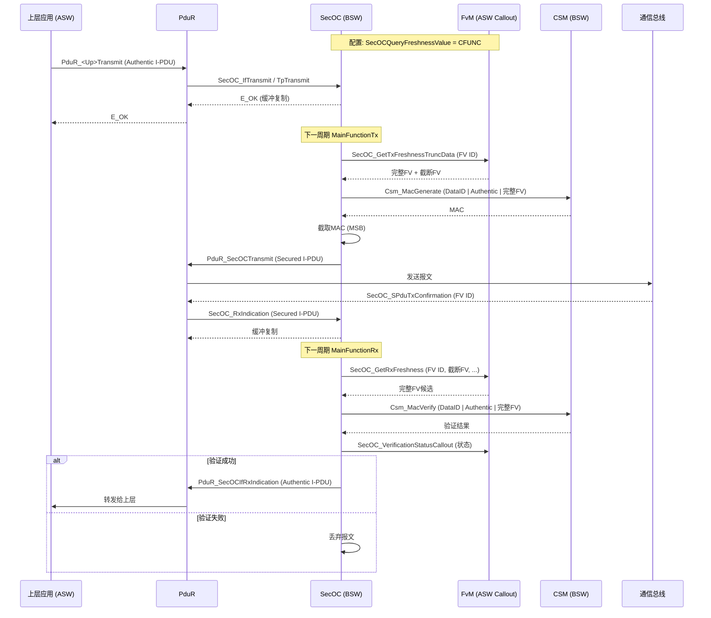
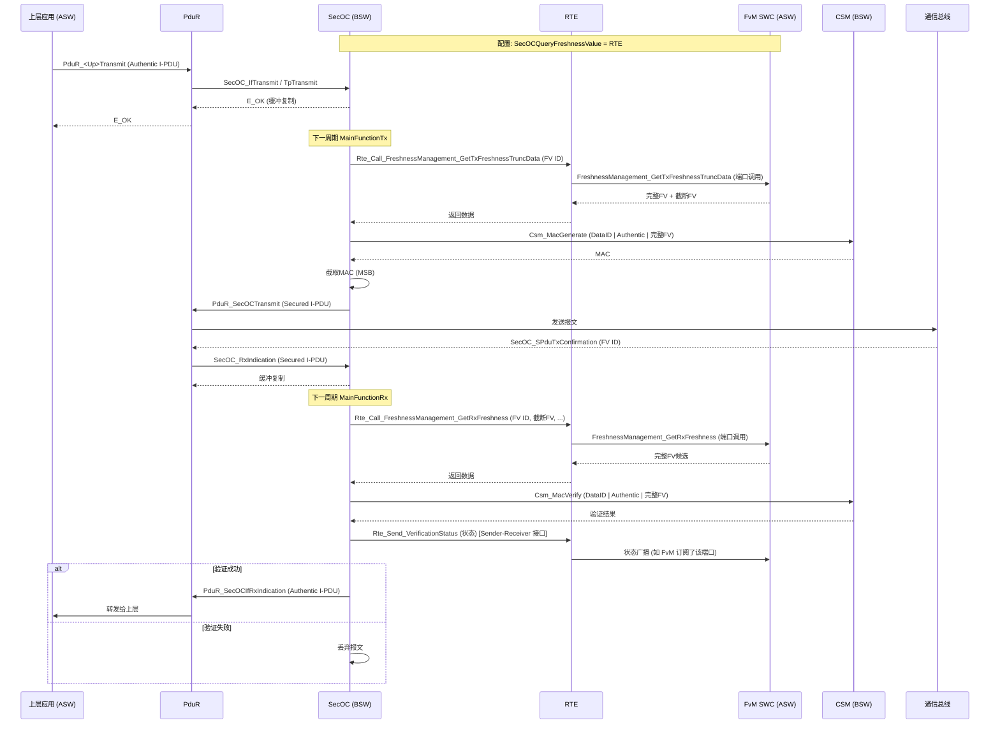
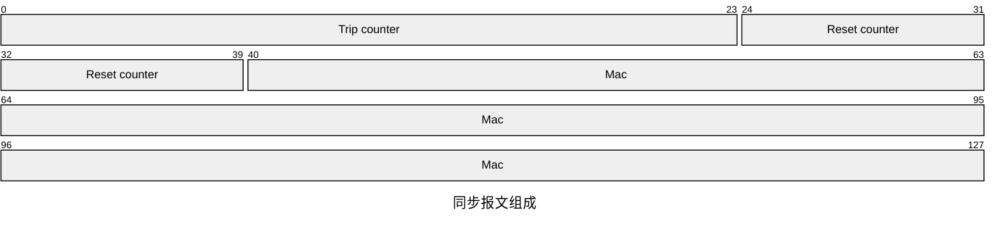
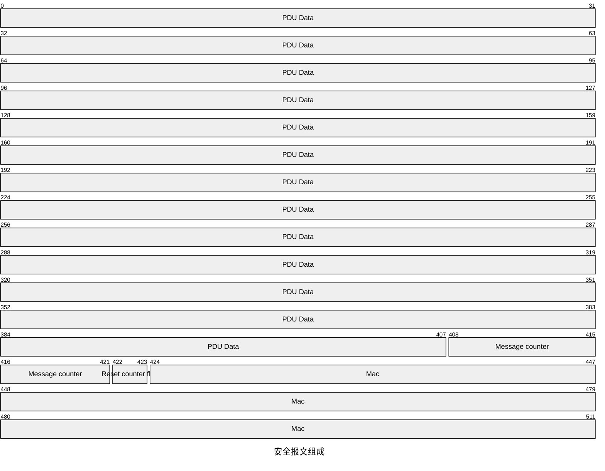
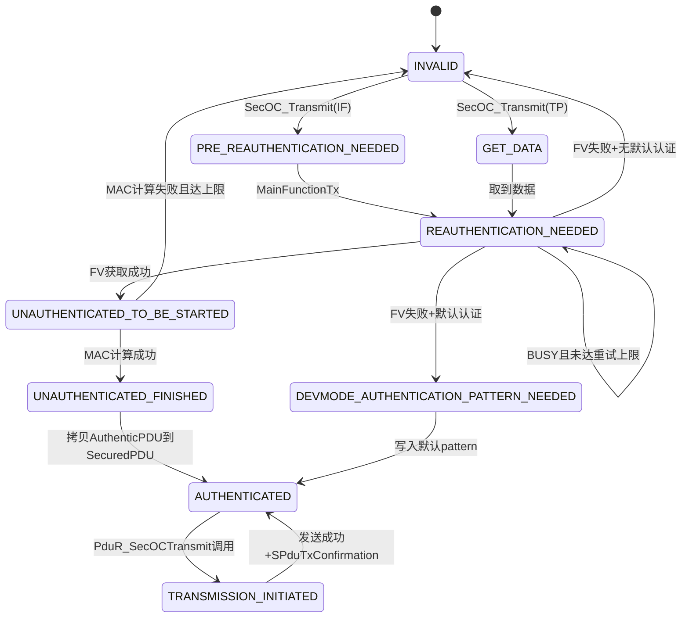
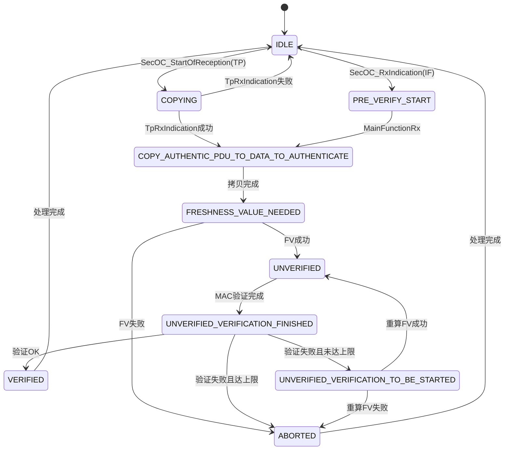

# 参考链接

https://blog.csdn.net/m0_58346868/article/details/149842070

https://blog.csdn.net/weixin_42108533/article/details/159755674

# 概述

AUTOSAR把新鲜度管理完全交给应用层，让FvM成为一个可插拔、可定制的SWC。OEM可以自由实现：

- 单计数器（每次发送自增）
- 时间戳（基于全局时间）
- 多级计数器（Trip + Reset + Message，主从同步）

FvM的核心任务是“新鲜度值的全生命周期管理”，包括：

1. **提供新鲜度值**：当SecOC需要时（发送或接收），FvM必须返回一个新鲜度值。
   1. 对于发送，通常返回当前计数器值；
   2. 对于接收，FvM可能需要根据收到的截断值推测完整值（例如，尝试多种可能性，直到MAC验证通过）。
2. **维护计数器状态**：维护每个安全信道（FreshnessValueID）的计数器，确保单调递增。计数器可以放在RAM中，必要时同步到NVM。
3. **处理同步**：如果采用主从同步，FvM需要处理同步报文（TripResetSyncMsg），更新本地的Trip Counter、Reset Counter。
4. **通知与故障处理**：接收SecOC的验证结果通知，如果连续失败，可能触发同步或报故障。

FvM的实现没有“标准模板”，但标准附录提供了三种典型用例作为参考

1. `UC_SecOC_00200`：单计数器（Freshness Counter），每次发送递增，接收时通过截断值推测完整值。
2. `UC_SecOC_00201`：单时间戳（Freshness Timestamp），使用全局同步时间，接收时检查是否在允许窗口内。
3. `UC_SecOC_00202`：多计数器主从同步（Trip + Reset + Message），用于扩展规范，需要周期性同步报文。

OEM可以根据需求选择其一，或自行创新。

> [!tip]
>
> 在战场上有两个通信兵，这两个通信兵互不认识且来自不同的指挥部，他们要给同一个远方的阵地传达一份完整的情报。
>
> - 通信兵A只知道行动的时间计划， 
> - 通信兵B只知道行动的人员安排。
>
> 他们两个来自不同的地方、来自不同的时间，去向相同的目的地，也不是同时到达。到了目的阵地，将军们要想获取完整的作战部署，就要把A+B的信息整合到一起才有意义，这里面：
>
> **通信兵A -- 同步报文(SyncMsg)**
>
> **通信兵B--安全报文(SecuredMsg)**
>
> **完整的作战部署---新鲜值(Freshness Value)**
>
> **整合A、B信息的那个部门/个人----新鲜值管理(FVM)。**
>
> **FVM最重要的作用就是从分散的报文中恢复/补齐出一个完整的FV！**


# SecOc和Fvm的交互：

SecOC需要获取新鲜度值时，必须通过一种方式“呼叫”FvM。AUTOSAR定义了两种互斥的机制，通过配置参数SecOCQueryFreshnessValue选择：

| 模式      | 配置值 | 交互方式                                                     | 适用场景                                        |
| --------- | ------ | ------------------------------------------------------------ | ----------------------------------------------- |
| CFUNC模式 | CFUNC  | SecOC直接调用C函数，函数名固定（如`SecOC_GetTxFreshness `）FvM作为Callout实现这些函数，通常编译进同一个二进制文件 | 轻量化，FvM逻辑简单，无需RTE，适用于小型ECU.    |
| RTE模式   | RTE    | SecOC通过RTE调用SWC端口服务（如 `FreshnessManagement_GetTxFreshness`）。FvM实现该SWC，提供端口。 | 符合标准分层，FvM可以与其他SWC通信，适合大型ECU |


这两种模式是并行可选的，但一个系统只能选其一。如果你选择了CFUNC，就不能再用RTE；反之亦然。它们的核心区别在于“谁来负责函数名映射”——CFUNC是直接函数调用，RTE是通过RTE生成的标准接口。

无论选择哪种模式，SecOC需要的功能是相同的。下表列出了所有SecOC需要从FvM获得的“服务”以及对应的CFUNC函数名和RTE服务操作名。

| 服务功能                           | CFUNC函数名 （FvM实现）           | RTE服务操作名（FvM实现）                      |
| ---------------------------------- | --------------------------------- | --------------------------------------------- |
| 获取发送新鲜度（完整值）           | `SecOC_GetTxFreshness`            | `FreshnessManagement_GetTxFreshness`          |
| 获取发送新鲜度（同时返回截断值     | `SecOC_GetTxFreshnessTruncData`   | `FreshnessManagement_GetTxFreshnessTruncData` |
| 获取接收验证新鲜度                 | `SecOC_GetRxFreshness`            | `FreshnessManagement_GetRxFreshness`          |
| 获取接收验证新鲜度（传入部分数据） | `SecOC_GetRxFreshnessAuthData`    | `FreshnessManagement_GetRxFreshnessAuthData`  |
| 通知发送完成                       | `SecOC_SPduTxConfirmation`        | `FreshnessManagement_SPduTxConfirmation`      |
| 通知验证结果                       | `SecOc_VerificationStatusCallout` | `VerificationStatus`（S/R接口）               |

这些接口的参数在标准中都有详细定义。例如，SecOC_GetTxFreshnessTruncData除了返回完整新鲜度值，还会返回 截断 值（即要放到报文中的那部分），这样FvM可以灵活决定截断规则（标准要求从LSB侧截取，但FvM也可以自己决定）。

状态通知：验证结果如何“广播”？

SecOC每次验证后，都需要将结果告知外部，特别是FvM（因为它需要根据结果决定是否更新计数器）。标准提供了两种通知方式：

- Callout函数：SecOC_VerificationStatusCallout，由FvM实现，每次验证后调用。
- Sender-Receiver接口：VerificationStatus，SecOC提供ProvidePort，任意SWC（包括FvM）可以Require该端口接收状态。

如果选择了RTE模式，通常使用S/R接口；如果选择了CFUNC模式，则使用Callout。两者同样可以互斥选择，但标准允许同时使用（例如，同时通知FvM和应用层监控）。

通知的数据结构SecOC_VerificationStatusType包含：

- `freshnessValueID`：哪个新鲜度值ID对应的验证。
- `verificationStatus`：枚举值，包括SECOC_VERIFICATIONSUCCESS、SECOC_VERIFICATIONFAILURE、SECOC_FRESHNESSFAILURE等。
- `secOCDataId`：对应的DataID。

FvM收到失败通知后，可以执行同步逻辑；收到成功通知后，可以更新“上次成功接收的计数器值”。
CFUNC模式时序图为：




RTE模式时序图为：




两种模式的对比为：

| 特性       | CFUNC模式                               | RTE模式                                   |
| ---------- | --------------------------------------- | ----------------------------------------- |
| 调用方式   | SecOC直接调用C函数 （函数名固定）       | SecOC通过RTE调用SWC端口服务               |
| FVM形态    | 一组Callout函数， 通常与SecOC同编译单元 | 独立的AUTOSAR SWC， 通过RTE连接           |
| 配置参数   | `SecOCQueryFreshnessValue`=CFUNC        | `SecOCQueryFreshnessValue` =RTE           |
| 适用场景   | 轻量化、 小型ECU、无需复杂SWC交互       | 大型ECU、 需要与其他ASW通信、符合标准分层 |
| 状态通知   | `SecOc_VerificationStatusCallout`       | `VerificationStatus` Sender-Receiver 接口 |
| 标准化程序 | 函数接口固定，但实现可自由              | 完全符合AUTOSAR方法论，工具链自动生成RTE  |

# FV构成

FVM分为三类：

1. 基于Counter的
2. 基于时间戳计数器的
3. 复合多计数器的。

FV的构成为：


完整的FV包含:

- 里程计数器(Trip Counter): 变化最慢，递增条件：复位，开始新点火循环，到最大值之后会重置，它的变化会重置Reset Counter。
- 复位计数器(Reset Counter):周期性(秒级)递增，到达最大值后会保持，它的递增会重置Message Counter。
- 消息计数器(Message Counter):在报文收发成功后会自增，到达最大值后会保持。它分为MsgCnt_Hi和MsgCnt_Lo两部分。
- 复位标志(Reset Flag):它就是复位计数器(Reset Counter)低2位的影子。

# 同步报文

同步报文是由FVM主机发给FVM从机的报文，同步报文在FVM主机和构建的时候，采用：
$$
CANID + TripCnt|ResetCnt+用Key生成较长长度的MAC
$$
比如16Byte。但是在总线上传输的时候，为了节省带宽，只在总线上传输：
$$
TripCnt|ResetCnt+裁剪的MAC
$$
假设3个byte的trip counter、2个byte的reset counter和11个byte的Mac计算值，那么同步报文的组成格式为：



处理过程为


> [!tip]
>
> ==Data ID和Key为可以简单理解为双方提前约定，故而不在总线上传输==

从机接收到同步报文后，会根据收到裁剪的新鲜值TripCnt|ResetCnt和本地的key，去逆向计算出一个MAC_Local(这个是在HSM中做的，实际的host Core看不到)，然后调用Csm_MacVerify(MAC)给HSM用于和MAC_Local做对比。对比通过后，FVM会用最新的同步报文里面的信息去更新本地维护的新鲜值FV。

> [!tip]
>
> 实际上，当收到一个正确的同步报文的时候，完整的FV就计算出来了（Msg counter是FV内部维护的）

# 安全报文

安全报文是由安全报文的Sender发给receiver的报文，安全报文在本地和构建的时候，采用（这里的完整的FV就是通过同步报文计算出来的）：
$$
CANID + 完整的FV+用Key生成较长长度的MAC
$$
但是在总线上传输的时候，为了节省带宽，只在总线上传输：
$$
Data+MsgCnt\_Low|ResetFlag+裁剪的MAC\_Trim
$$
假设Pdu长度为51个byte，14bit的MsgCounter，2bit的resetflag和11个byte的mac值，那么安全报文的组成格式为：



处理过程为：


receiver接收到安全报文后，要校验这个不完整的MAC值是否正确，肯定首先要逆向一个完整的算子，Data ID和Key为事先约定，那么FV如何获取？这个时候SecOC会调用FVM的接口，比如FVM_GetFV()来获取本地维护的完整的FV，然后再采用和Sender一样的方式采用CANID + 完整的FV+用Key生成较长长度的MAC_Local。裁剪后为MAC_Local_Trim。

然后receiver调用Csm_MacVerify(MAC_Local_Trim)给HSM用于和MAC_Trim做对比。对比通过后，FVM会用最新的安全报文里面的信息去更新本地维护的新鲜值FV。

# 关键值


在报文发送接受过程中有三个重要的值：

1. **先前值**：是指上次安全报文验证成功时各计数器的值。

   更新时机：安全报文验证通过后，即SecOC在接受到安全报文后

   1. 调用FVM_GetFV获取完整的新鲜值。
   2. SecOC验证通过后会通过一个接口比如SecOC_VerifyPass()通知FVM，我这个报文是有效的。
   3. FVM收到通知后，根据一定的策略，决定是否采纳该值。具体策略见下文。

2. **最新值**：是指从节点接收到的同步报文中新鲜度计数器值。

   更新时机：从节点对接收的同步报文验证通过后。

3. **接收值**：是指当前接收到的安全报文中各计数器的值。

   更新时机：即SecOC在接受到安全报文后，调用FVM_GetFV(uint8* truncatedFreshnessValue......)获取完整的新鲜值时，在实参中传递过来的部分计数器就是接收值。

# 完整过程

## 报文表现

首先上位机发送一帧同步报文，报文为：

```
00 00 01 04 74 40 02 0C FB A1 E8 E9 45 D3 0A E5
```

那么按照上面的假设：

1. 3Byte的Trip Counter：`00 00 01`
2. 2Byte的Reset Counter：`04 74`
3. 11Byte的Mac值：`40 02 0C FB A1 E8 E9 45 D3 0A E5`

假设这里的Data ID为`0x2A`，Key为`ab55105a61f90abf3596245b9cf0330a`，算法使用AES。那么需要计算的序列应该为：

```
00 2A 00 00 01 04 74
```

计算出来的MAC为：

```
40 02 0c fb a1 e8 e9 45 d3 0a e5 1e 9f 55 cf 7a
```

那么裁剪高11位得到`40 02 0C FB A1 E8 E9 45 D3 0A E5`，校验通过

此时收到（发送）安全报文就可以进行拼接完整的FV了，收到的安全报文为：

```
74 00 5D DF FF FF FF FF FF FF FF FF FF FF FF FF FF FF FF FF FF FF FF FF FF FF FF FF FF FF FF FF FF FF FF FF FF FF FF FF FF FF FF FF FF FF FF FF FF FF FF 16 F4 78 81 10 54 F5 2B 54 1F 9C 7E A4
```

那么按照上面的假设：

1. 51Byte的PDU Data：`74 00 5D DF FF FF FF FF FF FF FF FF FF FF FF FF FF FF FF FF FF FF FF FF FF FF FF FF FF FF FF FF FF FF FF FF FF FF FF FF FF FF FF FF FF FF FF FF FF FF FF`
2. `16 F4`
   1. 14bit的MsgCounter：`0001 0110 1111 01`
   2. 2bit的ResetFlag：`00`，这里是通过同步报文的Reset Counter低2位& 0x03得到，`04 74`的低两位为`00`，所以这里的flag为00
3. 11Byte的Mac为`78 81 10 54 F5 2B 54 1F 9C 7E A4`

假设这里的Data ID为`0x1F`，Key为`ab55105a61f90abf3596245b9cf0330a`，算法使用AES。需要注意的是，这里的计算就需要使用完整的FV来计算了，将同步报文和安全报文中提取的FV信号拼成一个完整的FV，也就是计算序列为`DataID + PDU + 完整的FV`，那么需要计算的序列应该为：

```
00 1F 74 00 5D DF FF FF FF FF FF FF FF FF FF FF FF FF FF FF FF FF FF FF FF FF FF FF FF FF FF FF FF FF FF FF FF FF FF FF FF FF FF FF FF FF FF FF FF FF FF FF FF  00 00 01 04 74 16 F4 
```

计算出来的Mac为：

```
78 81 10 54 f5 2b 54 1f 9c 7e a4 80 c7 53 40 4d
```

那么裁剪高11位得到`78 81 10 54 f5 2b 54 1f 9c 7e a4`，校验通过

## 操作过程

### 发送链路（`SecOC_MainFunctionTx`）

1. 上层触发 `SecOC_Transmit`

   ```c
   FUNC(Std_ReturnType) SecOC_Transmit(PduIdType id, P2CONST(PduInfoType) info)
   {
       // 开发错误检查：未初始化、ID 越界、无效句柄、空指针、长度不匹配
       // 取 txPduInfoIdx
       if (TxPduState == INVALID || TxPduState == PRE_REAUTHENTICATION_NEEDED) {
           switch (PduType) {
           case IFPDU:
               // 把 Authentic PDU 拷贝到内部 AuthenticPduDataContainer
               VStdMemCpyRamToRam(AuthenticPduDataContainer, info->SduDataPtr, info->SduLength);
               // 重置 TxBuildAttemptsCounter
               TxBuildAttemptsCounter = 0;
               // 状态机：进入 PRE_REAUTHENTICATION_NEEDED
               TxPduState = SECOC_PRE_REAUTHENTICATION_NEEDED_TXPDUSTATE;
               // 标记发送请求
               TransmitRequest = SECOC_TRANSMIT_TRANSMITREQUEST;
               ret = E_OK;
           case TPPDU:
               TxPduState = SECOC_GET_DATA_TXPDUSTATE;
           }
       }
       return ret;
   }
   ```

   > [!tip]
   >
   > **关键点**：这一步**不计算 MAC**，只是把数据存进内部缓冲区、设置状态和发送请求，立即返回。报文此时还没发出去。

2. `SecOC_MainFunctionTx` → `SecOC_TxIf_HandlePdus` → `SecOC_TxIf_ProcessTxPdu`

   `SecOC_MainFunctionTx` 只是遍历所有 TxPduInfo，逐个调用 `SecOC_TxIf_ProcessTxPdu`。核心逻辑都在 `SecOC_TxIf_ProcessTxPdu` ：

   ```c
   SECOC_LOCAL_INLINE FUNC(Std_ReturnType) SecOC_TxIf_ProcessTxPdu(txPduId)
   {
       // (Tp PDU 先取数据)
       SecOC_TxIf_HandlePdu_TPPDU(txPduId);
       
       // 核心：ReauthenticationNeeded 状态处理
       SecOC_TxIf_HandlePdu_ReauthenticationNeeded(txPduId);
       
       if (SecOC_IsTxPduStateUnauthenticated(txPduId)) {
           // 只有状态为 UNAUTHENTICATED_TO_BE_STARTED 才真正算 MAC
           if (TxPduState == SECOC_UNAUTHENTICATED_TO_BE_STARTED_TXPDUSTATE) {
               SecOC_Authenticate_GenerateAuthenticator(txPduId);
           }
           // MAC 算完后，把 Authentic PDU 拷到 SecuredPduDataContainer
           if (TxPduState == SECOC_UNAUTHENTICATED_FINISHED_TXPDUSTATE) {
               VStdMemCpyRamToRam(SecuredPduDataContainer, AuthenticPduDataContainer, Len);
               TxPduState = SECOC_AUTHENTICATED_TXPDUSTATE;
           }
       }
       
       // 发送请求 + 已认证 → 调 PduR_SecOCTransmit
       if (TxPduState == SECOC_AUTHENTICATED_TXPDUSTATE && TransmitRequest == SECOC_TRANSMIT_TRANSMITREQUEST) {
           PduInfoType pduInfo;
           pduInfo.SduDataPtr = SecuredPduDataContainer;
           pduInfo.SduLength = LengthOfTxSecuredPdu;
           TxPduState = SECOC_TRANSMISSION_INITIATED_TXPDUSTATE;
           retVal = PduR_SecOCTransmit(SecuredExternalId, &pduInfo);
           if (retVal == E_OK) {
               // 发送成功 → 调 FvM 的 SPduTxConfirmation（Update Previous = Latest）
               SPduTxConfirmation_FuncName(ExternalFreshnessId);
               TransmitRequest = SECOC_IDLE_TRANSMITREQUEST;
           }
       }
   }
   ```

3. 关键子函数：

   1. `SecOC_TxIf_HandlePdu_ReauthenticationNeeded`

      ```c
      SECOC_LOCAL_INLINE FUNC(void) SecOC_TxIf_HandlePdu_ReauthenticationNeeded(txPduId)
      {
          if (TxPduState == SECOC_PRE_REAUTHENTICATION_NEEDED_TXPDUSTATE) {
              TxPduState = SECOC_REAUTHENTICATION_NEEDED_TXPDUSTATE;
          }
          if (TxPduState == SECOC_REAUTHENTICATION_NEEDED_TXPDUSTATE) {
              Std_ReturnType ret = SecOC_FreshnessValue_CopyTxFreshnessValues(txPduId);
              if (ret == E_OK) {
                  TxPduState = SECOC_UNAUTHENTICATED_TO_BE_STARTED_TXPDUSTATE;  // 继续算 MAC
              } else if (ret == E_NOT_OK) {
                  // 发送默认认证模式 或 INVALID 状态 → 报文不发
                  ...
              } else { // SECOC_E_BUSY
                  SecOC_Authenticate_IncrementAndCheckBuildAttempts(txPduId);  // 重试
              }
          }
      }
      ```

   2. `SecOC_FreshnessValue_CopyTxFreshnessValues`

      ```c
      SECOC_LOCAL_INLINE FUNC(Std_ReturnType) SecOC_FreshnessValue_CopyTxFreshnessValues(txPduId)
      {
          uint8 freshnessValue[SECOC_FRESHNESS_SIZE_TXPDUS];
          uint8 truncatedFreshnessValue[SECOC_TRUNC_FRESHNESS_SIZE_TXPDUS];
          Std_ReturnType ret = SecOC_FreshnessValue_GetValueForTxPduOfCallout(
              txPduId, freshnessValue, SECOC_FRESHNESS_SIZE_TXPDUS,
              truncatedFreshnessValue, SECOC_TRUNC_FRESHNESS_SIZE_TXPDUS);
          if (ret == E_OK) {
              // 把完整 FV 拷到 AuthenticPduDataContainer 的 FreshnessVerifyValue 区域
              for (...) AuthenticPduDataContainer[valueidx] = freshnessValue[...];
              // 把截断 FV 写进 SecuredPduDataContainer 的 TruncatedFreshnessValue 区域
              SecOC_FreshnessValue_WriteTruncFreshnessValue(txPduId, truncatedFreshnessValue);
          }
          return ret;
      }
      ```

      它最终调用 **`GetTxFreshnessTruncData_FuncName`**（FvM 的 `SecOC_GetTxFreshnessTruncData`）。

4. 计算 MAC：`SecOC_Authenticate_GenerateAuthenticator` → `SecOC_Authenticate_GenerateAuthenticatorUsingCSM43`

   ```c
   SECOC_LOCAL_INLINE FUNC(void) SecOC_Authenticate_GenerateAuthenticator(txPduId)
   {
       // 把 DataID 写进 DataToAuthenticate 头部
       SecOC_AddTxDataIdsToDataToAuthenticate(txPduId);
       ret = SecOC_Authenticate_GenerateAuthenticatorUsingCSM43(txPduId);
       if (ret == E_OK) {
           // 把 AuthenticatorCache 里的 MAC 截断后拷到 SecuredPduDataContainer
           SecOC_GetArrayByteAligned(AuthenticatorCache, SecuredPduDataContainer[TruncatedAuthenticatorStartIdx],
               TruncatedAuthLength, 0, ..., FALSE);
           TxPduState = SECOC_UNAUTHENTICATED_FINISHED_TXPDUSTATE;
       }
   }
   ```

   `SecOC_Authenticate_GenerateAuthenticatorUsingCSM43` 组装 `DataToAuthenticate = DataID | AuthenticPdu | FV`，调用 `Csm_MacGenerate`。

5. 发送确认：`SecOC_TxConfirmation`

   底层发出后回调 `SecOC_TxConfirmation`，它调用 `PduR_SecOCTxConfirmation` 上传给上层（如果配置了 `ConfirmationNeeded`）。真正的 FV 前移（Latest → Previous）是在 `SecOC_TxIf_ProcessTxPdu` 里 `PduR_SecOCTransmit` 返回 `E_OK` 后立刻调用 `SPduTxConfirmation_FuncName` 完成的，**不依赖** `SecOC_TxConfirmation`。

发送状态定义：

| 状态枚举                                                 | 含义                                   |
| -------------------------------------------------------- | -------------------------------------- |
| `SECOC_INVALID_SECURED_PDU_TXPDUSTATE`                   | 初始/无效状态，不可发送                |
| `SECOC_PRE_REAUTHENTICATION_NEEDED_TXPDUSTATE`           | 已收到发送请求，等待 MainFunction 处理 |
| `SECOC_REAUTHENTICATION_NEEDED_TXPDUSTATE`               | MainFunction 已接手，准备获取 FV       |
| `SECOC_UNAUTHENTICATED_TO_BE_STARTED_TXPDUSTATE`         | FV 已获取，等待计算 MAC                |
| `SECOC_UNAUTHENTICATED_FINISHED_TXPDUSTATE`              | MAC 已计算完成，等待组装 Secured PDU   |
| `SECOC_AUTHENTICATED_TXPDUSTATE`                         | Secured PDU 已组装完成，等待发送       |
| `SECOC_TRANSMISSION_INITIATED_TXPDUSTATE`                | 已调用 PduR 发送，等待确认             |
| `SECOC_DEVMODE_AUTHENTICATION_PATTERN_NEEDED_TXPDUSTATE` | 降级状态：使用默认认证模式             |

状态迁移表为

| 当前状态                              | 事件                           | 条件                              | 动作                                                         | 下一状态                              |
| ------------------------------------- | ------------------------------ | --------------------------------- | ------------------------------------------------------------ | ------------------------------------- |
| INVALID                               | `SecOC_Transmit` 被调用        | PduType=IF 且长度合法             | 拷贝 Authentic PDU 到内部缓冲；置 `TransmitRequest=TRANSMIT`；重置 BuildAttempts | PRE_REAUTHENTICATION_NEEDED           |
| INVALID                               | `SecOC_Transmit` 被调用        | PduType=TP                        | 设置 TxAuthenticPduSizeOffset                                | GET_DATA                              |
| PRE_REAUTHENTICATION_NEEDED           | MainFunctionTx                 | 总是                              | 无                                                           | REAUTHENTICATION_NEEDED               |
| REAUTHENTICATION_NEEDED               | MainFunctionTx                 | `CopyTxFreshnessValues` 返回 E_OK | 把 FV 写入 DataToAuthenticate；截断 FV 写入 Secured PDU      | UNAUTHENTICATED_TO_BE_STARTED         |
| REAUTHENTICATION_NEEDED               | MainFunctionTx                 | 返回 E_NOT_OK 且启用默认认证      | 无                                                           | DEVMODE_AUTHENTICATION_PATTERN_NEEDED |
| REAUTHENTICATION_NEEDED               | MainFunctionTx                 | 返回 E_NOT_OK 且未启用默认认证    | 置 `TransmitRequest=IDLE`                                    | INVALID                               |
| REAUTHENTICATION_NEEDED               | MainFunctionTx                 | 返回 SECOC_E_BUSY                 | BuildAttempts++；未达上限则重试，达上限则 INVALID            | REAUTHENTICATION_NEEDED / INVALID     |
| UNAUTHENTICATED_TO_BE_STARTED         | MainFunctionTx                 | 总是                              | 调 CSM 算 MAC；成功则截断 MAC 写入 Secured PDU               | UNAUTHENTICATED_FINISHED              |
| UNAUTHENTICATED_FINISHED              | MainFunctionTx                 | 总是                              | 把 Authentic PDU 拷到 SecuredPduDataContainer                | AUTHENTICATED                         |
| AUTHENTICATED                         | MainFunctionTx                 | `TransmitRequest=TRANSMIT`        | 调 `PduR_SecOCTransmit`                                      | TRANSMISSION_INITIATED                |
| AUTHENTICATED                         | MainFunctionTx                 | 发送失败且未启用重试              | 置 `TransmitRequest=IDLE`                                    | AUTHENTICATED                         |
| TRANSMISSION_INITIATED                | `PduR_SecOCTransmit` 返回 E_OK | 总是                              | 调 FvM `SPduTxConfirmation`（Latest→Previous）；置 `TransmitRequest=IDLE` | AUTHENTICATED（等待下次发送）         |
| DEVMODE_AUTHENTICATION_PATTERN_NEEDED | MainFunctionTx                 | 总是                              | 用默认 pattern 覆盖 MAC/FV；拷贝 Authentic PDU               | AUTHENTICATED                         |

发送状态图




### 接收链路（`SecOC_MainFunctionRx`）

1. 底层调用 `SecOC_RxIndication`

   ```c
   FUNC(void) SecOC_RxIndication(PduIdType id, P2CONST(PduInfoType) info)
   {
       // 开发错误检查
       boolean wasProcessed = SecOC_RxIndication_PDUProcessing(id, info);
       if (wasProcessed == FALSE) {
           // 队列满 → 尝试入队 或 报 BUFFER_BUSY
           SecOC_Queue_AddPDUToQueue(...);
       }
   }
   ```

   `SecOC_RxIndication_PDUProcessing` 做的事：

   - 把收到的 Secured PDU 拷到内部 `SecuredPduDataContainer`
   - 处理 CAN FD padding、message linker、split PDU
   - 把 `RxPduState` 设为 **`SECOC_PRE_VERIFY_START_RXPDUSTATE`**
   - 如果配置为 ImmediateProcessing，立即调用 `SecOC_Verify_MAC`

2. `SecOC_MainFunctionRx` → `SecOC_RxIf_HandlePdus`

   遍历所有 RxPduInfo，对状态非 IDLE 的调用 `SecOC_Verify_MAC`。

3. `SecOC_Verify_MAC`（核心状态机）

   ```c
   SECOC_LOCAL_INLINE FUNC(void) SecOC_Verify_MAC(rxPduId)
   {
       // PRE_VERIFY_START → COPY_AUTHENTIC_PDU_TO_DATA_TO_AUTHENTICATE
       if (RxPduState == SECOC_PRE_VERIFY_START_RXPDUSTATE) {
           RxPduState = SECOC_COPY_AUTHENTIC_PDU_TO_DATA_TO_AUTHENTICATE_RXPDUSTATE;
       }
       if (RxPduState == SECOC_COPY_AUTHENTIC_PDU_TO_DATA_TO_AUTHENTICATE_RXPDUSTATE) {
           // 去 padding，把 SecuredPDU 拷到 AuthenticPduDataContainer
           VStdMemCpyRamToRam(AuthenticPduDataContainer, SecuredPduDataContainer, Len);
           RxPduState = SECOC_FRESHNESS_VALUE_NEEDED_RXPDUSTATE;
       }
       
       if (SecOC_IsSecuredRxPduVerficationOfRxPduInfo(rxPduId)) {
           if (RxPduState == SECOC_FRESHNESS_VALUE_NEEDED_RXPDUSTATE) {
               // ★ 调 FvM 计算/校验 FV → SecOC_FreshnessValue_CalculateVerifyValueFromCallout
               SecOC_FreshnessValue_CalculateVerifyValueFromCallout(rxPduId);
           }
       } else {
           RxPduState = SECOC_VERIFIED_RXPDUSTATE;
           SecOC_Verify_ProcessSuccessfulVerificationResult(rxPduId, SECOC_VERIFICATIONSUCCESS);
       }
       
       // ★ 计算 MAC 并验证
       if (SecOC_IsRxPduStateUnverified(rxPduId)) {
           SecOC_Verify_MAC_DoUnverifiedProcessing(rxPduId);
       }
       
       // ABORTED / VERIFIED → IDLE
       if (RxPduState == SECOC_ABORTED_RXPDUSTATE) { ... RxPduState = SECOC_IDLE_RXPDUSTATE; }
       if (RxPduState == SECOC_VERIFIED_RXPDUSTATE) { RxPduState = SECOC_IDLE_RXPDUSTATE; }
   }
   ```

4. `SecOC_FreshnessValue_CalculateVerifyValueFromCallout`

   ```c
   SECOC_LOCAL_INLINE FUNC(void) SecOC_FreshnessValue_CalculateVerifyValueFromCallout(rxPduId)
   {
       uint8 freshnessVerifyValue[SECOC_FRESHNESS_SIZE_RXPDUS];
       result = SecOC_FreshnessValue_GetVerifyValueFromCallout(rxPduId, freshnessVerifyValue, ...);
       if (result == E_OK) {
           // 把 FvM 算出的完整 FV 拷进 AuthenticPduDataContainer 的 FreshnessVerifyValue 区域
           SecOC_FreshnessValue_CopyVerifyValueToBuffer(rxPduId, freshnessVerifyValue);
           RxPduState = SECOC_UNVERIFIED_RXPDUSTATE;
       } else if (result == SECOC_E_BUSY) {
           SecOC_Verify_IncrementBuildAttempts(rxPduId);
       } else {
           // FV 计算失败 → PropagationStatus(FRESHNESSFAILURE) + RxPduState = ABORTED
           SecOC_Verify_PropagateVerificationStatus(rxPduId, SECOC_FRESHNESSFAILURE);
           SecOC_Verify_PropagateVerificationStatusWithSecuredPdu(rxPduId, SECOC_FRESHNESSFAILURE);
           SecOC_SetRxPduState(rxPduId, SECOC_ABORTED_RXPDUSTATE);
       }
   }
   ```

   `SecOC_FreshnessValue_GetVerifyValueFromCallout` 内部调用 **`GetRxFreshness_FuncName`**（FvM 的 `SecOC_GetRxFreshness`），并传入从报文里解析出的截断 FV、`SecOCAuthVerifyAttempts`（`SecOC_GetVerifyAttemptsCounter`）。

5. `SecOC_Verify_MAC_DoUnverifiedProcessing`

   ```c
   SECOC_LOCAL_INLINE FUNC(void) SecOC_Verify_MAC_DoUnverifiedProcessing(rxPduId)
   {
       do {
           // 根据 VerifyOverrideStatus 决定：真验证 / 强制通过 / 强制失败
           if (overrideStatus == CANCEL || PASS_UNTIL_LIMIT || PASS_UNTIL_NOTICE) {
               verificationResult = SecOC_Verify_MACUsingCSM43(rxPduId);  // 调 Csm_MacVerify
               wasOverride = FALSE;
           } else {
               verificationResult = SecOC_Verify_GetVerificationResultOfOverrideStatus(rxPduId);
               wasOverride = TRUE;
           }
           
           if (RxPduState == SECOC_UNVERIFIED_VERIFICATION_FINISHED_RXPDUSTATE) {
               SecOC_Verify_ProcessVerificationResult(verificationResult, rxPduId, verifyOverrideStatus);
           }
           if (wasOverride && verificationResult != OK) {
               RxPduState = SECOC_ABORTED_RXPDUSTATE;
           }
       } while (RxPduState == SECOC_UNVERIFIED_VERIFICATION_TO_BE_STARTED_RXPDUSTATE);
   }
   ```

   

6. `SecOC_Verify_ProcessVerificationResult` → 成功/失败分支

   - **成功**：`SecOC_Verify_ProcessSuccessfulVerificationResult`
     - 调 `PduR_SecOCRxIndication`（IF PDU）或 `PduR_SecOCTpCopyRxData` + `PduR_SecOCTpRxIndication`（TP PDU），把 Authentic PDU 上传给上层
     - 触发 `SecOC_Verify_PropagateVerificationStatus` → 遍历所有 `VerificationStatusCallout`（包括 **FvM_VerificationStatusCallout**）→ Rte_Write
     - `RxPduState = SECOC_VERIFIED_RXPDUSTATE`
   - **失败**：`SecOC_Verify_ProcessUnsuccessfulVerificationResult`
     - `SecOC_IncVerifyAttemptsCounter(rxPduId)`
     - 若重试次数未达 `VerifyAttempts`：重新 `CalculateVerifyValueFromCallout`，状态回到 `UNVERIFIED_VERIFICATION_TO_BE_STARTED`，下一轮循环再试（FvM 会拿 `AuthVerifyAttempts` 尝试 ±offset 重构 FV）
     - 若已达上限：PropagationStatus(VERIFICATIONFAILURE)，状态 `ABORTED`

接收状态定义

| 状态枚举                                                     | 含义                               |
| ------------------------------------------------------------ | ---------------------------------- |
| `SECOC_IDLE_RXPDUSTATE`                                      | 空闲，可接收新报文                 |
| `SECOC_PRE_VERIFY_START_RXPDUSTATE`                          | 已收到报文，等待 MainFunction 处理 |
| `SECOC_COPY_AUTHENTIC_PDU_TO_DATA_TO_AUTHENTICATE_RXPDUSTATE` | 正在剥离 Authentic PDU             |
| `SECOC_FRESHNESS_VALUE_NEEDED_RXPDUSTATE`                    | 需要从 FvM 获取/校验 FV            |
| `SECOC_UNVERIFIED_RXPDUSTATE`                                | FV 已就绪，等待 MAC 验证           |
| `SECOC_UNVERIFIED_VERIFICATION_TO_BE_STARTED_RXPDUSTATE`     | 验证失败但未达重试上限，准备重验   |
| `SECOC_UNVERIFIED_VERIFICATION_FINISHED_RXPDUSTATE`          | MAC 验证完成（结果已出）           |
| `SECOC_VERIFIED_RXPDUSTATE`                                  | 验证通过，已上传上层               |
| `SECOC_ABORTED_RXPDUSTATE`                                   | 验证失败/中止                      |
| `SECOC_COPYING_RXPDUSTATE`                                   | TP 接收中，正在拷贝数据            |

状态迁移表

| 当前状态                                   | 事件                           | 条件                       | 动作                                                         | 下一状态                                        |
| ------------------------------------------ | ------------------------------ | -------------------------- | ------------------------------------------------------------ | ----------------------------------------------- |
| IDLE                                       | `SecOC_RxIndication`           | 缓冲区可用                 | 拷贝 Secured PDU 到内部缓冲；重置 VerifyAttempts/BuildAttempts | PRE_VERIFY_START                                |
| IDLE                                       | `SecOC_RxIndication`           | 缓冲区忙且有队列           | 入队                                                         | IDLE                                            |
| IDLE                                       | `SecOC_StartOfReception`（TP） | 长度合法                   | 设置 RxAuthenticPduSizeOffset                                | COPYING                                         |
| COPYING                                    | `SecOC_CopyRxData`             | 数据未收完                 | 逐段拷贝                                                     | COPYING                                         |
| COPYING                                    | `SecOC_TpRxIndication`         | 接收成功                   | 无                                                           | COPY_AUTHENTIC_PDU_TO_DATA_TO_AUTHENTICATE      |
| COPYING                                    | `SecOC_TpRxIndication`         | 接收失败                   | 上报 E_NOT_OK                                                | IDLE                                            |
| PRE_VERIFY_START                           | MainFunctionRx                 | 总是                       | 无                                                           | COPY_AUTHENTIC_PDU_TO_DATA_TO_AUTHENTICATE      |
| COPY_AUTHENTIC_PDU_TO_DATA_TO_AUTHENTICATE | MainFunctionRx                 | 总是                       | 去 padding；拷贝 Secured PDU 到 AuthenticPduDataContainer    | FRESHNESS_VALUE_NEEDED                          |
| FRESHNESS_VALUE_NEEDED                     | MainFunctionRx                 | `GetRxFreshness` 返回 E_OK | FV 写入 DataToAuthenticate                                   | UNVERIFIED                                      |
| FRESHNESS_VALUE_NEEDED                     | MainFunctionRx                 | 返回 E_NOT_OK              | PropagationStatus(FRESHNESSFAILURE)                          | ABORTED                                         |
| FRESHNESS_VALUE_NEEDED                     | MainFunctionRx                 | 返回 SECOC_E_BUSY          | BuildAttempts++；未达上限则保持                              | FRESHNESS_VALUE_NEEDED / ABORTED                |
| UNVERIFIED                                 | MainFunctionRx                 | CSM 验证返回 OK            | 无                                                           | UNVERIFIED_VERIFICATION_FINISHED                |
| UNVERIFIED                                 | MainFunctionRx                 | CSM 验证返回 NOT_OK        | IncVerifyAttempts                                            | UNVERIFIED_VERIFICATION_TO_BE_STARTED           |
| UNVERIFIED_VERIFICATION_TO_BE_STARTED      | MainFunctionRx                 | VerifyAttempts 未达上限    | 重新 `CalculateVerifyValueFromCallout`（FvM 用 ±offset 重构 FV） | UNVERIFIED                                      |
| UNVERIFIED_VERIFICATION_TO_BE_STARTED      | MainFunctionRx                 | VerifyAttempts 达上限      | PropagationStatus(VERIFICATIONFAILURE)                       | ABORTED                                         |
| UNVERIFIED_VERIFICATION_FINISHED           | MainFunctionRx                 | 验证结果 OK                | `PduR_SecOCRxIndication` 上传；PropagationStatus(SUCCESS)；FvM Callout 前移 Latest→Previous | VERIFIED                                        |
| UNVERIFIED_VERIFICATION_FINISHED           | MainFunctionRx                 | 验证结果 NOT_OK            | IncVerifyAttempts；未达上限则重验                            | UNVERIFIED_VERIFICATION_TO_BE_STARTED / ABORTED |
| VERIFIED                                   | MainFunctionRx                 | 总是                       | 无                                                           | IDLE                                            |
| ABORTED                                    | MainFunctionRx                 | 总是                       | 无                                                           | IDLE                                            |

接收状态图




### 排查问题建议

#### 两条状态机与 FvM 的交互点

| 交互点           | SecOC 侧状态                                | FvM 侧函数                      | 返回值影响                                       |
| ---------------- | ------------------------------------------- | ------------------------------- | ------------------------------------------------ |
| 发送取 FV        | REAUTHENTICATION_NEEDED                     | `SecOC_GetTxFreshnessTruncData` | E_OK → 继续；E_BUSY → 重试；E_NOT_OK → INVALID   |
| 发送成功确认     | TRANSMISSION_INITIATED                      | `SecOC_SPduTxConfirmation`      | 无返回值；FvM 内部 Latest→Previous               |
| 接收取 FV        | FRESHNESS_VALUE_NEEDED                      | `SecOC_GetRxFreshness`          | E_OK → UNVERIFIED；E_NOT_OK → ABORTED            |
| 接收验证成功回调 | UNVERIFIED_VERIFICATION_FINISHED → VERIFIED | `FvM_VerificationStatusCallout` | 无返回值；FvM 内部 Latest→Previous、同步状态更新 |

#### 调试时如何用这张表

1. **发送卡住**：在 `SecOC_TxIf_ProcessTxPdu` 里读 `SecOC_GetTxPduState(txPduId)`，对照发送状态表，看停在哪个状态。
   - 停在 `REAUTHENTICATION_NEEDED` → FvM 的 `SecOC_GetTxFreshnessTruncData` 返回了 `E_NOT_OK`/`E_BUSY`。
   - 停在 `INVALID` → 发送请求被放弃，检查 `SendDefaultAuthentication` 配置或 FvM 同步状态。
   - 停在 `AUTHENTICATED` 但 `TransmitRequest=IDLE` → 发送失败且未启用重试。
2. **接收验证失败**：在 `SecOC_Verify_MAC` 里读 `SecOC_GetRxPduState(rxPduId)`，对照接收状态表，看是卡在 FV 阶段（`FRESHNESS_VALUE_NEEDED` → `ABORTED`）还是 MAC 阶段（`UNVERIFIED_VERIFICATION_TO_BE_STARTED` → `ABORTED`）。
3. **Callout 不触发**：只有状态到达 `UNVERIFIED_VERIFICATION_FINISHED` 且结果为 OK，才会走 `VERIFIED` 并调用 `SecOC_Verify_PropagateVerificationStatus` → FvM Callout。如果状态一直是 `ABORTED`，Callout 永远不会命中。

#### 建议的调试断点表

| 目的                         | 断点函数                                             | 观察变量                                                  |
| ---------------------------- | ---------------------------------------------------- | --------------------------------------------------------- |
| 确认上层是否触发发送         | `SecOC_Transmit`                                     | `id`、`info->SduLength`、返回值                           |
| 确认 MainFunctionTx 是否调度 | `SecOC_MainFunctionTx`                               | 是否命中                                                  |
| 确认状态机走到哪             | `SecOC_TxIf_ProcessTxPdu`                            | `SecOC_GetTxPduState(txPduId)`、`TransmitRequest`         |
| 确认 FvM 请求结果            | `SecOC_TxIf_HandlePdu_ReauthenticationNeeded`        | `SecOC_FreshnessValue_CopyTxFreshnessValues` 返回值       |
| 确认 FV 内容                 | `SecOC_FreshnessValue_CopyTxFreshnessValues`         | `freshnessValue[]`、`truncatedFreshnessValue[]`           |
| 确认 MAC 计算                | `SecOC_Authenticate_GenerateAuthenticatorUsingCSM43` | `Csm_MacGenerate` 返回值                                  |
| 确认是否调 PduR 发送         | `SecOC_TxIf_ProcessTxPdu` 末尾                       | `PduR_SecOCTransmit` 返回值                               |
| 确认接收入口                 | `SecOC_RxIndication`                                 | 是否命中、`info->SduLength`                               |
| 确认接收验证                 | `SecOC_Verify_MAC`                                   | `SecOC_GetRxPduState(rxPduId)`                            |
| 确认 FvM 接收 FV             | `SecOC_FreshnessValue_GetVerifyValueFromCallout`     | `GetRxFreshness_FuncName` 返回值、`verifyAttemptsCounter` |
| 确认 Callout 触发            | `SecOC_Verify_PropagateVerificationStatus`           | 是否遍历到 Callout                                        |


